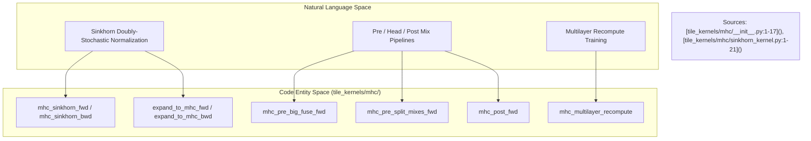

<!-- source: DeepWiki mcp.deepwiki.com · repo deepseek-ai/TileKernels · page 4 Manifold HyperConnection (mHC) Module · fetched 2026-10-30 -->

# Manifold HyperConnection (mHC) Module

Relevant source files

The following files were used as context for generating this wiki page:

- [tile_kernels/mhc/__init__.py](tile_kernels/mhc/__init__.py)
- [tile_kernels/mhc/sinkhorn_kernel.py](tile_kernels/mhc/sinkhorn_kernel.py)

The Manifold HyperConnection (mHC) module provides high-performance TileLang kernels and modeling abstractions for multi-head residual hyper-connections in large language models. Unlike standard transformer residual streams that simply add sublayer outputs, mHC maintains multiple residual heads and combines them via learned, Sinkhorn-normalized mixing coefficients. This subsystem spans iterative normalization, expansion, normalization-fused GEMMs, pre/head/post processing stages, fused inference paths, and memory-saving multilayer recompute strategies across CUDA and Ascend NPU backends [tile_kernels/mhc/__init__.py:1-17](), [tile_kernels/mhc/sinkhorn_kernel.py:1-21]().

"mHC Subsystem Architecture and Code Mapping"

---

## 4.1. Sinkhorn, Expand and Norm Kernels

The core mathematical operations underpinning mHC require iterative doubly-stochastic normalization, head expansion from standard embeddings, and RMSNorm-fused GEMM routines. The `sinkhorn_kernel` module performs iterative normalization on combination mixing weights for both forward and backward passes [tile_kernels/mhc/sinkhorn_kernel.py:6-21](). Additionally, `expand_kernel` handles manifold expansion, while `norm_fn_kernel` combines RMSNorm with subsequent linear projections across both CUDA and Ascend hardware.

For details, see [Sinkhorn, Expand and Norm Kernels](#4.1).

Sources:
* [tile_kernels/mhc/__init__.py:1-17]()
* [tile_kernels/mhc/sinkhorn_kernel.py:1-21]()

---

## 4.2. Pre / Head / Post Mix Pipeline Kernels

The mHC forward and backward passes execute through a structured pipeline of splitting, mixing, computing, and post-integration. This subsystem comprises `pre_split_mixes`, `pre_apply_mix`, `head_compute_mix`, and `post` kernels that manage mixing coefficients across multi-head residual states [tile_kernels/mhc/__init__.py:2-16](). For high-throughput inference, the subsystem provides the fused `pre_big_fuse` kernel (`mhc_pre_big_fuse_fwd`), which eliminates intermediate global memory round-trips by combining normalization, splitting, mixing, and Sinkhorn normalization into a single execution step [tile_kernels/mhc/__init__.py:12]().

For details, see [Pre / Head / Post Mix Pipeline Kernels](#4.2).

Sources:
* [tile_kernels/mhc/__init__.py:1-17]()

---

## 4.3. Multilayer Recompute

Training deep models with multi-head manifold hyper-connections accumulates significant activation memory across layers. The `multilayer_recompute_kernel` (`mhc_multilayer_recompute`) optimizes training memory overhead by recomputing mHC intermediate activations on-the-fly across multiple layers rather than caching them globally [tile_kernels/mhc/__init__.py:3]().

For details, see [Multilayer Recompute](#4.3).

Sources:
* [tile_kernels/mhc/__init__.py:1-17]()

---

