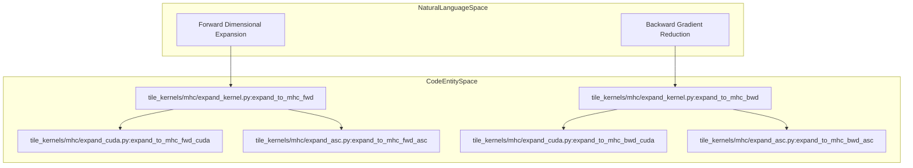
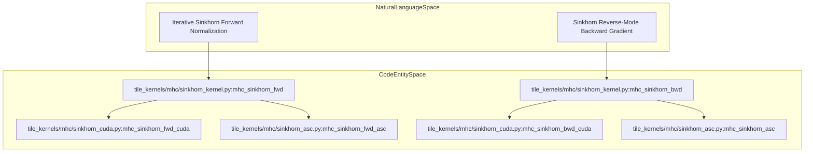

<!-- source: DeepWiki mcp.deepwiki.com · repo deepseek-ai/TileKernels · page 4.1 Sinkhorn, Expand and Norm Kernels · fetched 2026-10-30 -->

# Sinkhorn, Expand and Norm Kernels

Relevant source files

The following files were used as context for generating this wiki page:

- [tile_kernels/mhc/expand_asc.py](tile_kernels/mhc/expand_asc.py)
- [tile_kernels/mhc/expand_cuda.py](tile_kernels/mhc/expand_cuda.py)
- [tile_kernels/mhc/expand_kernel.py](tile_kernels/mhc/expand_kernel.py)
- [tile_kernels/mhc/norm_fn_asc.py](tile_kernels/mhc/norm_fn_asc.py)
- [tile_kernels/mhc/norm_fn_cuda.py](tile_kernels/mhc/norm_fn_cuda.py)
- [tile_kernels/mhc/norm_fn_kernel.py](tile_kernels/mhc/norm_fn_kernel.py)
- [tile_kernels/mhc/sinkhorn_asc.py](tile_kernels/mhc/sinkhorn_asc.py)
- [tile_kernels/mhc/sinkhorn_cuda.py](tile_kernels/mhc/sinkhorn_cuda.py)
- [tile_kernels/mhc/sinkhorn_kernel.py](tile_kernels/mhc/sinkhorn_kernel.py)

## Purpose and Scope
This page details three core subsystems of the Manifold HyperConnection (mHC) module within TileKernels: `expand_kernel` (dimensional expansion from embeddings to multi-head residual streams), `sinkhorn_kernel` (iterative doubly-stochastic normalization for mixing matrices, forward and backward passes), and `norm_fn_kernel` (RMSNorm reductions and coefficient merging). Each subsystem provides dual implementations targeting NVIDIA CUDA (SM90/SM100) and Huawei Ascend NPU architectures via TileLang's backend dispatch layer.

---

## 1. Dimensional Expansion and Reduction (`expand_kernel`)

The `expand_kernel` subsystem manages the transformation between a flat token-embedding representation `(num_tokens, hidden)` and the multi-head manifold hyperconnection stream `(num_tokens, mhc, hidden)` [tile_kernels/mhc/expand_kernel.py:9-10]().

### Backend Implementation Details

*   **Python Dispatcher**: Defined in `tile_kernels/mhc/expand_kernel.py` [tile_kernels/mhc/expand_kernel.py:1-49](). It inspects the device configuration via `is_ascend()` [tile_kernels/mhc/expand_kernel.py:27](), computes tile sizes using helper functions like `_asc_fwd_h_blk` and `_asc_h_blk` [tile_kernels/mhc/expand_kernel.py:5-23](), and invokes the respective CUDA or Ascend JIT-compiled kernels.
*   **CUDA Implementation (`expand_cuda.py`)**: Implements `expand_to_mhc_fwd_cuda` and `expand_to_mhc_bwd_cuda` using thread-block tiling (`blk_n = 32`, `blk_h = 128`) [tile_kernels/mhc/expand_cuda.py:5-53](). The forward pass broadcasts the hidden tensor across the `mhc` dimension [tile_kernels/mhc/expand_cuda.py:20-26](), while the backward pass accumulates gradients into a `float32` fragment accumulator before writing to `x_grad` [tile_kernels/mhc/expand_cuda.py:43-51](). Optional Program Dependency Logic (`use_pdl`) is supported [tile_kernels/mhc/expand_cuda.py:16]().
*   **Ascend Implementation (`expand_asc.py`)**: Implements `expand_to_mhc_fwd_asc` and `expand_to_mhc_bwd_asc` using vector cores (`num_vec_cores`) [tile_kernels/mhc/expand_asc.py:6,40](). It utilizes `T.SimdVF()` vector instructions (`T.simd.vld`, `T.simd.vsts`, `T.simd.vadd`, `T.simd.vcvt`) [tile_kernels/mhc/expand_asc.py:27-35,62-73](), shared memory double/multi-buffering via `T.annotate_buffer_versions` [tile_kernels/mhc/expand_asc.py:17,51](), and persistent loops (`T.Persistent`) [tile_kernels/mhc/expand_asc.py:19,53]().

### Natural Language to Code Mapping: Expand Subsystem

Sources: [tile_kernels/mhc/expand_kernel.py:1-49](), [tile_kernels/mhc/expand_cuda.py:5-53](), [tile_kernels/mhc/expand_asc.py:6-75]()

---

## 2. Iterative Doubly-Stochastic Normalization (`sinkhorn_kernel`)

The `sinkhorn_kernel` subsystem executes Sinkhorn-Knopp iterations to enforce doubly-stochastic constraints on combination mixing matrices per token [tile_kernels/mhc/sinkhorn_kernel.py:6-21]().

### Algorithm and Backend Architecture

*   **Python Dispatcher**: `mhc_sinkhorn_fwd` and `mhc_sinkhorn_bwd` in `tile_kernels/mhc/sinkhorn_kernel.py` route execution to backend-specific modules [tile_kernels/mhc/sinkhorn_kernel.py:6-21]().
*   **CUDA Implementation (`sinkhorn_cuda.py`)**:
    *   `mhc_sinkhorn_fwd_cuda`: Uses `T.reduce_max` for numerical stability, computes exponential differences, and iteratively normalizes rows and columns over `repeat` steps using parallel fragments (`token_block_size = 1` to `8`) [tile_kernels/mhc/sinkhorn_cuda.py:9-57]().
    *   `mhc_sinkhorn_bwd_cuda`: Re-runs the forward normalization steps while caching intermediate shared memory buffers (`xs`, `sums`) to execute backward adjoint operations for row/column normalization gradients [tile_kernels/mhc/sinkhorn_cuda.py:59-146](). Disables warp specialization via `_PASS_CONFIGS` [tile_kernels/mhc/sinkhorn_cuda.py:4-6]().
*   **Ascend Implementation (`sinkhorn_asc.py`)**:
    *   `mhc_sinkhorn_fwd_asc`: Leverages Ascend SIMD vector instructions (`SimdVF`) to process packed tokens (4 tokens packed per Vector Register) [tile_kernels/mhc/sinkhorn_asc.py:28-38](). Uses custom reduction helpers (`_row_reduce`, `_row_max`, `_col_reduce`) built on top of `S.vcgmax`, `S.vcgadd`, and `S.vselr` with bit-manipulation masks (`S.vci`, `S.vand`, `S.vcmps`) to handle sub-VLane row and column dimensions independently [tile_kernels/mhc/sinkhorn_asc.py:6-25,71-148]().

### Natural Language to Code Mapping: Sinkhorn Subsystem

Sources: [tile_kernels/mhc/sinkhorn_kernel.py:6-21](), [tile_kernels/mhc/sinkhorn_cuda.py:9-146](), [tile_kernels/mhc/sinkhorn_asc.py:6-148]()

---

## 3. Normalization and Coefficient Merging (`norm_fn_kernel`)

The `norm_fn_kernel` module handles fusing mixing weights (`fn`) with normalization weights (`normw`) and reducing intermediate split computations for RMSNorm [tile_kernels/mhc/norm_fn_kernel.py:21-134]().

### Key Kernels

| Function Name | File Path | Role |
| :--- | :--- | :--- |
| `mhc_fn_normw_merge_fwd` | [tile_kernels/mhc/norm_fn_kernel.py:21-36]() | Multiplies mixing coefficients `fn` by normalization weights `normw` |
| `mhc_fn_normw_merge_bwd` | [tile_kernels/mhc/norm_fn_kernel.py:38-62]() | Computes gradients for `fn` and `normw` during backward pass |
| `mhc_reduce_partials_and_rmsnorm_fwd` | [tile_kernels/mhc/norm_fn_kernel.py:64-100]() | Reduces split partials and computes RMSNorm forward |
| `mhc_reduce_partials_and_rmsnorm_bwd` | [tile_kernels/mhc/norm_fn_kernel.py:102-134]() | Computes gradients for RMSNorm and split partial sums |

### Implementation Highlights
*   **CUDA (`norm_fn_cuda.py`)**: Uses parallel loops over block dimensions with thread bindings (`n_thr = 32`) and disables WGMMA via `_PASS_CONFIGS` for compatibility with specific data layouts [tile_kernels/mhc/norm_fn_cuda.py:6-8,81,128]().
*   **Ascend (`norm_fn_asc.py`)**: Implements vectorized merge routines (`mhc_fn_normw_merge_fwd_asc`, `mhc_fn_normw_merge_bwd_asc`) using `S.vld`, `S.vmul`, `S.vadd`, and `S.vsts` with `NORM_B32` instructions across hidden blocks [tile_kernels/mhc/norm_fn_asc.py:10-148]().

Sources: [tile_kernels/mhc/norm_fn_kernel.py:21-134](), [tile_kernels/mhc/norm_fn_cuda.py:6-155](), [tile_kernels/mhc/norm_fn_asc.py:10-168]()

---

