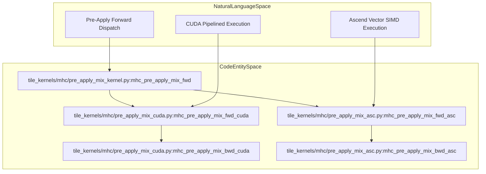
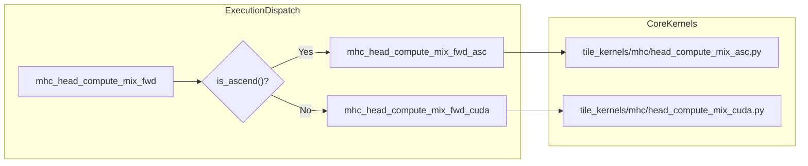

<!-- source: DeepWiki mcp.deepwiki.com · repo deepseek-ai/TileKernels · page 4.2 Pre / Head / Post Mix Pipeline Kernels · fetched 2026-10-30 -->

# Pre / Head / Post Mix Pipeline Kernels

Relevant source files

The following files were used as context for generating this wiki page:

- [tile_kernels/mhc/head_compute_mix_asc.py](tile_kernels/mhc/head_compute_mix_asc.py)
- [tile_kernels/mhc/head_compute_mix_cuda.py](tile_kernels/mhc/head_compute_mix_cuda.py)
- [tile_kernels/mhc/head_compute_mix_kernel.py](tile_kernels/mhc/head_compute_mix_kernel.py)
- [tile_kernels/mhc/post_asc.py](tile_kernels/mhc/post_asc.py)
- [tile_kernels/mhc/post_cuda.py](tile_kernels/mhc/post_cuda.py)
- [tile_kernels/mhc/post_kernel.py](tile_kernels/mhc/post_kernel.py)
- [tile_kernels/mhc/pre_apply_mix_asc.py](tile_kernels/mhc/pre_apply_mix_asc.py)
- [tile_kernels/mhc/pre_apply_mix_cuda.py](tile_kernels/mhc/pre_apply_mix_cuda.py)
- [tile_kernels/mhc/pre_apply_mix_kernel.py](tile_kernels/mhc/pre_apply_mix_kernel.py)
- [tile_kernels/mhc/pre_big_fuse_asc.py](tile_kernels/mhc/pre_big_fuse_asc.py)
- [tile_kernels/mhc/pre_big_fuse_cuda.py](tile_kernels/mhc/pre_big_fuse_cuda.py)
- [tile_kernels/mhc/pre_big_fuse_kernel.py](tile_kernels/mhc/pre_big_fuse_kernel.py)
- [tile_kernels/mhc/pre_split_mixes_asc.py](tile_kernels/mhc/pre_split_mixes_asc.py)
- [tile_kernels/mhc/pre_split_mixes_cuda.py](tile_kernels/mhc/pre_split_mixes_cuda.py)
- [tile_kernels/mhc/pre_split_mixes_kernel.py](tile_kernels/mhc/pre_split_mixes_kernel.py)

## Purpose and Scope
This page details the implementation and composition of the Manifold HyperConnection (mHC) pre-mix, head-mix, post-mix, and fused inference pipelines in `TileKernels`. It covers the dispatchers, dual-backend implementations (CUDA and Ascend NPU), and data flow for `pre_split_mixes`, `pre_apply_mix`, `head_compute_mix`, `post`, and the fused inference-only `pre_big_fuse` kernel.

---

## 1. Pre-Mix Kernels: Splitting and Application

The pre-mix stage processes the raw outputs from the layer normalization/GEMM block, splits them into functional mixing coefficients (`pre_layer_mix`, `post_layer_mix`, and `comb_res_mix`), and applies the pre-layer mix to the expanded residual streams.

### Pre-Apply Mix
The `pre_apply_mix` kernel applies the `pre_layer_mix` coefficients across the expanded hidden dimensions of the residual tensor [tile_kernels/mhc/pre_apply_mix_kernel.py:8-26]().

* **CUDA Implementation**: Implemented in `tile_kernels/mhc/pre_apply_mix_cuda.py` [tile_kernels/mhc/pre_apply_mix_cuda.py:12-114](), using partitioned blocks over tokens and hidden chunks with `T.Pipelined` loops.
* **Ascend Implementation**: Implemented in `tile_kernels/mhc/pre_apply_mix_asc.py` [tile_kernels/mhc/pre_apply_mix_asc.py:11-127](), leveraging `T.SimdVF` vector instructions with `_VEC = 64` lanes and broadcast registers (`BRC_B32`) to maximize vector unit saturation.

**Pre-Apply Mix Pipeline & Code Entities**

Sources: [tile_kernels/mhc/pre_apply_mix_kernel.py:8-51](), [tile_kernels/mhc/pre_apply_mix_cuda.py:12-114](), [tile_kernels/mhc/pre_apply_mix_asc.py:11-127]()

---

## 2. Head Compute Mix Kernels

The `head_compute_mix` kernel computes head-specific transformations using scaling, bias, and sigmoid activation, combined with an epsilon offset (`mhc_pre_eps`) [tile_kernels/mhc/head_compute_mix_cuda.py:10-36]().

* **Mathematical Operation**: 
  $$\text{output\_mix}[i, j] = \sigma(\text{input\_mix}[i, j] \cdot \text{scale}[0] + \text{base}[j]) + \text{mhc\_pre\_eps}$$
* **CUDA Kernel**: Uses `T.Kernel` with dynamic thread blocks and parallel loops over token block sizes (`token_block_size = 32`) [tile_kernels/mhc/head_compute_mix_cuda.py:10-36]().
* **Ascend Kernel**: Constrained to `mhc_mult == 4`, utilizing `T.SimtVF` with 256 threads and persistent schedules optimized for Ascend vector cores [tile_kernels/mhc/head_compute_mix_asc.py:6-41]().

**Head Compute Mix Architecture**

Sources: [tile_kernels/mhc/head_compute_mix_kernel.py:28-63](), [tile_kernels/mhc/head_compute_mix_cuda.py:10-36](), [tile_kernels/mhc/head_compute_mix_asc.py:6-41]()

---

## 3. Post-Mix Kernels

The `post` kernel handles the final recombination of the layer outputs with residuals and combination mixing weights (`comb_res_mix` and `post_layer_mix`) [tile_kernels/mhc/post_kernel.py:10-66]().

* **Forward Calculation**: Computes $x = c \cdot d + A \cdot b$, where $A$ is the combination tensor and $c$ is the post-mix vector [tile_kernels/mhc/post_cuda.py:12-64]().
* **Backward Calculation**: Evaluates gradients across all inputs ($dx, d\_residual, d\_post\_layer\_mix, d\_comb\_res\_mix$) via custom reduction operators (`T.reducer_init`, `T.reducer_update`) [tile_kernels/mhc/post_cuda.py:67-157]().

Sources: [tile_kernels/mhc/post_kernel.py:10-118](), [tile_kernels/mhc/post_cuda.py:12-157](), [tile_kernels/mhc/post_asc.py:11-204]()

---

## 4. Fused Inference Pipeline (`pre_big_fuse`)

For inference efficiency, `pre_big_fuse` fuses RMSNorm finalization, mix splitting, Sinkhorn iterative normalization, and pre-apply mixing into a single compiled kernel (`mhc_pre_big_fuse_fwd`) [tile_kernels/mhc/pre_big_fuse_kernel.py:10-73]().

* **CUDA Variant**: Fuses reduction over split-K dimensions, RMS scaling, Sinkhorn row/column normalizations, and residual pre-application in `tile_kernels/mhc/pre_big_fuse_cuda.py` [tile_kernels/mhc/pre_big_fuse_cuda.py:12-136]().
* **Ascend Variant**: Requires `n_splits = 1` and `mhc_mult = 4`, operating bit-wise identically to the composed reference path using specialized vector intrinsics (`_row_reduce`, `_row_max`) in `tile_kernels/mhc/pre_big_fuse_asc.py` [tile_kernels/mhc/pre_big_fuse_asc.py:25-165]().

Sources: [tile_kernels/mhc/pre_big_fuse_kernel.py:10-73](), [tile_kernels/mhc/pre_big_fuse_cuda.py:12-136](), [tile_kernels/mhc/pre_big_fuse_asc.py:25-165]()

---

