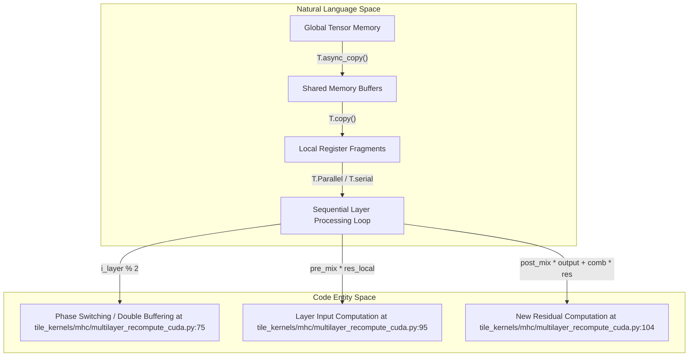

<!-- source: DeepWiki mcp.deepwiki.com · repo deepseek-ai/TileKernels · page 4.3 Multilayer Recompute · fetched 2026-10-30 -->

# Multilayer Recompute

<details>
<summary>Relevant source files</summary>

The following files were used as context for generating this wiki page:

- [tests/mhc/test_multilayer_recompute.py](tests/mhc/test_multilayer_recompute.py)
- [tile_kernels/mhc/multilayer_recompute_asc.py](tile_kernels/mhc/multilayer_recompute_asc.py)
- [tile_kernels/mhc/multilayer_recompute_cuda.py](tile_kernels/mhc/multilayer_recompute_cuda.py)
- [tile_kernels/mhc/multilayer_recompute_kernel.py](tile_kernels/mhc/multilayer_recompute_kernel.py)

</details>


## Purpose and Scope

The multilayer recompute module provides the `mhc_multilayer_recompute` kernel and its corresponding backend implementations for CUDA and Ascend NPUs [tile_kernels/mhc/multilayer_recompute_kernel.py:36-44](). During the training of Manifold HyperConnection (mHC) networks, storing intermediate activations across all layers demands excessive memory. The multilayer recompute kernel fuses pre-apply mix operations, layer input generation, and post-mix residual updates across multiple sequential layers into a single compiled kernel execution. This drastically reduces memory traffic and eliminates the need to materialize and store all intermediate layer inputs in global memory.

---

## Python Dispatcher and Pointer Batching

The high-level entry point `mhc_multilayer_recompute` is defined in `tile_kernels/mhc/multilayer_recompute_kernel.py` [tile_kernels/mhc/multilayer_recompute_kernel.py:36-44](). Because training involves lists of tensors across varying layer depths (pre-mix tensors, layer outputs, post-mix tensors, combination mix tensors, layer inputs, and residuals), the Python wrapper converts these lists into contiguous GPU-resident pointer tables using `_make_ptr_tables_batched` [tile_kernels/mhc/multilayer_recompute_kernel.py:10-33]().

```mermaid
graph TD
    subgraph NaturalLanguageSpace["Natural Language Space"]
        PythonWrapper["Python API Wrapper"]
        PointerBatching["Pointer Table Builder"]
        BackendSelector["Hardware Backend Dispatcher"]
    end

    subgraph CodeEntitySpace["Code Entity Space"]
        PythonWrapper -->|"invokes"| mhc_multilayer_recompute["mhc_multilayer_recompute() at tile_kernels/mhc/multilayer_recompute_kernel.py:36"]
        PointerBatching -->|"calls"| _make_ptr_tables_batched["_make_ptr_tables_batched() at tile_kernels/mhc/multilayer_recompute_kernel.py:10"]
        BackendSelector -->|"branches on is_ascend()"| check{is_ascend()}
        check -->|"True"| AscendKernel["mhc_multilayer_recompute_asc() at tile_kernels/mhc/multilayer_recompute_asc.py:14"]
        check -->|"False"| CUDAKernel["mhc_multilayer_recompute_cuda() at tile_kernels/mhc/multilayer_recompute_cuda.py:12"]
    end
```

Title: Natural Language to Code Entity Space Mapping for Multilayer Recompute Dispatch

Sources: 
- `tile_kernels/mhc/multilayer_recompute_kernel.py:10-44`
- `tile_kernels/mhc/multilayer_recompute_kernel.py:69-98`

---

## CUDA Backend Implementation

The CUDA kernel implementation `mhc_multilayer_recompute_cuda` is compiled via TileLang with specialized pass configurations [tile_kernels/mhc/multilayer_recompute_cuda.py:4-11](). It uses thread blocks defined over tokens and hidden chunks (`n * num_chunks`, `n_thr=64`) [tile_kernels/mhc/multilayer_recompute_cuda.py:40]() and applies double-buffering via asynchronous copies (`T.async_copy`) across layers (`phase = i_layer % 2`) [tile_kernels/mhc/multilayer_recompute_cuda.py:75]().



Title: CUDA Backend Dataflow and Memory Hierarchy in mhc_multilayer_recompute_cuda

Inside the layer loop, `mhc_multilayer_recompute_cuda` computes the `layer_input` tensor by multiplying the current residual state with the `pre_mix` weights [tile_kernels/mhc/multilayer_recompute_cuda.py:95-99](). It then loads the `layer_output` produced by the transformer block, combines it with `post_mix` and `comb_mix` weights, and updates the local residual fragment for the next layer [tile_kernels/mhc/multilayer_recompute_cuda.py:101-112]().

Sources:
- `tile_kernels/mhc/multilayer_recompute_cuda.py:12-128`

---

## Ascend NPU Backend Implementation

The Ascend NPU backend is implemented in `mhc_multilayer_recompute_asc` [tile_kernels/mhc/multilayer_recompute_asc.py:14]() using TileLang's Ascend extension (`tilelang.ascend` and `tilelang.ascend.language.simd`) [tile_kernels/mhc/multilayer_recompute_asc.py:2-3]().

The kernel targets vector cores (`num_vec_cores`) using persistent grids (`T.Persistent`) [tile_kernels/mhc/multilayer_recompute_asc.py:43,53](). It explicitly manages Unified Buffer (UB) memory allocations for residuals, layer outputs, pre/post/combination mixing weights, and layer inputs [tile_kernels/mhc/multilayer_recompute_asc.py:44-49](). Synchronization between MTE (Memory Transfer Engine) and Vector units is enforced using explicit hardware flags (`T.ascend_set_flag` and `T.ascend_wait_flag`) [tile_kernels/mhc/multilayer_recompute_asc.py:51,59-62](). Vector calculations utilize SIMD instructions (`S.vld`, `S.vmul`, `S.vmula`, `S.vsts`, `S.vcvt`) [tile_kernels/mhc/multilayer_recompute_asc.py:83-111]().

Sources:
- `tile_kernels/mhc/multilayer_recompute_asc.py:13-158`

---

## Verification and Testing

Correctness and performance of the multilayer recompute kernel are validated in `tests/mhc/test_multilayer_recompute.py` [tests/mhc/test_multilayer_recompute.py:1](). The test suite compares the fused kernel output against a PyTorch reference implementation `_mhc_multilayer_recompute_ref` that iteratively executes `mhc_pre_apply_mix_fwd` and `mhc_post_fwd` [tests/mhc/test_multilayer_recompute.py:71-96]().

Parametrized correctness test cases cover varying layer counts, post-layer counts, and hidden dimensions [tests/mhc/test_multilayer_recompute.py:10-28,111-128]():

| Parameters (`num_layers`, `num_post`, `hidden`) | Description |
| :--- | :--- |
| `(1, 1, 2560)` | Single layer baseline |
| `(3, 2, 2560)` to `(3, 3, 2560)` | Small multi-layer case |
| `(10, 9, 2560)` to `(10, 10, 8192)` | Deep model configurations across standard hidden dimensions |

Sources:
- `tests/mhc/test_multilayer_recompute.py:1-178`

---

