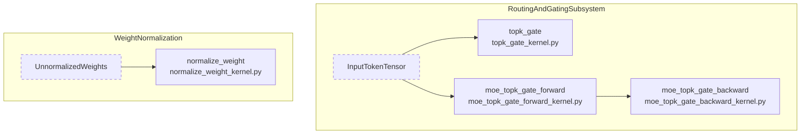
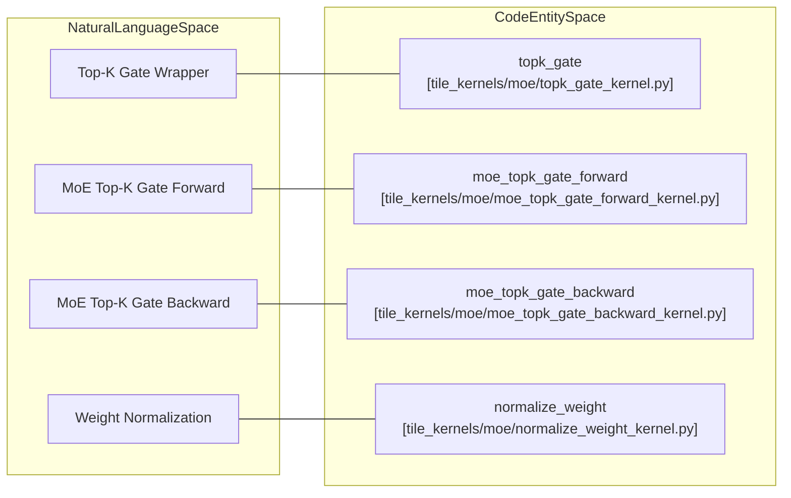

<!-- source: DeepWiki mcp.deepwiki.com · repo deepseek-ai/TileKernels · page 5 Mixture of Experts (MoE) Module · fetched 2026-10-30 -->

# Mixture of Experts (MoE) Module

Relevant source files

The following files were used as context for generating this wiki page:

- [tile_kernels/moe/__init__.py](tile_kernels/moe/__init__.py)

The Mixture of Experts (MoE) module provides high-performance TileLang kernels for sparse routing, expert selection, and weight normalization in MoE transformer architectures. This subsystem handles top-k gating forward and backward passes, group scoring, and output weight normalization across dual CUDA and Ascend backends [tile_kernels/moe/__init__.py:1-4]().

### Subsystem Architecture Overview

The MoE routing and normalization pipeline relies on distinct routing and gating operations exposed through the package initialization interface [tile_kernels/moe/__init__.py:1-4]().

**Sources:** [tile_kernels/moe/__init__.py:1-4]()

---

### Top-k Gate Kernels

The top-k gating subsystem manages expert selection, group scoring, and gradient propagation for routing tokens to appropriate experts. It provides standard top-k gating via `topk_gate` [tile_kernels/moe/__init__.py:4-4]() as well as specialized group-scored forward and backward routines via `moe_topk_gate_forward` and `moe_topk_gate_backward` [tile_kernels/moe/__init__.py:2-3]().

For detailed information on expert selection, group scoring, gradient computations, and backend variants, see [Top-k Gate Kernels](#5.1).

**Sources:** [tile_kernels/moe/__init__.py:2-4]()

---

### Weight Normalization and Scoring Helpers

To prepare routing weights for token aggregation, the module applies normalization routines. The `normalize_weight` kernel ensures that expert routing probabilities scale correctly [tile_kernels/moe/__init__.py:1-1](). Additionally, scoring helper functions such as `sqrt_softplus` assist in non-linear expert scoring during routing.

For detailed documentation on weight normalization kernels and testing utilities in `tile_kernels/testing/moe.py`, see [Weight Normalization and Scoring Helpers](#5.2).

**Sources:** [tile_kernels/moe/__init__.py:1-1]()

---

### Code Entity Mapping

The diagram below maps the natural language concepts of the MoE routing subsystem to their corresponding code symbols and file paths.

**Sources:** [tile_kernels/moe/__init__.py:1-4]()

---

### Child Pages
*   **[Top-k Gate Kernels](#5.1)** — Reference for `topk_gate` and `moe_topk_gate_forward` / `moe_topk_gate_backward` kernels: top-k expert selection, group scoring, gradient computation, and CUDA/Ascend variants.
*   **[Weight Normalization and Scoring Helpers](#5.2)** — Documents `normalize_weight` kernels and `sqrt_softplus` scoring helper used in MoE routing, plus the testing helpers in `tile_kernels/testing/moe.py`.

---

