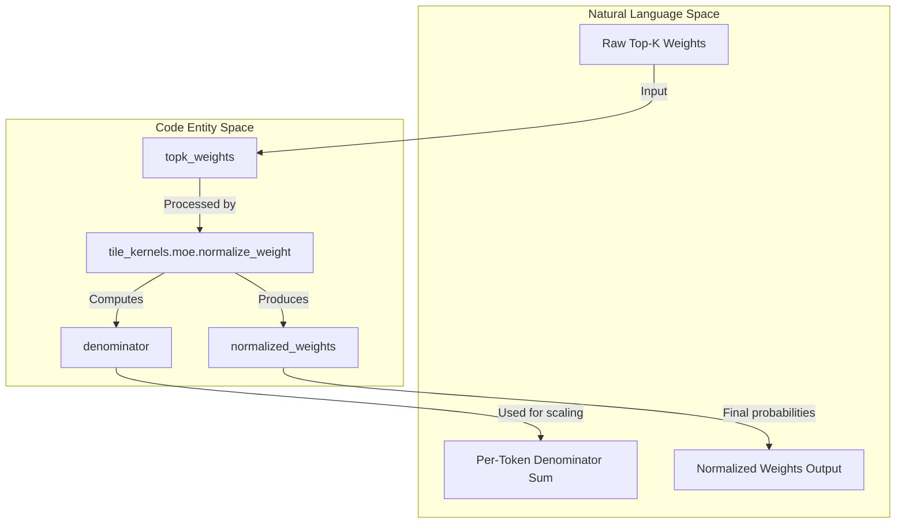
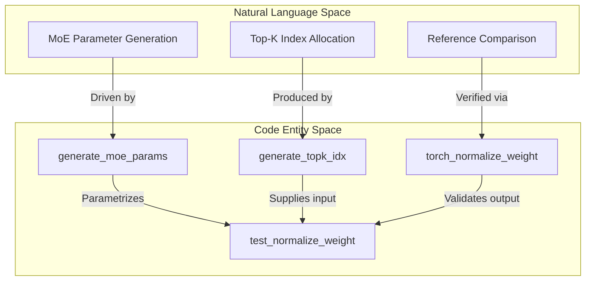

<!-- source: DeepWiki mcp.deepwiki.com · repo deepseek-ai/TileKernels · page 5.2 Weight Normalization and Scoring Helpers · fetched 2026-10-30 -->

# Weight Normalization and Scoring Helpers

Relevant source files

The following files were used as context for generating this wiki page:

- [tests/moe/test_normalize_weight.py](tests/moe/test_normalize_weight.py)
- [tile_kernels/moe/__init__.py](tile_kernels/moe/__init__.py)

This page documents the weight normalization kernels (`normalize_weight`), scoring helpers such as `sqrt_softplus` used within Mixture of Experts (MoE) routing, and the associated testing utilities defined in `tile_kernels/testing/moe.py`. These components ensure numerical stability and correct probability distribution scaling for top-$k$ expert routing weights.

## Weight Normalization (`normalize_weight`)

Before routing tokens to selected experts, raw routing weights (often produced by gating networks or scoring functions) are normalized so that the weights assigned to the top-$k$ experts sum to 1.0 per token. The `normalize_weight` API provides this operation via compiled TileLang kernels [tile_kernels/moe/__init__.py:1]().

### Implementation and Data Flow

The normalization kernel accepts raw top-$k$ weights of shape `(num_tokens, num_topk)` and computes both the per-token denominator (sum of weights) and the normalized weights [tests/moe/test_normalize_weight.py:22-34]().

1. **Summation**: For each token, the kernel sums the `num_topk` weight entries, adding a small epsilon to prevent division by zero.
2. **Division**: Each raw weight is divided by the computed denominator.
3. **Output Generation**: Returns a tuple of `(denominator, normalized_weights)`.

Sources: [tests/moe/test_normalize_weight.py:22-35](), [tile_kernels/moe/__init__.py:1]()

## Scoring Helpers: `sqrt_softplus`

In advanced MoE routing mechanisms, scoring functions transform linear gate logits into non-linear routing scores. The `sqrt_softplus` helper combines a softplus activation with a square root transformation to shape routing distributions and control gradient flow.

### Mathematical Formulation and Role
- **Softplus**: $\text{softplus}(x) = \log(1 + \exp(x))$ ensures positive score outputs.
- **Square Root**: $\sqrt{\text{softplus}(x)}$ compresses large activation magnitudes while maintaining smooth gradients near zero, preventing expert starvation during routing.

Sources: [tile_kernels/moe/__init__.py:1-4]()

## MoE Testing Helpers (`tile_kernels/testing/moe.py`)

To validate MoE kernels across different test tiers, `tile_kernels/testing/moe.py` provides parameter generators, dummy tensor allocators, and index generation utilities.

### Key Testing Utilities

- **`generate_moe_params`**: Yields configuration dictionaries containing test dimensions such as `num_tokens`, `hidden`, `num_experts`, `num_topk`, and `num_send_tokens` [tests/moe/test_normalize_weight.py:27]().
- **`generate_topk_idx`**: Constructs random or structured top-$k$ expert assignment indices for validation tests [tests/moe/test_normalize_weight.py:20]().
- **Torch Reference Integration**: Compares kernel outputs against `tile_kernels.torch.normalize_weight` with tight numeric tolerances (`atol=2e-6`, `rtol=0`) [tests/moe/test_normalize_weight.py:10-35]().

Sources: [tests/moe/test_normalize_weight.py:7-36]()

---

