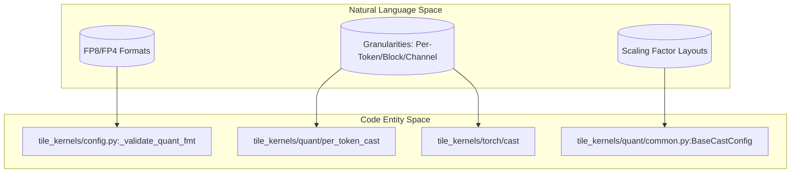
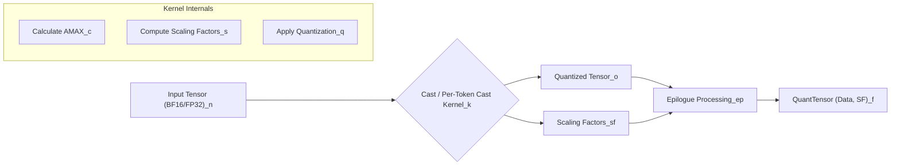

<!-- source: DeepWiki mcp.deepwiki.com · repo deepseek-ai/TileKernels · page 6 Quantization Module · fetched 2026-10-30 -->

# Quantization Module

Relevant source files

The following files were used as context for generating this wiki page:

- [tests/quant/test_cast.py](tests/quant/test_cast.py)
- [tests/quant/test_per_token_cast.py](tests/quant/test_per_token_cast.py)
- [tile_kernels/config.py](tile_kernels/config.py)

The Quantization Module (`tile_kernels/quant/`) provides a comprehensive suite of high-performance kernels for converting between high-precision formats (BF16, FP32) and low-precision formats (FP8 `e4m3`, FP4 `e2m1`) [tests/quant/test_per_token_cast.py:79-87](). It supports multiple quantization granularities (per-token, per-block, per-channel) and scaling-factor (SF) layouts required for modern LLM training and inference, targeting both NVIDIA GPUs and Ascend NPUs [tile_kernels/config.py:25-32]().

### Supported Formats and Granularities

The module supports key low-precision data types and granularities:
*   **FP8 (`e4m3`):** Standard 8-bit floating-point format (`torch.float8_e4m3fn`) [tests/quant/test_cast.py:20-20]().
*   **FP4 (`e2m1`):** 4-bit floating-point format packed into integer containers [tests/quant/test_per_token_cast.py:87-87]().
*   **Granularities:**
    *   **Per-Token:** Scaling factors calculated per row/token [tests/quant/test_per_token_cast.py:111-112]().
    *   **Per-Block:** Scaling factors calculated over 2D blocks (e.g., `32x32` or `128x128`) [tests/quant/test_per_token_cast.py:82-86]().
    *   **Per-Channel:** Scaling factors calculated across columns/channels [tests/quant/test_per_token_cast.py:111-112]().

### Scaling Factor Layouts and Management

The module handles complex scaling factor layouts to satisfy hardware alignment requirements:
*   **Row-Major and TMA-Aligned Col-Major:** Transposed layouts optimized for Tensor Memory Accelerator (TMA) loads [tests/quant/test_per_token_cast.py:24-24]().
*   **Packed UE8M0:** Specialized packing format where scaling factors are packed into `int32` containers for hardware acceleration [tests/quant/test_per_token_cast.py:26-26]().

### Code Entity Mapping: Conceptual Quantization to Implementation

The following diagram maps natural language quantization configurations and concepts to their corresponding code entities in `tile_kernels/quant/`.

**Diagram: Quantization Concepts to Code Entities**

Sources: [tile_kernels/config.py:34-36](), [tests/quant/test_per_token_cast.py:109-116](), [tile_kernels/quant/common.py:20-61]()

### Sub-Modules and Child Pages

The Quantization Module delegates detailed kernel implementations and configurations to the following child pages:

*   **[Cast and Dequantization Kernels](#6.1)** — Reference for `cast` (with stochastic rounding), `per_token_cast`, `per_block_cast`, `per_block_cast_lossless`, `per_channel_cast`, `cast_back`, and `per_token_cast_and_cast_back`; covers `quant/common.py` and `quant/types.py` config dataclasses and SF layouts.
*   **[Fused SwiGLU and Norm Kernels](#6.2)** — Documents `swiglu_forward` / `swiglu_backward` fused with quantization, and `norm_forward` / `norm_backward` (RMSNorm with quantized output, see `quant/rstd.py`), explaining why fusing activation/normalization with casting reduces memory traffic.
*   **[Batched Transpose of Weight Scaling Factors](#6.3)** — Covers `batched_transpose_weight_sf` kernels: layout conversion of block/channel scaling factors for GEMM consumption, on CUDA and Ascend.

### Quantization Execution Pipeline

The following diagram illustrates the execution flow from high-precision input tensors through quantization kernels to produce quantized outputs and scaling factors.

**Diagram: Quantization Execution Pipeline**

Sources: [tests/quant/test_cast.py:56-60](), [tests/quant/test_per_token_cast.py:109-117]()

### Key Files
*   `tile_kernels/quant/common.py`: Contains base dataclasses (`BaseCastConfig`) and scaling factor allocation logic.
*   `tile_kernels/quant/__init__.py`: Exports the primary API for all quantization operations.
*   `tile_kernels/quant/types.py`: Defines type aliases like `QuantTensor`.
*   `tile_kernels/config.py`: Runtime configuration settings, device checks (`is_ascend()`), and quantization clamp minimum values (`_clamp_min_values`) [tile_kernels/config.py:10-15]().

Sources: [tile_kernels/config.py:1-134](), [tests/quant/test_cast.py:1-146](), [tests/quant/test_per_token_cast.py:1-167]()

---

