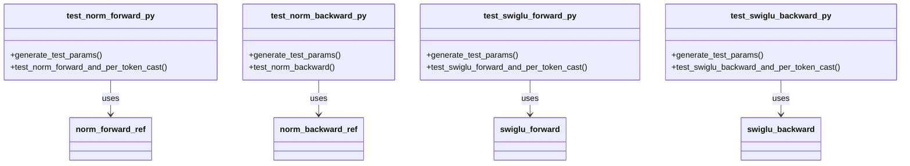

<!-- source: DeepWiki mcp.deepwiki.com · repo deepseek-ai/TileKernels · page 6.2 Fused SwiGLU and Norm Kernels · fetched 2026-10-30 -->

# Fused SwiGLU and Norm Kernels

Relevant source files

The following files were used as context for generating this wiki page:

- [tests/quant/test_norm_backward.py](tests/quant/test_norm_backward.py)
- [tests/quant/test_norm_forward.py](tests/quant/test_norm_forward.py)
- [tests/quant/test_swiglu_backward.py](tests/quant/test_swiglu_backward.py)
- [tests/quant/test_swiglu_forward.py](tests/quant/test_swiglu_forward.py)

The Fused SwiGLU and Norm Kernels module provides high-performance TileLang kernels that combine activation functions (SwiGLU) or normalization layers (RMSNorm) with low-precision quantization (such as FP8 e4m3) and casting operations. By fusing activation and normalization with casting, the system avoids redundant memory round-trips to High Bandwidth Memory (HBM), keeping intermediate values in registers or shared memory before producing their quantized representations.

## Purpose and Memory Efficiency

In standard Transformer architectures, operations like SwiGLU or RMSNorm are typically followed by a quantization step to prepare tensors for subsequent low-precision linear layers (e.g., FP8 GEMMs). A non-fused implementation incurs heavy memory overhead:
1. **Read** unquantized high-precision input from HBM.
2. **Compute** activation or normalization in registers/shared memory.
3. **Write** high-precision intermediate results back to HBM.
4. **Read** high-precision intermediate results from HBM.
5. **Quantize** (compute scaling factors, absolute maximums, and cast).
6. **Write** quantized output and scaling factors to HBM.

The fused kernels implemented in `tile_kernels/quant/` compress this lifecycle into a single Read-Compute-Cast-Write cycle, eliminating intermediate HBM traffic and optimizing memory bandwidth utilization.

**Fused Memory Traffic Comparison**

```mermaid
graph TD
    subgraph "Non-Fused Pipeline (Multiple HBM Round-Trips)"
        HBM_In["HBM Input"] --> Read1["Read Unquantized"]
        Read1 --> Comp["Compute Activation / Norm"]
        Comp --> Write1["Write High-Precision to HBM"]
        Write1 --> Read2["Read High-Precision from HBM"]
        Read2 --> Quant["Compute SF & Quantize"]
        Quant --> HBM_Out["Write Quantized Output & SF to HBM"]
    end

    subgraph "Fused Pipeline (Single Pass)"
        HBM_In_Fused["HBM Input"] --> Read_Fused["Read Input"]
        Read_Fused --> Comp_Fused["Compute & Quantize In-Register"]
        Comp_Fused --> HBM_Out_Fused["Write Quantized Output & SF Directly"]
    end
```

Sources: [tests/quant/test_norm_forward.py:83-128](), [tests/quant/test_swiglu_forward.py:71-144]()

---

## Fused SwiGLU Kernels (`swiglu_forward` / `swiglu_backward`)

The SwiGLU activation function combined with quantization is heavily utilized in Mixture of Experts (MoE) and dense MLP layers. 

### Forward Pass (`swiglu_forward` / `swiglu_forward_and_per_token_cast`)
* **Operation**: Computes the SwiGLU transformation $x_{\text{gate}} \cdot \text{sigmoid}(x_{\text{gate}}) \cdot x_{\text{up}}$, optionally applies top-k weights or routed scaling factors, handles clamp values, and computes per-token scaling factors (`amax` reduction) in a single kernel invocation [tests/quant/test_swiglu_forward.py:71-144]().
* **Layout Support**: Supports standard layouts as well as packed expert layouts (`psum_num_tokens_per_expert`) for MoE execution paths [tests/quant/test_swiglu_forward.py:26-35]().

### Backward Pass (`swiglu_backward` / `swiglu_backward_and_per_token_cast`)
* **Operation**: Computes the gradient with respect to the SwiGLU inputs given the output gradients and original activations (or recomputing them via `do_recompute`), followed by per-token quantization of the gradient tensor [tests/quant/test_swiglu_backward.py:98-178]().
* **Parameters**: Accepts optional top-k weights, routed scaling factors, and clamp bounds [tests/quant/test_swiglu_backward.py:98-127]().

Sources: [tests/quant/test_swiglu_forward.py:71-144](), [tests/quant/test_swiglu_backward.py:98-178]()

---

## Fused Normalization Kernels (`norm_forward` / `norm_backward`)

The normalization subsystem implements Root Mean Square Normalization (RMSNorm) integrated with casting and residual connections, relying on utility routines in `quant/rstd.py` for root-mean-square statistics (`rstd`) management.

### Forward Pass (`norm_forward` / `norm_forward_and_per_token_cast`)
* **Operation**: Computes RMSNorm over input tensor `x` using weight parameters, optional residual addition (`residual`), and computes reciprocal standard deviation (`rstd`) required for the backward pass [tests/quant/test_norm_forward.py:83-128]().
* **Quantization Output**: When target format is `e4m3`, it produces quantized activations and scaling factors while optionally writing out unquantized or bfloat16 representations (`out_bf16`) [tests/quant/test_norm_forward.py:97-111]().

### Backward Pass (`norm_backward`)
* **Operation**: Computes gradients with respect to input `x` and weights given `out_grad`, saved `rstd`, and optional `residual_out_grad` [tests/quant/test_norm_backward.py:73-109]().
* **Accumulation**: Supports gradient accumulation (`weight_grad`) with precision scaling across multiple device streaming multiprocessors or core allocations [tests/quant/test_norm_backward.py:73-109]().

Sources: [tests/quant/test_norm_forward.py:83-128](), [tests/quant/test_norm_backward.py:73-109]()

---

## Code Entity Mapping

The following diagram bridges the high-level functional concepts of fused SwiGLU and Norm operations to their corresponding test suites and functional entry points in the codebase.

**Entity Mapping: Fused Kernels and Test Suites**

Sources: [tests/quant/test_norm_forward.py:18-110](), [tests/quant/test_norm_backward.py:18-86](), [tests/quant/test_swiglu_forward.py:8-138](), [tests/quant/test_swiglu_backward.py:114-138]()

---

## Configuration Dataclasses and Scaling Factors

Both fused SwiGLU and Norm quantization pipelines share common configuration parameters defined across casting utilities to control precision, block granularity, and rounding behavior.

| Parameter | Type / Options | Description |
| :--- | :--- | :--- |
| `fmt` | `str` (`'bf16'`, `'fp32'`, `'e4m3'`) | Target datatype format for quantization or casting [tests/quant/test_norm_forward.py:58](), [tests/quant/test_swiglu_forward.py:53]() |
| `num_per_channels` | `int` (e.g., `32`, `128`) | Granularity of scaling factors along the channel/hidden dimension [tests/quant/test_norm_forward.py:61](), [tests/quant/test_swiglu_forward.py:54]() |
| `round_sf` | `bool` | Enables rounding scaling factors to powers of two [tests/quant/test_norm_forward.py:67](), [tests/quant/test_swiglu_forward.py:48]() |
| `use_packed_ue8m0` | `bool` | Enables packed ue8m0 representations for scaling factors [tests/quant/test_norm_forward.py:67](), [tests/quant/test_swiglu_forward.py:49]() |
| `clamp_value` | `float` or `None` | Optional threshold to clamp activation values or scaling factors [tests/quant/test_swiglu_forward.py:60]() |

Sources: [tests/quant/test_norm_forward.py:43-79](), [tests/quant/test_swiglu_forward.py:38-67]()

---

