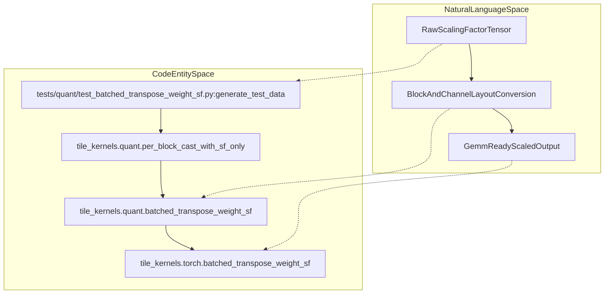
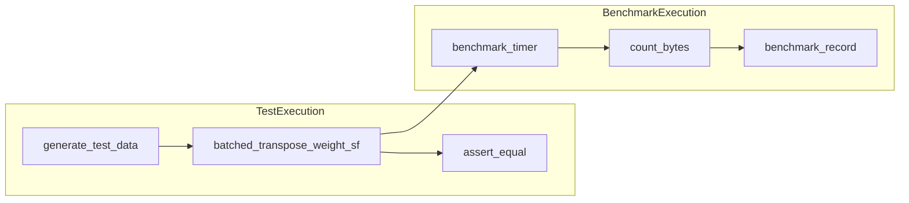

<!-- source: DeepWiki mcp.deepwiki.com · repo deepseek-ai/TileKernels · page 6.3 Batched Transpose of Weight Scaling Factors · fetched 2026-10-30 -->

# Batched Transpose of Weight Scaling Factors

Relevant source files

The following files were used as context for generating this wiki page:

- [tests/quant/test_batched_transpose_weight_sf.py](tests/quant/test_batched_transpose_weight_sf.py)

## Purpose and Scope

The `batched_transpose_weight_sf` module covers specialized layout conversion kernels for block and channel quantization scaling factors (SF) within `tile_kernels.quant`. These operations reorganize scaling factor tensors to optimize memory access patterns and layout requirements for GEMM instructions across both CUDA and Ascend NPU backends [tests/quant/test_batched_transpose_weight_sf.py:33-40]().

Sources: [tests/quant/test_batched_transpose_weight_sf.py:33-40]()

---

## API Interface and Parameters

The primary entry point is `tile_kernels.quant.batched_transpose_weight_sf`, which accepts a list of scaling factor tensors, block size configurations, transpose flags, and optional pre-allocated output buffers [tests/quant/test_batched_transpose_weight_sf.py:49]().

### Function Signature & Arguments
* `sf` (`List[torch.Tensor]`): List of input scaling factor tensors generated by block or channel casting operations (e.g., `per_block_cast_with_sf_only`) [tests/quant/test_batched_transpose_weight_sf.py:37]().
* `block_size` (`int`): Granularity of the block scaling (supported values include `32` on all backends, and `128` on CUDA) [tests/quant/test_batched_transpose_weight_sf.py:25-30]().
* `transpose_sf1s` (`List[bool]`): Boolean flags per weight tensor indicating whether secondary scaling factors require transposition [tests/quant/test_batched_transpose_weight_sf.py:39]().
* `outs` (`List[Optional[torch.Tensor]]`): Optional output buffer list for in-place or pre-allocated tensor reuse [tests/quant/test_batched_transpose_weight_sf.py:47]().

Sources: [tests/quant/test_batched_transpose_weight_sf.py:25-49]()

---

## Data Flow and Execution Architecture

The scaling factor transposition pipeline takes raw block scaling factors, reshapes and permutes them according to group and block dimensions, and ensures proper alignment (`32`-byte alignment) for subsequent tensor core or cube core consumption [tests/quant/test_batched_transpose_weight_sf.py:33-57]().

"Batched Transpose Scaling Factor Data Flow"

Sources: [tests/quant/test_batched_transpose_weight_sf.py:33-50]()

---

## Test Suite and Benchmarking

The validation suite for batched scaling factor transpose is defined in `tests/quant/test_batched_transpose_weight_sf.py`. It tests mixed weight configurations across different block sizes and group counts, comparing kernel outputs against reference implementations (`tile_kernels.torch.batched_transpose_weight_sf`) [tests/quant/test_batched_transpose_weight_sf.py:14-56]().

### Test Configurations Matrix

| Block Size | Weight Configs (`N`, `K`, `num_groups`, `transpose_sf1`) | Target Backend Constraints |
| :--- | :--- | :--- |
| `32` | `_MIXED_WEIGHT_CONFIGS` (7 distinct shapes) | Universal (CUDA & Ascend) [tests/quant/test_batched_transpose_weight_sf.py:14-28]() |
| `128` | `_MIXED_WEIGHT_CONFIGS` (7 distinct shapes) | CUDA only (`is_ascend()` skipped) [tests/quant/test_batched_transpose_weight_sf.py:25-29]() |

### Verification and Benchmarking Pipeline

"Verification And Benchmark Architecture"

Sources: [tests/quant/test_batched_transpose_weight_sf.py:33-80]()

---

