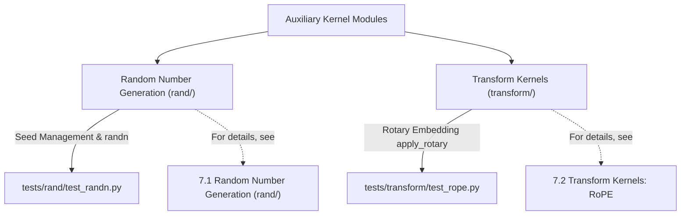
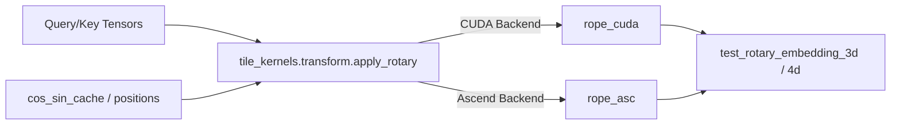

<!-- source: DeepWiki mcp.deepwiki.com · repo deepseek-ai/TileKernels · page 7 Auxiliary Kernel Modules · fetched 2026-10-30 -->

# Auxiliary Kernel Modules

Relevant source files

The following files were used as context for generating this wiki page:

- [tests/rand/test_randn.py](tests/rand/test_randn.py)
- [tests/transform/test_rope.py](tests/transform/test_rope.py)

The auxiliary kernel modules package utility operations that support core LLM training and inference pipelines. Specifically, this module covers random number generation (`rand/`) for deterministic test data and initialization across backends [tests/rand/test_randn.py:17-41](), and tensor transform operations (`transform/`) focusing on rotary position embeddings (RoPE) [tests/transform/test_rope.py:21-47](). 

As a parent page, this section provides a high-level architectural overview of these two auxiliary domains. Detailed design, JIT compilation strategies, and backend-specific implementations are documented in the respective child pages.

Sources: [tests/rand/test_randn.py:17-92](), [tests/transform/test_rope.py:21-140]()

---

## 7.1 Random Number Generation (`rand/`)

The random number generation subsystem provides efficient, deterministic pseudo-random number generation across both CUDA and Ascend NPU backends. It supports global seed management through `tile_kernels.rand.set_seed()` and exposes distribution kernels such as `tile_kernels.rand.randn()` and `tile_kernels.rand.randn_like()` [tests/rand/test_randn.py:17-41](). These utilities are critical for reproducible tensor initialization and deterministic test data generation in multi-backend workflows.

For complete technical specifications, kernel design, and seed propagation details, see [Random Number Generation (rand/)](#7.1).

Sources: [tests/rand/test_randn.py:17-41]()

---

## 7.2 Transform Kernels: RoPE

The tensor transform subsystem houses specialized geometric and positional embedding operations, prominently featuring the Rotary Position Embedding (RoPE) kernel via `tile_kernels.transform.apply_rotary()` [tests/transform/test_rope.py:36-43](). The RoPE module supports 3D and 4D tensor layouts [tests/transform/test_rope.py:21-58](), configurable head splitting [tests/transform/test_rope.py:15](), interleaved vs. neox memory formats [tests/transform/test_rope.py:19](), and conjugate operations [tests/transform/test_rope.py:20](), with validation tested against reference implementations like `rotary_embedding_ref` [tests/transform/test_rope.py:33-34]().

For detailed breakdowns of `rope_cuda`, `rope_asc`, and performance benchmarking, see [Transform Kernels: RoPE](#7.2).

Sources: [tests/transform/test_rope.py:21-96]()

---

