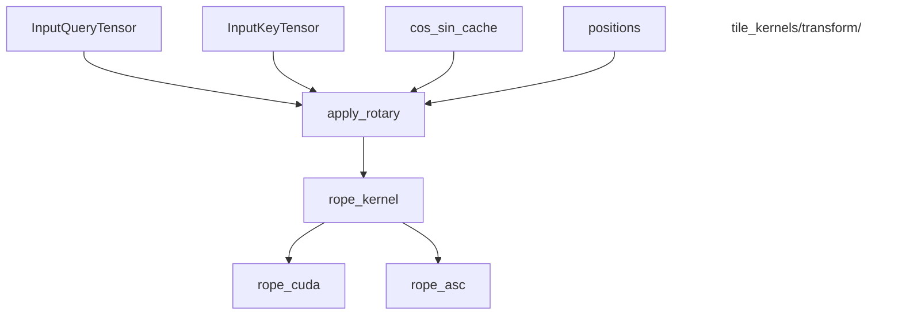
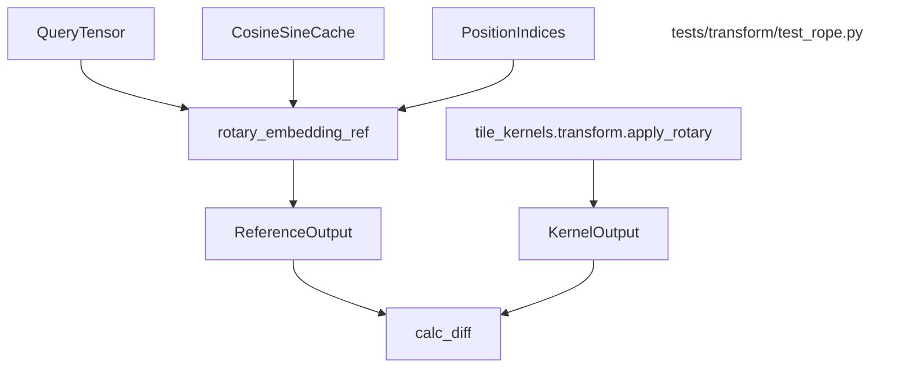
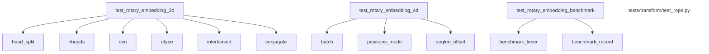

<!-- source: DeepWiki mcp.deepwiki.com · repo deepseek-ai/TileKernels · page 7.2 Transform Kernels: RoPE · fetched 2026-10-30 -->

# Transform Kernels: RoPE

Relevant source files

The following files were used as context for generating this wiki page:

- [tests/transform/test_rope.py](tests/transform/test_rope.py)

## Purpose and Scope

The `tile_kernels/transform/` subsystem provides Rotary Position Embedding (RoPE) kernels designed for large language model attention layers. This module implements efficient positional encoding transformations supporting both 3D and 4D tensor layouts, interleaved and non-interleaved (Neox-style) memory layouts, complex conjugation options, and flexible position indexing modes (`none`, broadcast, `int32`, and `int64`). Kernels are dispatched across CUDA and Ascend NPU backends.

Sources: `tests/transform/test_rope.py:1-141`

---

## Core API and Data Flow

The public-facing entry point for rotary embedding transformations is `tile_kernels.transform.apply_rotary`, which accepts query and key tensors, precomputed or on-the-fly cosine/sine caches (`cos_sin_cache`), optional position tensors, and layout configuration flags.

### Key Parameters and Configurations

*   `query`, `key`: Input tensors of 3D or 4D shape containing attention projections. Sources: `tests/transform/test_rope.py:27-28`, `tests/transform/test_rope.py:64`.
*   `cos_sin_cache`: Precomputed frequency tensor containing cosine and sine components. Sources: `tests/transform/test_rope.py:29`, `tests/transform/test_rope.py:65`.
*   `positions`: Optional tensor specifying token positions per sequence or batch element. Sources: `tests/transform/test_rope.py:30`, `tests/transform/test_rope.py:67-74`.
*   `interleaved`: Boolean flag toggling between interleaved and non-interleaved element pairs. Sources: `tests/transform/test_rope.py:19`, `tests/transform/test_rope.py:41`.
*   `conjugate`: Boolean flag applying complex conjugation to the rotary transformation. Sources: `tests/transform/test_rope.py:20`, `tests/transform/test_rope.py:42`.
*   `seqlen_offset`: Integer offset applied to sequence positions. Sources: `tests/transform/test_rope.py:50`, `tests/transform/test_rope.py:92`.

Sources: `tests/transform/test_rope.py:27-43`, `tests/transform/test_rope.py:86-93`

---

## Numerical Reference Implementation

To ensure correctness across hardware backends, kernel outputs are validated against the PyTorch reference implementation `rotary_embedding_ref` imported from `tile_kernels.torch`.

Sources: `tests/transform/test_rope.py:9`, `tests/transform/test_rope.py:33-46`, `tests/transform/test_rope.py:77-95`

---

## Test Coverage and Benchmarking

The test suite in `tests/transform/test_rope.py` verifies correctness across multiple dimensions, including tensor dimensionality, data types, head splitting, and position indexing modes.

### Test Suites

*   `test_rotary_embedding_3d`: Validates 3D tensor configurations against `rotary_embedding_ref` using `pytest.mark.parametrize` over `head_split`, `nheads`, `dim`, `dtype`, `interleaved`, and `conjugate`. Sources: `tests/transform/test_rope.py:15-47`.
*   `test_rotary_embedding_4d`: Validates 4D batched tensors across `positions_mode` variants (`none`, `broadcast`, `int32`, `int64`) and sequence offsets. Sources: `tests/transform/test_rope.py:48-96`.
*   `test_rotary_embedding_benchmark`: Measures kernel execution time via `benchmark_timer` and computes memory bandwidth throughput (`bandwidth_gbs`). Sources: `tests/transform/test_rope.py:98-140`.

Sources: `tests/transform/test_rope.py:15-140`

---

