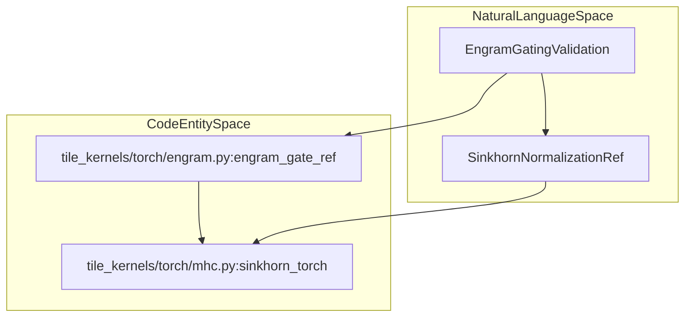
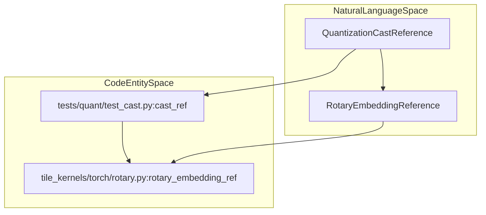

<!-- source: DeepWiki mcp.deepwiki.com · repo deepseek-ai/TileKernels · page 8 Reference Implementations (tile_kernels/torch) · fetched 2026-10-30 -->

# Reference Implementations (tile_kernels/torch)

Relevant source files

The following files were used as context for generating this wiki page:

- [tests/engram/test_engram_gate_bwd.py](tests/engram/test_engram_gate_bwd.py)
- [tests/quant/test_cast.py](tests/quant/test_cast.py)
- [tests/transform/test_rope.py](tests/transform/test_rope.py)

The `tile_kernels/torch/` sub-package provides PyTorch-native reference implementations for the high-performance kernels defined across the library. These reference functions serve as numerical ground truth for correctness testing during development and continuous integration. By executing the equivalent mathematical logic through standard PyTorch operations, the test suites verify that optimized TileLang kernels produce outputs within strict floating-point tolerances.

For a detailed breakdown of individual reference operations, refer to the child pages:
- [Reference Ops for Engram and mHC](#8.1)
- [Reference Ops for Quant, MoE and Transform](#8.2)

---

## 8.1. Reference Ops for Engram and mHC

The Engram and Manifold HyperConnection (mHC) modules implement complex multi-step training and inference pipelines. To validate these layers, the `tile_kernels/torch/engram.py` and `tile_kernels/torch/mhc.py` modules supply PyTorch reference functions that compute both forward activations and critical intermediate tensors. For instance, tests such as `tests/engram/test_engram_gate_bwd.py` invoke `engram_gate_ref` to save required intermediates (`dot`, `gate_score`, `rstd_x`, `rstd_k`) for autograd backward validation [tests/engram/test_engram_gate_bwd.py:54-63]().

Similarly, mHC reference operations simulate iterative Sinkhorn normalization and multi-head residual hyper-connection pipelines to confirm that optimized kernels preserve precision across multi-layer workflows.

For details, see [Reference Ops for Engram and mHC](#8.1).

*Diagram 1: Association between Engram/mHC validation concepts and their corresponding reference functions.*

Sources: [tests/engram/test_engram_gate_bwd.py:54-63]()

---

## 8.2. Reference Ops for Quant, MoE and Transform

Quantization, Mixture of Experts (MoE), and tensor transformation modules require specialized reference logic to handle lower-precision formats, gating rules, and spatial transformations. The modules `tile_kernels/torch/cast.py`, `norm.py`, `swiglu.py`, `topk.py`, `moe.py`, `reduce_fused.py`, and `rope.py` provide these baselines. 

For example, quantization tests such as `tests/quant/test_cast.py` implement `cast_ref` to simulate hardware saturation and rounding behaviors [tests/quant/test_cast.py:62-67](), while transform tests like `tests/transform/test_rope.py` import `rotary_embedding_ref` to check rotary position embeddings [tests/transform/test_rope.py:9](). These reference paths define explicit numeric-tolerance thresholds (`rtol` and `atol`) used during assertion checks.

For details, see [Reference Ops for Quant, MoE and Transform](#8.2).

*Diagram 2: Association between quantization and transform testing concepts and their validation functions.*

Sources: [tests/quant/test_cast.py:62-67](), [tests/transform/test_rope.py:9]()

---

