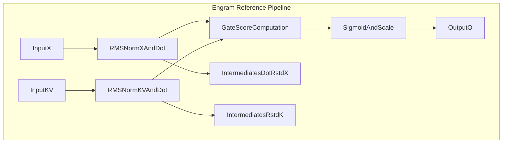
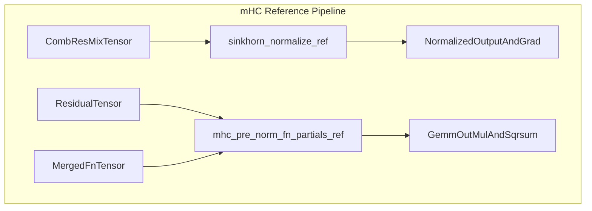

<!-- source: DeepWiki mcp.deepwiki.com · repo deepseek-ai/TileKernels · page 8.1 Reference Ops for Engram and mHC · fetched 2026-10-30 -->

# Reference Ops for Engram and mHC

Relevant source files

The following files were used as context for generating this wiki page:

- [tests/engram/test_engram_gate_bwd.py](tests/engram/test_engram_gate_bwd.py)
- [tests/mhc/test_norm_fn.py](tests/mhc/test_norm_fn.py)
- [tests/mhc/test_sinkhorn.py](tests/mhc/test_sinkhorn.py)

This page details the PyTorch-native reference implementations located in `tile_kernels/torch/engram.py` and `tile_kernels/torch/mhc.py`. These reference modules provide mathematically equivalent, high-precision golden paths used by the engram and mhc test suites (such as `tests/engram/test_engram_gate_bwd.py`, `tests/mhc/test_norm_fn.py`, and `tests/mhc/test_sinkhorn.py`) to validate kernel correctness and gradients.

Sources: [tests/engram/test_engram_gate_bwd.py:1-152](), [tests/mhc/test_norm_fn.py:1-192](), [tests/mhc/test_sinkhorn.py:1-171]()

---

## Engram Reference Implementation (`torch/engram.py`)

The Engram subsystem relies on reference routines to compute fused RMSNorm and signed-sqrt sigmoid gates alongside saved intermediates. In [tests/engram/test_engram_gate_bwd.py:54-63](), `engram_gate_ref` is invoked to compute both the forward activation and the required backward intermediates.

### Key Function: `engram_gate_ref`

`engram_gate_ref` computes the forward pass of the Engram gating mechanism with the following data flow:
1. **RMSNorm calculation**: Normalizes input tensor `x` and key-value tensor `kv` using root-mean-square statistics with parameters `eps` and `clamp_value`.
2. **Dot Product and Scoring**: Computes inner products (`dot`) and signed-square-root scaling factors (`gate_score`).
3. **Intermediate Caching**: When `save_for_backward=True`, it returns `(o, dot, gate_score, rstd_x, rstd_k)` which are fed directly into the tile kernels or PyTorch autograd engine.
4. **Image Token Masking**: Applies `image_token_mask` to bypass gating for designated image tokens, matching the conditional branch logic found in hardware kernels.

Sources: [tests/engram/test_engram_gate_bwd.py:46-63]()

---

## Manifold HyperConnection (mHC) Reference Implementation (`torch/mhc.py`)

The mHC reference implementations provide golden paths for doubly-stochastic normalization via Sinkhorn iterations and pre-norm mixture computations.

### Sinkhorn Normalization Reference (`sinkhorn_normalize_ref`)
As exercised in [tests/mhc/test_sinkhorn.py:53-55](), `sinkhorn_normalize_ref` performs iterative row and column normalization on combination-residual mixing tensors (`comb_res_mix`) given a repeat count and tolerance `eps`. It supports full automatic differentiation to yield exact reference gradients (`comb_res_mix_ref.grad`) for tests like `test_sinkhorn_comprehensive`.

### Pre-Norm and Partials Reference (`mhc_pre_norm_fn_ref` and `mhc_pre_norm_fn_partials_ref`)
In [tests/mhc/test_norm_fn.py:151-152](), reference functions handle the computation of mHC pre-normalization mixes and partial reductions across split dimensions:
* `mhc_pre_norm_fn_ref`: Computes the combined residual norms and function products.
* `mhc_pre_norm_fn_partials_ref`: Generates split-wise reduction intermediates (`gemm_out_mul`, `gemm_out_sqrsum`) that match the tiling structure of `mhc_reduce_partials_and_rmsnorm_fwd`.

Sources: [tests/mhc/test_norm_fn.py:134-168](), [tests/mhc/test_sinkhorn.py:42-60]()

---

