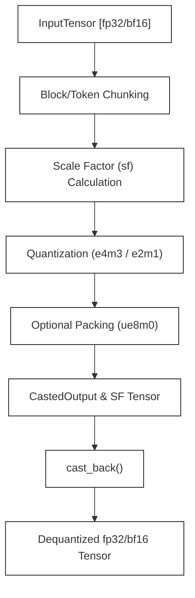
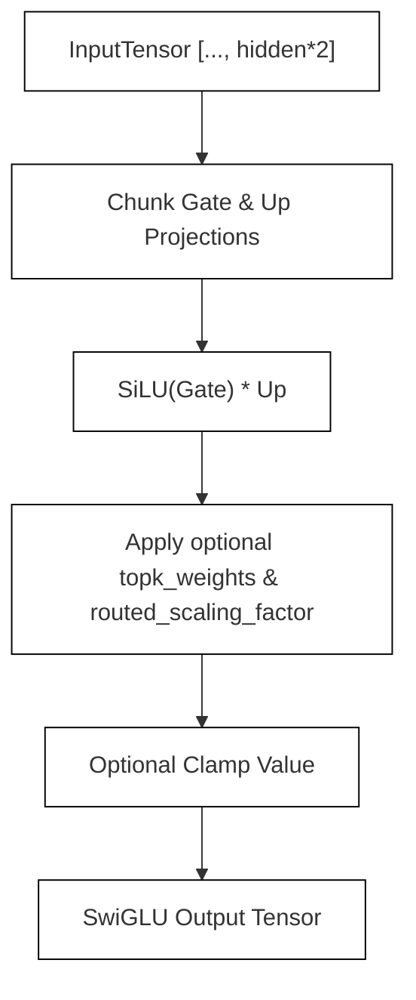
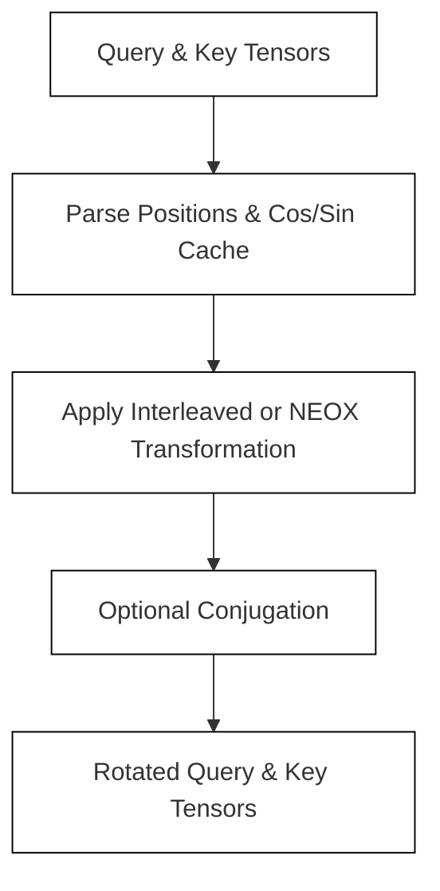

<!-- source: DeepWiki mcp.deepwiki.com · repo deepseek-ai/TileKernels · page 8.2 Reference Ops for Quant, MoE and Transform · fetched 2026-10-30 -->

# Reference Ops for Quant, MoE and Transform

Relevant source files

The following files were used as context for generating this wiki page:

- [tests/moe/test_moe_topk_gate_forward.py](tests/moe/test_moe_topk_gate_forward.py)
- [tests/quant/test_per_token_cast.py](tests/quant/test_per_token_cast.py)
- [tests/quant/test_swiglu_forward.py](tests/quant/test_swiglu_forward.py)
- [tests/transform/test_rope.py](tests/transform/test_rope.py)

This page details the PyTorch-native reference implementations located in `tile_kernels/torch/` for quantization, normalization, activation, Mixture of Experts (MoE) routing, tensor reduction, and transform operations. These reference operators serve as the numerical ground truth for validating high-performance TileLang kernels across both CUDA and Ascend NPU backends.

---

## 1. Scope and Overview of Reference Operators

The `tile_kernels/torch` module provides clean, unoptimized PyTorch implementations of all custom kernels. These implementations mirror the exact mathematical behavior, data types, scaling factor (SF) handlings, and tiling layouts of the low-level TileLang kernels. Test suites compare high-performance kernel outputs against these references using strict numerical thresholds.

The following table summarizes the reference modules covered on this page:

| Reference Module | Key Functions | Primary Role |
| :--- | :--- | :--- |
| `tile_kernels/torch/cast.py` | `cast`, `cast_back` | FP8/FP4 casting, scaling factor extraction, and stochastic rounding |
| `tile_kernels/torch/norm.py` | `rms_norm_ref` | Root Mean Square Normalization with optional quantized output |
| `tile_kernels/torch/swiglu.py` | `swiglu_forward` | SwiGLU activation fusion with scaling and clamping |
| `tile_kernels/torch/topk.py` | `sqrt_softplus_ref`, `topk_gate_ref` | Softplus scoring, expert bias injection, and top-k routing selection |
| `tile_kernels/torch/moe.py` | `moe_topk_gate_forward` | End-to-end MoE routing reference with shared/routed expert mapping |
| `tile_kernels/torch/reduce_fused.py` | Fused reduction helpers | Parallel reduction operations across token and hidden dimensions |
| `tile_kernels/torch/rope.py` | `rotary_embedding_ref` | 3D/4D Rotary Position Embedding (RoPE) with interleave/NEOX and conjugate support |

Sources: `tests/quant/test_per_token_cast.py:35-42`, `tests/quant/test_swiglu_forward.py:100-112`, `tests/transform/test_rope.py:33-34`

---

## 2. Quantization and Normalization Reference Ops (`cast.py`, `norm.py`)

### Quantization & Casting (`torch/cast.py`)
The casting reference logic handles type conversions between high-precision formats (`fp32`, `bf16`) and low-precision quantization formats (`e4m3`, `e2m1`). It computes block-wise or token-wise scaling factors (`sf`), handles TMA-aligned column-major layouts, packs `ue8m0` scaling factors, and supports round-sf operations as observed in [tests/quant/test_per_token_cast.py:35-42]().

Data Flow for Casting Reference:

Sources: `tests/quant/test_per_token_cast.py:35-120`

### Normalization (`torch/norm.py`)
`rms_norm_ref` calculates the Root Mean Square over the hidden dimension:
$$\text{RMS}(x) = \sqrt{\frac{1}{d} \sum_{i=1}^{d} x_i^2 + \epsilon}$$
It normalizes the input tensor and applies learned gain weights. When coupled with quantization options, it yields both the normalized high-precision tensor and its corresponding per-token scaling factors.

Sources: `tests/quant/test_swiglu_forward.py:99-112`

---

## 3. Activation Reference Ops (`swiglu.py`)

### SwiGLU Activation (`torch/swiglu.py`)
The SwiGLU reference function `swiglu_forward` processes incoming token states (split into gate and up projections), computes the SiLU activation on the gate, multiplies by the up projection, and applies optional routing weights, scaling factors, and clamping bounds [tests/quant/test_swiglu_forward.py:100-107]().

Sources: `tests/quant/test_swiglu_forward.py:100-112`

---

## 4. MoE and Top-K Routing Reference Ops (`topk.py`, `moe.py`)

### Top-K Gating & Scoring (`torch/topk.py`)
Mixture of Experts routing relies on scoring functions and selection algorithms:
- `sqrt_softplus_ref`: Computes a smooth transformation of expert logits using $\sqrt{\text{softplus}(x)}$.
- Expert Biases & Masking: Adds routing and image biases, handles padded tokens, and executes top-$k$ selection across routed and shared experts.

### MoE Forward Reference (`torch/moe.py`)
`moe_topk_gate_forward` integrates logits construction, score calculation, expert capacity mapping, and physical-to-logical expert routing tables as tested in [tests/moe/test_moe_topk_gate_forward.py:163-170]().

Sources: `tests/moe/test_moe_topk_gate_forward.py:13-14`

---

## 5. Reduction and Transform Reference Ops (`reduce_fused.py`, `rope.py`)

### Rotary Position Embedding (`torch/rope.py`)
`rotary_embedding_ref` implements 3D and 4D rotary position embeddings for query and key tensors [tests/transform/test_rope.py:33-34](). It supports:
- Interleaved vs. NEOX (non-interleaved) layouts.
- Conjugate forms for complex number representations.
- Position offsets (`seqlen_offset`) and various position tensor modes (`int32`, `int64`, broadcasted, or none).

Sources: `tests/transform/test_rope.py:33-43`

---

## 6. Numeric-Tolerance Expectations

To guarantee numerical equivalence between TileLang compiled kernels and PyTorch references, test suites enforce strict tolerances:
- **Standard Precision (`fp32`, `bf16`)**: Verified using `calc_diff` with thresholds typically set to $\le 1\text{e-8}$ for deterministic operations [tests/transform/test_rope.py:45]().
- **Quantized Formats (`e4m3`, `e2m1`)**: Validated via quantized back-casts (`cast_back`) and scaling factor comparisons (`assert_equal`) [tests/quant/test_per_token_cast.py:119-126]().
- **Stochastic Rounding & FMA**: Minor deviations due to hardware FMA instruction ordering on different accelerator backends are accommodated where explicitly documented in test assertions [tests/transform/test_rope.py:45]().

Sources: `tests/quant/test_per_token_cast.py:119-126`, `tests/transform/test_rope.py:45-46`

---

