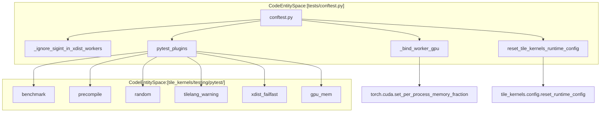
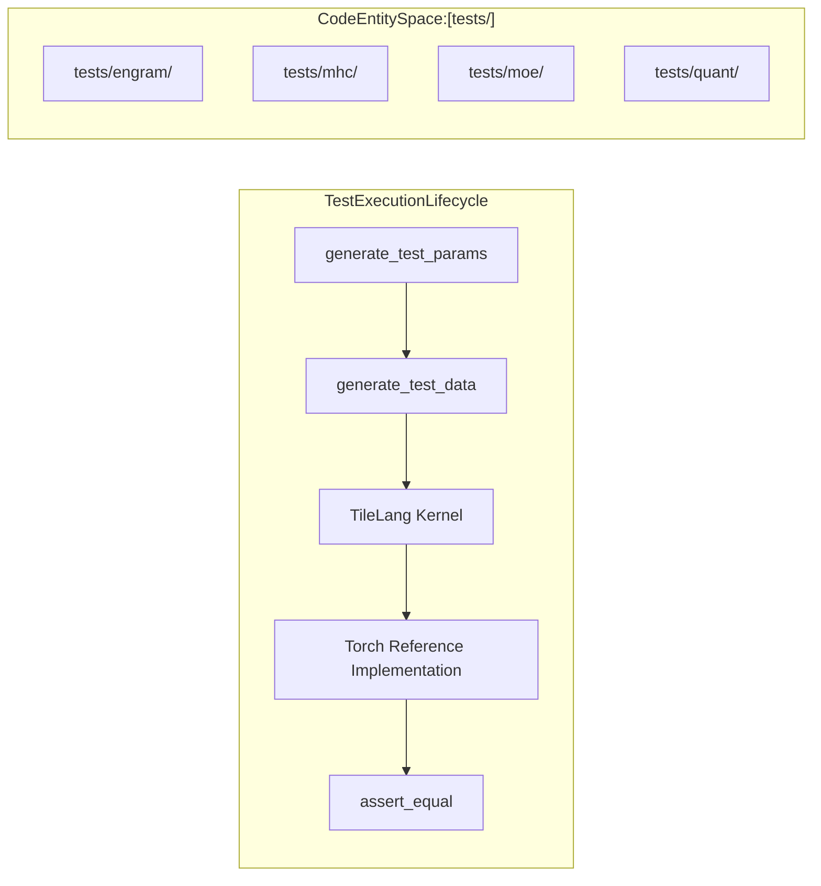

<!-- source: DeepWiki mcp.deepwiki.com · repo deepseek-ai/TileKernels · page 9 Testing and Benchmarking Infrastructure · fetched 2026-10-30 -->

# Testing and Benchmarking Infrastructure

Relevant source files

The following files were used as context for generating this wiki page:

- [tests/__init__.py](tests/__init__.py)
- [tests/conftest.py](tests/conftest.py)

The **TileKernels** testing and benchmarking infrastructure ensures the correctness, determinism, and performance of GPU and NPU kernels across dual backends. Powered by `pytest`, the suite combines session bootstrapping, parallel execution management via `pytest-xdist`, specialized custom plugins, and a comprehensive utility library for tensor generation and accuracy validation.

As a parent overview, this page summarizes the core pillars of the testing stack. For granular implementation details, refer to the respective child pages:
- **Test Session Bootstrap and Pytest Plugins**: For configuration, environment defaults, worker binding, and custom plugins (`tests/conftest.py` and `tile_kernels/testing/pytest/`). See [Test Session Bootstrap and Pytest Plugins](#9.1).
- **Testing Utilities**: For validation (`numeric.py`), input generation (`generator.py`), profiling (`bench.py`), and domain-specific helpers. See [Testing Utilities (tile_kernels/testing)](#9.2).
- **Kernel Test Suites**: For module-specific test layouts, parameterization patterns, and benchmark baselines. See [Kernel Test Suites](#9.3).

---

## Test Session Bootstrap and Pytest Plugins

The test harness initializes via root-level bootstrapping in `tests/conftest.py`, which configures environment defaults, handles signal interception for parallel runs, and binds workers to specific physical accelerators before driver initialization [tests/conftest.py:1-137]().

Sources: [tests/conftest.py:31-157]()

For detailed documentation on environment variable defaults, `pytest-xdist` worker GPU/NPU binding, memory reservation fractions, and individual plugin responsibilities, see [Test Session Bootstrap and Pytest Plugins](#9.1).

---

## Testing Utilities (`tile_kernels/testing`)

The `tile_kernels/testing/` package provides reusable building blocks for numeric verification, parameter generation, and performance reporting. These utilities are shared across all kernel test suites to maintain uniform assertions and data distributions.

| Module | Primary Code Entities / Functions | Role in Test Suite |
| :--- | :--- | :--- |
| `numeric.py` | `assert_equal`, `calc_diff`, `count_bytes` | Validates parity between TileLang kernels and PyTorch reference models within specified absolute/relative tolerances. |
| `generator.py` | `get_test_level`, `generate_num_tokens`, `generate_hidden_sizes` | Controls test matrix size dynamically based on environment verbosity flags like `TK_TEST_LEVEL`. |
| `bench.py` | `make_param_id`, performance reporters | Standardizes benchmark parameter labeling and throughput calculations. |
| `quant.py` / `moe.py` | Quantization & MoE verification helpers | Sets up specialized tensor configurations for block-quantized and expert-routed inputs. |

For a complete review of these utility modules and their APIs, see [Testing Utilities (tile_kernels/testing)](#9.2).

---

## Kernel Test Suites and Benchmarking

Kernel tests reside in the `tests/` subdirectories, mirroring the package structure (`engram`, `mhc`, `moe`, `quant`, `rand`, `transform`). They generally adhere to a standardized execution lifecycle:

Sources: [tests/conftest.py:22-29]()

Tests also integrate with regression-checking fixtures that compare execution runtimes and memory consumption against stored baselines under directories such as `tests/benchmark_baselines/` and `tests/gpu_mem_profiles/` [tests/conftest.py:22-25]().

For detailed walkthroughs of individual module test suites, test parameterization strategies, and regression enforcement, see [Kernel Test Suites](#9.3).

---

## Child Pages

- **[Test Session Bootstrap and Pytest Plugins](#9.1)** — Deep dive into `tests/conftest.py` initialization logic and the `tile_kernels/testing/pytest/` plugin suite.
- **[Testing Utilities (tile_kernels/testing)](#9.2)** — Comprehensive documentation for numeric assertion, data generation, and benchmarking helper modules.
- **[Kernel Test Suites](#9.3)** — Detailed tour of per-module test directories, execution patterns, and benchmark regression baselines.

---

