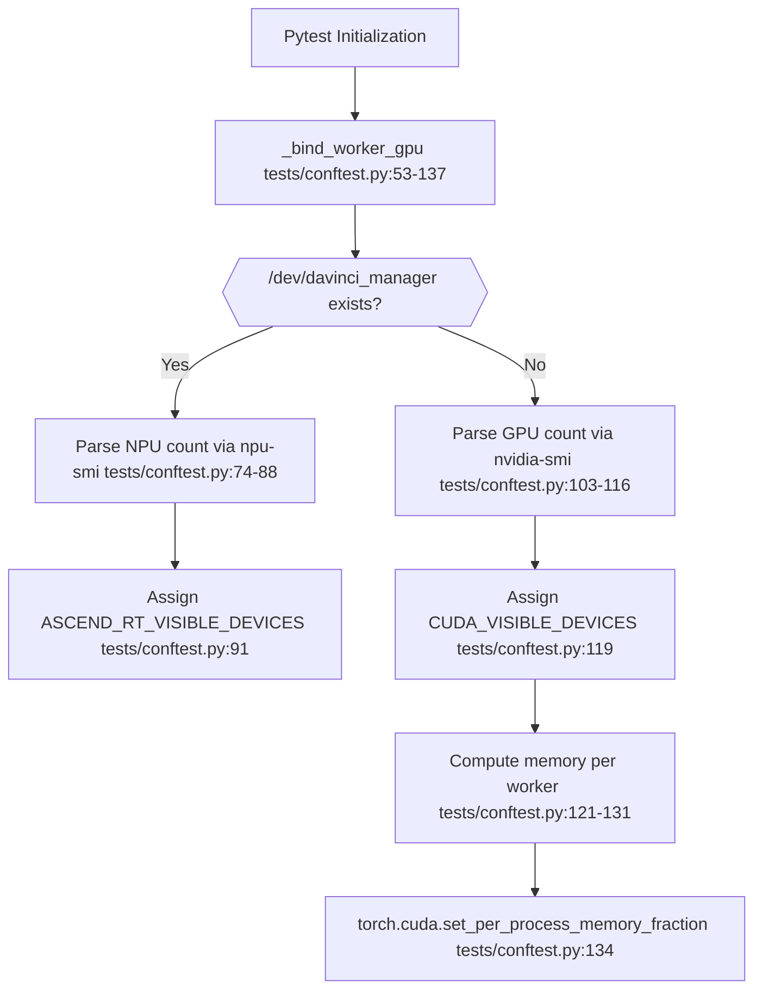
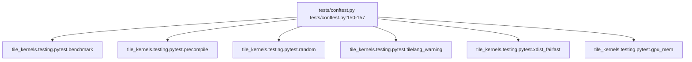

<!-- source: DeepWiki mcp.deepwiki.com · repo deepseek-ai/TileKernels · page 9.1 Test Session Bootstrap and Pytest Plugins · fetched 2026-10-30 -->

# Test Session Bootstrap and Pytest Plugins

Relevant source files

The following files were used as context for generating this wiki page:

- [tests/__init__.py](tests/__init__.py)
- [tests/conftest.py](tests/conftest.py)

## Purpose and Scope
This page documents the test session initialization and bootstrap logic implemented in `tests/conftest.py`, as well as the suite of testing plugins registered via `pytest_plugins` from `tile_kernels/testing/pytest/`. It covers execution ordering requirements for hardware accelerator driver binding, pytest-xdist signal handling, environment variable defaults, runtime configuration fixtures, and the specialized testing extensions for benchmarking, precompilation, random seed control, warning filters, fail-fast mechanics, and GPU memory profiling.

---

## 1. Test Session Bootstrap (`tests/conftest.py`)

The root configuration module `tests/conftest.py` executes before any test collection or execution phase occurs. It establishes fallback environment variables, configures distributed testing worker isolation for CUDA and Ascend NPU backends, and registers core pytest hooks and fixtures.

### Environment Variable Defaults
Before any test routines are discovered, `tests/conftest.py` establishes default paths for benchmark test suites, performance baselines, and GPU memory profiles using `os.environ.setdefault()` [tests/conftest.py:19-29](). It also configures default benchmark regression thresholds and failure modes:

* `TK_BENCHMARK_TESTS_DIR`: Points to the repository's test directory [tests/conftest.py:22-23]().
* `TK_BENCHMARK_BASELINES_DIR`: Resolves to `<tests-dir>/benchmark_baselines` [tests/conftest.py:24]().
* `TK_GPU_MEM_PROFILES_DIR`: Resolves to `<tests-dir>/gpu_mem_profiles` [tests/conftest.py:25]().
* `TK_BENCHMARK_FAIL_MODE`: Defaults to `'regression'` [tests/conftest.py:26]().
* `TK_BENCHMARK_REGRESSION_THRESHOLD`: Defaults to `'0.05'` (5%) [tests/conftest.py:27]().
* `TK_BENCHMARK_MIN_DELTA_US`: Defaults to `'0.8'` microseconds [tests/conftest.py:28]().

### Worker-to-Device Binding (`_bind_worker_gpu`)
Because `tilelang` initializes the CUDA driver upon import, any modification to device visibility (`CUDA_VISIBLE_DEVICES`) after imports occur will be ignored. To support multi-GPU or multi-NPU execution under `pytest-xdist`, `_bind_worker_gpu()` runs at the top of `conftest.py` prior to driver initialization [tests/conftest.py:9-11, 53-61]().

1. **Ascend NPU Detection**: If `/dev/davinci_manager` exists, the worker ID (e.g., `gw0`, `gw1`) is mapped to an NPU index [tests/conftest.py:66-67](). It inspects `ASCEND_RT_VISIBLE_DEVICES` or queries `npu-smi` to establish available devices, assigning `ASCEND_RT_VISIBLE_DEVICES = npu_list[npu_id % num_npus]` [tests/conftest.py:69-91]().
2. **CUDA GPU Detection**: If running on NVIDIA hardware, worker IDs are mapped to physical GPU indices via `CUDA_VISIBLE_DEVICES` [tests/conftest.py:93-119]().
3. **Memory Fraction Allocation**: To prevent Out-Of-Memory (OOM) errors when multiple `pytest-xdist` workers share a single physical GPU, `_bind_worker_gpu()` computes a per-process memory fraction [tests/conftest.py:121-135](). It reserves 10 GB for system overhead (`_reserve_bytes`), queries total memory via `torch.cuda.mem_get_info()`, and invokes `torch.cuda.set_per_process_memory_fraction()` [tests/conftest.py:125-134]().

Sources: [tests/conftest.py:53-137]()

### SIGINT Handling in Xdist Workers (`_ignore_sigint_in_xdist_workers`)
When running tests with `pytest-xdist`, pressing `Ctrl+C` sends a `SIGINT` signal to the entire foreground process group, terminating worker processes mid-test and triggering unintended xdist worker restarts. `_ignore_sigint_in_xdist_workers()` checks for the presence of `PYTEST_XDIST_WORKER` and ignores `SIGINT` (`signal.SIG_IGN`) inside worker processes [tests/conftest.py:31-50](). This delegates interruption handling entirely to the main xdist controller.
Sources: [tests/conftest.py:31-50]()

### Runtime Configuration Reset Fixture
The autouse fixture `reset_tile_kernels_runtime_config()` guarantees test isolation by automatically invoking `reset_runtime_config()` from `tile_kernels.config` both before and after every test execution [tests/conftest.py:141-148]().
Sources: [tests/conftest.py:141-148]()

---

## 2. Pytest Plugin Ecosystem (`tile_kernels/testing/pytest/`)

Root configuration loads six custom testing plugins through the `pytest_plugins` list [tests/conftest.py:150-157](). These plugins are bundled directly within the `tile_kernels` package structure.

Sources: [tests/conftest.py:150-157]()

### Summary of Registered Plugins
* **`benchmark` (`tile_kernels/testing/pytest/benchmark.py`)**: Manages performance regression detection, timing collection, execution warmup loops, and baseline comparison reporting against stored performance targets.
* **`precompile` (`tile_kernels/testing/pytest/precompile.py`)**: Handles JIT compilation queue hooks, allowing kernel compilation phases to be batched or executed prior to parallel test runner dispatch.
* **`random` (`tile_kernels/testing/pytest/random.py`)**: Controls deterministic random state initialization across test runs, ensuring reproducible tensor generation across both CUDA and Ascend NPU backends.
* **`tilelang_warning` (`tile_kernels/testing/pytest/tilelang_warning.py`)**: Filters and sanitizes TileLang compiler warnings and deprecation notices, preventing log clutter during automated test execution.
* **`xdist_failfast` (`tile_kernels/testing/pytest/xdist_failfast.py`)**: Coordinates early test session termination across distributed `pytest-xdist` worker nodes when a failure threshold is breached.
* **`gpu_mem` (`tile_kernels/testing/pytest/gpu_mem.py`)**: Profiles peak memory utilization per test case and compares allocations against baseline JSON files stored in `TK_GPU_MEM_PROFILES_DIR`.

Sources: [tests/conftest.py:150-157]()

---

