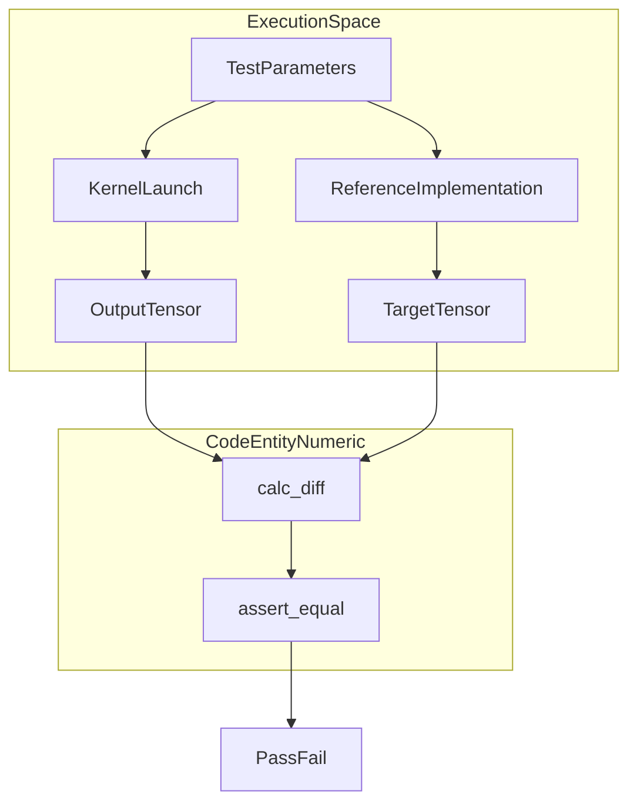
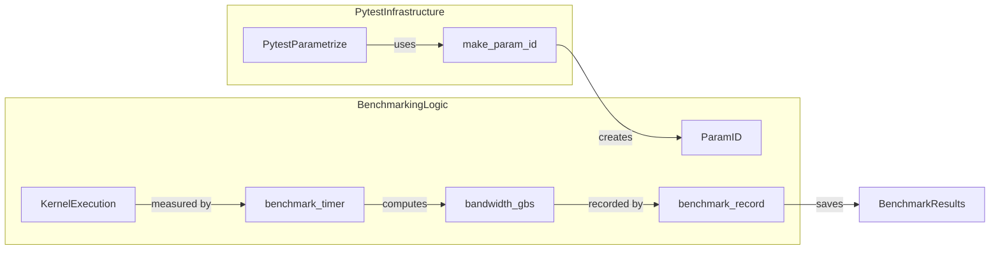

<!-- source: DeepWiki mcp.deepwiki.com · repo deepseek-ai/TileKernels · page 9.2 Testing Utilities (tile_kernels/testing) · fetched 2026-10-30 -->

# Testing Utilities (tile_kernels/testing)

Relevant source files

The following files were used as context for generating this wiki page:

- [tests/engram/test_engram_fused_weight.py](tests/engram/test_engram_fused_weight.py)
- [tests/engram/test_engram_gate_bwd.py](tests/engram/test_engram_gate_bwd.py)

The `tile_kernels/testing` package provides a standardized infrastructure for validating kernel correctness, generating synthetic data for specialized numerical formats, and benchmarking performance [tests/engram/test_engram_fused_weight.py:9-11](). These utilities ensure consistency across the test suite and simplify the process of verifying high-performance CUDA and Ascend NPU kernels against PyTorch reference implementations.

Sources: `tile_kernels/testing/`

---

## 1. Numeric Validation (`numeric.py`)

The `numeric.py` module contains core assertions and metrics for comparing kernel outputs against ground-truth tensors.

### Key Functions

| Function | Purpose | Implementation Detail |
| :--- | :--- | :--- |
| `assert_equal` | Validates two tensors are numerically close [tests/engram/test_engram_fused_weight.py:37](). | Uses `torch.allclose` with configurable `atol` and `rtol`. |
| `calc_diff` | Computes statistical distance between tensors. | Returns max difference, mean absolute error (MAE), and MSE. |
| `count_bytes` | Estimates memory traffic for bandwidth calculations [tests/engram/test_engram_fused_weight.py:48](). | Sums the size of all input/output tensors in bytes. |

### Data Flow: Kernel Verification
The following diagram illustrates how `numeric.py` utilities are integrated into test lifecycles to bridge kernel execution and validation.

**Figure 1: Kernel Output Validation Flow**

Sources: `tile_kernels/testing/numeric.py`, `tests/engram/test_engram_fused_weight.py:31-38]()

---

## 2. Data Generation (`generator.py`)

`generator.py` provides deterministic and stochastic data generators tailored for shapes and types used in TileKernels, such as Mixture of Experts (MoE), Engram, and low-precision quantization formats.

### Specialized Generators & Test Levels

*   **Test Levels (`get_test_level`)**: Determines test intensity and parameter grid size (often controlled via environment variables like `TK_TEST_LEVEL`) [tests/engram/test_engram_fused_weight.py:10]().
*   **Token & Hidden Sizes**: Functions like `generate_num_tokens` [tests/engram/test_engram_gate_bwd.py:10]() and `generate_hidden_sizes` [tests/engram/test_engram_fused_weight.py:10]() return lists of common architectural dimensions (e.g., powers of two, non-aligned sizes) to ensure robust kernel test coverage.
*   **MoE & Quantization Parameters**: Generates valid configurations for expert counts, top-k routing, and scaling factor layouts.

Sources: `tile_kernels/testing/generator.py`, `tests/engram/test_engram_fused_weight.py:10()`, `tests/engram/test_engram_gate_bwd.py:10()`

---

## 3. Benchmarking and Profiling (`bench.py`)

The `bench.py` module provides utilities for performance measurement, reporting, and parameter formatting.

### Key Utilities

*   **`make_param_id`**: Generates stable, unique parameter identifiers used as test IDs in `pytest.mark.parametrize` [tests/engram/test_engram_fused_weight.py:9]() and [tests/engram/test_engram_fused_weight.py:30]().
*   **Performance Reporting**: Calculates and prints throughput metrics (e.g., GB/s) based on execution time and byte counts [tests/engram/test_engram_fused_weight.py:48-55]().

### Benchmark Lifecycle
The benchmarking process uses custom `pytest` fixtures and plugins interacting with these utilities.

**Figure 2: Benchmark Integration Architecture**

Sources: `tile_kernels/testing/bench.py`, `tests/engram/test_engram_fused_weight.py:40-56()`

---

## 4. Quantization Utilities (`quant.py`)

This module contains specialized helpers for managing quantization states and scaling factors (SF) during test execution.

*   **Scaling Factor Management**: Helpers to verify block/channel scaling factors and clear unused scaling factors (e.g., `clear_unused_sf`) to prevent non-deterministic behavior during reduction or backward passes.

Sources: `tile_kernels/testing/quant.py`

---

## 5. Mixture of Experts Helpers (`moe.py`)

The `moe.py` module supplies testing and reference helpers specific to Mixture of Experts routing architectures.

*   **Routing & Scoring Validation**: Utilities for generating ground-truth top-k router logits, expert assignments, and weight normalization checks to validate `topk_gate` and related MoE kernels against PyTorch reference routines.

Sources: `tile_kernels/testing/moe.py`

---

## 6. Test Infrastructure Integration

Testing utilities integrate tightly with `tests/conftest.py` and custom pytest plugins for random seeds, benchmarking, and worker distribution across multi-device hardware setups.

Sources: `tests/conftest.py`

---

