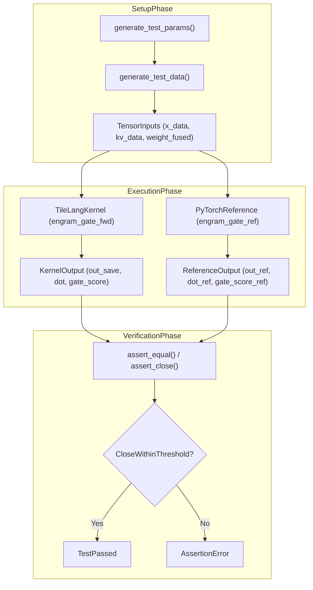
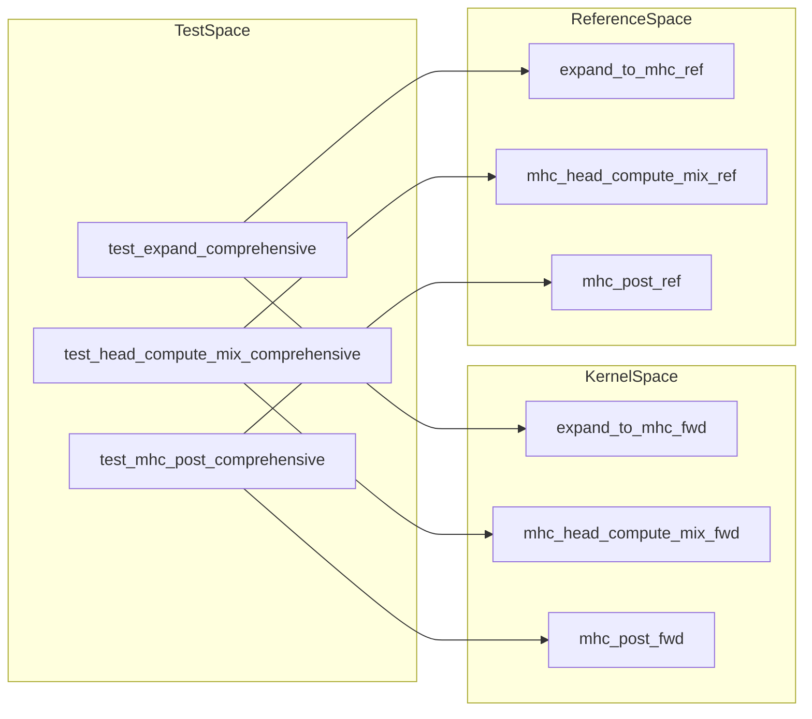

<!-- source: DeepWiki mcp.deepwiki.com · repo deepseek-ai/TileKernels · page 9.3 Kernel Test Suites · fetched 2026-10-30 -->

# Kernel Test Suites

Relevant source files

The following files were used as context for generating this wiki page:

- [tests/engram/test_engram_gate_fwd.py](tests/engram/test_engram_gate_fwd.py)
- [tests/engram/test_engram_grad_w_reduce.py](tests/engram/test_engram_grad_w_reduce.py)
- [tests/engram/test_engram_hash.py](tests/engram/test_engram_hash.py)
- [tests/engram/test_engram_sinkhorn.py](tests/engram/test_engram_sinkhorn.py)
- [tests/mhc/test_expand.py](tests/mhc/test_expand.py)
- [tests/mhc/test_head_compute_mix.py](tests/mhc/test_head_compute_mix.py)
- [tests/mhc/test_post.py](tests/mhc/test_post.py)
- [tests/mhc/test_pre_apply_mix.py](tests/mhc/test_pre_apply_mix.py)
- [tests/mhc/test_pre_big_fuse.py](tests/mhc/test_pre_big_fuse.py)
- [tests/mhc/test_pre_split_mixes.py](tests/mhc/test_pre_split_mixes.py)
- [tests/moe/test_moe_topk_gate_backward.py](tests/moe/test_moe_topk_gate_backward.py)
- [tests/moe/test_moe_topk_gate_forward.py](tests/moe/test_moe_topk_gate_forward.py)

The `TileKernels` test suite provides a comprehensive validation framework for TileLang-based kernels. It ensures numerical correctness against PyTorch reference implementations and measures hardware performance (bandwidth and latency) across various tensor shapes and configurations.

## Test Suite Structure

The test infrastructure is organized by kernel family under the `tests/` directory [tests/engram/test_engram_gate_fwd.py:1-44](). Each sub-directory mirrors the structure of the `tile_kernels/` source tree, covering subsystems like engram, mhc, moe, quant, rand, and transform.

| Directory | Scope | Key Kernels Tested |
| :--- | :--- | :--- |
| `tests/engram/` | Engram Gating & Sinkhorn | `engram_gate_fwd`, `engram_gate_bwd`, `grad_w_reduce`, `engram_hash`, `engram_sinkhorn_step` [tests/engram/test_engram_gate_fwd.py:7](), [tests/engram/test_engram_grad_w_reduce.py:7](), [tests/engram/test_engram_hash.py:7](), [tests/engram/test_engram_sinkhorn.py:7-11]() |
| `tests/mhc/` | Manifold HyperConnection | `expand_to_mhc_fwd`, `mhc_head_compute_mix_fwd`, `mhc_post_fwd`, `mhc_pre_big_fuse_fwd` [tests/mhc/test_expand.py:5](), [tests/mhc/test_head_compute_mix.py:5](), [tests/mhc/test_post.py:5](), [tests/mhc/test_pre_big_fuse.py:9]() |
| `tests/moe/` | Mixture of Experts | `moe_topk_gate_forward`, `moe_topk_gate_backward` [tests/moe/test_moe_topk_gate_backward.py:13](), [tests/moe/test_moe_topk_gate_forward.py:6]() |
| `tests/quant/` | Quantization & Casts | `per_token_cast`, `per_block_cast`, `swiglu_forward_and_per_token_cast` |
| `tests/rand/` | Random Number Generation | `randn` |
| `tests/transform/` | Tensor Transforms & RoPE | `rope_kernel` |

Sources: [tests/engram/test_engram_gate_fwd.py:1-44](), [tests/engram/test_engram_grad_w_reduce.py:1-44](), [tests/mhc/test_expand.py:1-17](), [tests/moe/test_moe_topk_gate_forward.py:1-62]()

## Standard Test Pattern

All kernel tests follow a consistent lifecycle to ensure parity between TileLang kernels and PyTorch references: `generate_test_params` $\to$ `generate_test_data` $\to$ kernel execution $\to$ `assert_equal` / `assert_close` verification [tests/engram/test_engram_gate_fwd.py:18-75]().

### 1. Parameter Generation
Tests utilize `generate_test_params(level)` to create a list of configurations (e.g., hidden sizes, token counts, mask options) [tests/engram/test_engram_gate_fwd.py:34-41](). This function uses test levels obtained via `get_test_level()` and shape generators like `generate_hidden_sizes()` and `generate_num_tokens()` [tests/engram/test_engram_gate_fwd.py:10]().

### 2. Data Preparation
The `generate_test_data(params)` function initializes input tensors on the active device using `randn()` and PyTorch tensor operations [tests/engram/test_engram_gate_fwd.py:18-31](). For backward tests, it prepares gradients and intermediate state buffers [tests/moe/test_moe_topk_gate_backward.py:101-115]().

### 3. Execution and Validation
The test compares the TileLang kernel output against a reference implementation from `tile_kernels.torch.*` [tests/engram/test_engram_gate_fwd.py:12](). Correctness is validated using `assert_equal()`, `assert_close()`, or `torch.testing.assert_close()` [tests/engram/test_engram_gate_fwd.py:70-74](). For modeling ops with autograd, `torch.autograd.backward()` is invoked on both the kernel-wrapped function and the reference [tests/mhc/test_expand.py:43-50]().

### Data Flow Diagram: Kernel Validation
The following diagram bridges the natural language test specification to the underlying code entities (`generate_test_params`, `generate_test_data`, `engram_gate_fwd`, `engram_gate_ref`, `assert_equal`).

"Kernel Validation Flow"

Sources: [tests/engram/test_engram_gate_fwd.py:18-75](), [tests/mhc/test_expand.py:36-51]()

## Benchmark Fixtures and Regression Checks

Tests marked with `@pytest.mark.benchmark` serve as performance regression checks [tests/engram/test_engram_gate_fwd.py:107-113](). They utilize two primary fixtures:
*   `benchmark_timer`: Measures the execution time of a kernel call in microseconds ($\mu s$) [tests/engram/test_engram_gate_fwd.py:125-134]().
*   `benchmark_record`: Logs the kernel name, operation type, parameters, execution time, and calculated memory bandwidth (`bandwidth_gbs`) to the test report [tests/engram/test_engram_gate_fwd.py:137-143]().

Bandwidth is calculated using `count_bytes()` to determine the total I/O volume (bytes read and written) divided by execution time [tests/engram/test_engram_gate_fwd.py:135-142]().

Sources: [tests/engram/test_engram_gate_fwd.py:107-143](), [tests/engram/test_engram_grad_w_reduce.py:67-90]()

## Specialized Test Suites and Code Entity Association

### MHC Multilayer Recompute and Fused Ops
The MHC test suite validates complex pipelines such as `expand_to_mhc_fwd`, `mhc_head_compute_mix_fwd`, `mhc_post_fwd`, and the fused `mhc_pre_big_fuse_fwd` [tests/mhc/test_expand.py:22](), [tests/mhc/test_head_compute_mix.py:36](), [tests/mhc/test_post.py:42](), [tests/mhc/test_pre_big_fuse.py:103]().

### Code Entity Association: MHC Test Suite
This diagram maps test functions in `tests/mhc/` directly to their implementation modules and PyTorch reference counterparts.

"MHC Entity Association"

Sources: [tests/mhc/test_expand.py:5-40](), [tests/mhc/test_head_compute_mix.py:5-102](), [tests/mhc/test_post.py:5-60]()

## Environment Variables and Execution Control

Test suite behavior and JIT compilation can be controlled via environment variables:

*   `TK_TEST_LEVEL`: Determines the parameter generation thoroughness level (e.g. level 0 for core smoke tests, higher levels for full Cartesian test coverage) [tests/engram/test_engram_gate_fwd.py:44]().
*   `TILELANG_PRINT_ON_COMPILATION`: Set to `'0'` in test files to suppress TileLang source code generation prints during JIT compilation [tests/engram/test_engram_gate_fwd.py:14-15]().

Sources: [tests/engram/test_engram_gate_fwd.py:10-15](), [tests/engram/test_engram_gate_fwd.py:44]()

---

