# Page: TileKernels Overview

# TileKernels Overview

<details>
<summary>Relevant source files</summary>

The following files were used as context for generating this wiki page:

- [LICENSE](LICENSE)
- [README.md](README.md)
- [tile_kernels/__init__.py](tile_kernels/__init__.py)

</details>


TileKernels is a high-performance kernel library implemented in [TileLang](https://github.com/tile-ai/tilelang), designed for Large Language Model (LLM) training and inference workloads [README.md:1-3](). It provides optimized operators for mixture-of-experts routing, Engram gating, quantization, manifold hyper-connections (mHC), rotary position embeddings, and random number generation [README.md:11-20](). 

A key feature of TileKernels is its dual-backend support: it runs natively on NVIDIA CUDA architectures (SM90/SM100) and Huawei Ascend NPUs, sharing a unified Python API that automatically dispatches to the correct hardware backend [README.md:3-9]().

## Requirements and Supported Backends

TileKernels targets modern hardware accelerators and requires an up-to-date software stack for JIT compilation via TileLang [README.md:21-32]().

| Requirement | Minimum Version / Specification |
| :--- | :--- |
| **Python** | 3.12 or higher [README.md:23]() |
| **PyTorch** | 2.13 or higher [README.md:24]() |
| **TileLang** | 0.1.15 or higher [README.md:25]() |
| **NVIDIA CUDA Backend** | NVIDIA SM90 or SM100 GPU, CUDA Toolkit 13.1+ [README.md:26-28]() |
| **Huawei Ascend Backend** | Ascend 950 NPU, CANN 9.2.0+ [README.md:29-31]() |

For installation steps, configuration flags, and test commands, see **[Getting Started: Installation and Configuration](#1.1)**.

Sources: [README.md:21-32]()

## Module Map and Package Architecture

The library is organized into modular sub-packages under `tile_kernels/`, exposing core operations, reference implementations, modeling wrappers, and test harnesses [README.md:73-86](). 

*   `tile_kernels/engram/`: Engram gating kernels, signed-sqrt sigmoid gating, fused RMSNorm, and weight gradient reduction [README.md:15]().
*   `tile_kernels/mhc/`: Manifold HyperConnection kernels including Sinkhorn normalization, expand, and mix pipelines [README.md:16]().
*   `tile_kernels/moe/`: Mixture of Experts routing, top-k expert selection, and scoring helpers [README.md:13]().
*   `tile_kernels/quant/`: Low-precision casting (FP8 e4m3, FP4 e2m1) across per-token, per-block, and per-channel granularities, plus fused SwiGLU and normalization [README.md:14]().
*   `tile_kernels/rand/`: Random number generation kernels and seed management [README.md:18]().
*   `tile_kernels/transform/`: Rotary Position Embedding (`rope`) kernels [README.md:17]().
*   `tile_kernels/modeling/`: High-level `torch.autograd.Function` wrappers (such as `EngramGateFn`) for differentiable integration into PyTorch models [README.md:19]().
*   `tile_kernels/torch/`: PyTorch-native reference implementations used as ground truth for numeric validation [README.md:84]().
*   `tile_kernels/testing/`: Testing utilities, benchmarking fixtures, and pytest plugins [README.md:83]().

For a complete breakdown of file hierarchies and the `_kernel.py` / `_cuda.py` / `_asc.py` file triple pattern, see **[Repository Layout and Package Structure](#1.2)**.

Sources: [README.md:11-20](), [README.md:73-86]()

## System Architecture and Code Entity Mapping

The diagram below maps high-level functional subsystems to their underlying code entities within the `tile_kernels` package structure (`tile_kernels/__init__.py`) [tile_kernels/__init__.py:1-15]().

### Module to Code Entity Mapping
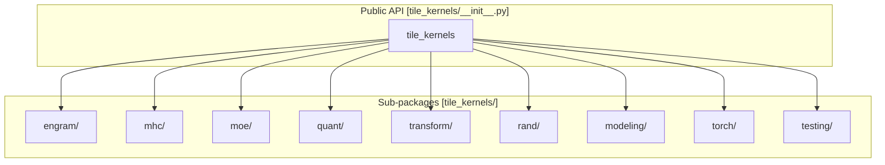
Sources: [tile_kernels/__init__.py:1-15]()

### Dual-Backend Execution Flow
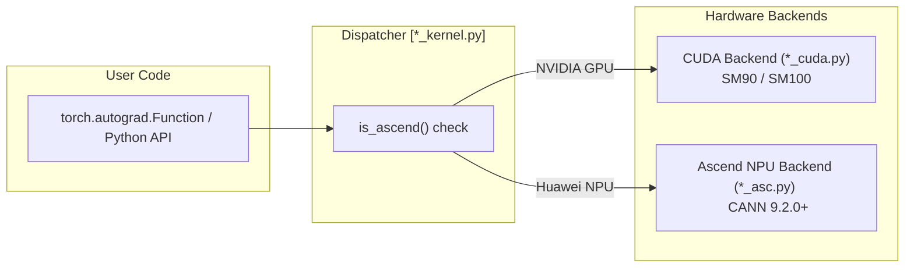
Sources: [README.md:3-9](), [tile_kernels/__init__.py:1-35]()

## Child Pages

*   **[Getting Started: Installation and Configuration](#1.1)** — Installation instructions, environment setup, test execution with `TK_TEST_LEVEL`, and runtime configuration APIs in `tile_kernels/config.py`.
*   **[Repository Layout and Package Structure](#1.2)** — Overview of top-level directories, the per-kernel file triple convention (`*_kernel.py`, `*_cuda.py`, `*_asc.py`), and symbol re-exporting.
*   **[Development Workflow and Tooling](#1.3)** — Contributor guidelines including pre-commit hooks, ruff formatting, style rules, and licensing.

---
**Sources:**
- [README.md:1-106]()
- [tile_kernels/__init__.py:1-39]()
- [LICENSE:1-21]()

---

# Page: Getting Started: Installation and Configuration

# Getting Started: Installation and Configuration

<details>
<summary>Relevant source files</summary>

The following files were used as context for generating this wiki page:

- [README.md](README.md)
- [pyproject.toml](pyproject.toml)
- [tile_kernels/config.py](tile_kernels/config.py)

</details>


This page provides a comprehensive technical guide for setting up the `TileKernels` environment, managing package dependencies and versioning via `pyproject.toml`, running tests across different test levels and benchmark flags, and utilizing the global runtime configuration API (`tile_kernels/config.py`).

## Purpose and Scope

`TileKernels` is a collection of high-performance kernels implemented in **TileLang**, supporting dual hardware backends: NVIDIA CUDA (SM90/SM100 architectures) and Huawei Ascend NPUs [README.md:3-3](). The library offers optimized implementations for mixture-of-experts (MoE) routing, Engram gating, quantization, and manifold hyper-connections (mHC) [README.md:13-19](). Proper installation ensures that the TileLang JIT compiler correctly targets the local hardware backend, while the runtime configuration API allows developers to tune core allocation, memory limits, token alignment, and execution modes.

Sources:
* `README.md:1-20()`
* `pyproject.toml:1-11()`

---

## Installation and Prerequisites

The build system relies on `setuptools` with dynamic versioning handled by `setuptools-scm`, which generates `tile_kernels/_version.py` from git tags [pyproject.toml:1-7]().

### Core Prerequisites & Dependencies
*   **Python**: `>=3.12` [pyproject.toml:36-36]()
*   **PyTorch**: `>=2.13` [pyproject.toml:33-33]()
*   **TileLang**: `>=0.1.15` [pyproject.toml:34-34]()
*   **CUDA Backend**: NVIDIA SM90 or SM100 architecture GPU with CUDA Toolkit 13.1 or higher [README.md:26-28]()
*   **Ascend Backend**: Ascend 950 NPU with CANN 9.2.0 or higher [README.md:29-31]()

### Installation Commands
To install a local editable development version with test dependencies (such as `pytest`, `pytest-xdist`, and `pytest-repeat`), run [README.md:35-39](), [pyproject.toml:46-47]():
```bash
pip install -e ".[dev]"
```

To install a release version from a distribution package [README.md:41-45]():
```bash
pip install tile-kernels
```

Sources:
* `README.md:21-46()`
* `pyproject.toml:1-48()`

---

## Running Tests and Benchmarks

Testing is managed via `pytest` with support for parallel execution (`pytest-xdist`) [README.md:49-49](), [pyproject.toml:47-47](). 

### Test Execution Commands
To run a specific test file for correctness using 4 parallel workers [README.md:54-54]():
```bash
python -m pytest tests/quant/test_per_token_cast.py -n 4
```

To execute both correctness tests and performance benchmarks on a test file [README.md:55-55]():
```bash
python -m pytest tests/quant/test_per_token_cast.py --run-benchmark
```

### Test Levels via Environment Variables
The test suite respects the `TK_TEST_LEVEL` environment variable to control test granularity and thoroughness [README.md:58-63]():
```bash
# Run core smoke tests across 4 workers
TK_TEST_LEVEL=0 python -m pytest -n 4

# Run full expanded test suites with repetition
TK_TEST_LEVEL=2 python -m pytest -n 4 --count 2
```

Sources:
* `README.md:47-64()`

---

## Runtime Configuration API (`tile_kernels/config.py`)

The `tile_kernels/config.py` module exposes a centralized runtime configuration interface [tile_kernels/config.py:1-134](). It handles backend detection, core counts, memory buffer limits, and clamping configurations.

### Key Configuration Functions and State

| Function / Symbol | Description | Implementation File & Line |
| :--- | :--- | :--- |
| `is_ascend()` | Detects if running on Ascend NPU by checking existence of `/dev/davinci_manager`. | `tile_kernels/config.py:24-26` [tile_kernels/config.py:24-26]() |
| `get_device()` | Returns `'npu'` if Ascend is detected, otherwise `'cuda'`. | `tile_kernels/config.py:29-31` [tile_kernels/config.py:29-31]() |
| `get_device_num_sms()` | Queries physical hardware properties for total SM count or cube core count. | `tile_kernels/config.py:39-47` [tile_kernels/config.py:39-47]() |
| `set_num_sms(num_sms)` | Manually overrides active streaming multiprocessor / core count. | `tile_kernels/config.py:49-52` [tile_kernels/config.py:49-52]() |
| `get_num_sms()` | Returns active SM count (defaults to hardware maximum if set to 0). | `tile_kernels/config.py:55-59` [tile_kernels/config.py:55-59]() |
| `get_num_ai_cores()` / `get_num_cube_cores()` | Aliases for `get_num_sms()` targeting AIC/Cube cores. | `tile_kernels/config.py:66-67` [tile_kernels/config.py:66-67]() |
| `get_num_vec_cores()` | Returns vector core count (`get_num_sms() * 2`). | `tile_kernels/config.py:70-71` [tile_kernels/config.py:70-71]() |
| `get_max_smem_per_sm()` | Returns CUDA shared memory per multiprocessor. | `tile_kernels/config.py:74-78` [tile_kernels/config.py:74-78]() |
| `get_max_ub_per_vector_core()` | Returns Ascend Unified Buffer (UB) limit per vector core. | `tile_kernels/config.py:80-84` [tile_kernels/config.py:80-84]() |
| `set_token_alignment(val)` / `get_token_alignment()` | Manages token alignment requirements (default: 128). | `tile_kernels/config.py:86-93` [tile_kernels/config.py:86-93]() |
| `set_pdl(use_pdl)` / `get_pdl()` | Controls Program Dependent Launch (PDL) settings. | `tile_kernels/config.py:105-112` [tile_kernels/config.py:105-112]() |
| `use_deterministic_algorithms()` | Enables or disables deterministic execution algorithms. | `tile_kernels/config.py:115-122` [tile_kernels/config.py:115-122]() |
| `set_amax_clamp_for_quant()` / `get_amax_clamp_for_quant()` | Manages minimum clamping thresholds for quantization formats (`e4m3`, `e2m1`). | `tile_kernels/config.py:125-134` [tile_kernels/config.py:125-134]() |
| `reset_runtime_config()` | Resets all runtime configuration variables back to default values. | `tile_kernels/config.py:96-103` [tile_kernels/config.py:96-103]() |

Sources:
* `tile_kernels/config.py:1-135()`

---

## Architecture and Data Flow

The following diagrams bridge natural language concepts to their concrete code entities, illustrating how package metadata and runtime configuration initialize and direct kernel execution.

**Build and Versioning Data Flow**
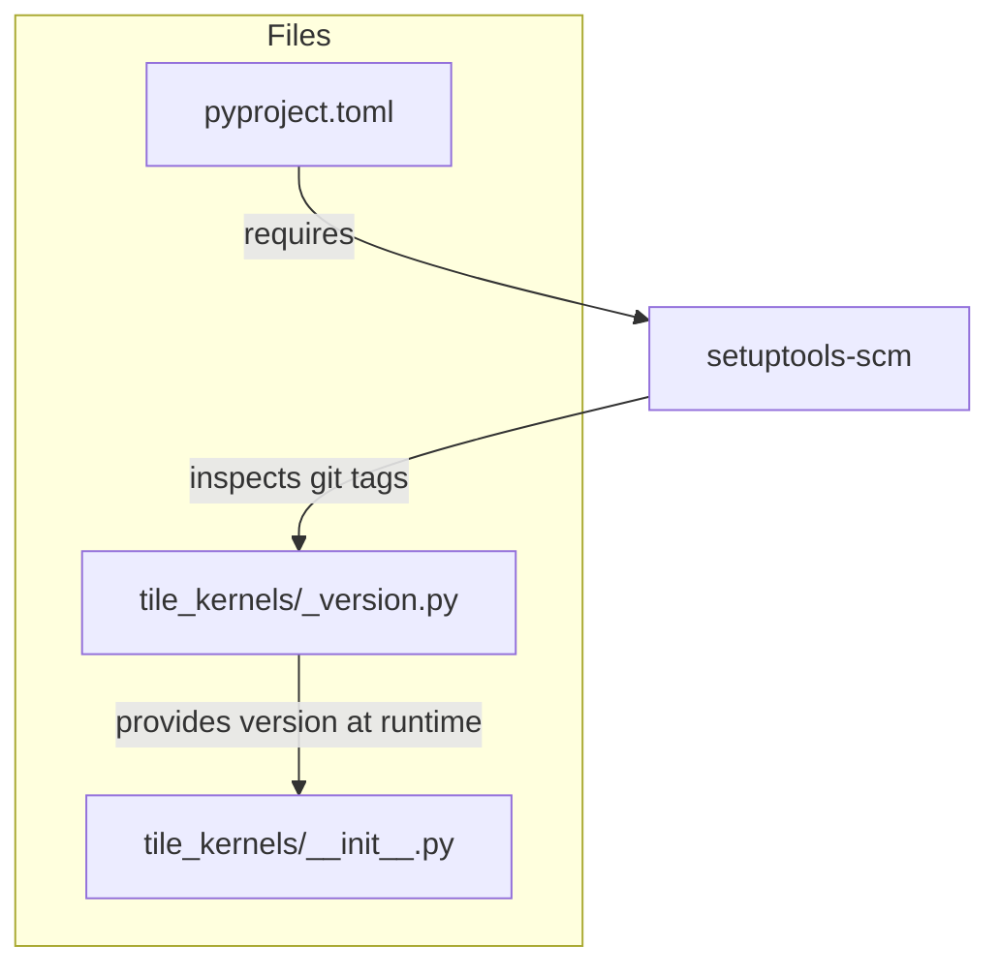
Sources:
* `pyproject.toml:1-7()`

**Runtime Configuration and Device Dispatch Data Flow**
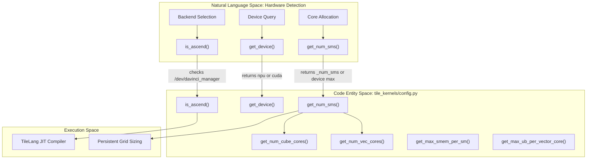
Sources:
* `tile_kernels/config.py:24-84()`

---

# Page: Repository Layout and Package Structure

# Repository Layout and Package Structure

<details>
<summary>Relevant source files</summary>

The following files were used as context for generating this wiki page:

- [README.md](README.md)
- [tile_kernels/__init__.py](tile_kernels/__init__.py)
- [tile_kernels/engram/__init__.py](tile_kernels/engram/__init__.py)
- [tile_kernels/mhc/__init__.py](tile_kernels/mhc/__init__.py)
- [tile_kernels/moe/__init__.py](tile_kernels/moe/__init__.py)

</details>


This page describes the physical and logical organizational structure of the `TileKernels` codebase. The architecture separates low-level kernel definitions into modular sub-packages, enforces a consistent multi-backend file convention, and uses explicit re-exports in `__init__.py` files to provide clean public APIs.

---

## Top-Level Directory Tree

The repository root houses the core library package `tile_kernels/`, the test suite `tests/`, and project metadata. The sub-packages under `tile_kernels/` partition the library by functional domain, while `tests/` mirrors this structure for unit and integration testing.

```txt
tile_kernels/
├── engram/     # Engram gating kernels
├── mhc/        # Manifold HyperConnection kernels
├── modeling/   # High-level autograd modeling layer (engram)
├── moe/        # Mixture of Experts routing kernels
├── quant/      # Quantization kernels
├── rand/       # Random number generator kernel
├── testing/    # Test and benchmark utilities
├── torch/      # PyTorch reference implementations
└── transform/  # Rotary position embedding kernel
```

**Sources:**
- [README.md:76-86]()
- [tile_kernels/__init__.py:3-15]()

---

## Package Structure and Data Flow

The internal structure of `tile_kernels/` mirrors the functional modules of the library. Sub-packages manage specific LLM primitives, relying on shared configuration in `tile_kernels/config.py` and utilities in `tile_kernels/utils.py`.

### Dependency and Import Graph

The following diagram illustrates how core sub-packages and auxiliary modules interact within the runtime environment.

**TileKernels Internal Dependency Flow**
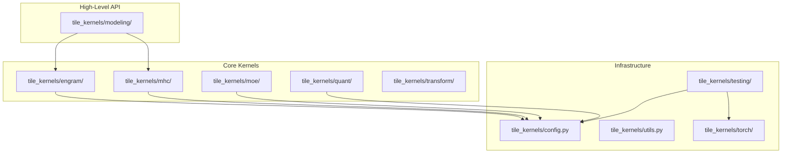
**Sources:**
- [tile_kernels/__init__.py:3-16]()

---

## The Per-Kernel File Triple Convention

To support dual hardware backends (NVIDIA CUDA and Huawei Ascend NPU) without cluttering the dispatch logic, TileKernels employs a three-file-per-kernel convention (the "file triple"):

1. **`*_kernel.py` (Dispatcher)**: Acts as the public entry point. It performs shape validation, dtype checks, dynamic tiling selection, and uses `tile_kernels.config.is_ascend()` to delegate compilation and execution to either the CUDA or Ascend factory.
2. **`*_cuda.py` (NVIDIA Backend)**: Contains the TileLang kernel definition (`@tilelang.jit`, `T.prim_func`) targeting NVIDIA SM90/SM100 architectures.
3. **`*_asc.py` (Ascend Backend)**: Contains the corresponding TileLang kernel definition optimized for Huawei Ascend NPU vector and cube cores.

---

## Symbol Re-Exporting via `__init__.py`

Each sub-package uses its `__init__.py` file to flatten module imports and expose a curated public interface. For instance, `tile_kernels/engram/__init__.py` [tile_kernels/engram/__init__.py:1-11]() imports core symbols directly from their respective internal modules:

```python
from .engram_fused_weight_kernel import fused_weight
from .engram_gate_bwd_kernel import engram_gate_bwd
from .engram_gate_fwd_kernel import engram_gate_fwd
from .engram_grad_w_reduce_kernel import grad_w_reduce
from .engram_hash_kernel import engram_hash
from .engram_sinkhorn_kernel import (
    engram_sinkhorn_finalize,
    engram_sinkhorn_momentum_update,
    engram_sinkhorn_step,
    engram_sinkhorn_step_reduce,
)
```

Similarly, `tile_kernels/mhc/__init__.py` [tile_kernels/mhc/__init__.py:1-17]() and `tile_kernels/moe/__init__.py` [tile_kernels/moe/__init__.py:1-4]() re-export their respective mix, norm, and top-k functions:

```python
from .expand_kernel import expand_to_mhc_bwd, expand_to_mhc_fwd
from .head_compute_mix_kernel import mhc_head_compute_mix_bwd, mhc_head_compute_mix_fwd
from .multilayer_recompute_kernel import mhc_multilayer_recompute
from .norm_fn_kernel import (
    mhc_fn_normw_merge_bwd,
    mhc_fn_normw_merge_fwd,
    mhc_reduce_partials_and_rmsnorm_bwd,
    mhc_reduce_partials_and_rmsnorm_fwd,
)
from .post_kernel import mhc_post_bwd, mhc_post_fwd
from .pre_apply_mix_kernel import mhc_pre_apply_mix_bwd, mhc_pre_apply_mix_fwd
from .pre_big_fuse_kernel import mhc_pre_big_fuse_fwd
from .pre_split_mixes_kernel import (
    mhc_pre_split_mixes_bwd,
    mhc_pre_split_mixes_fwd,
)
from .sinkhorn_kernel import mhc_sinkhorn_bwd, mhc_sinkhorn_fwd
```

**Sources:**
- [tile_kernels/engram/__init__.py:1-11]()
- [tile_kernels/mhc/__init__.py:1-17]()
- [tile_kernels/moe/__init__.py:1-4]()

---

## Code Entity Mapping

The following diagrams map conceptual architectural modules and per-kernel naming spaces to their concrete code entities within the repository.

**System Concept to Code Entity Mapping**
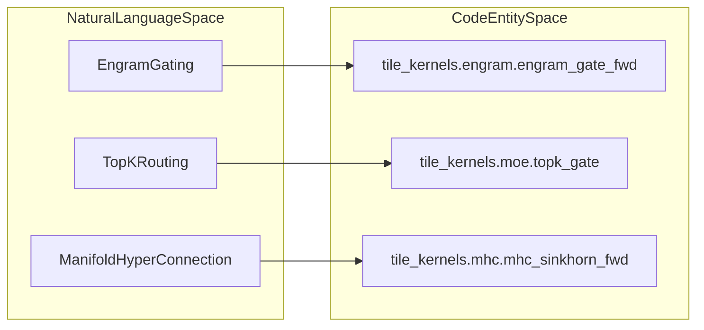

**Kernel Triple File Architecture Mapping**
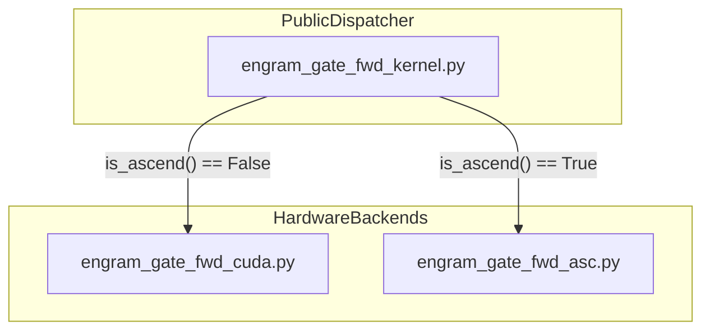

**Sources:**
- [tile_kernels/engram/__init__.py:1-4]()
- [tile_kernels/moe/__init__.py:2-4]()
- [tile_kernels/mhc/__init__.py:17]()

---

# Page: Development Workflow and Tooling

# Development Workflow and Tooling

<details>
<summary>Relevant source files</summary>

The following files were used as context for generating this wiki page:

- [.editorconfig](.editorconfig)
- [.gitignore](.gitignore)
- [.pre-commit-config.yaml](.pre-commit-config.yaml)
- [LICENSE](LICENSE)

</details>


## Purpose and Scope
This section covers the contributor tooling, style configurations, repository hygiene rules, and licensing infrastructure used within the TileKernels codebase. Maintaining consistent formatting, automated checks, and precise repository boundaries ensures stability across dual CUDA and Ascend NPU backends.

Sources: [.pre-commit-config.yaml:1-16](), [.editorconfig:1-58](), [.gitignore:1-23](), [LICENSE:1-21]()

---

## Pre-commit Infrastructure and Automation
TileKernels enforces code style, linting standards, and hygiene rules automatically using `pre-commit` hooks. The configuration is maintained in `.pre-commit-config.yaml`. 

The pipeline integrates two primary repositories:
1. `pre-commit/pre-commit-hooks`: Handles generic file hygiene such as removing trailing whitespaces and ensuring files terminate with a newline.
2. `astral-sh/ruff-pre-commit`: Executes `ruff` for ultra-fast Python linting with automatic fixing (`--fix`) and code formatting (`ruff-format`).

### Pre-commit Configuration Details
* **Trailing Whitespace Fixer**: Automatically strips trailing whitespaces from staged files (`[.pre-commit-config.yaml:5]()`).
* **End-of-File Fixer**: Ensures every file terminates with a newline character (`[.pre-commit-config.yaml:6]()`).
* **Ruff Linter**: Invokes `ruff` with the `--fix` argument to correct lint violations (`[.pre-commit-config.yaml:13-14]()`).
* **Ruff Formatter**: Invokes `ruff-format` to normalize Python syntax layout (`[.pre-commit-config.yaml:16]()`).

Title: Pre-commit Hook Pipeline Execution
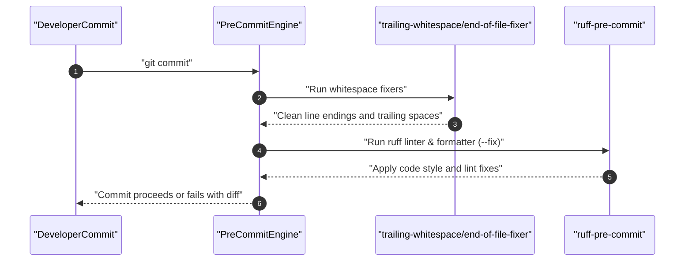

Sources: [.pre-commit-config.yaml:1-16]()

---

## Editor Configuration and Style Rules
To accommodate contributors using diverse IDEs and text editors, TileKernels standardizes text encoding, indentation, and line termination rules via `.editorconfig`.

The root configuration applies universal defaults, which are overridden for specific file extensions:
* **Universal Defaults**: UTF-8 character encoding, LF line endings, 4-space indentation, trailing whitespace trimming, and mandatory final newlines (`[.editorconfig:5-11]()`).
* **Python Files (`*.{py,pyi}`)**: Enforces 4-space indentation (`[.editorconfig:13-15]()`).
* **C/C++/CUDA Headers and Sources (`*.{cpp,hpp,cxx,cc,c,h,cu,cuh}`)**: Enforces 4-space indentation (`[.editorconfig:16-18]()`).
* **YAML Files (`*.{yaml,yml}`)**: Configures 2-space indentation (`[.editorconfig:25-27]()`).
* **Markdown and reStructuredText (`*.md`, `*.rst}`)**: Uses soft-wrap text formatting with specific indentation rules (`[.editorconfig:41-47]()`).
* **Exception Rule**: Test and example text files (`**/test{,s,ing}/**/*.txt`, `**/example{,s}/**/*.txt`) disable whitespace stripping and final newline insertion to preserve test fixtures (`[.editorconfig:52-59]`).

Title: Tooling Configuration Architecture
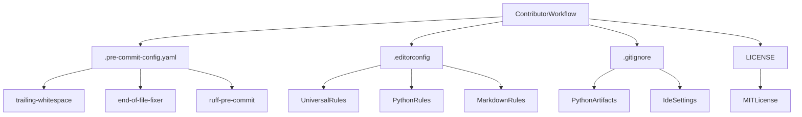

Sources: [.editorconfig:1-58]()

---

## Repository Hygiene and Exclusions
The `.gitignore` file defines patterns for files and directories that should be excluded from version control tracking. 

Key exclusion categories include:
* **Python Packaging and Build Artifacts**: Excludes `build/`, `dist/`, `*.egg-info`, compiled bytecode `*.pyc`, `__pycache__/`, and dynamically generated package version files like `_version.py` (`[.gitignore:2-14]()`).
* **IDE Configurations**: Ignores PyCharm settings (`.idea/`, `*.iml`, `*.iws`) and VSCode metadata (`/.vscode`) (`[.gitignore:8-18]()`).
* **Workspace Environments**: Excludes local `workspace/` directories and prompt/agent scratchpads (`AGENTS.md`) (`[.gitignore:20-23]`).

Sources: [.gitignore:1-23]()

---

## Licensing Information
TileKernels is distributed under the terms of the MIT License, granting broad permissions for commercial and non-commercial use, modification, and distribution, provided that the copyright notice and permission notice are included in all copies or substantial portions of the software (`[LICENSE:1-21]()`).

Sources: [LICENSE:1-21]()

---

# Page: Core Architecture: TileLang Kernel Framework

# Core Architecture: TileLang Kernel Framework

<details>
<summary>Relevant source files</summary>

The following files were used as context for generating this wiki page:

- [tile_kernels/config.py](tile_kernels/config.py)
- [tile_kernels/engram/engram_gate_fwd_kernel.py](tile_kernels/engram/engram_gate_fwd_kernel.py)
- [tile_kernels/mhc/sinkhorn_kernel.py](tile_kernels/mhc/sinkhorn_kernel.py)

</details>


This page provides an overview of the core architecture powering the TileKernels framework. TileKernels is built around **TileLang**, a domain-specific language that enables writing high-performance GPU and NPU kernels in Python while maintaining fine-grained control over memory hierarchies, asynchronous data movement, and hardware-specific execution grids. The framework relies on a robust dual-backend dispatch system, unified runtime configuration management, and modular kernel authoring idioms.

For detailed information on specific subsystems, refer to the child pages:
- [Dual-Backend Dispatch Pattern (_kernel / _cuda / _asc)](#2.1)
- [Device Configuration and Runtime Settings](#2.2)
- [Kernel Authoring Patterns](#2.3)

---

## 2.1 Dual-Backend Dispatch Pattern (`_kernel` / `_cuda` / `_asc`)

TileKernels employs a three-file convention per kernel to support both NVIDIA CUDA (SM90/SM100) and Huawei Ascend NPU hardware targets seamlessly from a unified Python API. The public-facing entry point resides in a `*_kernel.py` module (such as `tile_kernels/engram/engram_gate_fwd_kernel.py`), which handles input tensor shape and data type validation, allocates output tensors, and inspects runtime flags like `is_ascend()` [tile_kernels/config.py:24-26] to select the appropriate backend factory.

Depending on the active hardware device, the dispatcher invokes either the CUDA compilation factory (`get_*_cuda`) or the Ascend compilation factory (`get_*_asc`), leveraging Python's `functools.lru_cache` to compile and cache JIT kernels across identical shape and tuning parameters.

**Dual-Backend Dispatch Architecture**
```mermaid
graph TD
    subgraph "Public API Layer"
        A["engram_gate_fwd(hidden_states, kv, ...)"] --> B{"is_ascend()"}
    end

    subgraph "Backend Selection"
        B -->|False (CUDA)| C["get_engram_gate_fwd_kernel_cuda()"]
        B -->|True (Ascend)| D["get_engram_gate_fwd_kernel_asc()"]
    end

    subgraph "Compilation & Execution"
        C --> E["CUDA JIT Cache & Execution"]
        D --> F["Ascend JIT Cache & Execution"]
    end

    Sources["Sources: tile_kernels/engram/engram_gate_fwd_kernel.py, tile_kernels/config.py"]
```

For a comprehensive deep dive into the dispatch pattern, tiling-parameter selection loops, and caching strategies, see [Dual-Backend Dispatch Pattern (_kernel / _cuda / _asc)](#2.1).

---

## 2.2 Device Configuration and Runtime Settings

The `tile_kernels/config.py` module centralizes global runtime configurations, hardware capability queries, and environment tuning parameters. It exposes helper functions to detect the underlying hardware target via `is_ascend()` [tile_kernels/config.py:24-26] and `get_device()` [tile_kernels/config.py:29-32], query core counts across architectures (`get_num_sms()`, `get_num_cube_cores()`, `get_num_vec_cores()`) [tile_kernels/config.py:55-71], and inspect hardware memory bounds such as shared memory per SM or Unified Buffer (UB) limits (`get_max_smem_per_sm()`, `get_max_ub_per_vector_core()`) [tile_kernels/config.py:74-83].

Additionally, the configuration module manages token alignment constraints, Program Dependent Launch (PDL) flags, deterministic execution modes, quantization clamp-min thresholds, and provides a `reset_runtime_config()` utility to restore default states [tile_kernels/config.py:86-103].

**Configuration and Hardware Query Flow**
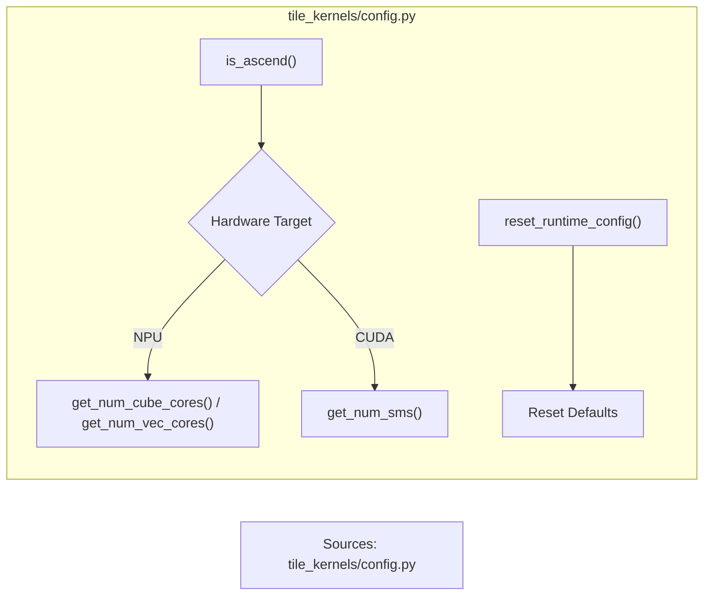

For detailed documentation on configuration APIs, memory limits, and quantization settings, see [Device Configuration and Runtime Settings](#2.2).

---

## 2.3 Kernel Authoring Patterns

TileLang kernels across the codebase share consistent authoring idioms designed to maximize hardware utilization. Kernels are marked with the `@tilelang.jit` decorator alongside specific pass configurations, wrapping a `T.prim_func` entry point. Inside the primitive function, `T.Kernel` establishes persistent execution grids where block counts are decoupled from total workload sizes to improve cache locality and occupancy.

Memory management is handled explicitly through `T.alloc_shared` and `T.alloc_local`, paired with asynchronous copy primitives (`T.async_copy`) and pipelining structures to overlap global memory latency with computation. Furthermore, kernels utilize warp and block reductions, vectorized loops (`T.vectorized`), and Ascend-specific vector-core patterns.

For detailed code examples and explanations of TileLang idioms, asynchronous pipelines, and reduction patterns, see [Kernel Authoring Patterns](#2.3).

---

**Sources:**
- [tile_kernels/config.py:1-134]()
- [tile_kernels/engram/engram_gate_fwd_kernel.py:1-85]()
- [tile_kernels/mhc/sinkhorn_kernel.py:1-21]()

---

# Page: Dual-Backend Dispatch Pattern (_kernel / _cuda / _asc)

# Dual-Backend Dispatch Pattern (_kernel / _cuda / _asc)

<details>
<summary>Relevant source files</summary>

The following files were used as context for generating this wiki page:

- [tile_kernels/config.py](tile_kernels/config.py)
- [tile_kernels/engram/engram_gate_fwd_asc.py](tile_kernels/engram/engram_gate_fwd_asc.py)
- [tile_kernels/engram/engram_gate_fwd_cuda.py](tile_kernels/engram/engram_gate_fwd_cuda.py)
- [tile_kernels/engram/engram_gate_fwd_kernel.py](tile_kernels/engram/engram_gate_fwd_kernel.py)

</details>


## Purpose and Scope
This page details the core dual-backend dispatch architecture used across the TileKernels codebase. TileKernels implements a rigid three-file convention (`*_kernel.py`, `*_cuda.py`, and `*_asc.py`) for every compute kernel to cleanly separate public API validation from hardware-specific JIT compilation and execution logic for NVIDIA CUDA (SM90/SM100) and Ascend NPU architectures.

---

## 1. The Three-File Convention & Public Wrapper (`*_kernel.py`)

Every kernel subsystem adheres to a strict modular split:
- **`*_kernel.py`**: The public-facing Python module containing tensor shape/dtype validation, intermediate tensor allocations, and the high-level dispatcher function.
- **`*_cuda.py`**: The NVIDIA CUDA implementation utilizing TileLang primitives, asynchronous copies (`T.async_copy`), and thread/block bindings.
- **`*_asc.py`**: The Huawei Ascend NPU implementation targeting vector/cube core layouts with SIMD intrinsics (`T.SimdVF`, `S.vld`, etc.).

For example, in the Engram gate subsystem, `engram_gate` is exposed via `tile_kernels/engram/engram_gate_fwd_kernel.py` [tile_kernels/engram/engram_gate_fwd_kernel.py:7-16](). It validates incoming tensor shapes (`hidden_states`, `kv`, `weight_fused`), computes scalar factors, handles `inplace` vs out-of-place buffer allocation, and triggers the appropriate backend factory.

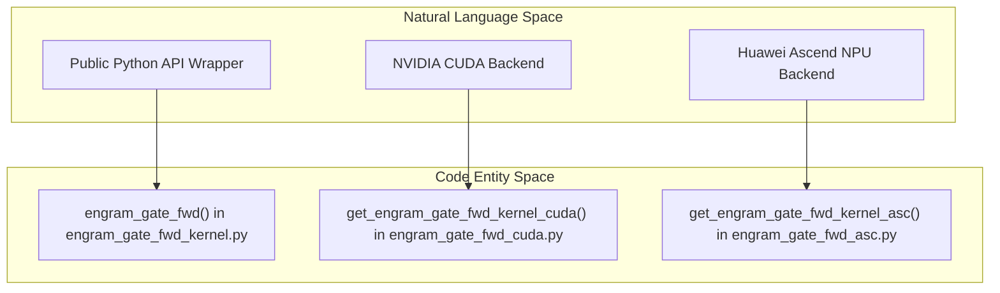

**Sources:**
- `tile_kernels/engram/engram_gate_fwd_kernel.py:1-86`
- `tile_kernels/config.py:24-32`

---

## 2. Backend Selection and Factory Delegation (`is_ascend()`)

At runtime, the dispatcher checks the hardware target via `is_ascend()` defined in `tile_kernels/config.py` [tile_kernels/config.py:24-27](). The `is_ascend()` function checks for the existence of `/dev/davinci_manager` with an `@functools.lru_cache(maxsize=1)` decorator to ensure fast, memoized hardware detection.

Depending on the result, the wrapper imports and executes either the CUDA kernel factory or the Ascend kernel factory:

```python
if is_ascend():
    from tile_kernels.engram.engram_gate_fwd_asc import get_engram_gate_fwd_kernel_asc
    kernel = get_engram_gate_fwd_kernel_asc(...)
else:
    kernel = get_engram_gate_fwd_kernel_cuda(...)
```

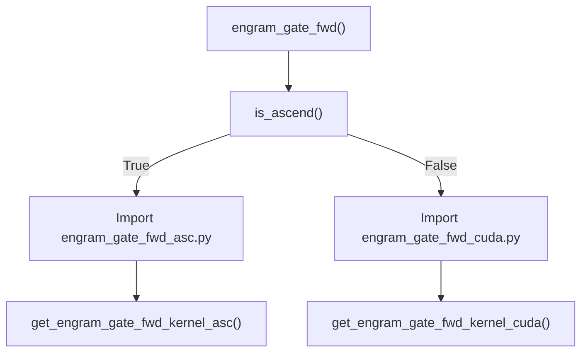

**Sources:**
- `tile_kernels/config.py:24-32`
- `tile_kernels/engram/engram_gate_fwd_kernel.py:35-61`

---

## 3. Tiling-Parameter Selection Loops & Dynamic Configurations

Before compiling or invoking kernels, dispatchers and factory functions execute heuristic loops to select optimal tiling parameters based on hardware properties (such as SM counts or shared memory limits).

In `get_engram_gate_fwd_kernel_cuda`, two helper functions dynamically select block sizes (`blk_d`) and persistent block counts based on `hidden_size` and device shared memory limits [tile_kernels/engram/engram_gate_fwd_cuda.py:32-46]():

- `_choose_blk_d(hidden_size)`: Iterates through candidate block dimensions `[1024, 768, 512, 256]` to find the largest factor compatible with the hidden dimension.
- `_choose_num_persistent_blocks(...)`: Computes block occupancy per SM using `get_max_smem_per_sm()` [tile_kernels/config.py:74-78]() and caps it against register pressure limits.

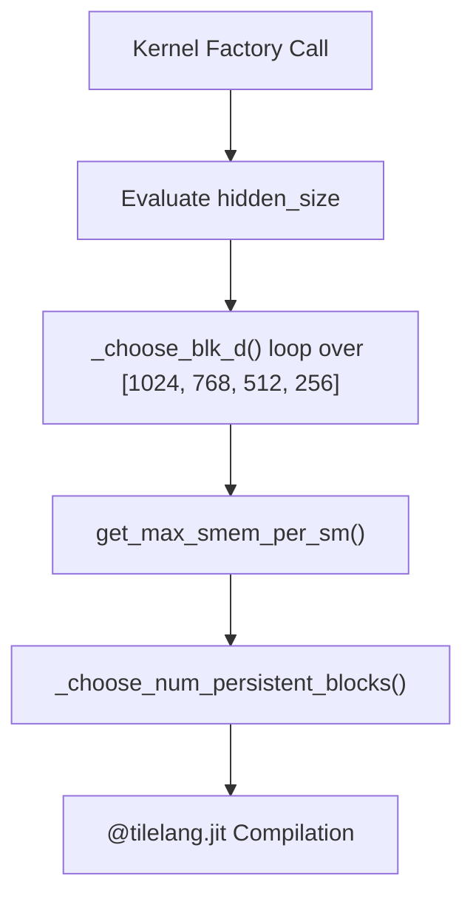

**Sources:**
- `tile_kernels/config.py:74-78`
- `tile_kernels/engram/engram_gate_fwd_cuda.py:32-46`

---

## 4. JIT Compilation, Caching (`@tilelang.jit`), and Execution

Compiled kernel factories are decorated with `@tilelang.jit`, which leverages Python's `functools.lru_cache` mechanism under the hood to cache generated binary artifacts for specific shape configurations and parameter sets. 

For CUDA kernels, pass configurations can be explicitly customized within the decorator (e.g., disabling warp specialization or thread storage sync) [tile_kernels/engram/engram_gate_fwd_cuda.py:7-12]():

```python
@tilelang.jit(
    pass_configs={
        tilelang.PassConfigKey.TL_DISABLE_WARP_SPECIALIZED: True,
        tilelang.PassConfigKey.TL_DISABLE_THREAD_STORAGE_SYNC: True,
    },
)
```

Once the compiled `kernel` callable is returned to the public wrapper, it is invoked with the validated PyTorch tensors [tile_kernels/engram/engram_gate_fwd_kernel.py:72-83]():

```python
if num_tokens > 0:
    kernel(
        hidden_states,
        kv,
        weight_fused,
        image_token_mask,
        None if inplace else output,
        dot,
        gate_score,
        rstd_x,
        rstd_k,
    )
```

**Sources:**
- `tile_kernels/engram/engram_gate_fwd_cuda.py:7-24`
- `tile_kernels/engram/engram_gate_fwd_kernel.py:72-85`

---

# Page: Device Configuration and Runtime Settings

# Device Configuration and Runtime Settings

<details>
<summary>Relevant source files</summary>

The following files were used as context for generating this wiki page:

- [tile_kernels/config.py](tile_kernels/config.py)

</details>


## Purpose and Scope
This page documents the global configuration and runtime settings module located at `tile_kernels/config.py`. This subsystem manages hardware abstraction across dual backends (CUDA and Ascend NPU), provides SM and core count accessors, defines shared-memory and Unified Buffer (UB) constraints, configures token alignment, persistent data loading (PDL), deterministic execution modes, quantization clamping thresholds, and supports test-time state resets via `reset_runtime_config()`.

---

## 1. Device Detection and Backend Selection

The configuration module determines whether the current execution runtime targets an NVIDIA CUDA GPU or an Ascend NPU. This detection occurs through physical device file inspection and is cached using `functools.lru_cache` to eliminate repeated filesystem or driver query overhead [tile_kernels/config.py:24-32]().

- **`is_ascend() -> bool`**: Checks for the existence of the Ascend driver device file `/dev/davinci_manager` [tile_kernels/config.py:24-27]().
- **`get_device() -> str`**: Returns `'npu'` if `is_ascend()` evaluates to `True`, otherwise returns `'cuda'` [tile_kernels/config.py:29-32]().

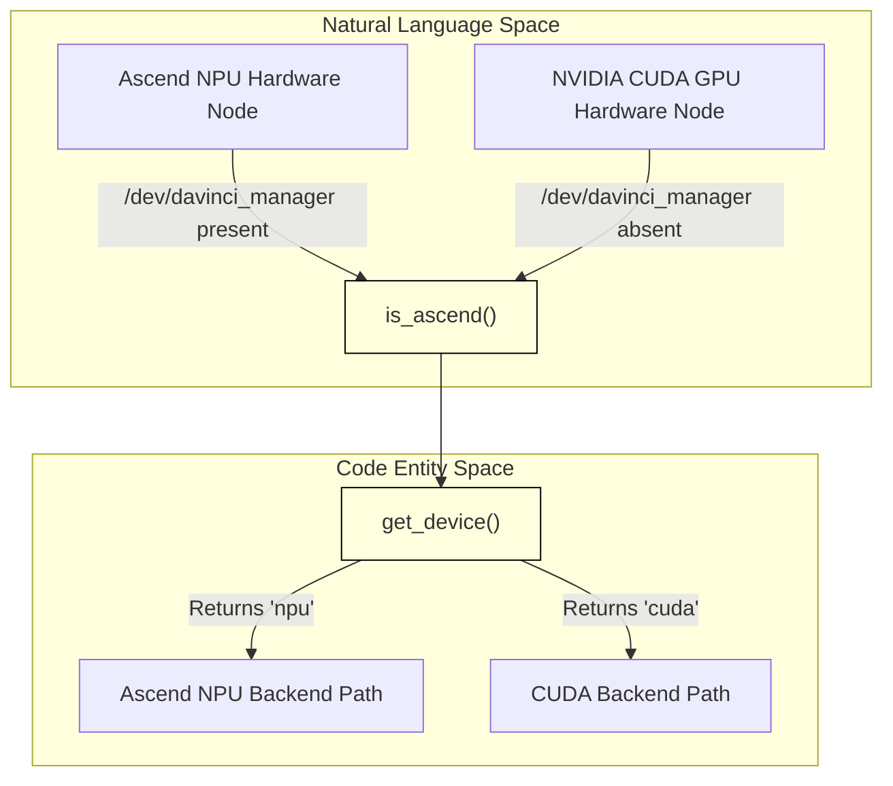

**Sources:** [tile_kernels/config.py:24-32]()

---

## 2. Core and SM Count Accessors

Kernel scheduling, thread block grid dimensions, and resource allocations depend heavily on hardware core counts. The module provides unified accessors that abstract backend differences between NVIDIA Multiprocessors (SMs) and Ascend NPU Core topologies [tile_kernels/config.py:39-72]().

- **`get_device_num_sms() -> int`**: Queries device properties via `torch.npu` (fetching `cube_core_num`) when running on Ascend, or `torch.cuda` (fetching `multi_processor_count`) on NVIDIA hardware [tile_kernels/config.py:39-47]().
- **`set_num_sms(num_sms: int)`**: Manually overrides the active SM or core count used by the library, validating that `0 < num_sms <= get_device_num_sms()` [tile_kernels/config.py:49-53]().
- **`get_num_sms() -> int`**: Returns the overridden `_num_sms` if explicitly configured, otherwise falls back to `get_device_num_sms()` [tile_kernels/config.py:55-60]().
- **Core Aliases**: 
  - `get_num_ai_cores = get_num_sms` [tile_kernels/config.py:66-66]()
  - `get_num_cube_cores = get_num_sms` [tile_kernels/config.py:67-67]()
- **`get_num_vec_cores() -> int`**: Returns double the active SM count (`get_num_sms() * 2`), reflecting the vector-to-cube core ratio on Ascend architectures [tile_kernels/config.py:70-71]().

**Sources:** [tile_kernels/config.py:39-72]()

---

## 3. Shared Memory and Unified Buffer Limits

Memory allocation bounds within TileLang kernels (`T.alloc_shared`, buffer sizes) are bound by hardware capacities retrieved through configuration accessors [tile_kernels/config.py:74-84]().

- **`get_max_smem_per_sm() -> int`**: Retrieves `shared_memory_per_multiprocessor` from the current CUDA device properties [tile_kernels/config.py:74-78]().
- **`get_max_ub_per_vector_core(use_simt: bool = True) -> int`**: Asserts that `is_ascend()` is active and returns the Unified Buffer (UB) limit per vector core (`216 * 1024` bytes when `use_simt=True`, otherwise `248 * 1024` bytes) [tile_kernels/config.py:80-84]().

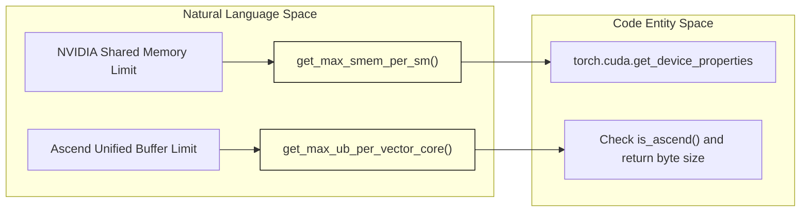

**Sources:** [tile_kernels/config.py:74-84]()

---

## 4. Runtime Feature Flags and Quantization Settings

The module maintains global runtime variables controlling padding alignments, execution determinism, data loading optimizations, and quantization clamp-min boundaries [tile_kernels/config.py:6-21](), [tile_kernels/config.py:86-134]().

### Token Alignment and PDL
- **Token Alignment**: Managed via `set_token_alignment(token_alignment: int)` and `get_token_alignment()` (default: `128`) [tile_kernels/config.py:86-93]().
- **Persistent Data Loading (PDL)**: Controlled via `set_pdl(use_pdl: bool)` and `get_pdl()` (default: `False`) [tile_kernels/config.py:105-112]().

### Deterministic Execution
- **Deterministic Mode**: Configured via `use_deterministic_algorithms(enabled: bool)` and `get_deterministic_algorithms()` (default: `False`) [tile_kernels/config.py:115-122]().

### Quantization Clamp-Min Values
Quantization formats (`e4m3`, `e2m1`) rely on minimum clamping thresholds to prevent underflow during scaling factor computations.
- **Default Registry (`_DEFAULT_CLAMP_MIN_VALUES`)**:
  - `('e4m3', False)`: `1e-4` [tile_kernels/config.py:11-11]()
  - `('e4m3', True)`: `float(T.max_value(T.float8_e4m3fn)) * (2**-9)` [tile_kernels/config.py:12-12]()
  - `('e2m1', False)`: `float(T.max_value(T.float4_e2m1fn) * (2**-126))` [tile_kernels/config.py:13-13]()
  - `('e2m1', True)`: `float(T.max_value(T.float4_e2m1fn)) * (2**-9)` [tile_kernels/config.py:14-14]()
- **Accessors**: `set_amax_clamp_for_quant(fmt: str, use_e4m3_sf: bool, clamp_min_value: float)` and `get_amax_clamp_for_quant(fmt: str, use_e4m3_sf: bool)` [tile_kernels/config.py:125-134](). `_validate_quant_fmt(fmt)` ensures only valid formats (`e4m3`, `e2m1`) are accepted [tile_kernels/config.py:34-37]().

**Sources:** [tile_kernels/config.py:6-21](), [tile_kernels/config.py:34-37](), [tile_kernels/config.py:86-134]()

---

## 5. Runtime State Resetting

To support test isolation and clean test suite teardowns, all global configuration variables can be restored to their factory defaults via `reset_runtime_config()` [tile_kernels/config.py:96-103]().

- **`reset_runtime_config()`**: Resets `_num_sms`, `_use_pdl`, `_deterministic_algorithms`, `_token_alignment`, and a copy of `_DEFAULT_CLAMP_MIN_VALUES` back to their initial default states [tile_kernels/config.py:96-103]().

**Sources:** [tile_kernels/config.py:96-103]()

---

# Page: Kernel Authoring Patterns

# Kernel Authoring Patterns

<details>
<summary>Relevant source files</summary>

The following files were used as context for generating this wiki page:

- [tile_kernels/engram/engram_gate_bwd_asc.py](tile_kernels/engram/engram_gate_bwd_asc.py)
- [tile_kernels/engram/engram_gate_bwd_cuda.py](tile_kernels/engram/engram_gate_bwd_cuda.py)
- [tile_kernels/mhc/pre_big_fuse_cuda.py](tile_kernels/mhc/pre_big_fuse_cuda.py)
- [tile_kernels/mhc/sinkhorn_cuda.py](tile_kernels/mhc/sinkhorn_cuda.py)

</details>


This page provides a comprehensive deep dive into the recurring architectural patterns, compilation configurations, and memory idioms used to implement high-performance kernels across CUDA (SM90/SM100) and Ascend NPU backends within the `TileKernels` library.

---

## 1. Kernel Definition and JIT Compilation

All kernels in `TileKernels` are defined using the `@tilelang.jit` decorator combined with the `T.prim_func` abstraction. This structure enables dynamic kernel generation based on runtime parameters such as `hidden_size`, `hc_mult`, and `num_vec_cores`.

### Pass Configuration
The `@tilelang.jit` decorator accepts a `pass_configs` dictionary to fine-tune the TileLang compiler pipeline. Common optimization keys include:
*   `TL_DISABLE_WARP_SPECIALIZED`: Disables automatic warp specialization, allowing manual thread and warp management [tile_kernels/engram/engram_gate_bwd_cuda.py:11-11](), [tile_kernels/mhc/pre_big_fuse_cuda.py:5-5]().
*   `TL_DISABLE_THREAD_STORAGE_SYNC`: Prevents automatic compiler-inserted sync barriers, giving the author explicit control over memory consistency [tile_kernels/engram/engram_gate_bwd_cuda.py:12-12]().
*   `TL_PTXAS_REGISTER_USAGE_LEVEL`: Controls register allocation strictness in `ptxas` [tile_kernels/mhc/pre_big_fuse_cuda.py:6-6]().
*   `TL_DISABLE_VECTORIZE_256`: Disables 256-bit vectorization passes when custom layouts are preferred [tile_kernels/mhc/pre_big_fuse_cuda.py:7-7]().

### Launch Grids and Persistent Scheduling
Kernels frequently employ persistent grid designs via `T.Kernel`, where a fixed block count loops over the global workload (such as tokens or channels) to maximize cache reuse and amortize launch overhead [tile_kernels/engram/engram_gate_bwd_cuda.py:116-116](), [tile_kernels/mhc/sinkhorn_cuda.py:24-24](). Dynamic dimensions like token counts are declared using `T.dynamic('num_tokens')` [tile_kernels/engram/engram_gate_bwd_cuda.py:31-31](), [tile_kernels/mhc/pre_big_fuse_cuda.py:30-30]().

Sources: [tile_kernels/engram/engram_gate_bwd_cuda.py:9-24](), [tile_kernels/mhc/pre_big_fuse_cuda.py:4-29](), [tile_kernels/mhc/sinkhorn_cuda.py:9-17]()

---

## 2. Memory Hierarchy Management

`TileKernels` explicitly manages device memory hierarchies—Global Memory (GMEM), Shared Memory (SMEM), and Registers (Local)—using TileLang allocation primitives and custom layouts.

### Allocation Primitives
*   `T.alloc_shared`: Allocates shared memory buffers accessible by all threads within a CTA block [tile_kernels/engram/engram_gate_bwd_cuda.py:150-155](), [tile_kernels/mhc/sinkhorn_cuda.py:91-92]().
*   `T.alloc_local`: Allocates thread-private registers for accumulators and vector elements [tile_kernels/engram/engram_gate_bwd_cuda.py:125-136]().
*   `T.alloc_fragment`: Allocates fragment layouts optimized for tensor core math or parallel block reductions [tile_kernels/mhc/pre_big_fuse_cuda.py:51-52](), [tile_kernels/mhc/sinkhorn_cuda.py:27-29]().

### Data Flow and Memory Layouts
In CUDA implementations, custom fragments and layouts map logical tensor indices to physical thread lanes using layout functions [tile_kernels/engram/engram_gate_bwd_cuda.py:146-148]().

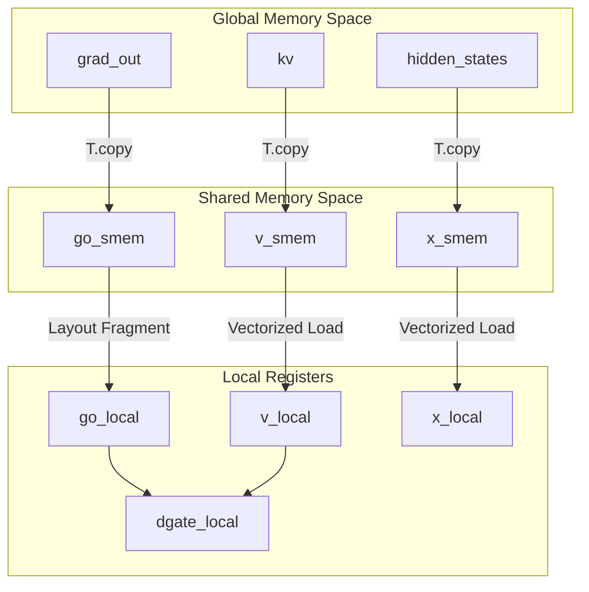
*Figure 1: Memory hierarchy data flow from Global Memory through Shared Memory into Local Registers during backward passes.*

Sources: [tile_kernels/engram/engram_gate_bwd_cuda.py:125-155](), [tile_kernels/mhc/pre_big_fuse_cuda.py:49-63](), [tile_kernels/mhc/sinkhorn_cuda.py:27-31]()

---

## 3. Pipelining, Async Copies, and Synchronization

To hide memory latency, kernels use pipelined loops and asynchronous transfers.

*   `T.Pipelined`: Overlaps global memory data movement with arithmetic computation by staging multiple iterations in shared memory [tile_kernels/mhc/pre_big_fuse_cuda.py:120-120]().
*   Cache Control: Transfers can specify L2 cache control flags such as `l2_cache_ctrl='NOTALLOC_KEEP'` to manage cache eviction policies [tile_kernels/engram/engram_gate_bwd_asc.py:101-102]().
*   Program Dependent Launch (PDL): Optional synchronization barriers (`T.pdl_sync()` and `T.pdl_trigger()`) coordinate dependent kernel execution phases [tile_kernels/engram/engram_gate_bwd_cuda.py:117-118](), [tile_kernels/mhc/pre_big_fuse_cuda.py:45-46]().

Sources: [tile_kernels/engram/engram_gate_bwd_asc.py:101-107](), [tile_kernels/engram/engram_gate_bwd_cuda.py:117-118](), [tile_kernels/mhc/pre_big_fuse_cuda.py:45-46](), [tile_kernels/mhc/pre_big_fuse_cuda.py:120-124]()

---

## 4. Reductions and Loop Optimizations

Efficient loop structuring and reduction primitives prevent bottlenecking in normalization and mixing layers.

*   `T.Parallel`: Distributes work across parallel threads or fragment dimensions [tile_kernels/mhc/pre_big_fuse_cuda.py:58-62](), [tile_kernels/mhc/sinkhorn_cuda.py:35-36]().
*   `T.reduce_max` / `T.reduce_sum`: Performs hardware-accelerated reductions across specified tensor dimensions during Sinkhorn normalization and softmax calculations [tile_kernels/mhc/pre_big_fuse_cuda.py:81-89](), [tile_kernels/mhc/sinkhorn_cuda.py:34-41]().
*   `T.unroll`: Forces compiler loop unrolling for small inner loops (e.g., Sinkhorn iteration steps), eliminating branch overhead [tile_kernels/mhc/sinkhorn_cuda.py:111-123]().

Sources: [tile_kernels/mhc/pre_big_fuse_cuda.py:58-92](), [tile_kernels/mhc/sinkhorn_cuda.py:34-53](), [tile_kernels/mhc/sinkhorn_cuda.py:111-123]()

---

## 5. Ascend-Specific Vector-Core Patterns

Ascend NPU kernels target vector cores using TileLang's Ascend language extension (`tilelang.ascend`), which employs SIMD instruction wrappers and specialized vector buffers.

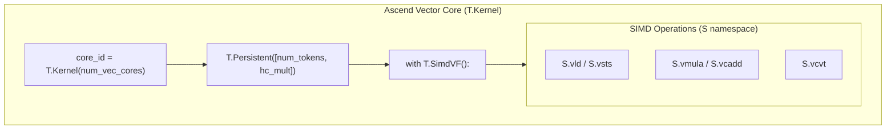
*Figure 2: Execution and control flow structure of Ascend NPU vector-core kernels.*

### Ascend Idioms and Intrinsics
*   **Vector Core Launch**: Kernels are launched across vector cores using `with T.Kernel(num_vec_cores) as core_id:` [tile_kernels/engram/engram_gate_bwd_asc.py:47-47]().
*   **Persistent Task Scheduling**: Workloads are distributed across cores using `T.Persistent` with configurable stages [tile_kernels/engram/engram_gate_bwd_asc.py:72-78]().
*   **SIMD Blocks**: Vector instructions are encapsulated within `with T.SimdVF():` blocks [tile_kernels/engram/engram_gate_bwd_asc.py:69-70]() and operate via the `S` namespace (`S.vdup`, `S.vld`, `S.vsts`, `S.vmula`, `S.vcadd`, `S.vcvt`) [tile_kernels/engram/engram_gate_bwd_asc.py:83-121]().
*   **Buffer Versioning**: `T.annotate_buffer_versions` tracks shared memory buffer state across pipeline stages [tile_kernels/engram/engram_gate_bwd_asc.py:58-67]().

Sources: [tile_kernels/engram/engram_gate_bwd_asc.py:47-121]()

---

# Page: Engram Module

# Engram Module

<details>
<summary>Relevant source files</summary>

The following files were used as context for generating this wiki page:

- [tile_kernels/engram/__init__.py](tile_kernels/engram/__init__.py)
- [tile_kernels/engram/engram_gate_fwd_kernel.py](tile_kernels/engram/engram_gate_fwd_kernel.py)

</details>


The Engram module provides a high-performance implementation of the Engram gating mechanism. This subsystem is designed to perform a fused gating operation that combines RMSNorm, a dot-product interaction, and a non-linear activation (signed-square-root sigmoid) to modulate hidden states.

The module is split into child pages covering specific low-level kernels and PyTorch modeling integrations:
- **[Engram Gate Forward and Backward Kernels (#3.1)]** — Reference for `engram_gate_fwd` and `engram_gate_bwd`.
- **[Engram Weight, Hash and Sinkhorn Kernels (#3.2)]** — Covers `fused_weight`, `grad_w_reduce`, `engram_hash`, and Sinkhorn normalization.
- **[EngramGateFn: Autograd Integration (#3.3)]** — Documents `tile_kernels/modeling/engram/engram_gate.py` and the `EngramGateFn` wrapper.

### Mathematical Definition
The Engram Gate computes the following interaction:

$$ \text{gate} = \sigma\left(\text{signed\_sqrt}\left(\frac{\text{RMSNorm}(x, w_h) \cdot \text{RMSNorm}(k, w_e)}{\sqrt{d}}\right)\right) $$
$$ \text{output} = x + \text{gate} \cdot v $$

Where:
*   $\sigma$ is the Sigmoid function.
*   $\text{signed\_sqrt}(a) = \text{sign}(a) \cdot \sqrt{|a|}$.
*   $d$ is the hidden dimension size.
*   $w_h$ and $w_e$ are learnable RMSNorm weights.

## Module Structure

The following diagram illustrates how the modeling layer interfaces with the low-level TileLang kernels.

**Engram System Architecture**
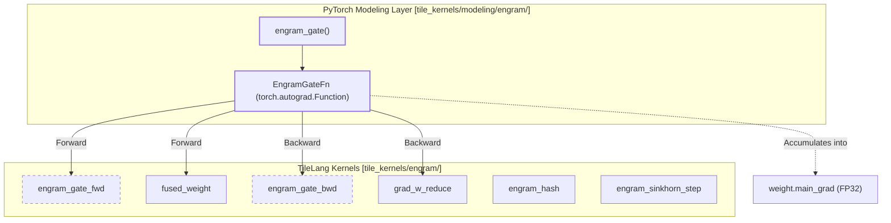
**Sources:** [tile_kernels/modeling/engram/engram_gate.py:6-95](), [tile_kernels/engram/__init__.py:1-11]()

## Exported Subsystems and Kernels

The Engram module exports several primary kernels for gating, weights, hashing, and Sinkhorn normalization to minimize global memory round-trips by fusing normalization and element-wise logic.

| Kernel / Function Name | Purpose | File Reference |
| :--- | :--- | :--- |
| `engram_gate_fwd` | Fused RMSNorm + Dot Product + Gating + Addition. | [tile_kernels/engram/__init__.py:3]() |
| `engram_gate_bwd` | Persistent backward kernel for gradients of $x, k, v$. | [tile_kernels/engram/__init__.py:2]() |
| `fused_weight` | Element-wise product of $w_h$ and $w_e$ used in the forward pass. | [tile_kernels/engram/__init__.py:1]() |
| `grad_w_reduce` | Reduces partial weight gradients into high-precision buffers. | [tile_kernels/engram/__init__.py:4]() |
| `engram_hash` | Utility for specialized Engram hashing operations. | [tile_kernels/engram/__init__.py:5]() |
| `engram_sinkhorn_step` | Sinkhorn normalization steps for dual-stochastic attention/weights. | [tile_kernels/engram/__init__.py:6-10]() |

For details, see [Engram Gate Forward and Backward Kernels (#3.1)] and [Engram Weight, Hash and Sinkhorn Kernels (#3.2)].

## Autograd Integration

The `EngramGateFn` class bridges the optimized kernels with PyTorch's autograd engine. It handles complex tensor reshaping for multi-head configurations and implements a custom gradient accumulation pattern.

### Key Features:
*   **Shape Management**: Handles inputs of shape `[*, hc_mult, hidden_size]` and ensures the output matches the input dimensionality.
*   **Gradient Accumulation**: The backward pass checks for the existence of a `.main_grad` attribute on weight tensors, accumulating gradients in-place in FP32.
*   **Memory Efficiency**: Saves intermediate values like `rstd_x` (inverse standard deviation) and `gate_score` during the forward pass.

For details on the autograd lifecycle and the `main_grad` pattern, see **[EngramGateFn: Autograd Integration (#3.3)]**.

**Sources:** [tile_kernels/modeling/engram/engram_gate.py:6-95]()

## Data Flow Mapping

The following diagram maps the logical variables used in the mathematical definition to the specific tensor names used in the code implementation.

**Natural Language to Code Entity Mapping**
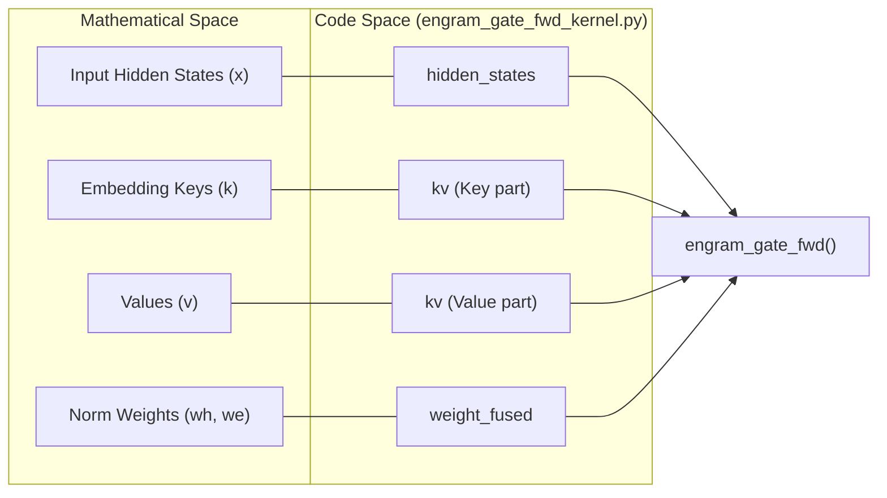
**Sources:** [tile_kernels/engram/engram_gate_fwd_kernel.py:7-32]()

---

# Page: Engram Gate Forward and Backward Kernels

# Engram Gate Forward and Backward Kernels

<details>
<summary>Relevant source files</summary>

The following files were used as context for generating this wiki page:

- [tile_kernels/engram/engram_gate_bwd_asc.py](tile_kernels/engram/engram_gate_bwd_asc.py)
- [tile_kernels/engram/engram_gate_bwd_cuda.py](tile_kernels/engram/engram_gate_bwd_cuda.py)
- [tile_kernels/engram/engram_gate_bwd_kernel.py](tile_kernels/engram/engram_gate_bwd_kernel.py)
- [tile_kernels/engram/engram_gate_fwd_asc.py](tile_kernels/engram/engram_gate_fwd_asc.py)
- [tile_kernels/engram/engram_gate_fwd_cuda.py](tile_kernels/engram/engram_gate_fwd_cuda.py)
- [tile_kernels/engram/engram_gate_fwd_kernel.py](tile_kernels/engram/engram_gate_fwd_kernel.py)

</details>


## Purpose and Scope

This page details the implementation of the Engram gating forward (`engram_gate_fwd`) and backward (`engram_gate_bwd`) kernels within the `tile_kernels/engram/` module. The engram gating mechanism combines a fused RMSNorm over hidden states and keys, computes a dot-product based gating score with a signed-square-root sigmoid activation, and handles image-token masking and gradient backpropagation across both NVIDIA CUDA and Huawei Ascend NPU backends.

---

## Kernel Architecture and Dispatch

The Python-level wrappers `engram_gate_fwd` and `engram_gate_bwd` serve as entry points that inspect device capabilities via `is_ascend()` [tile_kernels/config.py]() and dispatch to either CUDA (`_cuda.py`) or Ascend (`_asc.py`) JIT-compiled TileLang kernels.

### Forward Dispatch and Entity Mapping

The diagram below maps the logical forward operations to their respective code entities across the Python wrapper and backend implementations.

```mermaid
graph TD
    subgraph "Python API Space"
        PY_FWD["engresso_or_gate_fwd<br/>tile_kernels/engram/engram_gate_fwd_kernel.py:7"]
    end

    subgraph "Backend Dispatch"
        CHK{"is_ascend()"}
        CUDA_FWD["get_engram_gate_fwd_kernel_cuda<br/>tile_kernels/engram/engram_gate_fwd_cuda.py:13"]
        ASC_FWD["get_engram_gate_fwd_kernel_asc<br/>tile_kernels/engram/engram_gate_fwd_asc.py:7"]
    end

    PY_FWD --> CHK
    CHK -- "False (CUDA)" --> CUDA_FWD
    CHK -- "True (Ascend)" --> ASC_FWD
```
Sources: [tile_kernels/engram/engram_gate_fwd_kernel.py:7-85](), [tile_kernels/engram/engram_gate_fwd_cuda.py:13-24](), [tile_kernels/engram/engram_gate_fwd_asc.py:7-17]()

### Backward Dispatch and Entity Mapping

The backward dispatch maps gradient tensors and saved intermediates to the respective CUDA and Ascend implementation functions.

```mermaid
graph TD
    subgraph "Python API Space"
        PY_BWD["engram_gate_bwd<br/>tile_kernels/engram/engram_gate_bwd_kernel.py:12"]
    end

    subgraph "Backend Dispatch"
        CHK{"is_ascend()"}
        CUDA_BWD["get_engram_gate_bwd_kernel_cuda<br/>tile_kernels/engram/engram_gate_bwd_cuda.py:16"]
        ASC_BWD["get_engram_gate_bwd_kernel_asc<br/>tile_kernels/engram/engram_gate_bwd_asc.py:7"]
    end

    PY_BWD --> CHK
    CHK -- "False (CUDA)" --> CUDA_BWD
    CHK -- "True (Ascend)" --> ASC_BWD
```
Sources: [tile_kernels/engram/engram_gate_bwd_kernel.py:12-86](), [tile_kernels/engram/engram_gate_bwd_cuda.py:16-24](), [tile_kernels/engram/engram_gate_bwd_asc.py:7-14]()

---

## Engram Gate Forward (`engram_gate_fwd`)

The forward pass computes the RMSNorm of hidden states (`hidden_states`), computes similarity with keys (`kv`), applies a signed-square-root sigmoid gate, and optionally saves intermediate tensors (`dot`, `gate_score`, `rstd_x`, `rstd_k`) required for the backward pass.

### Key Features and Data Flow
- **Fused RMSNorm and Dot Product**: Combines normalization variance calculation with weight scaling and dot product against key embeddings [tile_kernels/engram/engram_gate_fwd_cuda.py:123-127](), [tile_kernels/engram/engram_gate_fwd_asc.py:148-151]().
- **Image Token Masking**: When `image_token_mask` is provided, tokens flagged as `True` bypass gating/normalization computations and copy hidden states directly to the output [tile_kernels/engram/engram_gate_fwd_cuda.py:97-104](), [tile_kernels/engram/engram_gate_fwd_asc.py:84-102]().
- **Inplace Operation**: Supports `inplace=True` where `hidden_states` are modified directly, provided `save_for_backward` is disabled [tile_kernels/engram/engram_gate_fwd_kernel.py:15-16](), [tile_kernels/engram/engram_gate_fwd_cuda.py:26]()].

### CUDA vs. Ascend Implementations
- **CUDA (`_cuda.py`)**: Uses a 32-thread persistent kernel (`get_engram_gate_fwd_kernel_cuda`) with `cp.async` pipelining over blocks (`blk_d`) and local vector registers (`vec_size = 8`) [tile_kernels/engram/engram_gate_fwd_cuda.py:28-41]().
- **Ascend (`_asc.py`)**: Leverages `num_vec_cores` with head-group parallelism (`heads_per_task = 2`), utilizing SIMD vector intrinsics (`S.vld`, `S.vmula`, `S.vcadd`) to execute reductions on the NPU vector core [tile_kernels/engram/engram_gate_fwd_asc.py:18-47]().

Sources: [tile_kernels/engram/engram_gate_fwd_kernel.py:7-85](), [tile_kernels/engram/engram_gate_fwd_cuda.py:13-199](), [tile_kernels/engram/engram_gate_fwd_asc.py:7-253]()

---

## Engram Gate Backward (`engram_gate_bwd`)

The backward pass computes gradients with respect to hidden states (`grad_hidden_states`), key/value embeddings (`grad_kv`), and partial weight gradients (`grad_w_partial`).

### Saved Intermediates Consumption
The backward kernel consumes the saved tensors produced during the forward pass:
- `dot`: Raw dot products [tile_kernels/engram/engram_gate_bwd_kernel.py:31]()
- `gate_score`: Saved gate activation scores [tile_kernels/engram/engram_gate_bwd_kernel.py:32]()
- `rstd_x`: Reciprocal standard deviation of input hidden states [tile_kernels/engram/engram_gate_bwd_kernel.py:33]()
- `rstd_k`: Reciprocal standard deviation of keys [tile_kernels/engram/engram_gate_bwd_kernel.py:34]()

### Implementation Characteristics
- **Persistent Block Scheduling**: Both backends utilize persistent scheduling across streaming multiprocessors (CUDA) or vector cores (Ascend) to optimize cache locality and reduce launch overhead [tile_kernels/engram/engram_gate_bwd_cuda.py:116](), [tile_kernels/engram/engram_gate_bwd_asc.py:47]().
- **Partial Weight Gradient Accumulation**: `grad_w_partial` outputs partial reductions across persistent blocks or vector core partitions, which are subsequently reduced in downstream operations [tile_kernels/engram/engram_gate_bwd_kernel.py:39-40](), [tile_kernels/engram/engram_gate_bwd_cuda.py:114](), [tile_kernels/engram/engram_gate_bwd_asc.py:45]().

Sources: [tile_kernels/engram/engram_gate_bwd_kernel.py:12-86](), [tile_kernels/engram/engram_gate_bwd_cuda.py:16-340](), [tile_kernels/engram/engram_gate_bwd_asc.py:7-201]()

---

# Page: Engram Weight, Hash and Sinkhorn Kernels

# Engram Weight, Hash and Sinkhorn Kernels

<details>
<summary>Relevant source files</summary>

The following files were used as context for generating this wiki page:

- [tile_kernels/engram/engram_fused_weight_asc.py](tile_kernels/engram/engram_fused_weight_asc.py)
- [tile_kernels/engram/engram_fused_weight_cuda.py](tile_kernels/engram/engram_fused_weight_cuda.py)
- [tile_kernels/engram/engram_fused_weight_kernel.py](tile_kernels/engram/engram_fused_weight_kernel.py)
- [tile_kernels/engram/engram_grad_w_reduce_asc.py](tile_kernels/engram/engram_grad_w_reduce_asc.py)
- [tile_kernels/engram/engram_grad_w_reduce_cuda.py](tile_kernels/engram/engram_grad_w_reduce_cuda.py)
- [tile_kernels/engram/engram_grad_w_reduce_kernel.py](tile_kernels/engram/engram_grad_w_reduce_kernel.py)
- [tile_kernels/engram/engram_hash_asc.py](tile_kernels/engram/engram_hash_asc.py)
- [tile_kernels/engram/engram_hash_cuda.py](tile_kernels/engram/engram_hash_cuda.py)
- [tile_kernels/engram/engram_hash_kernel.py](tile_kernels/engram/engram_hash_kernel.py)
- [tile_kernels/engram/engram_sinkhorn_asc.py](tile_kernels/engram/engram_sinkhorn_asc.py)
- [tile_kernels/engram/engram_sinkhorn_cuda.py](tile_kernels/engram/engram_sinkhorn_cuda.py)
- [tile_kernels/engram/engram_sinkhorn_kernel.py](tile_kernels/engram/engram_sinkhorn_kernel.py)

</details>


This page covers the core helper and normalization kernels within the Engram subsystem of TileKernels: `fused_weight` (element-wise weight product), `grad_w_reduce` (partial weight-gradient reduction), `engram_hash` ($n$-gram token hash index generation), and the engram-specific Sinkhorn doubly-stochastic normalization suite (`engram_sinkhorn_momentum_update`, `engram_sinkhorn_step`, `engram_sinkhorn_step_reduce`, and `engram_sinkhorn_finalize`). Each kernel is implemented across both CUDA (SM90) and Ascend NPU backends using the dual-backend dispatch convention.

---

## 1. Fused Weight Kernel (`fused_weight`)

The `fused_weight` operation computes the element-wise product of two RMSNorm weight tensors, `weight_hidden` and `weight_embed`, promoting the `bfloat16` operands to `float32` precision [tile_kernels/engram/engram_fused_weight_kernel.py:7-37]().

### Implementation Details
* **CUDA Backend**: Defined in `[tile_kernels/engram/engram_fused_weight_cuda.py:10-42]()` via `get_engram_fused_weight_kernel_cuda()`. It uses a 1D block layout over `hc_mult` and the number of hidden blocks `num_blk`, loading `bfloat16` chunks into local fragments, converting them to float, multiplying, and storing to a `float32` output tensor.
* **Ascend Backend**: Defined in `[tile_kernels/engram/engram_fused_weight_asc.py:7-57]()` via `get_engram_fused_weight_kernel_asc()`. It processes chunks using vector instructions (`S.vcvt`, `S.vld`, `S.vmul`, `S.vsts`) inside a persistent `T.Kernel` loop over `num_vec_cores` with multi-stage software pipelining.

```mermaid
graph TD
    A["Python API: fused_weight"] --> B{"is_ascend()?"}
    B -- "True" --> C["get_engram_fused_weight_kernel_asc"]
    B -- "False" --> D["get_engram_fused_weight_kernel_cuda"]
    C --> E["Ascend NPU Core Execution: T.Kernel"]
    D --> F["CUDA SM Execution: T.Kernel"]
    E --> G["weight_fused: float32"]
    F --> G

    subgraph "Code Entity Space"
    A
    C
    D
    E
    F
    G
    end
```
*Title: Natural Language to Code Entity Space: Fused Weight Dispatch & Execution*  
Sources: `[tile_kernels/engram/engram_fused_weight_kernel.py:7-37]()`, `[tile_kernels/engram/engram_fused_weight_cuda.py:10-42]()`, `[tile_kernels/engram/engram_fused_weight_asc.py:7-57]()`

---

## 2. Gradient Weight Reduction Kernel (`grad_w_reduce`)

The `grad_w_reduce` kernel aggregates partial weight gradients (`grad_w_partial`) computed across persistent blocks, fuses them with weight multiplication, and accumulates the results into `grad_weight_hidden` and `grad_weight_embed` [tile_kernels/engram/engram_grad_w_reduce_kernel.py:9-46]().

### Implementation Details
* **CUDA Backend**: Implemented in `[tile_kernels/engram/engram_grad_w_reduce_cuda.py:13-67]()`. It loops over persistent block shards using `T.Pipelined`, sums partial gradient entries into fragment registers, multiplies by the opposing weight tensor, and updates gradient buffers.
* **Ascend Backend**: Implemented in `[tile_kernels/engram/engram_grad_w_reduce_asc.py:7-76]()`. It divides dimensions into shards per head, loads partial shared-memory tiles, executes vector summation via `S.vadd`, and calculates accumulated weight gradients using `S.vmula`.

Sources: `[tile_kernels/engram/engram_grad_w_reduce_kernel.py:9-46]`, `[tile_kernels/engram/engram_grad_w_reduce_cuda.py:13-67]`, `[tile_kernels/engram/engram_grad_w_reduce_asc.py:7-76]`

---

## 3. Engram Hash Kernel (`engram_hash`)

The `engram_hash` function computes $n$-gram hash embedding indices for input token IDs, supporting multi-layer hashing, table-specific vocabulary size constraints, offsets, and optional image token masking [tile_kernels/engram/engram_hash_kernel.py:7-56]().

### Algorithm Overview
1. For each token, if `image_token_mask` is active and `True`, output indices are set to `-1` [tile_kernels/engram/engram_hash_cuda.py:45-47](), [tile_kernels/engram/engram_hash_asc.py:66-69]().
2. Otherwise, bitwise XOR combinations of token IDs and layer multipliers are computed across $n$-gram sizes [tile_kernels/engram/engram_hash_cuda.py:54-59](), [tile_kernels/engram/engram_hash_asc.py:71-77]().
3. The resulting hash is modulated by `vocab_sizes` and shifted by `offsets` to produce table lookup indices [tile_kernels/engram/engram_hash_cuda.py:60-63](), [tile_kernels/engram/engram_hash_asc.py:78-84]().

```mermaid
graph TD
    A["engram_hash: torch.Tensor"] --> B{"Backend Check: is_ascend()"}
    B -- "CUDA" --> C["get_engram_hash_kernel_cuda"]
    B -- "Ascend" --> D["get_engram_hash_kernel_asc"]
    C --> E["engram_hash_kernel_cuda: T.Kernel"]
    D --> F["engram_hash_kernel_asc: T.Kernel"]
    E --> G["Image Mask Check & XOR Hash Computation"]
    F --> G
    G --> H["Output Embedding Indices: int32"]

    subgraph "Code Entity Space"
    A
    C
    D
    E
    F
    G
    H
    end
```
*Title: Natural Language to Code Entity Space: Engram Hash Pipeline*  
Sources: `[tile_kernels/engram/engram_hash_kernel.py:7-56]`, `[tile_kernels/engram/engram_hash_cuda.py:10-69]`, `[tile_kernels/engram/engram_hash_asc.py:6-88]`

---

## 4. Engram Sinkhorn Kernels

The Engram Sinkhorn subsystem implements doubly-stochastic normalization for gradient matrices and embedding weights through a four-phase pipeline managed in `[tile_kernels/engram/engram_sinkhorn_kernel.py:13-178]()`.

### Phase 1: Momentum Update (`engram_sinkhorn_momentum_update`)
Updates momentum buffers in-place with decay factor `beta1`, optionally incorporating Nesterov lookahead, and outputs a `float32` tensor (`sinkhorn_input`) for normalization [tile_kernels/engram/engram_sinkhorn_kernel.py:13-65]().
* **CUDA**: `[tile_kernels/engram/engram_sinkhorn_cuda.py:19-59]()` (`get_engram_sinkhorn_momentum_kernel_cuda`).
* **Ascend**: `[tile_kernels/engram/engram_sinkhorn_asc.py:7-86]()` (`get_engram_sinkhorn_momentum_kernel_asc`).

### Phase 2: Normalization Step (`engram_sinkhorn_step`)
Iteratively normalizes matrix rows using `row_scale` and `col_scale`, calculates row norms, updates row scales with numerical stability epsilon $\epsilon$, and accumulates partial column squared sums [tile_kernels/engram/engram_sinkhorn_kernel.py:68-106]().
* **CUDA**: `[tile_kernels/engram/engram_sinkhorn_cuda.py:68-141]()` (`get_engram_sinkhorn_step_kernel_cuda`).
* **Ascend**: `[tile_kernels/engram/engram_sinkhorn_asc.py:88-157]()` (`get_engram_sinkhorn_step_kernel_asc`).

### Phase 3: Step Reduction (`engram_sinkhorn_step_reduce`)
Reduces per-CTA/core partial column squared sums (`col_sumsq_partial`) into a consolidated global `col_sumsq` buffer [tile_kernels/engram/engram_sinkhorn_kernel.py:109-137]().
* **CUDA**: `[tile_kernels/engram/engram_sinkhorn_cuda.py:150-183]()` (`get_engram_sinkhorn_step_reduce_kernel_cuda`).
* **Ascend**: Found in `[tile_kernels/engram/engram_sinkhorn_asc.py]` (via NPU vector accumulators).

### Phase 4: Finalization (`engram_sinkhorn_finalize`)
Materializes the final row-normalized Sinkhorn matrix by applying scales and scaling factor `alpha` [tile_kernels/engram/engram_sinkhorn_kernel.py:139-179]().
* **CUDA**: `[tile_kernels/engram/engram_sinkhorn_cuda.py]` (`get_engram_sinkhorn_finalize_kernel_cuda`).
* **Ascend**: `[tile_kernels/engram/engram_sinkhorn_asc.py]` (`get_engram_sinkhorn_finalize_kernel_asc`).

Sources: `[tile_kernels/engram/engram_sinkhorn_kernel.py:13-178]`, `[tile_kernels/engram/engram_sinkhorn_cuda.py:19-183]`, `[tile_kernels/engram/engram_sinkhorn_asc.py:7-157]`

---

# Page: EngramGateFn: Autograd Integration

# EngramGateFn: Autograd Integration

<details>
<summary>Relevant source files</summary>

The following files were used as context for generating this wiki page:

- [tile_kernels/modeling/__init__.py](tile_kernels/modeling/__init__.py)
- [tile_kernels/modeling/engram/__init__.py](tile_kernels/modeling/engram/__init__.py)
- [tile_kernels/modeling/engram/engram_gate.py](tile_kernels/modeling/engram/engram_gate.py)

</details>


The `EngramGateFn` serves as the bridge between high-level PyTorch modeling and the optimized TileLang kernels for the Engram gating mechanism. Defined in `tile_kernels/modeling/engram/engram_gate.py`, it implements a `torch.autograd.Function` that manages the forward pass (fused RMSNorm and gating) and the backward pass (gradient computation and in-place `main_grad` accumulation).

### Purpose and Mathematical Formulation

`EngramGateFn` implements a gated residual connection with normalized inputs. Mathematically, it computes:

1.  **Normalization**: $x_{norm} = \text{RMSNorm}(x, w_h)$ and $k_{norm} = \text{RMSNorm}(k, w_e)$.
2.  **Gating**: $gate = \sigma(\text{signed\_sqrt}(\text{dot}(x_{norm}, k_{norm}) \cdot \text{scalar}))$.
3.  **Output**: $output = \text{hidden\_states} + gate \cdot v$.

Where $\text{signed\_sqrt}(z) = \text{sign}(z) \cdot \sqrt{|z|}$ and $\text{scalar} = 1 / \sqrt{\text{hidden\_size}}$. A `clamp_value` is also applied during computation.

Sources: [tile_kernels/modeling/engram/engram_gate.py:6-33]()

---

### Forward Pass Data Flow

The following diagram bridges natural language concepts to the exact code entities invoked during `EngramGateFn.forward`.

**Diagram: Forward Pass Code Entities (`EngramGateFn.forward`)**
```mermaid
graph TD
    subgraph "PyTorch Modeling Space"
        InputTensors["hidden_states, kv, image_token_mask"]
        Weights["weight_hidden, weight_embed"]
    end

    subgraph "Code Entity Space: EngramGateFn"
        Reshape["View Reshaping (-1, hc_mult, hidden_size)"]
        FusedWeight["fused_weight(weight_hidden, weight_embed)"]
        FwdKernel["engram_gate_fwd(x, kv, weight_fused, eps, clamp_value)"]
        CtxSave["ctx.save_for_backward(...)"]
    end

    InputTensors --> Reshape
    Weights --> FusedWeight
    Reshape --> FwdKernel
    FusedWeight --> FwdKernel
    FwdKernel --> CtxSave
```
Sources: [tile_kernels/modeling/engram/engram_gate.py:35-61]()

The `forward` method prepares input tensors by flattening batch and sequence dimensions while maintaining the `hc_mult` and `hidden_size` structure [tile_kernels/modeling/engram/engram_gate.py:37-44](). It invokes `fused_weight` to combine RMSNorm weights, passes them along with `kv` and `image_token_mask` to `engram_gate_fwd`, and saves intermediate states (`dot`, `gate_score`, `rstd_x`, `rstd_k`) for backpropagation [tile_kernels/modeling/engram/engram_gate.py:45-61]().

Sources: [tile_kernels/modeling/engram/engram_gate.py:35-61]()

---

### Backward Pass and `main_grad` Accumulation

The `backward` method coordinates gradient computation and weight gradient reduction. The following diagram illustrates the execution flow and code entities involved in the backward pass.

**Diagram: Backward Pass and Gradient Reduction (`EngramGateFn.backward`)**
Main gradient accumulation logic mapping to kernel execution:
```mermaid
graph TD
    subgraph "PyTorch Autograd Space"
        GradOut["grad_output"]
        CtxTensor["ctx.saved_tensors"]
    end

    subgraph "Code Entity Space: Backward Kernels"
        Resh["grad_out.view(-1, hc_mult, hidden_size)"]
        BwdKernel["engram_gate_bwd(...)"]
        GradWReduce["grad_w_reduce(grad_w_partial, weight_hidden, weight_embed, grad_wh, grad_we)"]
    end

    subgraph "Main Grad Accumulation"
        CheckWh{"getattr(weight_hidden, 'main_grad')"}
        CheckWe{"getattr(weight_embed, 'main_grad')"}
        AllocWh["torch.zeros_like(weight_hidden, fp32)"]
        AllocWe["torch.zeros_like(weight_embed, fp32)"]
    end

    GradOut --> Resh
    CtxTensor --> BwdKernel
    Resh --> BwdKernel
    BwdKernel --> GradWReduce
    GradWReduce --> CheckWh
    GradWReduce --> CheckWe
    CheckWh -- "None" --> AllocWh
    CheckWe -- "None" --> AllocWe
    CheckWh -- "Exists" --> InPlaceWh["Accumulate in-place"]
    CheckWe -- "Exists" --> InPlaceWe["Accumulate in-place"]
```
Sources: [tile_kernels/modeling/engram/engram_gate.py:63-102]()

#### The `main_grad` Pattern
If parameter tensors (`weight_hidden` or `weight_embed`) possess a `.main_grad` attribute, `grad_w_reduce` accumulates the computed gradients directly into those high-precision (FP32) master buffers in-place [tile_kernels/modeling/engram/engram_gate.py:78-90](). When `main_grad` is utilized, the `backward` function returns `None` for those parameter gradients to prevent redundant external accumulation [tile_kernels/modeling/engram/engram_gate.py:93-102]().

Sources: [tile_kernels/modeling/engram/engram_gate.py:63-102]()

---

### Convenience API (`engram_gate`)

The module exports `engram_gate` as a functional shorthand wrapper around `EngramGateFn.apply` [tile_kernels/modeling/engram/engram_gate.py:105-105]().

```python
from tile_kernels.modeling import engram_gate

output = engram_gate(
    hidden_states, 
    kv, 
    weight_hidden, 
    weight_embed, 
    clamp_value, 
    eps, 
    image_token_mask
)
```

| Argument | Shape | Description |
| :--- | :--- | :--- |
| `hidden_states` | `[*, hc_mult, hidden_size]` | The residual input stream (`bf16`). |
| `kv` | `[*, (hc_mult + 1) * hidden_size]` | Key and value tensors combined (`bf16`). |
| `weight_hidden` | `[hc_mult, hidden_size]` | RMSNorm weights for hidden states (`bf16`). |
| `weight_embed` | `[hc_mult, hidden_size]` | RMSNorm weights for `k` (`bf16`). |
| `clamp_value` | `float` | Minimum clamp range value. |
| `eps` | `float` | RMSNorm numerical stability epsilon. |
| `image_token_mask` | `[*,]` (optional) | Boolean token mask tensor. |

Sources: [tile_kernels/modeling/engram/engram_gate.py:17-33](), [tile_kernels/modeling/engram/engram_gate.py:105-105]()

---

# Page: Manifold HyperConnection (mHC) Module

# Manifold HyperConnection (mHC) Module

<details>
<summary>Relevant source files</summary>

The following files were used as context for generating this wiki page:

- [tile_kernels/mhc/__init__.py](tile_kernels/mhc/__init__.py)
- [tile_kernels/mhc/sinkhorn_kernel.py](tile_kernels/mhc/sinkhorn_kernel.py)

</details>


The Manifold HyperConnection (mHC) module provides high-performance TileLang kernels and modeling abstractions for multi-head residual hyper-connections in large language models. Unlike standard transformer residual streams that simply add sublayer outputs, mHC maintains multiple residual heads and combines them via learned, Sinkhorn-normalized mixing coefficients. This subsystem spans iterative normalization, expansion, normalization-fused GEMMs, pre/head/post processing stages, fused inference paths, and memory-saving multilayer recompute strategies across CUDA and Ascend NPU backends [tile_kernels/mhc/__init__.py:1-17](), [tile_kernels/mhc/sinkhorn_kernel.py:1-21]().

"mHC Subsystem Architecture and Code Mapping"
```mermaid
graph TD
    subgraph "Natural Language Space"
        A["Sinkhorn Doubly-Stochastic Normalization"]
        B["Pre / Head / Post Mix Pipelines"]
        C["Multilayer Recompute Training"]
    end

    subgraph "Code Entity Space (tile_kernels/mhc/)"
        A --> D["mhc_sinkhorn_fwd / mhc_sinkhorn_bwd"]
        A --> E["expand_to_mhc_fwd / expand_to_mhc_bwd"]
        B --> F["mhc_pre_big_fuse_fwd"]
        B --> G["mhc_pre_split_mixes_fwd"]
        B --> H["mhc_post_fwd"]
        C --> I["mhc_multilayer_recompute"]
    end

    Sources["Sources: [tile_kernels/mhc/__init__.py:1-17](), [tile_kernels/mhc/sinkhorn_kernel.py:1-21]()"]
```

---

## 4.1. Sinkhorn, Expand and Norm Kernels

The core mathematical operations underpinning mHC require iterative doubly-stochastic normalization, head expansion from standard embeddings, and RMSNorm-fused GEMM routines. The `sinkhorn_kernel` module performs iterative normalization on combination mixing weights for both forward and backward passes [tile_kernels/mhc/sinkhorn_kernel.py:6-21](). Additionally, `expand_kernel` handles manifold expansion, while `norm_fn_kernel` combines RMSNorm with subsequent linear projections across both CUDA and Ascend hardware.

For details, see [Sinkhorn, Expand and Norm Kernels](#4.1).

Sources:
* [tile_kernels/mhc/__init__.py:1-17]()
* [tile_kernels/mhc/sinkhorn_kernel.py:1-21]()

---

## 4.2. Pre / Head / Post Mix Pipeline Kernels

The mHC forward and backward passes execute through a structured pipeline of splitting, mixing, computing, and post-integration. This subsystem comprises `pre_split_mixes`, `pre_apply_mix`, `head_compute_mix`, and `post` kernels that manage mixing coefficients across multi-head residual states [tile_kernels/mhc/__init__.py:2-16](). For high-throughput inference, the subsystem provides the fused `pre_big_fuse` kernel (`mhc_pre_big_fuse_fwd`), which eliminates intermediate global memory round-trips by combining normalization, splitting, mixing, and Sinkhorn normalization into a single execution step [tile_kernels/mhc/__init__.py:12]().

For details, see [Pre / Head / Post Mix Pipeline Kernels](#4.2).

Sources:
* [tile_kernels/mhc/__init__.py:1-17]()

---

## 4.3. Multilayer Recompute

Training deep models with multi-head manifold hyper-connections accumulates significant activation memory across layers. The `multilayer_recompute_kernel` (`mhc_multilayer_recompute`) optimizes training memory overhead by recomputing mHC intermediate activations on-the-fly across multiple layers rather than caching them globally [tile_kernels/mhc/__init__.py:3]().

For details, see [Multilayer Recompute](#4.3).

Sources:
* [tile_kernels/mhc/__init__.py:1-17]()

---

# Page: Sinkhorn, Expand and Norm Kernels

# Sinkhorn, Expand and Norm Kernels

<details>
<summary>Relevant source files</summary>

The following files were used as context for generating this wiki page:

- [tile_kernels/mhc/expand_asc.py](tile_kernels/mhc/expand_asc.py)
- [tile_kernels/mhc/expand_cuda.py](tile_kernels/mhc/expand_cuda.py)
- [tile_kernels/mhc/expand_kernel.py](tile_kernels/mhc/expand_kernel.py)
- [tile_kernels/mhc/norm_fn_asc.py](tile_kernels/mhc/norm_fn_asc.py)
- [tile_kernels/mhc/norm_fn_cuda.py](tile_kernels/mhc/norm_fn_cuda.py)
- [tile_kernels/mhc/norm_fn_kernel.py](tile_kernels/mhc/norm_fn_kernel.py)
- [tile_kernels/mhc/sinkhorn_asc.py](tile_kernels/mhc/sinkhorn_asc.py)
- [tile_kernels/mhc/sinkhorn_cuda.py](tile_kernels/mhc/sinkhorn_cuda.py)
- [tile_kernels/mhc/sinkhorn_kernel.py](tile_kernels/mhc/sinkhorn_kernel.py)

</details>


## Purpose and Scope
This page details three core subsystems of the Manifold HyperConnection (mHC) module within TileKernels: `expand_kernel` (dimensional expansion from embeddings to multi-head residual streams), `sinkhorn_kernel` (iterative doubly-stochastic normalization for mixing matrices, forward and backward passes), and `norm_fn_kernel` (RMSNorm reductions and coefficient merging). Each subsystem provides dual implementations targeting NVIDIA CUDA (SM90/SM100) and Huawei Ascend NPU architectures via TileLang's backend dispatch layer.

---

## 1. Dimensional Expansion and Reduction (`expand_kernel`)

The `expand_kernel` subsystem manages the transformation between a flat token-embedding representation `(num_tokens, hidden)` and the multi-head manifold hyperconnection stream `(num_tokens, mhc, hidden)` [tile_kernels/mhc/expand_kernel.py:9-10]().

### Backend Implementation Details

*   **Python Dispatcher**: Defined in `tile_kernels/mhc/expand_kernel.py` [tile_kernels/mhc/expand_kernel.py:1-49](). It inspects the device configuration via `is_ascend()` [tile_kernels/mhc/expand_kernel.py:27](), computes tile sizes using helper functions like `_asc_fwd_h_blk` and `_asc_h_blk` [tile_kernels/mhc/expand_kernel.py:5-23](), and invokes the respective CUDA or Ascend JIT-compiled kernels.
*   **CUDA Implementation (`expand_cuda.py`)**: Implements `expand_to_mhc_fwd_cuda` and `expand_to_mhc_bwd_cuda` using thread-block tiling (`blk_n = 32`, `blk_h = 128`) [tile_kernels/mhc/expand_cuda.py:5-53](). The forward pass broadcasts the hidden tensor across the `mhc` dimension [tile_kernels/mhc/expand_cuda.py:20-26](), while the backward pass accumulates gradients into a `float32` fragment accumulator before writing to `x_grad` [tile_kernels/mhc/expand_cuda.py:43-51](). Optional Program Dependency Logic (`use_pdl`) is supported [tile_kernels/mhc/expand_cuda.py:16]().
*   **Ascend Implementation (`expand_asc.py`)**: Implements `expand_to_mhc_fwd_asc` and `expand_to_mhc_bwd_asc` using vector cores (`num_vec_cores`) [tile_kernels/mhc/expand_asc.py:6,40](). It utilizes `T.SimdVF()` vector instructions (`T.simd.vld`, `T.simd.vsts`, `T.simd.vadd`, `T.simd.vcvt`) [tile_kernels/mhc/expand_asc.py:27-35,62-73](), shared memory double/multi-buffering via `T.annotate_buffer_versions` [tile_kernels/mhc/expand_asc.py:17,51](), and persistent loops (`T.Persistent`) [tile_kernels/mhc/expand_asc.py:19,53]().

### Natural Language to Code Mapping: Expand Subsystem

```mermaid
graph TD
    subgraph "NaturalLanguageSpace"
        NL1["Forward Dimensional Expansion"]
        NL2["Backward Gradient Reduction"]
    end

    subgraph "CodeEntitySpace"
        CE1["tile_kernels/mhc/expand_kernel.py:expand_to_mhc_fwd"]
        CE2["tile_kernels/mhc/expand_cuda.py:expand_to_mhc_fwd_cuda"]
        CE3["tile_kernels/mhc/expand_asc.py:expand_to_mhc_fwd_asc"]
        CE4["tile_kernels/mhc/expand_kernel.py:expand_to_mhc_bwd"]
        CE5["tile_kernels/mhc/expand_cuda.py:expand_to_mhc_bwd_cuda"]
        CE6["tile_kernels/mhc/expand_asc.py:expand_to_mhc_bwd_asc"]
    end

    NL1 --> CE1
    CE1 --> CE2
    CE1 --> CE3
    NL2 --> CE4
    CE4 --> CE5
    CE4 --> CE6
```
Sources: [tile_kernels/mhc/expand_kernel.py:1-49](), [tile_kernels/mhc/expand_cuda.py:5-53](), [tile_kernels/mhc/expand_asc.py:6-75]()

---

## 2. Iterative Doubly-Stochastic Normalization (`sinkhorn_kernel`)

The `sinkhorn_kernel` subsystem executes Sinkhorn-Knopp iterations to enforce doubly-stochastic constraints on combination mixing matrices per token [tile_kernels/mhc/sinkhorn_kernel.py:6-21]().

### Algorithm and Backend Architecture

*   **Python Dispatcher**: `mhc_sinkhorn_fwd` and `mhc_sinkhorn_bwd` in `tile_kernels/mhc/sinkhorn_kernel.py` route execution to backend-specific modules [tile_kernels/mhc/sinkhorn_kernel.py:6-21]().
*   **CUDA Implementation (`sinkhorn_cuda.py`)**:
    *   `mhc_sinkhorn_fwd_cuda`: Uses `T.reduce_max` for numerical stability, computes exponential differences, and iteratively normalizes rows and columns over `repeat` steps using parallel fragments (`token_block_size = 1` to `8`) [tile_kernels/mhc/sinkhorn_cuda.py:9-57]().
    *   `mhc_sinkhorn_bwd_cuda`: Re-runs the forward normalization steps while caching intermediate shared memory buffers (`xs`, `sums`) to execute backward adjoint operations for row/column normalization gradients [tile_kernels/mhc/sinkhorn_cuda.py:59-146](). Disables warp specialization via `_PASS_CONFIGS` [tile_kernels/mhc/sinkhorn_cuda.py:4-6]().
*   **Ascend Implementation (`sinkhorn_asc.py`)**:
    *   `mhc_sinkhorn_fwd_asc`: Leverages Ascend SIMD vector instructions (`SimdVF`) to process packed tokens (4 tokens packed per Vector Register) [tile_kernels/mhc/sinkhorn_asc.py:28-38](). Uses custom reduction helpers (`_row_reduce`, `_row_max`, `_col_reduce`) built on top of `S.vcgmax`, `S.vcgadd`, and `S.vselr` with bit-manipulation masks (`S.vci`, `S.vand`, `S.vcmps`) to handle sub-VLane row and column dimensions independently [tile_kernels/mhc/sinkhorn_asc.py:6-25,71-148]().

### Natural Language to Code Mapping: Sinkhorn Subsystem

```mermaid
graph TD
    subgraph "NaturalLanguageSpace"
        NL3["Iterative Sinkhorn Forward Normalization"]
        NL4["Sinkhorn Reverse-Mode Backward Gradient"]
    end

    subgraph "CodeEntitySpace"
        CE7["tile_kernels/mhc/sinkhorn_kernel.py:mhc_sinkhorn_fwd"]
        CE8["tile_kernels/mhc/sinkhorn_cuda.py:mhc_sinkhorn_fwd_cuda"]
        CE9["tile_kernels/mhc/sinkhorn_asc.py:mhc_sinkhorn_fwd_asc"]
        CE10["tile_kernels/mhc/sinkhorn_kernel.py:mhc_sinkhorn_bwd"]
        CE11["tile_kernels/mhc/sinkhorn_cuda.py:mhc_sinkhorn_bwd_cuda"]
        CE12["tile_kernels/mhc/sinkhorn_asc.py:mhc_sinkhorn_asc"]
    end

    NL3 --> CE7
    CE7 --> CE8
    CE7 --> CE9
    NL4 --> CE10
    CE10 --> CE11
    CE10 --> CE12
```
Sources: [tile_kernels/mhc/sinkhorn_kernel.py:6-21](), [tile_kernels/mhc/sinkhorn_cuda.py:9-146](), [tile_kernels/mhc/sinkhorn_asc.py:6-148]()

---

## 3. Normalization and Coefficient Merging (`norm_fn_kernel`)

The `norm_fn_kernel` module handles fusing mixing weights (`fn`) with normalization weights (`normw`) and reducing intermediate split computations for RMSNorm [tile_kernels/mhc/norm_fn_kernel.py:21-134]().

### Key Kernels

| Function Name | File Path | Role |
| :--- | :--- | :--- |
| `mhc_fn_normw_merge_fwd` | [tile_kernels/mhc/norm_fn_kernel.py:21-36]() | Multiplies mixing coefficients `fn` by normalization weights `normw` |
| `mhc_fn_normw_merge_bwd` | [tile_kernels/mhc/norm_fn_kernel.py:38-62]() | Computes gradients for `fn` and `normw` during backward pass |
| `mhc_reduce_partials_and_rmsnorm_fwd` | [tile_kernels/mhc/norm_fn_kernel.py:64-100]() | Reduces split partials and computes RMSNorm forward |
| `mhc_reduce_partials_and_rmsnorm_bwd` | [tile_kernels/mhc/norm_fn_kernel.py:102-134]() | Computes gradients for RMSNorm and split partial sums |

### Implementation Highlights
*   **CUDA (`norm_fn_cuda.py`)**: Uses parallel loops over block dimensions with thread bindings (`n_thr = 32`) and disables WGMMA via `_PASS_CONFIGS` for compatibility with specific data layouts [tile_kernels/mhc/norm_fn_cuda.py:6-8,81,128]().
*   **Ascend (`norm_fn_asc.py`)**: Implements vectorized merge routines (`mhc_fn_normw_merge_fwd_asc`, `mhc_fn_normw_merge_bwd_asc`) using `S.vld`, `S.vmul`, `S.vadd`, and `S.vsts` with `NORM_B32` instructions across hidden blocks [tile_kernels/mhc/norm_fn_asc.py:10-148]().

Sources: [tile_kernels/mhc/norm_fn_kernel.py:21-134](), [tile_kernels/mhc/norm_fn_cuda.py:6-155](), [tile_kernels/mhc/norm_fn_asc.py:10-168]()

---

# Page: Pre / Head / Post Mix Pipeline Kernels

# Pre / Head / Post Mix Pipeline Kernels

<details>
<summary>Relevant source files</summary>

The following files were used as context for generating this wiki page:

- [tile_kernels/mhc/head_compute_mix_asc.py](tile_kernels/mhc/head_compute_mix_asc.py)
- [tile_kernels/mhc/head_compute_mix_cuda.py](tile_kernels/mhc/head_compute_mix_cuda.py)
- [tile_kernels/mhc/head_compute_mix_kernel.py](tile_kernels/mhc/head_compute_mix_kernel.py)
- [tile_kernels/mhc/post_asc.py](tile_kernels/mhc/post_asc.py)
- [tile_kernels/mhc/post_cuda.py](tile_kernels/mhc/post_cuda.py)
- [tile_kernels/mhc/post_kernel.py](tile_kernels/mhc/post_kernel.py)
- [tile_kernels/mhc/pre_apply_mix_asc.py](tile_kernels/mhc/pre_apply_mix_asc.py)
- [tile_kernels/mhc/pre_apply_mix_cuda.py](tile_kernels/mhc/pre_apply_mix_cuda.py)
- [tile_kernels/mhc/pre_apply_mix_kernel.py](tile_kernels/mhc/pre_apply_mix_kernel.py)
- [tile_kernels/mhc/pre_big_fuse_asc.py](tile_kernels/mhc/pre_big_fuse_asc.py)
- [tile_kernels/mhc/pre_big_fuse_cuda.py](tile_kernels/mhc/pre_big_fuse_cuda.py)
- [tile_kernels/mhc/pre_big_fuse_kernel.py](tile_kernels/mhc/pre_big_fuse_kernel.py)
- [tile_kernels/mhc/pre_split_mixes_asc.py](tile_kernels/mhc/pre_split_mixes_asc.py)
- [tile_kernels/mhc/pre_split_mixes_cuda.py](tile_kernels/mhc/pre_split_mixes_cuda.py)
- [tile_kernels/mhc/pre_split_mixes_kernel.py](tile_kernels/mhc/pre_split_mixes_kernel.py)

</details>


## Purpose and Scope
This page details the implementation and composition of the Manifold HyperConnection (mHC) pre-mix, head-mix, post-mix, and fused inference pipelines in `TileKernels`. It covers the dispatchers, dual-backend implementations (CUDA and Ascend NPU), and data flow for `pre_split_mixes`, `pre_apply_mix`, `head_compute_mix`, `post`, and the fused inference-only `pre_big_fuse` kernel.

---

## 1. Pre-Mix Kernels: Splitting and Application

The pre-mix stage processes the raw outputs from the layer normalization/GEMM block, splits them into functional mixing coefficients (`pre_layer_mix`, `post_layer_mix`, and `comb_res_mix`), and applies the pre-layer mix to the expanded residual streams.

### Pre-Apply Mix
The `pre_apply_mix` kernel applies the `pre_layer_mix` coefficients across the expanded hidden dimensions of the residual tensor [tile_kernels/mhc/pre_apply_mix_kernel.py:8-26]().

* **CUDA Implementation**: Implemented in `tile_kernels/mhc/pre_apply_mix_cuda.py` [tile_kernels/mhc/pre_apply_mix_cuda.py:12-114](), using partitioned blocks over tokens and hidden chunks with `T.Pipelined` loops.
* **Ascend Implementation**: Implemented in `tile_kernels/mhc/pre_apply_mix_asc.py` [tile_kernels/mhc/pre_apply_mix_asc.py:11-127](), leveraging `T.SimdVF` vector instructions with `_VEC = 64` lanes and broadcast registers (`BRC_B32`) to maximize vector unit saturation.

**Pre-Apply Mix Pipeline & Code Entities**
```mermaid
graph TD
    subgraph "NaturalLanguageSpace"
        NL1["Pre-Apply Forward Dispatch"]
        NL2["CUDA Pipelined Execution"]
        NL3["Ascend Vector SIMD Execution"]
    end

    subgraph "CodeEntitySpace"
        CE1["tile_kernels/mhc/pre_apply_mix_kernel.py:mhc_pre_apply_mix_fwd"] --> CE2["tile_kernels/mhc/pre_apply_mix_cuda.py:mhc_pre_apply_mix_fwd_cuda"]
        CE1 --> CE3["tile_kernels/mhc/pre_apply_mix_asc.py:mhc_pre_apply_mix_fwd_asc"]
        CE2 --> CE4["tile_kernels/mhc/pre_apply_mix_cuda.py:mhc_pre_apply_mix_bwd_cuda"]
        CE3 --> CE5["tile_kernels/mhc/pre_apply_mix_asc.py:mhc_pre_apply_mix_bwd_asc"]
    end

    NL1 --> CE1
    NL2 --> CE2
    NL3 --> CE3
```
Sources: [tile_kernels/mhc/pre_apply_mix_kernel.py:8-51](), [tile_kernels/mhc/pre_apply_mix_cuda.py:12-114](), [tile_kernels/mhc/pre_apply_mix_asc.py:11-127]()

---

## 2. Head Compute Mix Kernels

The `head_compute_mix` kernel computes head-specific transformations using scaling, bias, and sigmoid activation, combined with an epsilon offset (`mhc_pre_eps`) [tile_kernels/mhc/head_compute_mix_cuda.py:10-36]().

* **Mathematical Operation**: 
  $$\text{output\_mix}[i, j] = \sigma(\text{input\_mix}[i, j] \cdot \text{scale}[0] + \text{base}[j]) + \text{mhc\_pre\_eps}$$
* **CUDA Kernel**: Uses `T.Kernel` with dynamic thread blocks and parallel loops over token block sizes (`token_block_size = 32`) [tile_kernels/mhc/head_compute_mix_cuda.py:10-36]().
* **Ascend Kernel**: Constrained to `mhc_mult == 4`, utilizing `T.SimtVF` with 256 threads and persistent schedules optimized for Ascend vector cores [tile_kernels/mhc/head_compute_mix_asc.py:6-41]().

**Head Compute Mix Architecture**
```mermaid
graph LR
    subgraph "ExecutionDispatch"
        A["mhc_head_compute_mix_fwd"] --> B{"is_ascend()?"}
        B -- "Yes" --> C["mhc_head_compute_mix_fwd_asc"]
        B -- "No" --> D["mhc_head_compute_mix_fwd_cuda"]
    end

    subgraph "CoreKernels"
        C --> E["tile_kernels/mhc/head_compute_mix_asc.py"]
        D --> F["tile_kernels/mhc/head_compute_mix_cuda.py"]
    end
```
Sources: [tile_kernels/mhc/head_compute_mix_kernel.py:28-63](), [tile_kernels/mhc/head_compute_mix_cuda.py:10-36](), [tile_kernels/mhc/head_compute_mix_asc.py:6-41]()

---

## 3. Post-Mix Kernels

The `post` kernel handles the final recombination of the layer outputs with residuals and combination mixing weights (`comb_res_mix` and `post_layer_mix`) [tile_kernels/mhc/post_kernel.py:10-66]().

* **Forward Calculation**: Computes $x = c \cdot d + A \cdot b$, where $A$ is the combination tensor and $c$ is the post-mix vector [tile_kernels/mhc/post_cuda.py:12-64]().
* **Backward Calculation**: Evaluates gradients across all inputs ($dx, d\_residual, d\_post\_layer\_mix, d\_comb\_res\_mix$) via custom reduction operators (`T.reducer_init`, `T.reducer_update`) [tile_kernels/mhc/post_cuda.py:67-157]().

Sources: [tile_kernels/mhc/post_kernel.py:10-118](), [tile_kernels/mhc/post_cuda.py:12-157](), [tile_kernels/mhc/post_asc.py:11-204]()

---

## 4. Fused Inference Pipeline (`pre_big_fuse`)

For inference efficiency, `pre_big_fuse` fuses RMSNorm finalization, mix splitting, Sinkhorn iterative normalization, and pre-apply mixing into a single compiled kernel (`mhc_pre_big_fuse_fwd`) [tile_kernels/mhc/pre_big_fuse_kernel.py:10-73]().

* **CUDA Variant**: Fuses reduction over split-K dimensions, RMS scaling, Sinkhorn row/column normalizations, and residual pre-application in `tile_kernels/mhc/pre_big_fuse_cuda.py` [tile_kernels/mhc/pre_big_fuse_cuda.py:12-136]().
* **Ascend Variant**: Requires `n_splits = 1` and `mhc_mult = 4`, operating bit-wise identically to the composed reference path using specialized vector intrinsics (`_row_reduce`, `_row_max`) in `tile_kernels/mhc/pre_big_fuse_asc.py` [tile_kernels/mhc/pre_big_fuse_asc.py:25-165]().

Sources: [tile_kernels/mhc/pre_big_fuse_kernel.py:10-73](), [tile_kernels/mhc/pre_big_fuse_cuda.py:12-136](), [tile_kernels/mhc/pre_big_fuse_asc.py:25-165]()

---

# Page: Multilayer Recompute

# Multilayer Recompute

<details>
<summary>Relevant source files</summary>

The following files were used as context for generating this wiki page:

- [tests/mhc/test_multilayer_recompute.py](tests/mhc/test_multilayer_recompute.py)
- [tile_kernels/mhc/multilayer_recompute_asc.py](tile_kernels/mhc/multilayer_recompute_asc.py)
- [tile_kernels/mhc/multilayer_recompute_cuda.py](tile_kernels/mhc/multilayer_recompute_cuda.py)
- [tile_kernels/mhc/multilayer_recompute_kernel.py](tile_kernels/mhc/multilayer_recompute_kernel.py)

</details>


## Purpose and Scope

The multilayer recompute module provides the `mhc_multilayer_recompute` kernel and its corresponding backend implementations for CUDA and Ascend NPUs [tile_kernels/mhc/multilayer_recompute_kernel.py:36-44](). During the training of Manifold HyperConnection (mHC) networks, storing intermediate activations across all layers demands excessive memory. The multilayer recompute kernel fuses pre-apply mix operations, layer input generation, and post-mix residual updates across multiple sequential layers into a single compiled kernel execution. This drastically reduces memory traffic and eliminates the need to materialize and store all intermediate layer inputs in global memory.

---

## Python Dispatcher and Pointer Batching

The high-level entry point `mhc_multilayer_recompute` is defined in `tile_kernels/mhc/multilayer_recompute_kernel.py` [tile_kernels/mhc/multilayer_recompute_kernel.py:36-44](). Because training involves lists of tensors across varying layer depths (pre-mix tensors, layer outputs, post-mix tensors, combination mix tensors, layer inputs, and residuals), the Python wrapper converts these lists into contiguous GPU-resident pointer tables using `_make_ptr_tables_batched` [tile_kernels/mhc/multilayer_recompute_kernel.py:10-33]().

```mermaid
graph TD
    subgraph NaturalLanguageSpace["Natural Language Space"]
        PythonWrapper["Python API Wrapper"]
        PointerBatching["Pointer Table Builder"]
        BackendSelector["Hardware Backend Dispatcher"]
    end

    subgraph CodeEntitySpace["Code Entity Space"]
        PythonWrapper -->|"invokes"| mhc_multilayer_recompute["mhc_multilayer_recompute() at tile_kernels/mhc/multilayer_recompute_kernel.py:36"]
        PointerBatching -->|"calls"| _make_ptr_tables_batched["_make_ptr_tables_batched() at tile_kernels/mhc/multilayer_recompute_kernel.py:10"]
        BackendSelector -->|"branches on is_ascend()"| check{is_ascend()}
        check -->|"True"| AscendKernel["mhc_multilayer_recompute_asc() at tile_kernels/mhc/multilayer_recompute_asc.py:14"]
        check -->|"False"| CUDAKernel["mhc_multilayer_recompute_cuda() at tile_kernels/mhc/multilayer_recompute_cuda.py:12"]
    end
```

Title: Natural Language to Code Entity Space Mapping for Multilayer Recompute Dispatch

Sources: 
- `tile_kernels/mhc/multilayer_recompute_kernel.py:10-44`
- `tile_kernels/mhc/multilayer_recompute_kernel.py:69-98`

---

## CUDA Backend Implementation

The CUDA kernel implementation `mhc_multilayer_recompute_cuda` is compiled via TileLang with specialized pass configurations [tile_kernels/mhc/multilayer_recompute_cuda.py:4-11](). It uses thread blocks defined over tokens and hidden chunks (`n * num_chunks`, `n_thr=64`) [tile_kernels/mhc/multilayer_recompute_cuda.py:40]() and applies double-buffering via asynchronous copies (`T.async_copy`) across layers (`phase = i_layer % 2`) [tile_kernels/mhc/multilayer_recompute_cuda.py:75]().

```mermaid
graph TD
    subgraph NaturalLanguageSpace["Natural Language Space"]
        GlobalMemory["Global Tensor Memory"]
        SharedMemory["Shared Memory Buffers"]
        LocalFragments["Local Register Fragments"]
        ComputeLoop["Sequential Layer Processing Loop"]
    end

    subgraph CodeEntitySpace["Code Entity Space"]
        GlobalMemory -->|"T.async_copy()"| SharedMemory
        SharedMemory -->|"T.copy()"| LocalFragments
        LocalFragments -->|"T.Parallel / T.serial"| ComputeLoop
        ComputeLoop -->|"i_layer % 2"| phase_switch["Phase Switching / Double Buffering at tile_kernels/mhc/multilayer_recompute_cuda.py:75"]
        ComputeLoop -->|"pre_mix * res_local"| layer_input_comp["Layer Input Computation at tile_kernels/mhc/multilayer_recompute_cuda.py:95"]
        ComputeLoop -->|"post_mix * output + comb * res"| new_res_comp["New Residual Computation at tile_kernels/mhc/multilayer_recompute_cuda.py:104"]
    end
```

Title: CUDA Backend Dataflow and Memory Hierarchy in mhc_multilayer_recompute_cuda

Inside the layer loop, `mhc_multilayer_recompute_cuda` computes the `layer_input` tensor by multiplying the current residual state with the `pre_mix` weights [tile_kernels/mhc/multilayer_recompute_cuda.py:95-99](). It then loads the `layer_output` produced by the transformer block, combines it with `post_mix` and `comb_mix` weights, and updates the local residual fragment for the next layer [tile_kernels/mhc/multilayer_recompute_cuda.py:101-112]().

Sources:
- `tile_kernels/mhc/multilayer_recompute_cuda.py:12-128`

---

## Ascend NPU Backend Implementation

The Ascend NPU backend is implemented in `mhc_multilayer_recompute_asc` [tile_kernels/mhc/multilayer_recompute_asc.py:14]() using TileLang's Ascend extension (`tilelang.ascend` and `tilelang.ascend.language.simd`) [tile_kernels/mhc/multilayer_recompute_asc.py:2-3]().

The kernel targets vector cores (`num_vec_cores`) using persistent grids (`T.Persistent`) [tile_kernels/mhc/multilayer_recompute_asc.py:43,53](). It explicitly manages Unified Buffer (UB) memory allocations for residuals, layer outputs, pre/post/combination mixing weights, and layer inputs [tile_kernels/mhc/multilayer_recompute_asc.py:44-49](). Synchronization between MTE (Memory Transfer Engine) and Vector units is enforced using explicit hardware flags (`T.ascend_set_flag` and `T.ascend_wait_flag`) [tile_kernels/mhc/multilayer_recompute_asc.py:51,59-62](). Vector calculations utilize SIMD instructions (`S.vld`, `S.vmul`, `S.vmula`, `S.vsts`, `S.vcvt`) [tile_kernels/mhc/multilayer_recompute_asc.py:83-111]().

Sources:
- `tile_kernels/mhc/multilayer_recompute_asc.py:13-158`

---

## Verification and Testing

Correctness and performance of the multilayer recompute kernel are validated in `tests/mhc/test_multilayer_recompute.py` [tests/mhc/test_multilayer_recompute.py:1](). The test suite compares the fused kernel output against a PyTorch reference implementation `_mhc_multilayer_recompute_ref` that iteratively executes `mhc_pre_apply_mix_fwd` and `mhc_post_fwd` [tests/mhc/test_multilayer_recompute.py:71-96]().

Parametrized correctness test cases cover varying layer counts, post-layer counts, and hidden dimensions [tests/mhc/test_multilayer_recompute.py:10-28,111-128]():

| Parameters (`num_layers`, `num_post`, `hidden`) | Description |
| :--- | :--- |
| `(1, 1, 2560)` | Single layer baseline |
| `(3, 2, 2560)` to `(3, 3, 2560)` | Small multi-layer case |
| `(10, 9, 2560)` to `(10, 10, 8192)` | Deep model configurations across standard hidden dimensions |

Sources:
- `tests/mhc/test_multilayer_recompute.py:1-178`

---

# Page: Mixture of Experts (MoE) Module

# Mixture of Experts (MoE) Module

<details>
<summary>Relevant source files</summary>

The following files were used as context for generating this wiki page:

- [tile_kernels/moe/__init__.py](tile_kernels/moe/__init__.py)

</details>


The Mixture of Experts (MoE) module provides high-performance TileLang kernels for sparse routing, expert selection, and weight normalization in MoE transformer architectures. This subsystem handles top-k gating forward and backward passes, group scoring, and output weight normalization across dual CUDA and Ascend backends [tile_kernels/moe/__init__.py:1-4]().

### Subsystem Architecture Overview

The MoE routing and normalization pipeline relies on distinct routing and gating operations exposed through the package initialization interface [tile_kernels/moe/__init__.py:1-4]().

```mermaid
graph TD
    subgraph "RoutingAndGatingSubsystem"
        A["InputTokenTensor"] --> B["topk_gate\ntopk_gate_kernel.py"]
        A --> C["moe_topk_gate_forward\nmoe_topk_gate_forward_kernel.py"]
        C --> D["moe_topk_gate_backward\nmoe_topk_gate_backward_kernel.py"]
    end
    subgraph "WeightNormalization"
        E["UnnormalizedWeights"] --> F["normalize_weight\nnormalize_weight_kernel.py"]
    end
    style A stroke-dasharray: 5 5
    style E stroke-dasharray: 5 5
```
**Sources:** [tile_kernels/moe/__init__.py:1-4]()

---

### Top-k Gate Kernels

The top-k gating subsystem manages expert selection, group scoring, and gradient propagation for routing tokens to appropriate experts. It provides standard top-k gating via `topk_gate` [tile_kernels/moe/__init__.py:4-4]() as well as specialized group-scored forward and backward routines via `moe_topk_gate_forward` and `moe_topk_gate_backward` [tile_kernels/moe/__init__.py:2-3]().

For detailed information on expert selection, group scoring, gradient computations, and backend variants, see [Top-k Gate Kernels](#5.1).

**Sources:** [tile_kernels/moe/__init__.py:2-4]()

---

### Weight Normalization and Scoring Helpers

To prepare routing weights for token aggregation, the module applies normalization routines. The `normalize_weight` kernel ensures that expert routing probabilities scale correctly [tile_kernels/moe/__init__.py:1-1](). Additionally, scoring helper functions such as `sqrt_softplus` assist in non-linear expert scoring during routing.

For detailed documentation on weight normalization kernels and testing utilities in `tile_kernels/testing/moe.py`, see [Weight Normalization and Scoring Helpers](#5.2).

**Sources:** [tile_kernels/moe/__init__.py:1-1]()

---

### Code Entity Mapping

The diagram below maps the natural language concepts of the MoE routing subsystem to their corresponding code symbols and file paths.

```mermaid
graph LR
    subgraph "NaturalLanguageSpace"
        N1["Top-K Gate Wrapper"]
        N2["MoE Top-K Gate Forward"]
        N3["MoE Top-K Gate Backward"]
        N4["Weight Normalization"]
    end

    subgraph "CodeEntitySpace"
        C1["topk_gate\n[tile_kernels/moe/topk_gate_kernel.py]"]
        C2["moe_topk_gate_forward\n[tile_kernels/moe/moe_topk_gate_forward_kernel.py]"]
        C3["moe_topk_gate_backward\n[tile_kernels/moe/moe_topk_gate_backward_kernel.py]"]
        C4["normalize_weight\n[tile_kernels/moe/normalize_weight_kernel.py]"]
    end

    N1 --- C1
    N2 --- C2
    N3 --- C3
    N4 --- C4
```
**Sources:** [tile_kernels/moe/__init__.py:1-4]()

---

### Child Pages
*   **[Top-k Gate Kernels](#5.1)** — Reference for `topk_gate` and `moe_topk_gate_forward` / `moe_topk_gate_backward` kernels: top-k expert selection, group scoring, gradient computation, and CUDA/Ascend variants.
*   **[Weight Normalization and Scoring Helpers](#5.2)** — Documents `normalize_weight` kernels and `sqrt_softplus` scoring helper used in MoE routing, plus the testing helpers in `tile_kernels/testing/moe.py`.

---

# Page: Top-k Gate Kernels

# Top-k Gate Kernels

<details>
<summary>Relevant source files</summary>

The following files were used as context for generating this wiki page:

- [tests/moe/test_topk_gate.py](tests/moe/test_topk_gate.py)
- [tile_kernels/moe/moe_topk_gate_backward_asc.py](tile_kernels/moe/moe_topk_gate_backward_asc.py)
- [tile_kernels/moe/moe_topk_gate_backward_cuda.py](tile_kernels/moe/moe_topk_gate_backward_cuda.py)
- [tile_kernels/moe/moe_topk_gate_backward_kernel.py](tile_kernels/moe/moe_topk_gate_backward_kernel.py)
- [tile_kernels/moe/moe_topk_gate_forward_asc.py](tile_kernels/moe/moe_topk_gate_forward_asc.py)
- [tile_kernels/moe/moe_topk_gate_forward_cuda.py](tile_kernels/moe/moe_topk_gate_forward_cuda.py)
- [tile_kernels/moe/moe_topk_gate_forward_kernel.py](tile_kernels/moe/moe_topk_gate_forward_kernel.py)

</details>


## Purpose and Scope
This page details the implementation of the Top-k gating kernels within the `tile_kernels/moe/` subsystem. These kernels compute expert routing decisions for Mixture of Experts (MoE) models, mapping token inputs to expert indices and routing weights using $\text{sqrt}(\text{softplus}(\text{logits}))$ scoring. The subsystem includes forward and backward passes implemented for both CUDA and Ascend NPU backends, supporting features such as expert bias, shared experts, physical-to-logical mapping, image token masking, and auxiliary load-balancing loss gradients.

Sources: [tile_kernels/moe/moe_topk_gate_forward_kernel.py:9-53](), [tile_kernels/moe/moe_topk_gate_backward_kernel.py:9-43]()

---

## Top-k Gate Forward Pass (`moe_topk_gate_forward`)
The forward pass `moe_topk_gate_forward` evaluates token-expert logits, applies optional biases and masks, computes $\text{scores} = \sqrt{\text{softplus}(\text{logits})}$, selects the top-$k$ experts per token, and normalizes the routing weights [tile_kernels/moe/moe_topk_gate_forward_kernel.py:9-53]().

### Backend Variants
- **CUDA Variant (`get_moe_topk_gate_forward_kernel_cuda`)**: Implemented in [tile_kernels/moe/moe_topk_gate_forward_cuda.py:22-152]() using warp-level parallel execution (each warp handles one token) and custom warp reductions for sorting and selecting top-k experts.
- **Ascend Variant (`get_moe_topk_gate_forward_kernel_asc`)**: Implemented in [tile_kernels/moe/moe_topk_gate_forward_asc.py:14-130]() using TileLang's Ascend SIMD language primitives (`T.SimdVF`, `S`) across vector cores (`num_vec_cores`).

### Key Parameters and Features
- **Scoring Function**: Strictly requires `'sqrtsoftplus'` where scores are derived via `sqrt(softplus(logits))` [tile_kernels/moe/moe_topk_gate_forward_kernel.py:37]().
- **Shared Experts**: Supports treating shared experts as routed or appending them via `num_shared_experts` [tile_kernels/moe/moe_topk_gate_forward_kernel.py:33-34]().
- **Masking & Force Random**: Supports `mask` for skipping tokens, `fix_routing_mask` for fixed routing, and `force_random` for randomized expert selection [tile_kernels/moe/moe_topk_gate_forward_kernel.py:38-46]().

Sources: [tile_kernels/moe/moe_topk_gate_forward_kernel.py:9-135](), [tile_kernels/moe/moe_topk_gate_forward_cuda.py:22-78](), [tile_kernels/moe/moe_topk_gate_forward_asc.py:14-69]()

---

## Top-k Gate Backward Pass (`moe_topk_gate_backward`)
The backward pass computes gradients with respect to the input logits, combining the routed weight gradients and the optional sequence-level auxiliary loss [tile_kernels/moe/moe_topk_gate_backward_kernel.py:9-43]().

### Mathematical Formulation
With $u = \sqrt{\text{softplus}(\text{logits})}$, selected expert score $u_j = u[\text{topk\_idx}[j]]$, denominator $D = \sum_j u_j + 10^{-20}$, and routed weight $w_j = \text{routed\_scaling\_factor} \cdot u_j / D$:
- The routed weight gradient yields $\frac{\partial L}{\partial u_j} = \frac{\text{routed\_scaling\_factor} \cdot g_j - \langle g, w \rangle}{D}$ [tile_kernels/moe/moe_topk_gate_backward_kernel.py:20-26]().
- When auxiliary loss is enabled (`grad_scores_sum` and `mask` provided), sequence-level normalized score sums contribute an additional term [tile_kernels/moe/moe_topk_gate_backward_kernel.py:24-26]().
- The chain rule is completed by multiplying with the derivative of $\sqrt{\text{softplus}}$ [tile_kernels/moe/moe_topk_gate_backward_kernel.py:26]().

### Backend Variants
- **CUDA Variant (`get_moe_topk_gate_backward_kernel_cuda`)**: Implemented in [tile_kernels/moe/moe_topk_gate_backward_cuda.py:15-135]() using atomic additions (`T.atomic_add`) to accumulate gradients across duplicate or shared expert indices.
- **Ascend Variant (`get_moe_topk_gate_backward_kernel_asc`)**: Implemented in [tile_kernels/moe/moe_topk_gate_backward_asc.py:11-122]() utilizing SIMD vector registers and reduction steps over top-k lanes.

Sources: [tile_kernels/moe/moe_topk_gate_backward_kernel.py:9-95](), [tile_kernels/moe/moe_topk_gate_backward_cuda.py:15-135](), [tile_kernels/moe/moe_topk_gate_backward_asc.py:11-122]()

---

## Data Flow and Code Entity Map
The following diagram illustrates the relationship between the Python wrapper functions and their respective backend JIT compiler factories.

**Top-k Gate Kernel Architecture**
```mermaid
graph TD
    "moe_topk_gate_forward"["Python Wrapper: moe_topk_gate_forward"] -->|"is_ascend() = False"| "get_moe_topk_gate_forward_kernel_cuda"["CUDA Factory: get_moe_topk_gate_forward_kernel_cuda"]
    "moe_topk_gate_forward" -->|"is_ascend() = True"| "get_moe_topk_gate_forward_kernel_asc"["Ascend Factory: get_moe_topk_gate_forward_kernel_asc"]
    
    "moe_topk_gate_backward"["Python Wrapper: moe_topk_gate_backward"] -->|"is_ascend() = False"| "get_moe_topk_gate_backward_kernel_cuda"["CUDA Factory: get_moe_topk_gate_backward_kernel_cuda"]
    "moe_topk_gate_backward" -->|"is_ascend() = True"| "get_moe_topk_gate_backward_kernel_asc"["Ascend Factory: get_moe_topk_gate_backward_kernel_asc"]
    
    subgraph "Test Suite"
        "test_topk_gate"["Test: test_topk_gate"] --> "topk_gate"["Python API: topk_gate"]
    end
```
Sources: [tile_kernels/moe/moe_topk_gate_forward_kernel.py:9-135](), [tile_kernels/moe/moe_topk_gate_backward_kernel.py:9-95](), [tests/moe/test_topk_gate.py:52-59]()

---

## Kernel Summary Table

| Kernel / Wrapper Function | Module Path | Description |
| :--- | :--- | :--- |
| `moe_topk_gate_forward` | `tile_kernels/moe/moe_topk_gate_forward_kernel.py` | Forward routing selection, scoring, and weight normalization. |
| `get_moe_topk_gate_forward_kernel_cuda` | `tile_kernels/moe/moe_topk_gate_forward_cuda.py` | CUDA JIT kernel for top-k forward pass using warp primitives. |
| `get_moe_topk_gate_forward_kernel_asc` | `tile_kernels/moe/moe_topk_gate_forward_asc.py` | Ascend NPU JIT kernel for top-k forward pass using SIMD vector operations. |
| `moe_topk_gate_backward` | `tile_kernels/moe/moe_topk_gate_backward_kernel.py` | Backward gradient computation for logits and auxiliary losses. |
| `get_moe_topk_gate_backward_kernel_cuda` | `tile_kernels/moe/moe_topk_gate_backward_cuda.py` | CUDA JIT kernel for top-k backward pass with atomic accumulation. |
| `get_moe_topk_gate_backward_kernel_asc` | `tile_kernels/moe/moe_topk_gate_backward_asc.py` | Ascend NPU JIT kernel for top-k backward pass using vector register gather/reduce. |
| `topk_gate` | `tile_kernels/moe/topk_gate_kernel.py` | Simplified top-k expert selection utility and test wrapper. |

Sources: [tile_kernels/moe/moe_topk_gate_forward_kernel.py:9-135](), [tile_kernels/moe/moe_topk_gate_backward_kernel.py:9-95](), [tests/moe/test_topk_gate.py:52-59]()

---

# Page: Weight Normalization and Scoring Helpers

# Weight Normalization and Scoring Helpers

<details>
<summary>Relevant source files</summary>

The following files were used as context for generating this wiki page:

- [tests/moe/test_normalize_weight.py](tests/moe/test_normalize_weight.py)
- [tile_kernels/moe/__init__.py](tile_kernels/moe/__init__.py)

</details>


This page documents the weight normalization kernels (`normalize_weight`), scoring helpers such as `sqrt_softplus` used within Mixture of Experts (MoE) routing, and the associated testing utilities defined in `tile_kernels/testing/moe.py`. These components ensure numerical stability and correct probability distribution scaling for top-$k$ expert routing weights.

## Weight Normalization (`normalize_weight`)

Before routing tokens to selected experts, raw routing weights (often produced by gating networks or scoring functions) are normalized so that the weights assigned to the top-$k$ experts sum to 1.0 per token. The `normalize_weight` API provides this operation via compiled TileLang kernels [tile_kernels/moe/__init__.py:1]().

### Implementation and Data Flow

The normalization kernel accepts raw top-$k$ weights of shape `(num_tokens, num_topk)` and computes both the per-token denominator (sum of weights) and the normalized weights [tests/moe/test_normalize_weight.py:22-34]().

1. **Summation**: For each token, the kernel sums the `num_topk` weight entries, adding a small epsilon to prevent division by zero.
2. **Division**: Each raw weight is divided by the computed denominator.
3. **Output Generation**: Returns a tuple of `(denominator, normalized_weights)`.

```mermaid
graph TD
    subgraph "Natural Language Space"
        N1["Raw Top-K Weights"]
        N2["Per-Token Denominator Sum"]
        N3["Normalized Weights Output"]
    end

    subgraph "Code Entity Space"
        C1["topk_weights"]
        C2["denominator"]
        C3["normalized_weights"]
        K["tile_kernels.moe.normalize_weight"]
    end

    N1 -->|Input| C1
    C1 -->|Processed by| K
    K -->|Computes| C2
    K -->|Produces| C3
    C2 -->|Used for scaling| N2
    C3 -->|Final probabilities| N3
```
Sources: [tests/moe/test_normalize_weight.py:22-35](), [tile_kernels/moe/__init__.py:1]()

## Scoring Helpers: `sqrt_softplus`

In advanced MoE routing mechanisms, scoring functions transform linear gate logits into non-linear routing scores. The `sqrt_softplus` helper combines a softplus activation with a square root transformation to shape routing distributions and control gradient flow.

### Mathematical Formulation and Role
- **Softplus**: $\text{softplus}(x) = \log(1 + \exp(x))$ ensures positive score outputs.
- **Square Root**: $\sqrt{\text{softplus}(x)}$ compresses large activation magnitudes while maintaining smooth gradients near zero, preventing expert starvation during routing.

Sources: [tile_kernels/moe/__init__.py:1-4]()

## MoE Testing Helpers (`tile_kernels/testing/moe.py`)

To validate MoE kernels across different test tiers, `tile_kernels/testing/moe.py` provides parameter generators, dummy tensor allocators, and index generation utilities.

### Key Testing Utilities

- **`generate_moe_params`**: Yields configuration dictionaries containing test dimensions such as `num_tokens`, `hidden`, `num_experts`, `num_topk`, and `num_send_tokens` [tests/moe/test_normalize_weight.py:27]().
- **`generate_topk_idx`**: Constructs random or structured top-$k$ expert assignment indices for validation tests [tests/moe/test_normalize_weight.py:20]().
- **Torch Reference Integration**: Compares kernel outputs against `tile_kernels.torch.normalize_weight` with tight numeric tolerances (`atol=2e-6`, `rtol=0`) [tests/moe/test_normalize_weight.py:10-35]().

```mermaid
graph TD
    subgraph "Natural Language Space"
        T1["MoE Parameter Generation"]
        T2["Top-K Index Allocation"]
        T3["Reference Comparison"]
    end

    subgraph "Code Entity Space"
        E1["generate_moe_params"]
        E2["generate_topk_idx"]
        E3["torch_normalize_weight"]
        E4["test_normalize_weight"]
    end

    T1 -->|Driven by| E1
    T2 -->|Produced by| E2
    T3 -->|Verified via| E3
    E1 -->|Parametrizes| E4
    E2 -->|Supplies input| E4
    E3 -->|Validates output| E4
```
Sources: [tests/moe/test_normalize_weight.py:7-36]()

---

# Page: Quantization Module

# Quantization Module

<details>
<summary>Relevant source files</summary>

The following files were used as context for generating this wiki page:

- [tests/quant/test_cast.py](tests/quant/test_cast.py)
- [tests/quant/test_per_token_cast.py](tests/quant/test_per_token_cast.py)
- [tile_kernels/config.py](tile_kernels/config.py)

</details>


The Quantization Module (`tile_kernels/quant/`) provides a comprehensive suite of high-performance kernels for converting between high-precision formats (BF16, FP32) and low-precision formats (FP8 `e4m3`, FP4 `e2m1`) [tests/quant/test_per_token_cast.py:79-87](). It supports multiple quantization granularities (per-token, per-block, per-channel) and scaling-factor (SF) layouts required for modern LLM training and inference, targeting both NVIDIA GPUs and Ascend NPUs [tile_kernels/config.py:25-32]().

### Supported Formats and Granularities

The module supports key low-precision data types and granularities:
*   **FP8 (`e4m3`):** Standard 8-bit floating-point format (`torch.float8_e4m3fn`) [tests/quant/test_cast.py:20-20]().
*   **FP4 (`e2m1`):** 4-bit floating-point format packed into integer containers [tests/quant/test_per_token_cast.py:87-87]().
*   **Granularities:**
    *   **Per-Token:** Scaling factors calculated per row/token [tests/quant/test_per_token_cast.py:111-112]().
    *   **Per-Block:** Scaling factors calculated over 2D blocks (e.g., `32x32` or `128x128`) [tests/quant/test_per_token_cast.py:82-86]().
    *   **Per-Channel:** Scaling factors calculated across columns/channels [tests/quant/test_per_token_cast.py:111-112]().

### Scaling Factor Layouts and Management

The module handles complex scaling factor layouts to satisfy hardware alignment requirements:
*   **Row-Major and TMA-Aligned Col-Major:** Transposed layouts optimized for Tensor Memory Accelerator (TMA) loads [tests/quant/test_per_token_cast.py:24-24]().
*   **Packed UE8M0:** Specialized packing format where scaling factors are packed into `int32` containers for hardware acceleration [tests/quant/test_per_token_cast.py:26-26]().

### Code Entity Mapping: Conceptual Quantization to Implementation

The following diagram maps natural language quantization configurations and concepts to their corresponding code entities in `tile_kernels/quant/`.

**Diagram: Quantization Concepts to Code Entities**
```mermaid
graph TD
    subgraph NaturalLanguageSpace ["Natural Language Space"]
        CF[("FP8/FP4 Formats")]
        GR[("Granularities: Per-Token/Block/Channel")]
        SL[("Scaling Factor Layouts")]
    end

    subgraph CodeEntitySpace ["Code Entity Space"]
        DT["tile_kernels/config.py:_validate_quant_fmt"]
        PT["tile_kernels/quant/per_token_cast"]
        TC["tile_kernels/torch/cast"]
        SC["tile_kernels/quant/common.py:BaseCastConfig"]
    end

    CF --> DT
    GR --> PT
    GR --> TC
    SL --> SC
```
Sources: [tile_kernels/config.py:34-36](), [tests/quant/test_per_token_cast.py:109-116](), [tile_kernels/quant/common.py:20-61]()

### Sub-Modules and Child Pages

The Quantization Module delegates detailed kernel implementations and configurations to the following child pages:

*   **[Cast and Dequantization Kernels](#6.1)** — Reference for `cast` (with stochastic rounding), `per_token_cast`, `per_block_cast`, `per_block_cast_lossless`, `per_channel_cast`, `cast_back`, and `per_token_cast_and_cast_back`; covers `quant/common.py` and `quant/types.py` config dataclasses and SF layouts.
*   **[Fused SwiGLU and Norm Kernels](#6.2)** — Documents `swiglu_forward` / `swiglu_backward` fused with quantization, and `norm_forward` / `norm_backward` (RMSNorm with quantized output, see `quant/rstd.py`), explaining why fusing activation/normalization with casting reduces memory traffic.
*   **[Batched Transpose of Weight Scaling Factors](#6.3)** — Covers `batched_transpose_weight_sf` kernels: layout conversion of block/channel scaling factors for GEMM consumption, on CUDA and Ascend.

### Quantization Execution Pipeline

The following diagram illustrates the execution flow from high-precision input tensors through quantization kernels to produce quantized outputs and scaling factors.

**Diagram: Quantization Execution Pipeline**
```mermaid
graph LR
    Input["Input Tensor (BF16/FP32)"_n] --> Kernel{"Cast / Per-Token Cast Kernel"_k}
    
    subgraph KernelInternals ["Kernel Internals"]
        direction TB
        Calc["Calculate AMAX"_c]
        GSF["Compute Scaling Factors"_s]
        Quant["Apply Quantization"_q]
    end

    Kernel --> Output["Quantized Tensor"_o]
    Kernel --> SF["Scaling Factors"_sf]
    
    Output --> Post["Epilogue Processing"_ep]
    SF --> Post
    Post --> Final["QuantTensor (Data, SF)"_f]
```
Sources: [tests/quant/test_cast.py:56-60](), [tests/quant/test_per_token_cast.py:109-117]()

### Key Files
*   `tile_kernels/quant/common.py`: Contains base dataclasses (`BaseCastConfig`) and scaling factor allocation logic.
*   `tile_kernels/quant/__init__.py`: Exports the primary API for all quantization operations.
*   `tile_kernels/quant/types.py`: Defines type aliases like `QuantTensor`.
*   `tile_kernels/config.py`: Runtime configuration settings, device checks (`is_ascend()`), and quantization clamp minimum values (`_clamp_min_values`) [tile_kernels/config.py:10-15]().

Sources: [tile_kernels/config.py:1-134](), [tests/quant/test_cast.py:1-146](), [tests/quant/test_per_token_cast.py:1-167]()

---

# Page: Cast and Dequantization Kernels

# Cast and Dequantization Kernels

<details>
<summary>Relevant source files</summary>

The following files were used as context for generating this wiki page:

- [tests/quant/test_cast.py](tests/quant/test_cast.py)
- [tests/quant/test_cast_back.py](tests/quant/test_cast_back.py)
- [tests/quant/test_per_block_cast.py](tests/quant/test_per_block_cast.py)
- [tests/quant/test_per_block_cast_lossless.py](tests/quant/test_per_block_cast_lossless.py)
- [tests/quant/test_per_channel_cast.py](tests/quant/test_per_channel_cast.py)
- [tests/quant/test_per_token_cast.py](tests/quant/test_per_token_cast.py)
- [tests/quant/test_per_token_cast_and_cast_back.py](tests/quant/test_per_token_cast_and_cast_back.py)

</details>


This page serves as the technical reference for the cast and dequantization subsystem within `tile_kernels/quant/`. It covers high-performance TileLang kernels for converting between high-precision formats (BF16, FP32) and quantized formats (such as FP8/E4M3, FP4/E2M1, and E5M6), supporting granularities including per-token, per-block, and per-channel casting. It also documents the configuration dataclasses (`quant/common.py`, `quant/types.py`), scaling factor (SF) layouts, stochastic rounding implementations, and round-trip verification kernels.

---

## Configuration Dataclasses (`quant/common.py` and `quant/types.py`)

The quantization pipeline relies on a structured configuration hierarchy to abstract target data types, block geometries, and memory layouts. 

### Core Dataclasses
- **`BaseCastConfig`**: Defines the foundational quantization parameters, including the target `torch_dtype`, scaling block size (`sf_block`), and flags for layout modifications like TMA alignment or UE8M0 packing [tile_kernels/quant/common.py:20-38]().
- **`CastInputConfig`**: Inherits from `BaseCastConfig` and configures parameters for input tensors that already carry or require scaling factors [tile_kernels/quant/common.py:40-43]().
- **`CastOutputConfig`**: Inherits from `BaseCastConfig` and adds parameters for output tensors, such as power-of-two SF rounding and custom clamping bounds [tile_kernels/quant/common.py:45-60]().

### Natural Language to Code Entity Mapping: Configuration

```mermaid
graph TD
    subgraph "Natural Language Space"
        N1["Target Precision Format"]
        N2["Scaling Granularity Block"]
        N3["Hardware Memory Layout Flags"]
    end

    subgraph "Code Entity Space (tile_kernels/quant/common.py)"
        C1["BaseCastConfig.torch_dtype"]
        C2["BaseCastConfig.sf_block"]
        C3["BaseCastConfig.use_tma_aligned_col_major_sf"]
        C4["BaseCastConfig.use_packed_ue8m0"]
    end

    N1 --> C1
    N2 --> C2
    N3 --> C3
    N3 --> C4

    C1 -- "Resolves to" --> D1["torch.float8_e4m3fn / torch.bfloat16"]
    C2 -- "Specifies" --> D2["(32, 32) or (128, 128) tile geometry"]
```
Sources: [tile_kernels/quant/common.py:20-60]()

---

## Scaling Factor (SF) Layouts and Helpers

Scaling factors can be arranged in multiple layouts depending on hardware accelerator constraints (e.g., NVIDIA Hopper TMA requirements):

1. **Row-Major**: Traditional layout where contiguous elements along a row share an SF.
2. **TMA-Aligned Column-Major**: Re-strided column-major layout optimized for asynchronous Tensor Memory Accelerator tensor loading [tile_kernels/quant/common.py:130-138]().
3. **Packed UE8M0**: An 8-bit unsigned format (1 sign/exponent bit scheme depending on packaging) packed tightly into `int32` storage words [tile_kernels/quant/common.py:135-137]().

### SF Utility Functions

| Utility Function | Description | Source Reference |
| :--- | :--- | :--- |
| `load_sf` | Macro to load SF from a strided tensor based on configuration. | [tile_kernels/quant/common.py:227-248]() |
| `store_sf` | Macro to store SF into memory, applying UE8M0 packing when requested. | [tile_kernels/quant/common.py:251-270]() |
| `get_sf_shape` | Computes physical tensor shapes for SF given token/hidden dimensions. | [tile_kernels/quant/common.py:130-138]() |
| `alloc_scaling_factors` | Allocates properly aligned `torch.Tensor` instances for SF buffers. | [tile_kernels/quant/common.py:141-166]() |
| `cast_epilogue` | Handles post-processing views (e.g., `int32` reinterpret) post-kernel execution. | [tile_kernels/quant/common.py:168-193]() |

Sources: [tile_kernels/quant/common.py:130-270]()

---

## Forward Cast Kernels

Forward quantization kernels map high-precision inputs into lower-precision representations while computing or applying scaling factors.

### Natural Language to Code Entity Mapping: Forward Cast Operations

```mermaid
graph TD
    subgraph "Natural Language Space"
        NL1["Element-wise Stochastic Cast"]
        NL2["Per-Token Quantization"]
        NL3["Per-Block Quantization"]
        NL4["Per-Channel Quantization"]
        NL5["Lossless FP4-to-FP8 Cast"]
    end

    subgraph "Code Entity Space (tile_kernels/quant/)"
        CE1["cast() in test_cast.py / kernel"]
        CE2["per_token_cast()"]
        CE3["per_block_cast()"]
        CE4["per_channel_cast()"]
        CE5["per_block_cast_lossless()"]
    end

    NL1 --> CE1
    NL2 --> CE2
    NL3 --> CE3
    NL4 --> CE4
    NL5 --> CE5
```
Sources: [tests/quant/test_cast.py:13-146](), [tests/quant/test_per_token_cast.py:30-162](), [tests/quant/test_per_block_cast.py:71-105](), [tests/quant/test_per_channel_cast.py:84-103](), [tests/quant/test_per_block_cast_lossless.py:48-56]()

### 1. `cast` (with Stochastic Rounding)
The basic `cast` kernel supports converting between `fp32`, `bf16`, and `e4m3`. When `stochastic_rounding=True`, pseudo-random bits are added to the mantissa before truncation to eliminate rounding bias in low-precision training [tests/quant/test_cast.py:41-48](). It saturates finite overflow and infinities while preserving NaNs [tests/quant/test_cast.py:62-67]().

### 2. `per_token_cast`
Computes scaling factors independently per token (row-wise), mapping activation tensors into FP8 or FP4 formats [tests/quant/test_per_token_cast.py:109-117](). It supports non-contiguous memory layouts and can operate with precomputed scaling factors via `per_token_cast_with_precomputed_sf` [tests/quant/test_per_token_cast.py:132-155]().

### 3. `per_block_cast`
Performs 2D block-level quantization (e.g., 32x32 or 128x128 blocks), utilizing two-stage shared memory reductions to find the absolute maximum (`amax`) per block [tests/quant/test_per_block_cast.py:40-72](). It exposes auxiliary modes like `per_block_cast_with_sf_only` to compute scaling factors without rewriting the data payload [tests/quant/test_per_block_cast.py:102-105]().

### 4. `per_channel_cast`
Quantizes tensor columns independently using block sizes structured along the channel dimension, often paired with transposition operations for weight matrices [tests/quant/test_per_channel_cast.py:84-92]().

### 5. `per_block_cast_lossless`
Performs a bit-exact, lossless transformation from FP4 (`e2m1`) to FP8 (`e4m3`) by adjusting exponent bits and scaling factor configurations directly without dequantizing back to floating-point space [tests/quant/test_per_block_cast_lossless.py:48-56]().

Sources: 
- [tests/quant/test_cast.py:1-146]()
- [tests/quant/test_per_block_cast.py:1-124]()
- [tests/quant/test_per_block_cast_lossless.py:1-127]()
- [tests/quant/test_per_channel_cast.py:1-126]()
- [tests/quant/test_per_token_cast.py:1-167]()

---

## Dequantization and Round-Trip Kernels

Dequantization operations restore quantized data back to high-precision (`bf16` or `fp32`) representations for subsequent layer computations.

```mermaid
graph LR
    subgraph "Quantized Inputs"
        QP["Quantized Tensor (x_fp8 / x_fp4)"]
        SF["Scaling Factors (x_sf)"]
    end

    subgraph "Dequantization Execution"
        LK["Load and Unpack SF & Data"]
        MUL["Element-wise Scale Multiplication"]
    end

    subgraph "Output"
        OUT["High Precision Tensor (bf16 / fp32)"]
    end

    QP --> LK
    SF --> LK
    LK --> MUL
    MUL --> OUT
```
Sources: [tests/quant/test_cast_back.py:37-64]()

### 1. `cast_back` and `per_token_cast_back`
- **`cast_back`**: Reconstructs high-precision tensors from arbitrary block-quantized layouts and scaling factors [tests/quant/test_cast_back.py:54-62]().
- **`per_token_cast_back`**: Optimized specifically for row/token-granularity dequantization paths [tests/quant/test_cast_back.py:28-38]().
- Also includes specialized bit-unpacking routines such as `e5m6_to_float` for packed 12-bit formats.

### 2. `per_token_cast_and_cast_back`
An in-place or direct round-trip utility (`per_token_cast_and_cast_back`) that performs token-wise quantization followed immediately by dequantization. This is heavily utilized in activation compression and simulation testing pipelines to verify numerical error bounds and bias characteristics [tests/quant/test_per_token_cast_and_cast_back.py:59-67]().

Sources: [tests/quant/test_cast_back.py:1-173](), [tests/quant/test_per_token_cast_and_cast_back.py:1-102]()

---

# Page: Fused SwiGLU and Norm Kernels

# Fused SwiGLU and Norm Kernels

<details>
<summary>Relevant source files</summary>

The following files were used as context for generating this wiki page:

- [tests/quant/test_norm_backward.py](tests/quant/test_norm_backward.py)
- [tests/quant/test_norm_forward.py](tests/quant/test_norm_forward.py)
- [tests/quant/test_swiglu_backward.py](tests/quant/test_swiglu_backward.py)
- [tests/quant/test_swiglu_forward.py](tests/quant/test_swiglu_forward.py)

</details>


The Fused SwiGLU and Norm Kernels module provides high-performance TileLang kernels that combine activation functions (SwiGLU) or normalization layers (RMSNorm) with low-precision quantization (such as FP8 e4m3) and casting operations. By fusing activation and normalization with casting, the system avoids redundant memory round-trips to High Bandwidth Memory (HBM), keeping intermediate values in registers or shared memory before producing their quantized representations.

## Purpose and Memory Efficiency

In standard Transformer architectures, operations like SwiGLU or RMSNorm are typically followed by a quantization step to prepare tensors for subsequent low-precision linear layers (e.g., FP8 GEMMs). A non-fused implementation incurs heavy memory overhead:
1. **Read** unquantized high-precision input from HBM.
2. **Compute** activation or normalization in registers/shared memory.
3. **Write** high-precision intermediate results back to HBM.
4. **Read** high-precision intermediate results from HBM.
5. **Quantize** (compute scaling factors, absolute maximums, and cast).
6. **Write** quantized output and scaling factors to HBM.

The fused kernels implemented in `tile_kernels/quant/` compress this lifecycle into a single Read-Compute-Cast-Write cycle, eliminating intermediate HBM traffic and optimizing memory bandwidth utilization.

**Fused Memory Traffic Comparison**
```mermaid
graph TD
    subgraph "Non-Fused Pipeline (Multiple HBM Round-Trips)"
        HBM_In["HBM Input"] --> Read1["Read Unquantized"]
        Read1 --> Comp["Compute Activation / Norm"]
        Comp --> Write1["Write High-Precision to HBM"]
        Write1 --> Read2["Read High-Precision from HBM"]
        Read2 --> Quant["Compute SF & Quantize"]
        Quant --> HBM_Out["Write Quantized Output & SF to HBM"]
    end

    subgraph "Fused Pipeline (Single Pass)"
        HBM_In_Fused["HBM Input"] --> Read_Fused["Read Input"]
        Read_Fused --> Comp_Fused["Compute & Quantize In-Register"]
        Comp_Fused --> HBM_Out_Fused["Write Quantized Output & SF Directly"]
    end
```
Sources: [tests/quant/test_norm_forward.py:83-128](), [tests/quant/test_swiglu_forward.py:71-144]()

---

## Fused SwiGLU Kernels (`swiglu_forward` / `swiglu_backward`)

The SwiGLU activation function combined with quantization is heavily utilized in Mixture of Experts (MoE) and dense MLP layers. 

### Forward Pass (`swiglu_forward` / `swiglu_forward_and_per_token_cast`)
* **Operation**: Computes the SwiGLU transformation $x_{\text{gate}} \cdot \text{sigmoid}(x_{\text{gate}}) \cdot x_{\text{up}}$, optionally applies top-k weights or routed scaling factors, handles clamp values, and computes per-token scaling factors (`amax` reduction) in a single kernel invocation [tests/quant/test_swiglu_forward.py:71-144]().
* **Layout Support**: Supports standard layouts as well as packed expert layouts (`psum_num_tokens_per_expert`) for MoE execution paths [tests/quant/test_swiglu_forward.py:26-35]().

### Backward Pass (`swiglu_backward` / `swiglu_backward_and_per_token_cast`)
* **Operation**: Computes the gradient with respect to the SwiGLU inputs given the output gradients and original activations (or recomputing them via `do_recompute`), followed by per-token quantization of the gradient tensor [tests/quant/test_swiglu_backward.py:98-178]().
* **Parameters**: Accepts optional top-k weights, routed scaling factors, and clamp bounds [tests/quant/test_swiglu_backward.py:98-127]().

Sources: [tests/quant/test_swiglu_forward.py:71-144](), [tests/quant/test_swiglu_backward.py:98-178]()

---

## Fused Normalization Kernels (`norm_forward` / `norm_backward`)

The normalization subsystem implements Root Mean Square Normalization (RMSNorm) integrated with casting and residual connections, relying on utility routines in `quant/rstd.py` for root-mean-square statistics (`rstd`) management.

### Forward Pass (`norm_forward` / `norm_forward_and_per_token_cast`)
* **Operation**: Computes RMSNorm over input tensor `x` using weight parameters, optional residual addition (`residual`), and computes reciprocal standard deviation (`rstd`) required for the backward pass [tests/quant/test_norm_forward.py:83-128]().
* **Quantization Output**: When target format is `e4m3`, it produces quantized activations and scaling factors while optionally writing out unquantized or bfloat16 representations (`out_bf16`) [tests/quant/test_norm_forward.py:97-111]().

### Backward Pass (`norm_backward`)
* **Operation**: Computes gradients with respect to input `x` and weights given `out_grad`, saved `rstd`, and optional `residual_out_grad` [tests/quant/test_norm_backward.py:73-109]().
* **Accumulation**: Supports gradient accumulation (`weight_grad`) with precision scaling across multiple device streaming multiprocessors or core allocations [tests/quant/test_norm_backward.py:73-109]().

Sources: [tests/quant/test_norm_forward.py:83-128](), [tests/quant/test_norm_backward.py:73-109]()

---

## Code Entity Mapping

The following diagram bridges the high-level functional concepts of fused SwiGLU and Norm operations to their corresponding test suites and functional entry points in the codebase.

**Entity Mapping: Fused Kernels and Test Suites**
```mermaid
classDiagram
    class test_norm_forward_py {
        +generate_test_params()
        +test_norm_forward_and_per_token_cast()
    }
    class test_norm_backward_py {
        +generate_test_params()
        +test_norm_backward()
    }
    class test_swiglu_forward_py {
        +generate_test_params()
        +test_swiglu_forward_and_per_token_cast()
    }
    class test_swiglu_backward_py {
        +generate_test_params()
        +test_swiglu_backward_and_per_token_cast()
    }

    test_norm_forward_py --> norm_forward_ref : uses
    test_norm_backward_py --> norm_backward_ref : uses
    test_swiglu_forward_py --> swiglu_forward : uses
    test_swiglu_backward_py --> swiglu_backward : uses
```
Sources: [tests/quant/test_norm_forward.py:18-110](), [tests/quant/test_norm_backward.py:18-86](), [tests/quant/test_swiglu_forward.py:8-138](), [tests/quant/test_swiglu_backward.py:114-138]()

---

## Configuration Dataclasses and Scaling Factors

Both fused SwiGLU and Norm quantization pipelines share common configuration parameters defined across casting utilities to control precision, block granularity, and rounding behavior.

| Parameter | Type / Options | Description |
| :--- | :--- | :--- |
| `fmt` | `str` (`'bf16'`, `'fp32'`, `'e4m3'`) | Target datatype format for quantization or casting [tests/quant/test_norm_forward.py:58](), [tests/quant/test_swiglu_forward.py:53]() |
| `num_per_channels` | `int` (e.g., `32`, `128`) | Granularity of scaling factors along the channel/hidden dimension [tests/quant/test_norm_forward.py:61](), [tests/quant/test_swiglu_forward.py:54]() |
| `round_sf` | `bool` | Enables rounding scaling factors to powers of two [tests/quant/test_norm_forward.py:67](), [tests/quant/test_swiglu_forward.py:48]() |
| `use_packed_ue8m0` | `bool` | Enables packed ue8m0 representations for scaling factors [tests/quant/test_norm_forward.py:67](), [tests/quant/test_swiglu_forward.py:49]() |
| `clamp_value` | `float` or `None` | Optional threshold to clamp activation values or scaling factors [tests/quant/test_swiglu_forward.py:60]() |

Sources: [tests/quant/test_norm_forward.py:43-79](), [tests/quant/test_swiglu_forward.py:38-67]()

---

# Page: Batched Transpose of Weight Scaling Factors

# Batched Transpose of Weight Scaling Factors

<details>
<summary>Relevant source files</summary>

The following files were used as context for generating this wiki page:

- [tests/quant/test_batched_transpose_weight_sf.py](tests/quant/test_batched_transpose_weight_sf.py)

</details>


## Purpose and Scope

The `batched_transpose_weight_sf` module covers specialized layout conversion kernels for block and channel quantization scaling factors (SF) within `tile_kernels.quant`. These operations reorganize scaling factor tensors to optimize memory access patterns and layout requirements for GEMM instructions across both CUDA and Ascend NPU backends [tests/quant/test_batched_transpose_weight_sf.py:33-40]().

Sources: [tests/quant/test_batched_transpose_weight_sf.py:33-40]()

---

## API Interface and Parameters

The primary entry point is `tile_kernels.quant.batched_transpose_weight_sf`, which accepts a list of scaling factor tensors, block size configurations, transpose flags, and optional pre-allocated output buffers [tests/quant/test_batched_transpose_weight_sf.py:49]().

### Function Signature & Arguments
* `sf` (`List[torch.Tensor]`): List of input scaling factor tensors generated by block or channel casting operations (e.g., `per_block_cast_with_sf_only`) [tests/quant/test_batched_transpose_weight_sf.py:37]().
* `block_size` (`int`): Granularity of the block scaling (supported values include `32` on all backends, and `128` on CUDA) [tests/quant/test_batched_transpose_weight_sf.py:25-30]().
* `transpose_sf1s` (`List[bool]`): Boolean flags per weight tensor indicating whether secondary scaling factors require transposition [tests/quant/test_batched_transpose_weight_sf.py:39]().
* `outs` (`List[Optional[torch.Tensor]]`): Optional output buffer list for in-place or pre-allocated tensor reuse [tests/quant/test_batched_transpose_weight_sf.py:47]().

Sources: [tests/quant/test_batched_transpose_weight_sf.py:25-49]()

---

## Data Flow and Execution Architecture

The scaling factor transposition pipeline takes raw block scaling factors, reshapes and permutes them according to group and block dimensions, and ensures proper alignment (`32`-byte alignment) for subsequent tensor core or cube core consumption [tests/quant/test_batched_transpose_weight_sf.py:33-57]().

"Batched Transpose Scaling Factor Data Flow"
```mermaid
graph TD
    subgraph "NaturalLanguageSpace"
        A["RawScalingFactorTensor"] --> B["BlockAndChannelLayoutConversion"]
        B --> C["GemmReadyScaledOutput"]
    end

    subgraph "CodeEntitySpace"
        D["tests/quant/test_batched_transpose_weight_sf.py:generate_test_data"] --> E["tile_kernels.quant.per_block_cast_with_sf_only"]
        E --> F["tile_kernels.quant.batched_transpose_weight_sf"]
        F --> G["tile_kernels.torch.batched_transpose_weight_sf"]
    end

    A -.-> D
    B -.-> F
    C -.-> G
```
Sources: [tests/quant/test_batched_transpose_weight_sf.py:33-50]()

---

## Test Suite and Benchmarking

The validation suite for batched scaling factor transpose is defined in `tests/quant/test_batched_transpose_weight_sf.py`. It tests mixed weight configurations across different block sizes and group counts, comparing kernel outputs against reference implementations (`tile_kernels.torch.batched_transpose_weight_sf`) [tests/quant/test_batched_transpose_weight_sf.py:14-56]().

### Test Configurations Matrix

| Block Size | Weight Configs (`N`, `K`, `num_groups`, `transpose_sf1`) | Target Backend Constraints |
| :--- | :--- | :--- |
| `32` | `_MIXED_WEIGHT_CONFIGS` (7 distinct shapes) | Universal (CUDA & Ascend) [tests/quant/test_batched_transpose_weight_sf.py:14-28]() |
| `128` | `_MIXED_WEIGHT_CONFIGS` (7 distinct shapes) | CUDA only (`is_ascend()` skipped) [tests/quant/test_batched_transpose_weight_sf.py:25-29]() |

### Verification and Benchmarking Pipeline

"Verification And Benchmark Architecture"
```mermaid
graph LR
    subgraph "TestExecution"
        H["generate_test_data"] --> I["batched_transpose_weight_sf"]
        I --> J["assert_equal"]
    end

    subgraph "BenchmarkExecution"
        K["benchmark_timer"] --> L["count_bytes"]
        L --> M["benchmark_record"]
    end

    I --> K
```
Sources: [tests/quant/test_batched_transpose_weight_sf.py:33-80]()

---

# Page: Auxiliary Kernel Modules

# Auxiliary Kernel Modules

<details>
<summary>Relevant source files</summary>

The following files were used as context for generating this wiki page:

- [tests/rand/test_randn.py](tests/rand/test_randn.py)
- [tests/transform/test_rope.py](tests/transform/test_rope.py)

</details>


The auxiliary kernel modules package utility operations that support core LLM training and inference pipelines. Specifically, this module covers random number generation (`rand/`) for deterministic test data and initialization across backends [tests/rand/test_randn.py:17-41](), and tensor transform operations (`transform/`) focusing on rotary position embeddings (RoPE) [tests/transform/test_rope.py:21-47](). 

As a parent page, this section provides a high-level architectural overview of these two auxiliary domains. Detailed design, JIT compilation strategies, and backend-specific implementations are documented in the respective child pages.

```mermaid
graph TD
    sub5["Auxiliary Kernel Modules"] --> sub51["Random Number Generation (rand/)"]
    sub5 --> sub52["Transform Kernels (transform/)"]
    
    sub51 -->|Seed Management & randn| T1["tests/rand/test_randn.py"]
    sub52 -->|Rotary Embedding apply_rotary| T2["tests/transform/test_rope.py"]

    sub51 -.->|For details, see| CP1["7.1 Random Number Generation (rand/)"]
    sub52 -.->|For details, see| CP2["7.2 Transform Kernels: RoPE"]
```
Sources: [tests/rand/test_randn.py:17-92](), [tests/transform/test_rope.py:21-140]()

---

## 7.1 Random Number Generation (`rand/`)

The random number generation subsystem provides efficient, deterministic pseudo-random number generation across both CUDA and Ascend NPU backends. It supports global seed management through `tile_kernels.rand.set_seed()` and exposes distribution kernels such as `tile_kernels.rand.randn()` and `tile_kernels.rand.randn_like()` [tests/rand/test_randn.py:17-41](). These utilities are critical for reproducible tensor initialization and deterministic test data generation in multi-backend workflows.

For complete technical specifications, kernel design, and seed propagation details, see [Random Number Generation (rand/)](#7.1).

Sources: [tests/rand/test_randn.py:17-41]()

---

## 7.2 Transform Kernels: RoPE

The tensor transform subsystem houses specialized geometric and positional embedding operations, prominently featuring the Rotary Position Embedding (RoPE) kernel via `tile_kernels.transform.apply_rotary()` [tests/transform/test_rope.py:36-43](). The RoPE module supports 3D and 4D tensor layouts [tests/transform/test_rope.py:21-58](), configurable head splitting [tests/transform/test_rope.py:15](), interleaved vs. neox memory formats [tests/transform/test_rope.py:19](), and conjugate operations [tests/transform/test_rope.py:20](), with validation tested against reference implementations like `rotary_embedding_ref` [tests/transform/test_rope.py:33-34]().

For detailed breakdowns of `rope_cuda`, `rope_asc`, and performance benchmarking, see [Transform Kernels: RoPE](#7.2).

```mermaid
graph LR
    InputTensor["Query/Key Tensors"] --> ApplyRotary["tile_kernels.transform.apply_rotary"]
    CosSin["cos_sin_cache / positions"] --> ApplyRotary
    ApplyRotary -->|CUDA Backend| RopeCUDA["rope_cuda"]
    ApplyRotary -->|Ascend Backend| RopeASC["rope_asc"]
    RopeCUDA --> Validated["test_rotary_embedding_3d / 4d"]
    RopeASC --> Validated
```
Sources: [tests/transform/test_rope.py:21-96]()

---

# Page: Random Number Generation (rand/)

# Random Number Generation (rand/)

<details>
<summary>Relevant source files</summary>

The following files were used as context for generating this wiki page:

- [tests/rand/test_randn.py](tests/rand/test_randn.py)

</details>


## Purpose and Scope

The `tile_kernels/rand/` subsystem provides high-performance, deterministic random number generation for the TileKernels framework. It supports multi-backend execution (CUDA and Ascend NPU) and is primarily utilized for deterministic test data generation, weight initialization, and stochastic operations. This page details seed management, the `randn` API, distribution validation, and benchmarking procedures as implemented in the test suites and auxiliary modules.

Sources: [tests/rand/test_randn.py:1-92]()

---

## Seed Management (`seed.py`)

Deterministic behavior across diverse hardware backends (CUDA SM90/SM100 and Ascend NPU) requires centralized seed management. The `tile_kernels.rand.set_seed()` function ensures that both PyTorch-level random state and backend-specific kernel generators are synchronized to the exact same seed value.

### Key Behavioral Aspects:
- **State Synchronization**: Calling `tile_kernels.rand.set_seed(seed)` propagates the seed value to PyTorch (`torch.manual_seed`) and any internal generator states [tests/rand/test_randn.py:17-24]().
- **Reproducibility**: As verified in unit tests, resetting the seed yields identical tensor outputs across successive calls with matching shapes and dtypes [tests/rand/test_randn.py:17-41]().

```mermaid
graph TD
    A["User Code / Test Suite"] -->|"tile_kernels.rand.set_seed(42)"| B["seed.py (State Manager)"]
    B -->|"torch.manual_seed(42)"| C["PyTorch CPU/GPU RNG State"]
    B -->|"Backend Generator Config"| D["CUDA / Ascend NPU RNG State"]
    C -->|"tile_kernels.rand.randn()"| E["Deterministic Tensor Output"]
    D -->|"tile_kernels.rand.randn()"| E

    classDef default fill:#fff,stroke:#333,stroke-width:2px;
```
*Diagram 1: Seed management and state propagation flow linking `tile_kernels.rand.set_seed` to backend generators.*

Sources: [tests/rand/test_randn.py:17-41]()

---

## Randn Kernel API (`randn` and `randn_like`)

The random normal generation API mimics PyTorch's factory functions while routing execution through optimized TileLang/backend kernels where applicable.

### Supported API Signatures:
- `tile_kernels.rand.randn(shape, dtype, device)`: Allocates and populates a new tensor of the specified `shape`, `dtype` (`bfloat16`, `float32`), and `device` with normally distributed random numbers [tests/rand/test_randn.py:30-32]().
- `tile_kernels.rand.randn_like(input)`: Convenience wrapper that matches the shape, dtype, and device of an existing reference tensor `input` [tests/rand/test_randn.py:35]().

```mermaid
graph TD
    subgraph "API Layer"
        F1["tile_kernels.rand.randn()"]
        F2["tile_kernels.rand.randn_like()"]
    end

    subgraph "Validation & Allocation"
        V["Shape, Dtype, Device Inspection"]
    end

    subgraph "Backend Execution"
        C["CUDA Backend (SM90/SM100)"]
        A["Ascend NPU Backend"]
    end

    F1 --> V
    F2 --> V
    V --> C
    V --> Alps["Ascend NPU / CUDA Rng Dispatch"]
    C --> O["Output Tensor"]
    Alps --> O

    classDef default fill:#fff,stroke:#333,stroke-width:2px;
```
*Diagram 2: Control flow for `randn` and `randn_like` through validation and backend dispatch.*

Sources: [tests/rand/test_randn.py:27-41]()

---

## Test Coverage and Distribution Validation

The random number generation module is accompanied by rigorous statistical and functional tests located in `tests/rand/test_randn.py`.

### Test Suite Structure:
1. **`test_set_seed_resets_torch_seed`**: Validates that resetting the seed guarantees identical tensor outputs between independent generation blocks [tests/rand/test_randn.py:17-24]().
2. **`test_randn_seed`**: Confirms shape, dtype, and device preservation for `randn_like` relative to input templates across `bfloat16` and `float32` dtypes [tests/rand/test_randn.py:27-41]().
3. **`test_randn_distribution`**: Validates numerical stability (no NaNs or infinities) across edge-case shapes (e.g., 1-element, prime dimensions, large sequence lengths like `16384`) and checks statistical convergence (mean near `0.0`, std deviation near `1.0`, and positive ratio near `0.5` within a `0.02` tolerance for large tensors $\ge 10^6$ elements) [tests/rand/test_randn.py:43-70]().
4. **`test_randn_benchmark`**: Evaluates kernel performance and calculates effective memory bandwidth (`bandwidth_gbs`) across varying shapes and dtypes using `benchmark_timer` and `benchmark_record` fixtures [tests/rand/test_randn.py:72-92]().

| Test Function | Target Dtypes | Key Assertions / Metrics | Sources |
| :--- | :--- | :--- | :--- |
| `test_set_seed_resets_torch_seed` | N/A | `torch.equal(first, repeated)` | [tests/rand/test_randn.py:17-24]() |
| `test_randn_seed` | `bfloat16`, `float32` | Shape, dtype, device equality & reproducibility | [tests/rand/test_randn.py:27-41]() |
| `test_randn_distribution` | `bfloat16`, `float32` | `torch.isfinite()`, Mean ($\approx 0$), Std ($\approx 1$) | [tests/rand/test_randn.py:43-70]() |
| `test_randn_benchmark` | `bfloat16`, `float32` | Execution time ($\mu s$), Bandwidth (GB/s) | [tests/rand/test_randn.py:72-92]() |

Sources: [tests/rand/test_randn.py:1-92]()

---

# Page: Transform Kernels: RoPE

# Transform Kernels: RoPE

<details>
<summary>Relevant source files</summary>

The following files were used as context for generating this wiki page:

- [tests/transform/test_rope.py](tests/transform/test_rope.py)

</details>


## Purpose and Scope

The `tile_kernels/transform/` subsystem provides Rotary Position Embedding (RoPE) kernels designed for large language model attention layers. This module implements efficient positional encoding transformations supporting both 3D and 4D tensor layouts, interleaved and non-interleaved (Neox-style) memory layouts, complex conjugation options, and flexible position indexing modes (`none`, broadcast, `int32`, and `int64`). Kernels are dispatched across CUDA and Ascend NPU backends.

Sources: `tests/transform/test_rope.py:1-141`

---

## Core API and Data Flow

The public-facing entry point for rotary embedding transformations is `tile_kernels.transform.apply_rotary`, which accepts query and key tensors, precomputed or on-the-fly cosine/sine caches (`cos_sin_cache`), optional position tensors, and layout configuration flags.

### Key Parameters and Configurations

*   `query`, `key`: Input tensors of 3D or 4D shape containing attention projections. Sources: `tests/transform/test_rope.py:27-28`, `tests/transform/test_rope.py:64`.
*   `cos_sin_cache`: Precomputed frequency tensor containing cosine and sine components. Sources: `tests/transform/test_rope.py:29`, `tests/transform/test_rope.py:65`.
*   `positions`: Optional tensor specifying token positions per sequence or batch element. Sources: `tests/transform/test_rope.py:30`, `tests/transform/test_rope.py:67-74`.
*   `interleaved`: Boolean flag toggling between interleaved and non-interleaved element pairs. Sources: `tests/transform/test_rope.py:19`, `tests/transform/test_rope.py:41`.
*   `conjugate`: Boolean flag applying complex conjugation to the rotary transformation. Sources: `tests/transform/test_rope.py:20`, `tests/transform/test_rope.py:42`.
*   `seqlen_offset`: Integer offset applied to sequence positions. Sources: `tests/transform/test_rope.py:50`, `tests/transform/test_rope.py:92`.

```mermaid
graph TD
  A["InputQueryTensor"] --> B["apply_rotary"]
  C["InputKeyTensor"] --> B
  D["cos_sin_cache"] --> B
  E["positions"] --> B
  B --> F["rope_kernel"]
  F --> G["rope_cuda"]
  F --> H["rope_asc"]
  
  sub1["tile_kernels/transform/"]
  style sub1 fill:none,stroke:none
```

Sources: `tests/transform/test_rope.py:27-43`, `tests/transform/test_rope.py:86-93`

---

## Numerical Reference Implementation

To ensure correctness across hardware backends, kernel outputs are validated against the PyTorch reference implementation `rotary_embedding_ref` imported from `tile_kernels.torch`.

```mermaid
graph TD
  I["QueryTensor"] --> J["rotary_embedding_ref"]
  K["CosineSineCache"] --> J
  L["PositionIndices"] --> J
  J --> M["ReferenceOutput"]
  N["tile_kernels.transform.apply_rotary"] --> O["KernelOutput"]
  M --> P["calc_diff"]
  O --> P
  
  sub2["tests/transform/test_rope.py"]
  style sub2 fill:none,stroke:none
```

Sources: `tests/transform/test_rope.py:9`, `tests/transform/test_rope.py:33-46`, `tests/transform/test_rope.py:77-95`

---

## Test Coverage and Benchmarking

The test suite in `tests/transform/test_rope.py` verifies correctness across multiple dimensions, including tensor dimensionality, data types, head splitting, and position indexing modes.

### Test Suites

*   `test_rotary_embedding_3d`: Validates 3D tensor configurations against `rotary_embedding_ref` using `pytest.mark.parametrize` over `head_split`, `nheads`, `dim`, `dtype`, `interleaved`, and `conjugate`. Sources: `tests/transform/test_rope.py:15-47`.
*   `test_rotary_embedding_4d`: Validates 4D batched tensors across `positions_mode` variants (`none`, `broadcast`, `int32`, `int64`) and sequence offsets. Sources: `tests/transform/test_rope.py:48-96`.
*   `test_rotary_embedding_benchmark`: Measures kernel execution time via `benchmark_timer` and computes memory bandwidth throughput (`bandwidth_gbs`). Sources: `tests/transform/test_rope.py:98-140`.

```mermaid
graph TD
  Q["test_rotary_embedding_3d"] --> R["head_split"]
  Q --> S["nheads"]
  Q --> T["dim"]
  Q --> U["dtype"]
  Q --> V["interleaved"]
  Q --> W["conjugate"]
  
  X["test_rotary_embedding_4d"] --> Y["batch"]
  X --> Z["positions_mode"]
  X --> AA["seqlen_offset"]
  
  AB["test_rotary_embedding_benchmark"] --> AC["benchmark_timer"]
  AB --> AD["benchmark_record"]
  
  sub3["tests/transform/test_rope.py"]
  style sub3 fill:none,stroke:none
```

Sources: `tests/transform/test_rope.py:15-140`

---

# Page: Reference Implementations (tile_kernels/torch)

# Reference Implementations (tile_kernels/torch)

<details>
<summary>Relevant source files</summary>

The following files were used as context for generating this wiki page:

- [tests/engram/test_engram_gate_bwd.py](tests/engram/test_engram_gate_bwd.py)
- [tests/quant/test_cast.py](tests/quant/test_cast.py)
- [tests/transform/test_rope.py](tests/transform/test_rope.py)

</details>


The `tile_kernels/torch/` sub-package provides PyTorch-native reference implementations for the high-performance kernels defined across the library. These reference functions serve as numerical ground truth for correctness testing during development and continuous integration. By executing the equivalent mathematical logic through standard PyTorch operations, the test suites verify that optimized TileLang kernels produce outputs within strict floating-point tolerances.

For a detailed breakdown of individual reference operations, refer to the child pages:
- [Reference Ops for Engram and mHC](#8.1)
- [Reference Ops for Quant, MoE and Transform](#8.2)

---

## 8.1. Reference Ops for Engram and mHC

The Engram and Manifold HyperConnection (mHC) modules implement complex multi-step training and inference pipelines. To validate these layers, the `tile_kernels/torch/engram.py` and `tile_kernels/torch/mhc.py` modules supply PyTorch reference functions that compute both forward activations and critical intermediate tensors. For instance, tests such as `tests/engram/test_engram_gate_bwd.py` invoke `engram_gate_ref` to save required intermediates (`dot`, `gate_score`, `rstd_x`, `rstd_k`) for autograd backward validation [tests/engram/test_engram_gate_bwd.py:54-63]().

Similarly, mHC reference operations simulate iterative Sinkhorn normalization and multi-head residual hyper-connection pipelines to confirm that optimized kernels preserve precision across multi-layer workflows.

For details, see [Reference Ops for Engram and mHC](#8.1).

```mermaid
graph TD
    subgraph "NaturalLanguageSpace"
        A["EngramGatingValidation"] --> B["SinkhornNormalizationRef"]
    end

    subgraph "CodeEntitySpace"
        C["tile_kernels/torch/engram.py:engram_gate_ref"] --> D["tile_kernels/torch/mhc.py:sinkhorn_torch"]
    end

    A --> C
    B --> D
```
*Diagram 1: Association between Engram/mHC validation concepts and their corresponding reference functions.*

Sources: [tests/engram/test_engram_gate_bwd.py:54-63]()

---

## 8.2. Reference Ops for Quant, MoE and Transform

Quantization, Mixture of Experts (MoE), and tensor transformation modules require specialized reference logic to handle lower-precision formats, gating rules, and spatial transformations. The modules `tile_kernels/torch/cast.py`, `norm.py`, `swiglu.py`, `topk.py`, `moe.py`, `reduce_fused.py`, and `rope.py` provide these baselines. 

For example, quantization tests such as `tests/quant/test_cast.py` implement `cast_ref` to simulate hardware saturation and rounding behaviors [tests/quant/test_cast.py:62-67](), while transform tests like `tests/transform/test_rope.py` import `rotary_embedding_ref` to check rotary position embeddings [tests/transform/test_rope.py:9](). These reference paths define explicit numeric-tolerance thresholds (`rtol` and `atol`) used during assertion checks.

For details, see [Reference Ops for Quant, MoE and Transform](#8.2).

```mermaid
graph TD
    subgraph "NaturalLanguageSpace"
        A["QuantizationCastReference"] --> B["RotaryEmbeddingReference"]
    end

    subgraph "CodeEntitySpace"
        C["tests/quant/test_cast.py:cast_ref"] --> D["tile_kernels/torch/rotary.py:rotary_embedding_ref"]
    end

    A --> C
    B --> D
```
*Diagram 2: Association between quantization and transform testing concepts and their validation functions.*

Sources: [tests/quant/test_cast.py:62-67](), [tests/transform/test_rope.py:9]()

---

# Page: Reference Ops for Engram and mHC

# Reference Ops for Engram and mHC

<details>
<summary>Relevant source files</summary>

The following files were used as context for generating this wiki page:

- [tests/engram/test_engram_gate_bwd.py](tests/engram/test_engram_gate_bwd.py)
- [tests/mhc/test_norm_fn.py](tests/mhc/test_norm_fn.py)
- [tests/mhc/test_sinkhorn.py](tests/mhc/test_sinkhorn.py)

</details>


This page details the PyTorch-native reference implementations located in `tile_kernels/torch/engram.py` and `tile_kernels/torch/mhc.py`. These reference modules provide mathematically equivalent, high-precision golden paths used by the engram and mhc test suites (such as `tests/engram/test_engram_gate_bwd.py`, `tests/mhc/test_norm_fn.py`, and `tests/mhc/test_sinkhorn.py`) to validate kernel correctness and gradients.

Sources: [tests/engram/test_engram_gate_bwd.py:1-152](), [tests/mhc/test_norm_fn.py:1-192](), [tests/mhc/test_sinkhorn.py:1-171]()

---

## Engram Reference Implementation (`torch/engram.py`)

The Engram subsystem relies on reference routines to compute fused RMSNorm and signed-sqrt sigmoid gates alongside saved intermediates. In [tests/engram/test_engram_gate_bwd.py:54-63](), `engram_gate_ref` is invoked to compute both the forward activation and the required backward intermediates.

### Key Function: `engram_gate_ref`

`engram_gate_ref` computes the forward pass of the Engram gating mechanism with the following data flow:
1. **RMSNorm calculation**: Normalizes input tensor `x` and key-value tensor `kv` using root-mean-square statistics with parameters `eps` and `clamp_value`.
2. **Dot Product and Scoring**: Computes inner products (`dot`) and signed-square-root scaling factors (`gate_score`).
3. **Intermediate Caching**: When `save_for_backward=True`, it returns `(o, dot, gate_score, rstd_x, rstd_k)` which are fed directly into the tile kernels or PyTorch autograd engine.
4. **Image Token Masking**: Applies `image_token_mask` to bypass gating for designated image tokens, matching the conditional branch logic found in hardware kernels.

```mermaid
graph TD
    subgraph "Engram Reference Pipeline"
        A["InputX"] --> C["RMSNormXAndDot"]
        B["InputKV"] --> D["RMSNormKVAndDot"]
        C --> E["GateScoreComputation"]
        D --> E
        E --> F["SigmoidAndScale"]
        F --> G["OutputO"]
        C --> H["IntermediatesDotRstdX"]
        D --> I["IntermediatesRstdK"]
    end
```
Sources: [tests/engram/test_engram_gate_bwd.py:46-63]()

---

## Manifold HyperConnection (mHC) Reference Implementation (`torch/mhc.py`)

The mHC reference implementations provide golden paths for doubly-stochastic normalization via Sinkhorn iterations and pre-norm mixture computations.

### Sinkhorn Normalization Reference (`sinkhorn_normalize_ref`)
As exercised in [tests/mhc/test_sinkhorn.py:53-55](), `sinkhorn_normalize_ref` performs iterative row and column normalization on combination-residual mixing tensors (`comb_res_mix`) given a repeat count and tolerance `eps`. It supports full automatic differentiation to yield exact reference gradients (`comb_res_mix_ref.grad`) for tests like `test_sinkhorn_comprehensive`.

### Pre-Norm and Partials Reference (`mhc_pre_norm_fn_ref` and `mhc_pre_norm_fn_partials_ref`)
In [tests/mhc/test_norm_fn.py:151-152](), reference functions handle the computation of mHC pre-normalization mixes and partial reductions across split dimensions:
* `mhc_pre_norm_fn_ref`: Computes the combined residual norms and function products.
* `mhc_pre_norm_fn_partials_ref`: Generates split-wise reduction intermediates (`gemm_out_mul`, `gemm_out_sqrsum`) that match the tiling structure of `mhc_reduce_partials_and_rmsnorm_fwd`.

```mermaid
graph TD
    subgraph "mHC Reference Pipeline"
        J["CombResMixTensor"] --> K["sinkhorn_normalize_ref"]
        K --> L["NormalizedOutputAndGrad"]
        M["ResidualTensor"] --> N["mhc_pre_norm_fn_partials_ref"]
        O["MergedFnTensor"] --> N
        N --> P["GemmOutMulAndSqrsum"]
    end
```
Sources: [tests/mhc/test_norm_fn.py:134-168](), [tests/mhc/test_sinkhorn.py:42-60]()

---

# Page: Reference Ops for Quant, MoE and Transform

# Reference Ops for Quant, MoE and Transform

<details>
<summary>Relevant source files</summary>

The following files were used as context for generating this wiki page:

- [tests/moe/test_moe_topk_gate_forward.py](tests/moe/test_moe_topk_gate_forward.py)
- [tests/quant/test_per_token_cast.py](tests/quant/test_per_token_cast.py)
- [tests/quant/test_swiglu_forward.py](tests/quant/test_swiglu_forward.py)
- [tests/transform/test_rope.py](tests/transform/test_rope.py)

</details>


This page details the PyTorch-native reference implementations located in `tile_kernels/torch/` for quantization, normalization, activation, Mixture of Experts (MoE) routing, tensor reduction, and transform operations. These reference operators serve as the numerical ground truth for validating high-performance TileLang kernels across both CUDA and Ascend NPU backends.

---

## 1. Scope and Overview of Reference Operators

The `tile_kernels/torch` module provides clean, unoptimized PyTorch implementations of all custom kernels. These implementations mirror the exact mathematical behavior, data types, scaling factor (SF) handlings, and tiling layouts of the low-level TileLang kernels. Test suites compare high-performance kernel outputs against these references using strict numerical thresholds.

The following table summarizes the reference modules covered on this page:

| Reference Module | Key Functions | Primary Role |
| :--- | :--- | :--- |
| `tile_kernels/torch/cast.py` | `cast`, `cast_back` | FP8/FP4 casting, scaling factor extraction, and stochastic rounding |
| `tile_kernels/torch/norm.py` | `rms_norm_ref` | Root Mean Square Normalization with optional quantized output |
| `tile_kernels/torch/swiglu.py` | `swiglu_forward` | SwiGLU activation fusion with scaling and clamping |
| `tile_kernels/torch/topk.py` | `sqrt_softplus_ref`, `topk_gate_ref` | Softplus scoring, expert bias injection, and top-k routing selection |
| `tile_kernels/torch/moe.py` | `moe_topk_gate_forward` | End-to-end MoE routing reference with shared/routed expert mapping |
| `tile_kernels/torch/reduce_fused.py` | Fused reduction helpers | Parallel reduction operations across token and hidden dimensions |
| `tile_kernels/torch/rope.py` | `rotary_embedding_ref` | 3D/4D Rotary Position Embedding (RoPE) with interleave/NEOX and conjugate support |

Sources: `tests/quant/test_per_token_cast.py:35-42`, `tests/quant/test_swiglu_forward.py:100-112`, `tests/transform/test_rope.py:33-34`

---

## 2. Quantization and Normalization Reference Ops (`cast.py`, `norm.py`)

### Quantization & Casting (`torch/cast.py`)
The casting reference logic handles type conversions between high-precision formats (`fp32`, `bf16`) and low-precision quantization formats (`e4m3`, `e2m1`). It computes block-wise or token-wise scaling factors (`sf`), handles TMA-aligned column-major layouts, packs `ue8m0` scaling factors, and supports round-sf operations as observed in [tests/quant/test_per_token_cast.py:35-42]().

Data Flow for Casting Reference:
```mermaid
graph TD
    sub5["InputTensor [fp32/bf16]"] --> sub6["Block/Token Chunking"]
    sub6 --> sub7["Scale Factor (sf) Calculation"]
    sub7 --> sub8["Quantization (e4m3 / e2m1)"]
    sub8 --> sub9["Optional Packing (ue8m0)"]
    sub9 --> sub10["CastedOutput & SF Tensor"]

    sub10 --> sub11["cast_back()"]
    sub11 --> sub12["Dequantized fp32/bf16 Tensor"]

    style sub5 fill:none,stroke:#000,stroke-width:1px
    style sub6 fill:none,stroke:#000,stroke-width:1px
    style sub7 fill:none,stroke:#000,stroke-width:1px
    style sub8 fill:none,stroke:#000,stroke-width:1px
    style sub9 fill:none,stroke:#000,stroke-width:1px
    style sub10 fill:none,stroke:#000,stroke-width:1px
    style sub11 fill:none,stroke:#000,stroke-width:1px
    style sub12 fill:none,stroke:#000,stroke-width:1px
```
Sources: `tests/quant/test_per_token_cast.py:35-120`

### Normalization (`torch/norm.py`)
`rms_norm_ref` calculates the Root Mean Square over the hidden dimension:
$$\text{RMS}(x) = \sqrt{\frac{1}{d} \sum_{i=1}^{d} x_i^2 + \epsilon}$$
It normalizes the input tensor and applies learned gain weights. When coupled with quantization options, it yields both the normalized high-precision tensor and its corresponding per-token scaling factors.

Sources: `tests/quant/test_swiglu_forward.py:99-112`

---

## 3. Activation Reference Ops (`swiglu.py`)

### SwiGLU Activation (`torch/swiglu.py`)
The SwiGLU reference function `swiglu_forward` processes incoming token states (split into gate and up projections), computes the SiLU activation on the gate, multiplies by the up projection, and applies optional routing weights, scaling factors, and clamping bounds [tests/quant/test_swiglu_forward.py:100-107]().

```mermaid
graph TD
    sub13["InputTensor [..., hidden*2]"] --> sub14["Chunk Gate & Up Projections"]
    sub14 --> sub15["SiLU(Gate) * Up"]
    sub15 --> sub16["Apply optional topk_weights & routed_scaling_factor"]
    sub16 --> sub17["Optional Clamp Value"]
    sub17 --> sub18["SwiGLU Output Tensor"]

    style sub13 fill:none,stroke:#000,stroke-width:1px
    style sub14 fill:none,stroke:#000,stroke-width:1px
    style sub15 fill:none,stroke:#000,stroke-width:1px
    style sub16 fill:none,stroke:#000,stroke-width:1px
    style sub17 fill:none,stroke:#000,stroke-width:1px
    style sub18 fill:none,stroke:#000,stroke-width:1px
```
Sources: `tests/quant/test_swiglu_forward.py:100-112`

---

## 4. MoE and Top-K Routing Reference Ops (`topk.py`, `moe.py`)

### Top-K Gating & Scoring (`torch/topk.py`)
Mixture of Experts routing relies on scoring functions and selection algorithms:
- `sqrt_softplus_ref`: Computes a smooth transformation of expert logits using $\sqrt{\text{softplus}(x)}$.
- Expert Biases & Masking: Adds routing and image biases, handles padded tokens, and executes top-$k$ selection across routed and shared experts.

### MoE Forward Reference (`torch/moe.py`)
`moe_topk_gate_forward` integrates logits construction, score calculation, expert capacity mapping, and physical-to-logical expert routing tables as tested in [tests/moe/test_moe_topk_gate_forward.py:163-170]().

Sources: `tests/moe/test_moe_topk_gate_forward.py:13-14`

---

## 5. Reduction and Transform Reference Ops (`reduce_fused.py`, `rope.py`)

### Rotary Position Embedding (`torch/rope.py`)
`rotary_embedding_ref` implements 3D and 4D rotary position embeddings for query and key tensors [tests/transform/test_rope.py:33-34](). It supports:
- Interleaved vs. NEOX (non-interleaved) layouts.
- Conjugate forms for complex number representations.
- Position offsets (`seqlen_offset`) and various position tensor modes (`int32`, `int64`, broadcasted, or none).

```mermaid
graph TD
    sub19["Query & Key Tensors"] --> sub20["Parse Positions & Cos/Sin Cache"]
    sub20 --> sub21["Apply Interleaved or NEOX Transformation"]
    sub21 --> sub22["Optional Conjugation"]
    sub22 --> sub23["Rotated Query & Key Tensors"]

    style sub19 fill:none,stroke:#000,stroke-width:1px
    style sub20 fill:none,stroke:#000,stroke-width:1px
    style sub21 fill:none,stroke:#000,stroke-width:1px
    style sub22 fill:none,stroke:#000,stroke-width:1px
    style sub23 fill:none,stroke:#000,stroke-width:1px
```
Sources: `tests/transform/test_rope.py:33-43`

---

## 6. Numeric-Tolerance Expectations

To guarantee numerical equivalence between TileLang compiled kernels and PyTorch references, test suites enforce strict tolerances:
- **Standard Precision (`fp32`, `bf16`)**: Verified using `calc_diff` with thresholds typically set to $\le 1\text{e-8}$ for deterministic operations [tests/transform/test_rope.py:45]().
- **Quantized Formats (`e4m3`, `e2m1`)**: Validated via quantized back-casts (`cast_back`) and scaling factor comparisons (`assert_equal`) [tests/quant/test_per_token_cast.py:119-126]().
- **Stochastic Rounding & FMA**: Minor deviations due to hardware FMA instruction ordering on different accelerator backends are accommodated where explicitly documented in test assertions [tests/transform/test_rope.py:45]().

Sources: `tests/quant/test_per_token_cast.py:119-126`, `tests/transform/test_rope.py:45-46`

---

# Page: Testing and Benchmarking Infrastructure

# Testing and Benchmarking Infrastructure

<details>
<summary>Relevant source files</summary>

The following files were used as context for generating this wiki page:

- [tests/__init__.py](tests/__init__.py)
- [tests/conftest.py](tests/conftest.py)

</details>


The **TileKernels** testing and benchmarking infrastructure ensures the correctness, determinism, and performance of GPU and NPU kernels across dual backends. Powered by `pytest`, the suite combines session bootstrapping, parallel execution management via `pytest-xdist`, specialized custom plugins, and a comprehensive utility library for tensor generation and accuracy validation.

As a parent overview, this page summarizes the core pillars of the testing stack. For granular implementation details, refer to the respective child pages:
- **Test Session Bootstrap and Pytest Plugins**: For configuration, environment defaults, worker binding, and custom plugins (`tests/conftest.py` and `tile_kernels/testing/pytest/`). See [Test Session Bootstrap and Pytest Plugins](#9.1).
- **Testing Utilities**: For validation (`numeric.py`), input generation (`generator.py`), profiling (`bench.py`), and domain-specific helpers. See [Testing Utilities (tile_kernels/testing)](#9.2).
- **Kernel Test Suites**: For module-specific test layouts, parameterization patterns, and benchmark baselines. See [Kernel Test Suites](#9.3).

---

## Test Session Bootstrap and Pytest Plugins

The test harness initializes via root-level bootstrapping in `tests/conftest.py`, which configures environment defaults, handles signal interception for parallel runs, and binds workers to specific physical accelerators before driver initialization [tests/conftest.py:1-137]().

```mermaid
graph TD
    subgraph "CodeEntitySpace:[tests/conftest.py]"
        CFG["conftest.py"] --> SIG["_ignore_sigint_in_xdist_workers"]
        CFG --> GPU["_bind_worker_gpu"]
        CFG --> FIX["reset_tile_kernels_runtime_config"]
        CFG --> PLG["pytest_plugins"]
    end

    subgraph "CodeEntitySpace:[tile_kernels/testing/pytest/]"
        PLG --> BP["benchmark"]
        PLG --> PP["precompile"]
        PLG --> RP["random"]
        PLG --> TW["tilelang_warning"]
        PLG --> XF["xdist_failfast"]
        PLG --> GM["gpu_mem"]
    end

    GPU --> CUDA["torch.cuda.set_per_process_memory_fraction"]
    FIX --> RC["tile_kernels.config.reset_runtime_config"]
```
Sources: [tests/conftest.py:31-157]()

For detailed documentation on environment variable defaults, `pytest-xdist` worker GPU/NPU binding, memory reservation fractions, and individual plugin responsibilities, see [Test Session Bootstrap and Pytest Plugins](#9.1).

---

## Testing Utilities (`tile_kernels/testing`)

The `tile_kernels/testing/` package provides reusable building blocks for numeric verification, parameter generation, and performance reporting. These utilities are shared across all kernel test suites to maintain uniform assertions and data distributions.

| Module | Primary Code Entities / Functions | Role in Test Suite |
| :--- | :--- | :--- |
| `numeric.py` | `assert_equal`, `calc_diff`, `count_bytes` | Validates parity between TileLang kernels and PyTorch reference models within specified absolute/relative tolerances. |
| `generator.py` | `get_test_level`, `generate_num_tokens`, `generate_hidden_sizes` | Controls test matrix size dynamically based on environment verbosity flags like `TK_TEST_LEVEL`. |
| `bench.py` | `make_param_id`, performance reporters | Standardizes benchmark parameter labeling and throughput calculations. |
| `quant.py` / `moe.py` | Quantization & MoE verification helpers | Sets up specialized tensor configurations for block-quantized and expert-routed inputs. |

For a complete review of these utility modules and their APIs, see [Testing Utilities (tile_kernels/testing)](#9.2).

---

## Kernel Test Suites and Benchmarking

Kernel tests reside in the `tests/` subdirectories, mirroring the package structure (`engram`, `mhc`, `moe`, `quant`, `rand`, `transform`). They generally adhere to a standardized execution lifecycle:

```mermaid
graph LR
    subgraph "TestExecutionLifecycle"
        P["generate_test_params"] --> D["generate_test_data"]
        D --> K["TileLang Kernel"]
        K --> R["Torch Reference Implementation"]
        R --> A["assert_equal"]
    end

    subgraph "CodeEntitySpace:[tests/]"
        T1["tests/engram/"]
        T2["tests/mhc/"]
        T3["tests/moe/"]
        T4["tests/quant/"]
    end
```
Sources: [tests/conftest.py:22-29]()

Tests also integrate with regression-checking fixtures that compare execution runtimes and memory consumption against stored baselines under directories such as `tests/benchmark_baselines/` and `tests/gpu_mem_profiles/` [tests/conftest.py:22-25]().

For detailed walkthroughs of individual module test suites, test parameterization strategies, and regression enforcement, see [Kernel Test Suites](#9.3).

---

## Child Pages

- **[Test Session Bootstrap and Pytest Plugins](#9.1)** — Deep dive into `tests/conftest.py` initialization logic and the `tile_kernels/testing/pytest/` plugin suite.
- **[Testing Utilities (tile_kernels/testing)](#9.2)** — Comprehensive documentation for numeric assertion, data generation, and benchmarking helper modules.
- **[Kernel Test Suites](#9.3)** — Detailed tour of per-module test directories, execution patterns, and benchmark regression baselines.

---

# Page: Test Session Bootstrap and Pytest Plugins

# Test Session Bootstrap and Pytest Plugins

<details>
<summary>Relevant source files</summary>

The following files were used as context for generating this wiki page:

- [tests/__init__.py](tests/__init__.py)
- [tests/conftest.py](tests/conftest.py)

</details>


## Purpose and Scope
This page documents the test session initialization and bootstrap logic implemented in `tests/conftest.py`, as well as the suite of testing plugins registered via `pytest_plugins` from `tile_kernels/testing/pytest/`. It covers execution ordering requirements for hardware accelerator driver binding, pytest-xdist signal handling, environment variable defaults, runtime configuration fixtures, and the specialized testing extensions for benchmarking, precompilation, random seed control, warning filters, fail-fast mechanics, and GPU memory profiling.

---

## 1. Test Session Bootstrap (`tests/conftest.py`)

The root configuration module `tests/conftest.py` executes before any test collection or execution phase occurs. It establishes fallback environment variables, configures distributed testing worker isolation for CUDA and Ascend NPU backends, and registers core pytest hooks and fixtures.

### Environment Variable Defaults
Before any test routines are discovered, `tests/conftest.py` establishes default paths for benchmark test suites, performance baselines, and GPU memory profiles using `os.environ.setdefault()` [tests/conftest.py:19-29](). It also configures default benchmark regression thresholds and failure modes:

* `TK_BENCHMARK_TESTS_DIR`: Points to the repository's test directory [tests/conftest.py:22-23]().
* `TK_BENCHMARK_BASELINES_DIR`: Resolves to `<tests-dir>/benchmark_baselines` [tests/conftest.py:24]().
* `TK_GPU_MEM_PROFILES_DIR`: Resolves to `<tests-dir>/gpu_mem_profiles` [tests/conftest.py:25]().
* `TK_BENCHMARK_FAIL_MODE`: Defaults to `'regression'` [tests/conftest.py:26]().
* `TK_BENCHMARK_REGRESSION_THRESHOLD`: Defaults to `'0.05'` (5%) [tests/conftest.py:27]().
* `TK_BENCHMARK_MIN_DELTA_US`: Defaults to `'0.8'` microseconds [tests/conftest.py:28]().

### Worker-to-Device Binding (`_bind_worker_gpu`)
Because `tilelang` initializes the CUDA driver upon import, any modification to device visibility (`CUDA_VISIBLE_DEVICES`) after imports occur will be ignored. To support multi-GPU or multi-NPU execution under `pytest-xdist`, `_bind_worker_gpu()` runs at the top of `conftest.py` prior to driver initialization [tests/conftest.py:9-11, 53-61]().

1. **Ascend NPU Detection**: If `/dev/davinci_manager` exists, the worker ID (e.g., `gw0`, `gw1`) is mapped to an NPU index [tests/conftest.py:66-67](). It inspects `ASCEND_RT_VISIBLE_DEVICES` or queries `npu-smi` to establish available devices, assigning `ASCEND_RT_VISIBLE_DEVICES = npu_list[npu_id % num_npus]` [tests/conftest.py:69-91]().
2. **CUDA GPU Detection**: If running on NVIDIA hardware, worker IDs are mapped to physical GPU indices via `CUDA_VISIBLE_DEVICES` [tests/conftest.py:93-119]().
3. **Memory Fraction Allocation**: To prevent Out-Of-Memory (OOM) errors when multiple `pytest-xdist` workers share a single physical GPU, `_bind_worker_gpu()` computes a per-process memory fraction [tests/conftest.py:121-135](). It reserves 10 GB for system overhead (`_reserve_bytes`), queries total memory via `torch.cuda.mem_get_info()`, and invokes `torch.cuda.set_per_process_memory_fraction()` [tests/conftest.py:125-134]().

```mermaid
graph TD
    A["Pytest Initialization"] --> B["_bind_worker_gpu tests/conftest.py:53-137"]
    B --> C{{"/dev/davinci_manager exists?"}}
    C -->|Yes| D["Parse NPU count via npu-smi tests/conftest.py:74-88"]
    C -->|No| E["Parse GPU count via nvidia-smi tests/conftest.py:103-116"]
    D --> F["Assign ASCEND_RT_VISIBLE_DEVICES tests/conftest.py:91"]
    E --> G["Assign CUDA_VISIBLE_DEVICES tests/conftest.py:119"]
    G --> H["Compute memory per worker tests/conftest.py:121-131"]
    H --> I["torch.cuda.set_per_process_memory_fraction tests/conftest.py:134"]
```
Sources: [tests/conftest.py:53-137]()

### SIGINT Handling in Xdist Workers (`_ignore_sigint_in_xdist_workers`)
When running tests with `pytest-xdist`, pressing `Ctrl+C` sends a `SIGINT` signal to the entire foreground process group, terminating worker processes mid-test and triggering unintended xdist worker restarts. `_ignore_sigint_in_xdist_workers()` checks for the presence of `PYTEST_XDIST_WORKER` and ignores `SIGINT` (`signal.SIG_IGN`) inside worker processes [tests/conftest.py:31-50](). This delegates interruption handling entirely to the main xdist controller.
Sources: [tests/conftest.py:31-50]()

### Runtime Configuration Reset Fixture
The autouse fixture `reset_tile_kernels_runtime_config()` guarantees test isolation by automatically invoking `reset_runtime_config()` from `tile_kernels.config` both before and after every test execution [tests/conftest.py:141-148]().
Sources: [tests/conftest.py:141-148]()

---

## 2. Pytest Plugin Ecosystem (`tile_kernels/testing/pytest/`)

Root configuration loads six custom testing plugins through the `pytest_plugins` list [tests/conftest.py:150-157](). These plugins are bundled directly within the `tile_kernels` package structure.

```mermaid
graph TD
    Conftest["tests/conftest.py tests/conftest.py:150-157"] --> P1["tile_kernels.testing.pytest.benchmark"]
    Conftest --> P2["tile_kernels.testing.pytest.precompile"]
    Conftest --> P3["tile_kernels.testing.pytest.random"]
    Conftest --> P4["tile_kernels.testing.pytest.tilelang_warning"]
    Conftest --> P5["tile_kernels.testing.pytest.xdist_failfast"]
    Conftest --> P6["tile_kernels.testing.pytest.gpu_mem"]
```
Sources: [tests/conftest.py:150-157]()

### Summary of Registered Plugins
* **`benchmark` (`tile_kernels/testing/pytest/benchmark.py`)**: Manages performance regression detection, timing collection, execution warmup loops, and baseline comparison reporting against stored performance targets.
* **`precompile` (`tile_kernels/testing/pytest/precompile.py`)**: Handles JIT compilation queue hooks, allowing kernel compilation phases to be batched or executed prior to parallel test runner dispatch.
* **`random` (`tile_kernels/testing/pytest/random.py`)**: Controls deterministic random state initialization across test runs, ensuring reproducible tensor generation across both CUDA and Ascend NPU backends.
* **`tilelang_warning` (`tile_kernels/testing/pytest/tilelang_warning.py`)**: Filters and sanitizes TileLang compiler warnings and deprecation notices, preventing log clutter during automated test execution.
* **`xdist_failfast` (`tile_kernels/testing/pytest/xdist_failfast.py`)**: Coordinates early test session termination across distributed `pytest-xdist` worker nodes when a failure threshold is breached.
* **`gpu_mem` (`tile_kernels/testing/pytest/gpu_mem.py`)**: Profiles peak memory utilization per test case and compares allocations against baseline JSON files stored in `TK_GPU_MEM_PROFILES_DIR`.

Sources: [tests/conftest.py:150-157]()

---

# Page: Testing Utilities (tile_kernels/testing)

# Testing Utilities (tile_kernels/testing)

<details>
<summary>Relevant source files</summary>

The following files were used as context for generating this wiki page:

- [tests/engram/test_engram_fused_weight.py](tests/engram/test_engram_fused_weight.py)
- [tests/engram/test_engram_gate_bwd.py](tests/engram/test_engram_gate_bwd.py)

</details>


The `tile_kernels/testing` package provides a standardized infrastructure for validating kernel correctness, generating synthetic data for specialized numerical formats, and benchmarking performance [tests/engram/test_engram_fused_weight.py:9-11](). These utilities ensure consistency across the test suite and simplify the process of verifying high-performance CUDA and Ascend NPU kernels against PyTorch reference implementations.

Sources: `tile_kernels/testing/`

---

## 1. Numeric Validation (`numeric.py`)

The `numeric.py` module contains core assertions and metrics for comparing kernel outputs against ground-truth tensors.

### Key Functions

| Function | Purpose | Implementation Detail |
| :--- | :--- | :--- |
| `assert_equal` | Validates two tensors are numerically close [tests/engram/test_engram_fused_weight.py:37](). | Uses `torch.allclose` with configurable `atol` and `rtol`. |
| `calc_diff` | Computes statistical distance between tensors. | Returns max difference, mean absolute error (MAE), and MSE. |
| `count_bytes` | Estimates memory traffic for bandwidth calculations [tests/engram/test_engram_fused_weight.py:48](). | Sums the size of all input/output tensors in bytes. |

### Data Flow: Kernel Verification
The following diagram illustrates how `numeric.py` utilities are integrated into test lifecycles to bridge kernel execution and validation.

**Figure 1: Kernel Output Validation Flow**
```mermaid
graph TD
    subgraph "ExecutionSpace"
        A["TestParameters"] --> B["KernelLaunch"]
        A --> C["ReferenceImplementation"]
        B --> D["OutputTensor"]
        C --> E["TargetTensor"]
    end

    subgraph "CodeEntityNumeric"
        D --> F["calc_diff"]
        E --> F
        F --> G["assert_equal"]
    end

    G --> H["PassFail"]
```
Sources: `tile_kernels/testing/numeric.py`, `tests/engram/test_engram_fused_weight.py:31-38]()

---

## 2. Data Generation (`generator.py`)

`generator.py` provides deterministic and stochastic data generators tailored for shapes and types used in TileKernels, such as Mixture of Experts (MoE), Engram, and low-precision quantization formats.

### Specialized Generators & Test Levels

*   **Test Levels (`get_test_level`)**: Determines test intensity and parameter grid size (often controlled via environment variables like `TK_TEST_LEVEL`) [tests/engram/test_engram_fused_weight.py:10]().
*   **Token & Hidden Sizes**: Functions like `generate_num_tokens` [tests/engram/test_engram_gate_bwd.py:10]() and `generate_hidden_sizes` [tests/engram/test_engram_fused_weight.py:10]() return lists of common architectural dimensions (e.g., powers of two, non-aligned sizes) to ensure robust kernel test coverage.
*   **MoE & Quantization Parameters**: Generates valid configurations for expert counts, top-k routing, and scaling factor layouts.

Sources: `tile_kernels/testing/generator.py`, `tests/engram/test_engram_fused_weight.py:10()`, `tests/engram/test_engram_gate_bwd.py:10()`

---

## 3. Benchmarking and Profiling (`bench.py`)

The `bench.py` module provides utilities for performance measurement, reporting, and parameter formatting.

### Key Utilities

*   **`make_param_id`**: Generates stable, unique parameter identifiers used as test IDs in `pytest.mark.parametrize` [tests/engram/test_engram_fused_weight.py:9]() and [tests/engram/test_engram_fused_weight.py:30]().
*   **Performance Reporting**: Calculates and prints throughput metrics (e.g., GB/s) based on execution time and byte counts [tests/engram/test_engram_fused_weight.py:48-55]().

### Benchmark Lifecycle
The benchmarking process uses custom `pytest` fixtures and plugins interacting with these utilities.

**Figure 2: Benchmark Integration Architecture**
```mermaid
graph LR
    subgraph "PytestInfrastructure"
    A["PytestParametrize"] -- "uses" --> B["make_param_id"]
    end

    subgraph "BenchmarkingLogic"
    B -- "creates" --> C["ParamID"]
    D["KernelExecution"] -- "measured by" --> E["benchmark_timer"]
    E -- "computes" --> F["bandwidth_gbs"]
    F -- "recorded by" --> G["benchmark_record"]
    end

    G -- "saves" --> H["BenchmarkResults"]
```
Sources: `tile_kernels/testing/bench.py`, `tests/engram/test_engram_fused_weight.py:40-56()`

---

## 4. Quantization Utilities (`quant.py`)

This module contains specialized helpers for managing quantization states and scaling factors (SF) during test execution.

*   **Scaling Factor Management**: Helpers to verify block/channel scaling factors and clear unused scaling factors (e.g., `clear_unused_sf`) to prevent non-deterministic behavior during reduction or backward passes.

Sources: `tile_kernels/testing/quant.py`

---

## 5. Mixture of Experts Helpers (`moe.py`)

The `moe.py` module supplies testing and reference helpers specific to Mixture of Experts routing architectures.

*   **Routing & Scoring Validation**: Utilities for generating ground-truth top-k router logits, expert assignments, and weight normalization checks to validate `topk_gate` and related MoE kernels against PyTorch reference routines.

Sources: `tile_kernels/testing/moe.py`

---

## 6. Test Infrastructure Integration

Testing utilities integrate tightly with `tests/conftest.py` and custom pytest plugins for random seeds, benchmarking, and worker distribution across multi-device hardware setups.

Sources: `tests/conftest.py`

---

# Page: Kernel Test Suites

# Kernel Test Suites

<details>
<summary>Relevant source files</summary>

The following files were used as context for generating this wiki page:

- [tests/engram/test_engram_gate_fwd.py](tests/engram/test_engram_gate_fwd.py)
- [tests/engram/test_engram_grad_w_reduce.py](tests/engram/test_engram_grad_w_reduce.py)
- [tests/engram/test_engram_hash.py](tests/engram/test_engram_hash.py)
- [tests/engram/test_engram_sinkhorn.py](tests/engram/test_engram_sinkhorn.py)
- [tests/mhc/test_expand.py](tests/mhc/test_expand.py)
- [tests/mhc/test_head_compute_mix.py](tests/mhc/test_head_compute_mix.py)
- [tests/mhc/test_post.py](tests/mhc/test_post.py)
- [tests/mhc/test_pre_apply_mix.py](tests/mhc/test_pre_apply_mix.py)
- [tests/mhc/test_pre_big_fuse.py](tests/mhc/test_pre_big_fuse.py)
- [tests/mhc/test_pre_split_mixes.py](tests/mhc/test_pre_split_mixes.py)
- [tests/moe/test_moe_topk_gate_backward.py](tests/moe/test_moe_topk_gate_backward.py)
- [tests/moe/test_moe_topk_gate_forward.py](tests/moe/test_moe_topk_gate_forward.py)

</details>


The `TileKernels` test suite provides a comprehensive validation framework for TileLang-based kernels. It ensures numerical correctness against PyTorch reference implementations and measures hardware performance (bandwidth and latency) across various tensor shapes and configurations.

## Test Suite Structure

The test infrastructure is organized by kernel family under the `tests/` directory [tests/engram/test_engram_gate_fwd.py:1-44](). Each sub-directory mirrors the structure of the `tile_kernels/` source tree, covering subsystems like engram, mhc, moe, quant, rand, and transform.

| Directory | Scope | Key Kernels Tested |
| :--- | :--- | :--- |
| `tests/engram/` | Engram Gating & Sinkhorn | `engram_gate_fwd`, `engram_gate_bwd`, `grad_w_reduce`, `engram_hash`, `engram_sinkhorn_step` [tests/engram/test_engram_gate_fwd.py:7](), [tests/engram/test_engram_grad_w_reduce.py:7](), [tests/engram/test_engram_hash.py:7](), [tests/engram/test_engram_sinkhorn.py:7-11]() |
| `tests/mhc/` | Manifold HyperConnection | `expand_to_mhc_fwd`, `mhc_head_compute_mix_fwd`, `mhc_post_fwd`, `mhc_pre_big_fuse_fwd` [tests/mhc/test_expand.py:5](), [tests/mhc/test_head_compute_mix.py:5](), [tests/mhc/test_post.py:5](), [tests/mhc/test_pre_big_fuse.py:9]() |
| `tests/moe/` | Mixture of Experts | `moe_topk_gate_forward`, `moe_topk_gate_backward` [tests/moe/test_moe_topk_gate_backward.py:13](), [tests/moe/test_moe_topk_gate_forward.py:6]() |
| `tests/quant/` | Quantization & Casts | `per_token_cast`, `per_block_cast`, `swiglu_forward_and_per_token_cast` |
| `tests/rand/` | Random Number Generation | `randn` |
| `tests/transform/` | Tensor Transforms & RoPE | `rope_kernel` |

Sources: [tests/engram/test_engram_gate_fwd.py:1-44](), [tests/engram/test_engram_grad_w_reduce.py:1-44](), [tests/mhc/test_expand.py:1-17](), [tests/moe/test_moe_topk_gate_forward.py:1-62]()

## Standard Test Pattern

All kernel tests follow a consistent lifecycle to ensure parity between TileLang kernels and PyTorch references: `generate_test_params` $\to$ `generate_test_data` $\to$ kernel execution $\to$ `assert_equal` / `assert_close` verification [tests/engram/test_engram_gate_fwd.py:18-75]().

### 1. Parameter Generation
Tests utilize `generate_test_params(level)` to create a list of configurations (e.g., hidden sizes, token counts, mask options) [tests/engram/test_engram_gate_fwd.py:34-41](). This function uses test levels obtained via `get_test_level()` and shape generators like `generate_hidden_sizes()` and `generate_num_tokens()` [tests/engram/test_engram_gate_fwd.py:10]().

### 2. Data Preparation
The `generate_test_data(params)` function initializes input tensors on the active device using `randn()` and PyTorch tensor operations [tests/engram/test_engram_gate_fwd.py:18-31](). For backward tests, it prepares gradients and intermediate state buffers [tests/moe/test_moe_topk_gate_backward.py:101-115]().

### 3. Execution and Validation
The test compares the TileLang kernel output against a reference implementation from `tile_kernels.torch.*` [tests/engram/test_engram_gate_fwd.py:12](). Correctness is validated using `assert_equal()`, `assert_close()`, or `torch.testing.assert_close()` [tests/engram/test_engram_gate_fwd.py:70-74](). For modeling ops with autograd, `torch.autograd.backward()` is invoked on both the kernel-wrapped function and the reference [tests/mhc/test_expand.py:43-50]().

### Data Flow Diagram: Kernel Validation
The following diagram bridges the natural language test specification to the underlying code entities (`generate_test_params`, `generate_test_data`, `engram_gate_fwd`, `engram_gate_ref`, `assert_equal`).

"Kernel Validation Flow"
```mermaid
graph TD
    subgraph "SetupPhase"
        P["generate_test_params()"] --> D["generate_test_data()"]
        D --> X["TensorInputs (x_data, kv_data, weight_fused)"]
    end

    subgraph "ExecutionPhase"
        X --> K["TileLangKernel (engram_gate_fwd)"]
        X --> R["PyTorchReference (engram_gate_ref)"]
        K --> O1["KernelOutput (out_save, dot, gate_score)"]
        R --> O2["ReferenceOutput (out_ref, dot_ref, gate_score_ref)"]
    end

    subgraph "VerificationPhase"
        O1 & O2 --> V["assert_equal() / assert_close()"]
        V --> A{"CloseWithinThreshold?"}
        A -- "Yes" --> Pass["TestPassed"]
        A -- "No" --> Fail["AssertionError"]
    end
```
Sources: [tests/engram/test_engram_gate_fwd.py:18-75](), [tests/mhc/test_expand.py:36-51]()

## Benchmark Fixtures and Regression Checks

Tests marked with `@pytest.mark.benchmark` serve as performance regression checks [tests/engram/test_engram_gate_fwd.py:107-113](). They utilize two primary fixtures:
*   `benchmark_timer`: Measures the execution time of a kernel call in microseconds ($\mu s$) [tests/engram/test_engram_gate_fwd.py:125-134]().
*   `benchmark_record`: Logs the kernel name, operation type, parameters, execution time, and calculated memory bandwidth (`bandwidth_gbs`) to the test report [tests/engram/test_engram_gate_fwd.py:137-143]().

Bandwidth is calculated using `count_bytes()` to determine the total I/O volume (bytes read and written) divided by execution time [tests/engram/test_engram_gate_fwd.py:135-142]().

Sources: [tests/engram/test_engram_gate_fwd.py:107-143](), [tests/engram/test_engram_grad_w_reduce.py:67-90]()

## Specialized Test Suites and Code Entity Association

### MHC Multilayer Recompute and Fused Ops
The MHC test suite validates complex pipelines such as `expand_to_mhc_fwd`, `mhc_head_compute_mix_fwd`, `mhc_post_fwd`, and the fused `mhc_pre_big_fuse_fwd` [tests/mhc/test_expand.py:22](), [tests/mhc/test_head_compute_mix.py:36](), [tests/mhc/test_post.py:42](), [tests/mhc/test_pre_big_fuse.py:103]().

### Code Entity Association: MHC Test Suite
This diagram maps test functions in `tests/mhc/` directly to their implementation modules and PyTorch reference counterparts.

"MHC Entity Association"
```mermaid
graph LR
    subgraph "TestSpace"
        T1["test_expand_comprehensive"]
        T2["test_head_compute_mix_comprehensive"]
        T3["test_mhc_post_comprehensive"]
    end

    subgraph "KernelSpace"
        M1["expand_to_mhc_fwd"]
        M2["mhc_head_compute_mix_fwd"]
        M3["mhc_post_fwd"]
    end

    subgraph "ReferenceSpace"
        R1["expand_to_mhc_ref"]
        R2["mhc_head_compute_mix_ref"]
        R3["mhc_post_ref"]
    end

    T1 --> M1 & R1
    T2 --> M2 & R2
    T3 --> M3 & R3
```
Sources: [tests/mhc/test_expand.py:5-40](), [tests/mhc/test_head_compute_mix.py:5-102](), [tests/mhc/test_post.py:5-60]()

## Environment Variables and Execution Control

Test suite behavior and JIT compilation can be controlled via environment variables:

*   `TK_TEST_LEVEL`: Determines the parameter generation thoroughness level (e.g. level 0 for core smoke tests, higher levels for full Cartesian test coverage) [tests/engram/test_engram_gate_fwd.py:44]().
*   `TILELANG_PRINT_ON_COMPILATION`: Set to `'0'` in test files to suppress TileLang source code generation prints during JIT compilation [tests/engram/test_engram_gate_fwd.py:14-15]().

Sources: [tests/engram/test_engram_gate_fwd.py:10-15](), [tests/engram/test_engram_gate_fwd.py:44]()

---

# Page: Glossary

# Glossary

<details>
<summary>Relevant source files</summary>

The following files were used as context for generating this wiki page:

- [README.md](README.md)
- [tests/conftest.py](tests/conftest.py)
- [tile_kernels/config.py](tile_kernels/config.py)

</details>


This page provides definitions for codebase-specific terms, abbreviations, and domain concepts used throughout the **TileKernels** repository. It serves as a technical reference for engineers to understand the mapping between mathematical concepts, hardware primitives, and their implementation in code.

---

## 1. Core Framework and Execution Conventions

### TileLang
The domain-specific language (DSL) used to author all kernels in this repository. It enables writing high-performance GPU and NPU kernels in Python that JIT-compile into optimized target machine code [README.md:1-5]().

### Dual-Backend Dispatch Convention (`_kernel` / `_cuda` / `_asc`)
A three-file-per-kernel design pattern where:
*   `*_kernel.py` acts as the public Python wrapper and dispatcher performing shape/dtype validation and caching compiled artifacts.
*   `*_cuda.py` implements the NVIDIA CUDA / Tensor Core logic.
*   `*_asc.py` implements the Huawei Ascend / NPU logic.
*   **Source:** [README.md:9-10]()

### xdist Worker Binding
A mechanism in `tests/conftest.py` that intercepts pytest-xdist execution to bind each worker process to a distinct physical GPU (`CUDA_VISIBLE_DEVICES`) or NPU (`ASCEND_RT_VISIBLE_DEVICES`) prior to driver initialization [tests/conftest.py:53-137]().

### `TK_TEST_LEVEL`
An environment variable controlling the test execution depth (e.g., `TK_TEST_LEVEL=0` for core correctness smoke tests, `TK_TEST_LEVEL=2` for comprehensive testing) [README.md:58-63]().

**Entity Mapping: Dual-Backend Dispatch and Configuration**
```mermaid
graph TD
    subgraph "Natural Language Space"
        A["Python API Request"]
        B["Hardware Selection"]
    end

    subgraph "Code Entity Space (tile_kernels/config.py)"
        C["is_ascend()"] --> D["get_device()"]
        E["_bind_worker_gpu()"] --> F["CUDA_VISIBLE_DEVICES"]
    end

    subgraph "Dispatcher Space (*_kernel.py)"
        G["dispatcher_wrapper"] --> H["get_cuda_kernel()"]
        G --> I["get_asc_kernel()"]
    end

    A -.-> G
    B -.-> C
    C -.-> H
    C -.-> I
```
Sources: [README.md:9-10](), [tests/conftest.py:53-137](), [tile_kernels/config.py:24-32]()

---

## 2. Hardware and Runtime Configuration

### SM (Streaming Multiprocessor)
The fundamental execution unit on NVIDIA GPUs. `TileKernels` queries the SM count to dynamically size thread block grids and configure memory partitioning [tile_kernels/config.py:40-47]().

### AIC / AIV (AI Core / AI Vector Core)
The processing core architecture on Huawei Ascend NPUs. AIC handles matrix multiplication (Cube operations), while AIV handles vector-parallel operations [tile_kernels/config.py:62-72]().

### Cube Cores / Vector Cores
Hardware functional units on Ascend and NVIDIA architectures responsible for dense matrix contraction (Tensor Cores / Cube) and element-wise/reduction workloads (Vector Cores) [tile_kernels/config.py:62-72]().

### UB (Unified Buffer)
The high-speed on-chip scratchpad memory available per vector core on Huawei Ascend NPUs, analogous to shared memory on NVIDIA GPUs [tile_kernels/config.py:80-84]().

### PDL (Program Dependent Launch)
A runtime configuration flag (`use_pdl`) managed in `tile_kernels/config.py` that dictates specific kernel launch optimizations or stream execution policies [tile_kernels/config.py:7-18]().

Sources: [tile_kernels/config.py:40-84]()

---

## 3. Engram Subsystem

The Engram module implements a gated residual connection mechanism incorporating RMSNorm, signed-sqrt sigmoid activation, and weight reduction [README.md:15]().

| Term | Definition | Code Entity |
| :--- | :--- | :--- |
| **Engram Gate** | Fused operation combining RMSNorm, a signed-sqrt sigmoid gate, and element-wise multiplication [README.md:15]() | `engram_gate_fwd` [README.md:15]() |
| **hc_mult** | Hyper-connection multiplier defining the number of residual heads (typically 4) | `hc_mult` |
| **weight_fused** | Pre-computed product of weights used in gating calculations to minimize global memory bandwidth | `weight_fused` |

Sources: [README.md:15]()

---

## 4. Manifold HyperConnection (mHC)

A subsystem for complex multi-head residual mixing and routing.

*   **Sinkhorn Normalization:** An iterative algorithm producing doubly-stochastic matrices (where rows and columns sum to 1) used for stable feature mixing.
*   **Big Fuse (`pre_big_fuse`):** An inference-optimized kernel fusing multiple mHC steps (norm, split, mix) into a single hardware launch to eliminate intermediate global memory round-trips.

Sources: [README.md:16]()

---

## 5. Quantization and Casting

### Scaling Factor (SF)
A multiplier coefficient used to scale floating-point tensors into low-precision representations. Granularities include:
*   **Per-token:** One scaling factor per row.
*   | **Per-block:** Scaling factors applied across defined block tiles `(M, N)`.
*   **Per-channel:** One scaling factor per column.

### e4m3 / e2m1
Low-precision floating-point formats supported by the quantization subsystem:
*   `e4m3`: 8-bit floating point format with 4 exponent bits and 3 mantissa bits (`float8_e4m3fn`).
*   `e2m1`: 4-bit floating point format with 2 exponent bits and 1 mantissa bit (`float4_e2m1fn`).
*   **Source:** [tile_kernels/config.py:10-15]()

### SwiGLU
Swish-Gated Linear Unit activation function, frequently fused with quantization and normalization kernels to maximize arithmetic intensity [README.md:14]().

Sources: [README.md:14](), [tile_kernels/config.py:10-15]()

---

## 6. Auxiliary Terms

### RoPE (Rotary Position Embedding)
A transformation kernel applying rotary position embeddings to query and key tensors in attention mechanisms [README.md:17]().

Sources: [README.md:17]()