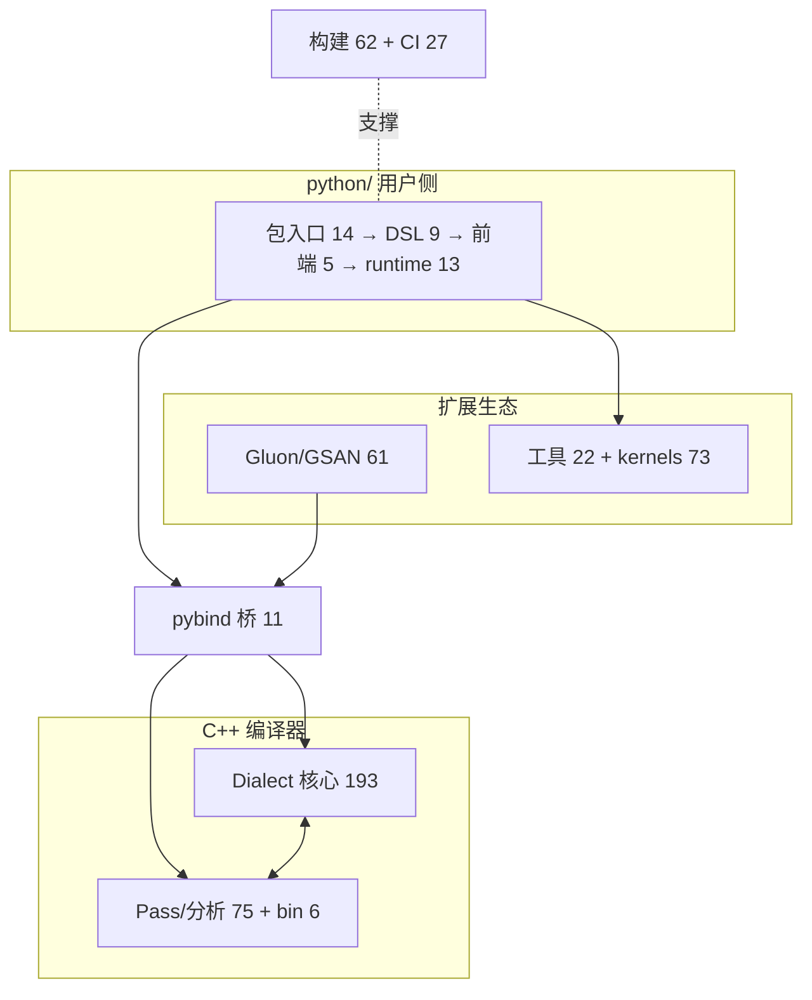

# Triton 新人上手指南

> 基于知识图谱（13 层/15 步导览/Top 热点），commit `e08ec196`，约 570 文件。

## 1. 项目概览

**Triton 是什么**：NVIDIA 维护的开源 GPU kernel 语言与编译器。用户用 Python DSL（`triton.language`/tl）写 kernel，经 MLIR 中间表示（TTIR→TTGIR）优化，NVIDIA 后端降级为 PTX/cubin，AMD 后端走 GCN。

**与 CUDA C 的关系**：CUDA C 以 thread/warp/block 手写共享内存与同步；Triton 以 block 张量为单位——`tl.load` 返回跨线程分布的张量，寄存器布局、bank conflict 消解、tensor core 映射、软件流水全交给编译器 pass。`@triton.jit` 装饰 Python 函数即可操作 PyTorch 张量，特化与重编译判定全自动。保底：`TRITON_INTERPRET=1` 用 numpy 解释执行。

**核心数字**：约 570 文件、13 层；语言 python/cpp/cuda/mlir-tablegen；框架 MLIR/LLVM、CUDA、nanobind。布局：`python/`（前端+runtime+tools+kernels）+ `include/ lib/ bin/`（5 个 dialect 与降级/分析库，即 C++ 编译器后端）。

## 2. 架构分层（13 层）

| 层（文件数） | 职责 |
|---|---|
| 包入口与全局设施（14） | API barrel、knobs、testing/预热 |
| language DSL（9） | tl 命名空间：core/standard/math/random/semantic |
| 编译器前端驱动（5） | AST→TTIR、stage 流水线 |
| 运行时与后端抽象（13） | jit、interpreter、cache、autotuner、backends 基类 |
| pybind11 桥接（11） | python/src 绑定 |
| MLIR Dialect 与 IR 核心（193） | 五 dialect 的 TableGen+C++，被 557 条边依赖 |
| 转换 Pass 与分析（75） | 两级降级、AxisInfo/Allocation/Membar |
| 编译器工具 bin（6） | triton-opt/lsp/reduce 等 |
| Gluon/GSAN 实验（61） | 显式布局模型（47）+ 竞争检测器 |
| Python 工具链（22） | compile/disasm/mxfp、gluon 翻译器 |
| triton_kernels（73） | 生产级 matmul/reduce/topk 算子 |
| 构建体系（62） | CMakeLists、setup.py、cmake/ 锚定 |
| CI 与文档（27） | 十条 workflows、ROCm CI、README/AGENTS |

## 3. 核心概念

**tl DSL**：`language/core.py`（3800+ 行）定义作者可见的一切——constexpr/dtype/tensor 类型系统、运算符协议、`tl.load/store/dot/reduce/make_tensor_descriptor` builtin；语义落地在 `semantic.py`（TritonSemantic 130+ 方法做类型检查与 IR 生成）。`standard.py` 的 softmax/topk 全由 builtin 组装；`extra/libdevice.py` 为 198 个声明 stub。

**@triton.jit 编译链**：`runtime/jit.py` 的 JITFunction——签名解析→参数特化（constexpr/对齐）→cache key→驱动编译；DependenciesFinder 用 AST 追踪闭包依赖判定重编译。

**IR 三级与 make_ttgir 管线**：主线 TTIR→TTGIR→LLVM→PTX。TTIR（tt.）是设备无关 block 语义；`TritonToTritonGPUPass.cpp` 用 17 个 RewritePattern 重写为带布局的 ttg.；make_ttgir（经 `passes.cc` 导出）串起 `AccelerateMatmul.cpp`（为 tt.dot 选 MMA 版本/encoding，v2/v3 到 tcgen05）、coalesce、布局消除、Pipeliner 软件流水（`LowerLoops.cpp` 把循环 load 降级为 async copy/TMA 多缓冲——Hopper/Blackwell 性能秘密）、WarpSpecialization、PlanCTA。LLVM 降级在 `Conversion/TritonGPUToLLVM/` 按家族分文件，ConvertLayout 按代价选 move/shuffle/swizzle。分析：AxisInfo、Allocation、Membar。

**后端抽象**：`backends/__init__.py` 经 entry_points 与目录扫描发现后端；`backends/compiler.py` 定义 BaseBackend 契约（GPUTarget、add_stages），各后端声明自己的 stage 链——一份前端、多家硬件。

**autotuner 与缓存**：`autotuner.py` 枚举 Config 测速（CUDA Graph/proton），支持磁盘缓存与剪枝；`cache.py` 为本地 FileCacheManager + Redis 远程。

**LinearLayout**：`lib/Tools/LinearLayout.cpp` 以 GF(2) 基向量表示"索引→(offset,register)"映射，是统一布局系统的数学基础。

**Gluon 实验**：显式控制 shared memory 与 warp 调度（`_core.py` builtin 带 layout 推断、nvidia/amd 代级 intrinsics），`triton_to_gluon_translator` 可自动转译存量 kernel。

## 4. 推荐学习路径（15 步）

| 步 | 主题与文件 |
|---|---|
| 1 | 全景：`README.md` |
| 2 | 包门面：`triton/__init__.py`、`knobs.py` |
| 3 | tl DSL：`language/core.py`、`standard.py` |
| 4 | JIT：`runtime/jit.py` |
| 5 | 编译驱动：`compiler/{code_generator,compiler}.py` |
| 6 | TTIR→TTGIR：`TritonToTritonGPUPass.cpp`、`AccelerateMatmul.cpp` |
| 7 | 软件流水：`Pipeliner/LowerLoops.cpp`、`PipeliningUtility.h` |
| 8 | TTGIR→LLVM：`ConvertLayoutOpToLLVM.cpp`、同目录 `Utility.cpp` |
| 9 | 后端启动：`backends/{__init__,compiler,driver}.py` |
| 10 | 调优缓存：`autotuner.py`、`cache.py` |
| 11 | 算子库：`triton_kernels/{tensor,matmul}.py`、`_p_matmul.py` |
| 12 | C++ 深潜一：`src/ir.cc`、`Triton/IR/Dialect.h` |
| 13 | C++ 深潜二：`TritonGPU/IR/Dialect.h`、`bin/triton-opt.cpp` |
| 14 | 前沿：`gluon/language/_core.py`、`experimental/gsan/` |
| 15 | 构建：`CMakeLists.txt`、`pyproject.toml`、`ci.yml` |

节奏：1-5 一天走完；6-8 主干，配 triton-opt dump IR；9-15 转工程与底层。

## 5. 文件地图（按层速查）

| 层 | 关键文件 |
|---|---|
| 包入口 | `knobs.py`、`testing.py`（do_bench）、`_test_runner.py` |
| language | `core.py`、`semantic.py`、`random.py`、`extra/libdevice.py` |
| 前端 | `code_generator.py`、`compiler.py` |
| runtime | `jit.py`、`interpreter.py`、`cache.py`、`autotuner.py` |
| pybind 桥 | `src/ir.cc`（1800+ 行）、`src/passes.cc`、`src/llvm.cc` |
| Dialect 核心 | `TritonGPU/IR/Dialect.cpp`、`TritonNvidiaGPU/IR/*`（TMEM） |
| Pass/分析 | `Pipeliner/*`、`WarpSpecialization/*`、`AxisInfo.cpp`、`Membar.cpp` |
| bin | `triton-opt.cpp`、`triton-reduce.cpp` |
| Gluon/GSAN | `_layouts.py`、`nvidia/blackwell/*`、`gsan/src/GSan.h` |
| 工具 | `compile.py`（AOT）、`disasm.py`（SASS） |
| kernels | `matmul.py`（522 行）、`tensor.py`、`reduce.py`（1214 行） |
| 构建/CI | `setup.py`、`Makefile`、`build_helpers.py`、`ci.yml` |

## 6. 复杂度热点 Top 10

| # | 文件（连接度） | 切入建议 |
|---|---|---|
| 1 | `TritonGPU/IR/Dialect.h`（113） | fan-in 之王：布局缓存先读它 |
| 2 | `language/core.py`（95） | 类型→运算符→builtin 三段读 |
| 3 | `triton_to_gluon_translator/slice_kernel.py`（79） | BFS 闭包+拓扑排序 |
| 4 | `Triton/IR/Dialect.h`（78） | tt. 语义源头 |
| 5 | `TritonNvidiaGPU/IR/Dialect.h`（76） | TMEM/tcgen05 入口 |
| 6 | `triton_kernels/matmul.py`（60） | 按分派维度逐支读 |
| 7 | `TritonGPU/IR/Dialect.cpp`（57） | 220+ 函数当手册查 |
| 8 | `triton_kernels/tensor.py`（57） | 算子库地基 |
| 9 | `TritonGPU/Transforms/Utility.h`（57） | 改 pass 必读 |
| 10 | `gluon/language/_core.py`（56） | Gluon 语义心脏 |

## 7. 构建与调试

- **构建**：pip 装 wheel 最快；源码走 `setup.py` 的 CMakeBuild（CMake+ninja 编 libtriton），`build_helpers.py` 下载部署 LLVM/JSON 依赖；日常 `make dev-install` 与 ninja 增量（Makefile 自述非构建系统本体）。
- **改 C++ 必须重建**（AGENTS.md 守则），否则测的是旧 libtriton。
- **测试**：pytest 为主（`conftest.py` 给 fresh_triton_cache fixture）；`_test_runner.py` 编排六阶段；`_filecheck.py` 用 FileCheck 做无 GPU 前端 IR 回归；Makefile 另有 lit/proton 入口。
- **调试**：`triton-opt` 在 .mlir 上单独跑 TTIR/TTGIR pass；`triton-reduce` 最小化复现；`triton-tensor-layout` 可视化布局；`disasm.py` 抽 SASS。编译行为开关（dump/缓存/并行）先查 `knobs.py`。

## 8. 常见坑与本地约定

1. **backends/nvidia 图谱缺席（裁剪边界）**：图谱只收录 `python/triton/backends/` 抽象层三件，`backends/nvidia/` 未扫描。launcher 生成、ptxas 调用、stage 链实现需直读该目录。
2. **third_party 子模块**：AMD 后端部分逻辑按 CODEOWNERS 在 `third_party/amd`，clone 后须初始化子模块；构建依赖 `build_helpers.py` 下载的 LLVM（版本由 `cmake/llvm-build-info.json` 锚定）。
3. **tutorials 被裁剪**：`python/tutorials` 不在图谱。替代路径：README → `triton_kernels/` 当教材（`matmul.py` 分派 + `_p_matmul.py` 743 行 persistent kernel）→ `triton_kernels/tests/` 对拍。
4. **占位文件**：`compiler/make_launcher.py` 已空置，launcher 生成迁至后端侧。
5. **缓存陷阱**：部分环境变量使编译缓存失效（`GetEnv.h` 的 CACHE_INVALIDATING_ENV_VARS 白名单），调 knob 后"重编没生效"多源于此。
6. **本地约定**：pre-commit 强制 ruff/autopep8；mypy 仅覆盖 knobs.py 与 runtime 七个核心文件；AGENTS.md 铁律：块内标量必须 uniform、禁 lane-varying 后门。

第一周走完 1-5 步并跑通 `make dev-install`+pytest；第二周用 triton-opt dump 一个 matmul 的 TTGIR。
