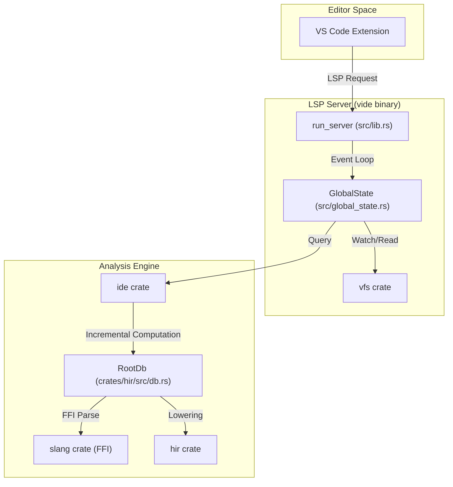
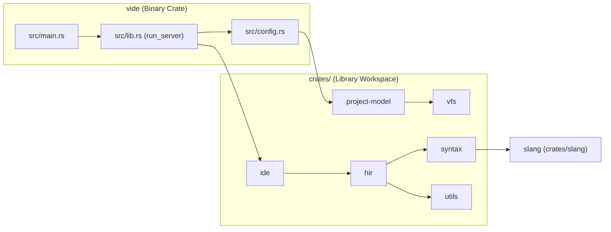

<!-- source: DeepWiki mcp.deepwiki.com · repo pascal-lab/vide · page 1 Overview · fetched 2026-10-12 -->

# Overview

Relevant source files

The following files were used as context for generating this wiki page:

- [Cargo.toml](Cargo.toml)
- [editors/vscode/LICENSE](editors/vscode/LICENSE)
- [editors/vscode/package-lock.json](editors/vscode/package-lock.json)
- [editors/vscode/package.json](editors/vscode/package.json)
- [src/config.rs](src/config.rs)
- [src/main.rs](src/main.rs)

Vide is an open-source, modern SystemVerilog Integrated Development Environment (IDE) designed to bring software-engineering-grade productivity to hardware description languages [Cargo.toml:11](). Developed by the PASCAL Research Group, Vide provides a comprehensive Language Server Protocol (LSP) implementation that powers features like precise completion, semantic highlighting, and automatic refactoring [Cargo.toml:7-11]().

The system is built as a multi-crate Rust workspace, leveraging the `slang` C++ library for high-performance SystemVerilog parsing and the `Salsa` framework for incremental computation [Cargo.toml:13-25](), [Cargo.toml:87]().

---

## System Architecture

Vide follows a layered architecture typical of modern compilers and language servers. It abstracts file access via a Virtual File System (VFS), builds a High-level Intermediate Representation (HIR) for semantic analysis, and provides an IDE query layer for editor features.

### High-Level Component Interaction
The following diagram illustrates how a user action in the editor flows through the system components.

**User Request Flow**

**Sources:** [Cargo.toml:19-25](), [src/main.rs:121-123](), [src/config.rs:78-87]()

---

## Key Subsystems

### 1. Language Server Protocol (LSP)
The entry point of the application is the `vide` crate (root binary), which manages JSON-RPC communication. It handles configuration via `Config` [src/config.rs:78](), manages workspace roots [src/config.rs:80](), and coordinates task execution.
*   **For details, see [LSP Server](#6).**

### 2. Project Modeling
Vide uses a `vide.toml` manifest to define the compilation environment. The `project-model` crate handles manifest discovery and construction of compilation profiles [src/config.rs:9-13](), [src/config.rs:157-167]().
*   **For details, see [Project Configuration (vide.toml)](#1.2).**

### 3. High-level Intermediate Representation (HIR)
The `hir` crate lowers raw syntax trees from Slang into a semantic model. It provides the `HirDb` query interface for scope resolution and name binding [Cargo.toml:54]().
*   **For details, see [HIR (High-level Intermediate Representation)](#4).**

### 4. IDE Intelligence
The `ide` crate implements user-facing features such as diagnostics, completions, and navigation by querying the HIR layer [Cargo.toml:55](). It supports localized messaging via the `i18n` module [src/config.rs:18-19]().
*   **For details, see [IDE Features](#5).**

---

## Code Entity Mapping

This diagram bridges the conceptual subsystems to the specific crates and modules found in the repository.

**Codebase Organization**

**Sources:** [Cargo.toml:13-14](), [Cargo.toml:53-63](), [src/main.rs:11-12]()

---

## Navigating the Wiki

To explore specific areas of the codebase, refer to the following sections:

*   **Setting up the Environment**: See [Getting Started](#1.1) for installation and VS Code configuration.
*   **Configuring Projects**: See [Project Configuration (vide.toml)](#1.2) to learn how Vide discovers source files and libraries.
*   **Understanding the Internals**:
    *   For the data flow and Salsa database, see [Architecture Overview](#2).
    *   For the SystemVerilog semantic model, see [HIR (High-level Intermediate Representation)](#4).
    *   For the implementation of features like Goto Definition or Completion, see [IDE Features](#5).
*   **Deployment and Testing**:
    *   For WASM/Browser support, see [Browser / WASM Support](#8).
    *   For the testing framework, see [Testing Infrastructure](#11).
*   **Editor Extensions**:
    *   For the VS Code client, see [Editor Integrations](#7).
    *   For the Zed extension, see [Zed Editor Extension](#7.4).

**Sources:** [Cargo.toml:13-25](), [editors/vscode/package.json:1-33]()

---

