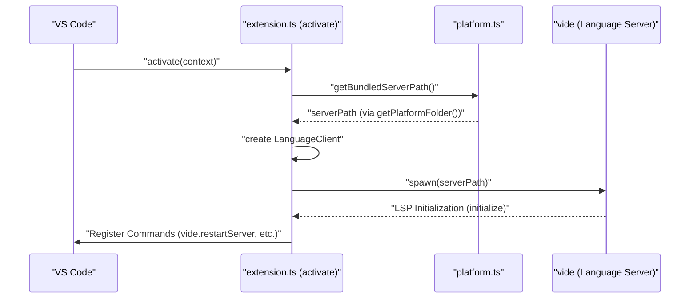
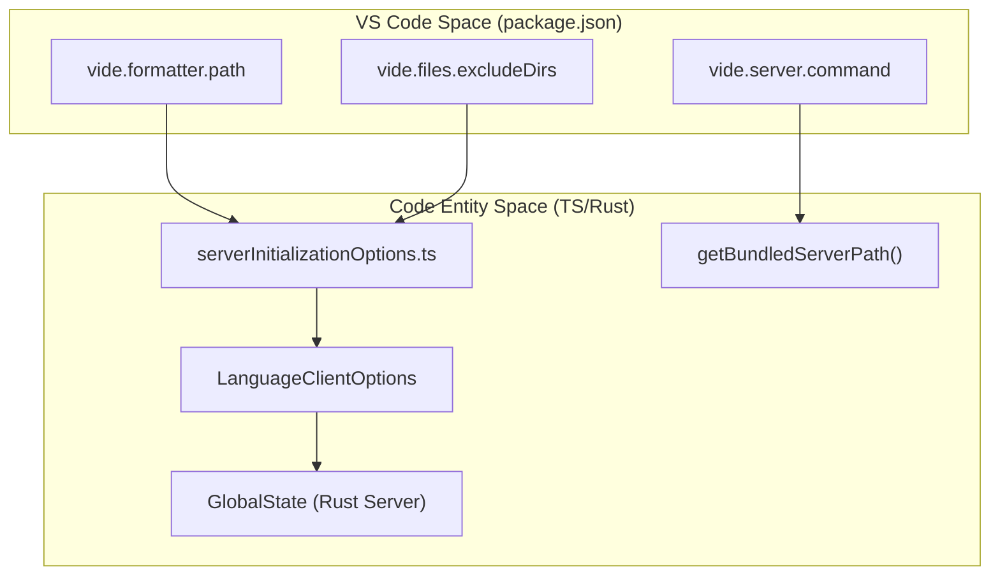

<!-- source: DeepWiki mcp.deepwiki.com · repo pascal-lab/vide · page 1.1 Getting Started · fetched 2026-10-12 -->

# Getting Started

<details>
<summary>Relevant source files</summary>

The following files were used as context for generating this wiki page:

- [Cargo.toml](Cargo.toml)
- [editors/vscode/LICENSE](editors/vscode/LICENSE)
- [editors/vscode/package-lock.json](editors/vscode/package-lock.json)
- [editors/vscode/package.json](editors/vscode/package.json)
- [editors/vscode/src/extension.ts](editors/vscode/src/extension.ts)
- [editors/vscode/src/projectConfig.ts](editors/vscode/src/projectConfig.ts)
- [editors/vscode/test/projectConfig.test.ts](editors/vscode/test/projectConfig.test.ts)

</details>


This page covers the installation, project setup, and initial configuration for Vide. Vide is a modern SystemVerilog IDE built on a Rust-based language server that implements the Language Server Protocol (LSP) [Cargo.toml:1-11]().

## Installation

The primary way to use Vide is through the VS Code extension, which manages the lifecycle of the underlying language server binary.

### Standard Installation (VS Code)
1.  **Extension Marketplace**: Search for `Vide` or the extension ID `pascal-lab.vide-ide` in the VS Code Extensions view [editors/vscode/package.json:2-6]().
2.  **Activation**: The extension contributes support for Verilog (`.v`, `.vh`) and SystemVerilog (`.sv`, `.svh`, `.svi`) [editors/vscode/package.json:34-57](). It activates automatically when these file types are handled by the editor [editors/vscode/package.json:29-29]().
3.  **Status Verification**: A "Vide" status item managed by `VideStatusController` appears in the status bar, providing details on the server state [editors/vscode/src/extension.ts:32-34]().

### Build from Source
For development, the language server and extension can be built from the workspace.

*   **Language Server**: The server is a Rust project located at the root of the repository [Cargo.toml:1-14]().
    *   Command: `cargo build --release`
*   **VS Code Extension**: Located in `editors/vscode/`. It uses `esbuild` for bundling [editors/vscode/package-lock.json:20-20]().
    *   Setup: `npm install` inside `editors/vscode/`.
    *   Development: Use the "Extension" launch configuration in VS Code to debug `extension.ts` [editors/vscode/src/extension.ts:1-12]().

### Data Flow: Extension Activation
The following diagram illustrates the startup sequence and how the VS Code extension resolves the language server binary using platform-specific logic.

**Extension Activation and Server Resolution**

Sources: [editors/vscode/src/extension.ts:14-43](), [editors/vscode/src/extension.ts:146-148]()

---

## First Project Setup

Vide uses a manifest file named `vide.toml` to define the compilation unit and analysis scope.

### Creating vide.toml
Vide looks for a configuration file in the workspace root [editors/vscode/src/projectConfig.ts:7-12](). The default configuration is initialized with an empty `sources` array and commented-out templates for advanced options.

```toml
#:schema https://vide.pascal-lab.net/schemas/v1/vide.schema.json
sources = []

# include_dirs = ["include"]
# defines = ["SYNTHESIS"]
# top_modules = ["top"]
# libraries = ["../common_cells"]
# exclude = ["build/**"]
```
Sources: [editors/vscode/test/projectConfig.test.ts:42-57]()

### Configuration Fields
| Field | Description |
| :--- | :--- |
| `sources` | List of root source files or directories to analyze [editors/vscode/test/projectConfig.test.ts:47-47](). |
| `include_dirs` | Search paths for `` `include `` directives [editors/vscode/test/projectConfig.test.ts:49-49](). |
| `defines` | Global macro definitions [editors/vscode/test/projectConfig.test.ts:50-50](). |
| `top_modules` | Explicitly defined top-level modules for hierarchy analysis [editors/vscode/test/projectConfig.test.ts:51-51](). |
| `libraries` | External library paths for module discovery [editors/vscode/test/projectConfig.test.ts:52-52](). |

---

## Editor Configuration

Vide provides several VS Code settings to customize behavior. These are defined in the `package.json` and passed to the server via `serverInitializationOptions` [editors/vscode/package.json:92-95](), [editors/vscode/src/extension.ts:17-17]().

### Key Settings
*   **`vide.server.command`**: Overrides the path to the language server binary [editors/vscode/package.json:105-112]().
*   **`vide.server.args`**: Additional arguments passed to the server process [editors/vscode/package.json:113-120]().
*   **`vide.formatter.provider`**: Choice of formatter (default is `verible`) [editors/vscode/package.json:211-221]().
*   **`vide.workspace.auto.reload`**: Automatically reload the workspace when `vide.toml` changes [editors/vscode/package.json:192-196]().

### Implementation: Configuration Mapping
The extension maps VS Code settings to LSP `InitializationOptions` which are then processed by the server.

**Settings Mapping to Code Entities**

Sources: [editors/vscode/src/extension.ts:14-17](), [editors/vscode/src/initializationOptions.ts:1-10](), [editors/vscode/package.json:105-136]()

---

## Basic Usage

### Commands
Vide registers several commands in the VS Code Command Palette (`Ctrl+Shift+P`):
*   **`Vide: Restart Server`**: Restarts the language server process [editors/vscode/src/extension.ts:43-43]().
*   **`Vide: Show Server Version`**: Displays the version and build metadata (commit hash, build date) [editors/vscode/src/extension.ts:44-44](), [editors/vscode/src/extension.ts:117-124]().
*   **`Vide: Reload Workspace`**: Manually triggers a workspace reload [editors/vscode/src/extension.ts:28-29]().
*   **`Vide: Run Qihe Analysis`**: Triggers advanced semantic analysis [editors/vscode/src/extension.ts:46-47]().

### Diagnostics and Output
The extension provides specialized output channels for monitoring:
1.  **Vide Language Server**: General LSP logs and server-side traces [editors/vscode/src/extension.ts:55-55]().
2.  **Vide Qihe**: Specialized analysis logs for the Qihe semantic engine [editors/vscode/src/extension.ts:56-56]().

If the server fails to start, an error message is shown with an option to "Show Output" to inspect the logs [editors/vscode/src/extension.ts:130-136]().

Sources: [editors/vscode/src/extension.ts:43-57](), [editors/vscode/src/extension.ts:130-144](), [editors/vscode/src/videStatus.ts:28-33]()

---

