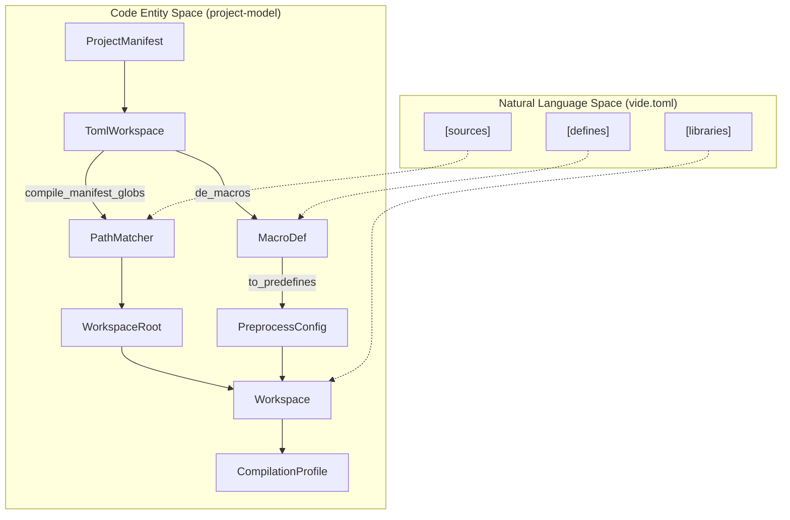
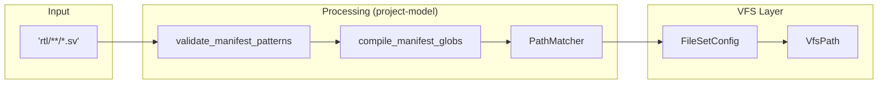

<!-- source: DeepWiki mcp.deepwiki.com · repo pascal-lab/vide · page 1.2 Project Configuration (vide.toml) · fetched 2026-10-12 -->

# Project Configuration (vide.toml)

Relevant source files

The following files were used as context for generating this wiki page:

- [crates/hir/Cargo.toml](crates/hir/Cargo.toml)
- [crates/hir/src/base_db/project.rs](crates/hir/src/base_db/project.rs)
- [crates/hir/src/base_db/source_root.rs](crates/hir/src/base_db/source_root.rs)
- [crates/hir/src/lib.rs](crates/hir/src/lib.rs)
- [crates/ide/src/diagnostics.rs](crates/ide/src/diagnostics.rs)
- [crates/project-model/Cargo.toml](crates/project-model/Cargo.toml)
- [crates/project-model/src/lib.rs](crates/project-model/src/lib.rs)
- [crates/project-model/src/macro_def.rs](crates/project-model/src/macro_def.rs)
- [crates/project-model/src/project_manifest.rs](crates/project-model/src/project_manifest.rs)
- [crates/project-model/src/toml_workspace.rs](crates/project-model/src/toml_workspace.rs)
- [crates/workspace-model/Cargo.toml](crates/workspace-model/Cargo.toml)
- [crates/workspace-model/src/lib.rs](crates/workspace-model/src/lib.rs)
- [crates/workspace-model/src/project.rs](crates/workspace-model/src/project.rs)
- [src/tests.rs](src/tests.rs)

The `vide.toml` file is the central manifest for a Vide project. It defines the boundaries of the compilation unit, including source file discovery, include search paths, preprocessor macros, and external library dependencies. While Vide can operate in a "best-effort" mode without a manifest, a well-configured `vide.toml` enables accurate cross-file semantic analysis, diagnostics, and advanced refactoring.

## Configuration Schema

The configuration is written in TOML and validated against a JSON schema defined in the `project-model` crate. The schema is generated using the `schemars` crate to ensure consistency between the code and documentation.

| Field | Type | Description |
| :--- | :--- | :--- |
| `sources` | `Option<Vec<String>>` | Workspace-relative shell globs for source files (e.g., `["rtl/**"]`). |
| `include_dirs` | `Option<Vec<Path>>` | Directories searched for `` `include `` directives. |
| `defines` | `Vec<String>` | Predefined macros in `NAME` or `NAME=VALUE` format. |
| `top_modules` | `Vec<String>` | Top-level module names for the compilation profile. |
| `libraries` | `Vec<Path>` | Paths to external dependency workspaces. |
| `exclude` | `Vec<String>` | Workspace-relative globs to ignore (e.g., `["build/**"]`). |

**Sources:** [crates/project-model/src/toml_workspace.rs:47-126](), [crates/project-model/src/toml_workspace.rs:134-145]()

---

## Data Flow: Manifest to Compilation Profile

The conversion from a physical `vide.toml` file to a semantic `CompilationProfile` involves several stages: discovery, deserialization, and path resolution.

### 1. Discovery and Loading
The `ProjectManifest` enum represents either a found `vide.toml` or an unconfigured directory. The `ProjectManifest::from_path` function implements the discovery logic, looking for the primary filename `vide.toml` defined by `MANIFEST_FILE_NAME`.

**Sources:** [crates/project-model/src/project_manifest.rs:7-8](), [crates/project-model/src/project_manifest.rs:33-36](), [crates/project-model/src/project_manifest.rs:59-83]()

### 2. Deserialization
The `TomlWorkspace` struct handles the raw TOML parsing. It uses custom deserializers like `de_macros` to transform strings into `MacroDef` structures, splitting `NAME=VALUE` pairs into `MacroAtom::Flag` or `MacroAtom::KeyValue`.

**Sources:** [crates/project-model/src/toml_workspace.rs:147-185](), [crates/project-model/src/macro_def.rs:7-10]()

### 3. Compilation Profile Construction
The `Workspace::from_toml` function converts the manifest into a `Workspace` object. This involves:
- Validating glob patterns with `validate_manifest_patterns`.
- Compiling globs into `PathMatcher` and `PathGlobMatcher` objects.
- Resolving relative paths for `include_dirs` and `libraries`.
- Constructing a `CompilationProfile` which contains the final `PreprocessConfig` and `Predefine` set.

**Sources:** [crates/project-model/src/lib.rs:183-210](), [crates/project-model/src/macro_def.rs:29-50]()

### Configuration Pipeline Diagram
This diagram shows how `vide.toml` entities map to internal code classes during the loading process.

**Sources:** [crates/project-model/src/lib.rs:33-64](), [crates/project-model/src/toml_workspace.rs:47-126](), [crates/project-model/src/project_manifest.rs:33-36](), [crates/project-model/src/macro_def.rs:29-30]()

---

## Analysis Behavior and Policy

The presence and content of `vide.toml` significantly change how the `RootDb` (Salsa database) treats files.

### Manifest Source Policy
Vide implements a `ManifestSourcePolicy` to handle different user intents:
- **Omitted `sources`**: The `DefaultIndex` policy is used. Vide performs best-effort indexing of the entire workspace for navigation but suppresses complex semantic diagnostics to avoid false positives.
- **`sources = []`**: Explicitly disables automatic scanning.
- **`sources = ["..."]`**: The `Explicit` policy is used. Vide treats matching files as the definitive project source set.

**Sources:** [crates/project-model/src/lib.rs:135-161](), [src/tests.rs:60-66]()

### Include Directory Inference
If `sources` is explicitly provided but `include_dirs` is omitted, Vide automatically infers include directories. The `ManifestSourcePolicy::defaults_include_dirs_to_sources` method determines if this fallback is active.

**Sources:** [crates/project-model/src/lib.rs:158-161](), [crates/project-model/src/lib.rs:202-210]()

### Feature Availability Matrix
| Feature | Unconfigured (No vide.toml) | Configured (With vide.toml) |
| :--- | :--- | :--- |
| **Diagnostics** | Syntax/Parse only | Full Semantic + Cross-file |
| **Rename** | Local (Single File) | Global (Project-wide) |
| **Semantic Highlighting** | Basic | Context-aware (Macro branches) |

**Sources:** [crates/ide/src/diagnostics.rs:216-235](), [crates/ide/src/diagnostics.rs:149-154]()

---

## Path Resolution and Globbing

Vide uses strict rules for paths in `vide.toml` to ensure portability:
- **Separators**: Must use `/` as handled by `Utf8PathBuf`.
- **Globbing**: 
    - `*` matches entries within a single directory.
    - `**` matches recursively across nested directories via `PathMatcher`.

**Sources:** [crates/project-model/src/lib.rs:20-24](), [crates/project-model/src/toml_workspace.rs:10-13]()

### Path Normalization Flow
This diagram tracks how a string from `vide.toml` becomes a `VfsPath` used by the analysis engine.

**Sources:** [crates/project-model/src/lib.rs:197-200](), [crates/project-model/src/lib.rs:20]()

---

## Library Management

The `libraries` field allows for modular project structures. Each path in `libraries` is resolved relative to the current manifest directory.

1. **Discovery**: Vide checks if the library path contains its own `vide.toml` using `ProjectManifest::from_path`.
2. **Recursive Loading**: If a manifest is found, it is loaded as a configured `Workspace`.
3. **Unconfigured Fallback**: If no manifest exists, the directory is loaded as an `UnconfiguredRoot`.

**Sources:** [crates/project-model/src/lib.rs:164-182](), [crates/project-model/src/project_manifest.rs:59-83]()

---

