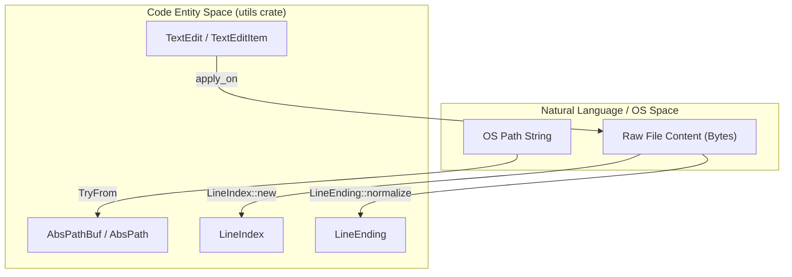
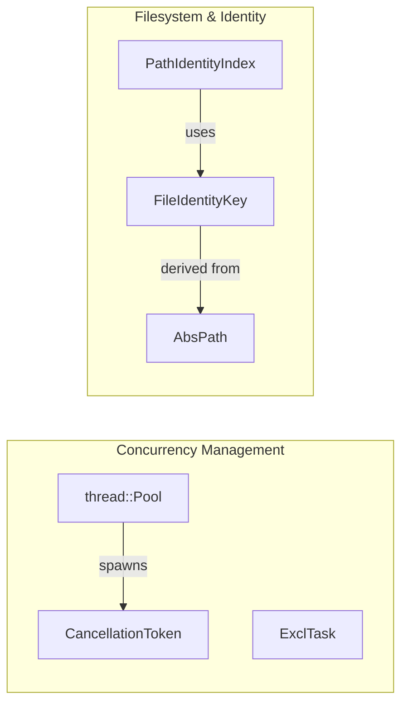

<!-- source: DeepWiki mcp.deepwiki.com · repo pascal-lab/vide · page 10 Utilities and Shared Infrastructure · fetched 2026-10-12 -->

# Utilities and Shared Infrastructure

Relevant source files

The following files were used as context for generating this wiki page:

- [crates/utils/Cargo.toml](crates/utils/Cargo.toml)
- [crates/utils/src/lib.rs](crates/utils/src/lib.rs)
- [crates/utils/src/lines.rs](crates/utils/src/lines.rs)
- [crates/utils/src/path_identity.rs](crates/utils/src/path_identity.rs)
- [crates/utils/src/paths.rs](crates/utils/src/paths.rs)
- [crates/utils/src/test_support.rs](crates/utils/src/test_support.rs)
- [crates/utils/src/text_edit.rs](crates/utils/src/text_edit.rs)
- [crates/utils/src/thread.rs](crates/utils/src/thread.rs)
- [crates/utils/src/utry.rs](crates/utils/src/utry.rs)

The `utils` crate provides cross-cutting infrastructure used throughout the Vide codebase. It abstracts common concerns such as filesystem path handling, text coordinate mapping, and concurrency primitives to ensure consistency across the LSP server, VFS, and IDE layers.

## Data Flow and Entity Mapping

The following diagram illustrates how raw text from the filesystem or LSP is transformed into structured utility types used for analysis.

### Text and Path Transformation

**Sources:** [crates/utils/src/paths.rs:13-168](), [crates/utils/src/lines.rs:11-26](), [crates/utils/src/text_edit.rs:36-77]()

---

## Key Components

### Path and Text Utilities
Vide uses specialized path wrappers to distinguish between absolute (`AbsPathBuf`) and relative (`RelPathBuf`) paths at the type level [crates/utils/src/paths.rs:13-239](). This prevents common errors when resolving file locations in the VFS. It leverages the `camino` crate for UTF-8 path safety [crates/utils/src/paths.rs:11]().

Text handling is managed via the `LineIndex`, which provides efficient mapping between byte offsets (`TextSize`) and `(line, column)` coordinates. It supports both UTF-8 and wide encodings (UTF-16/UTF-32) required by the LSP protocol [crates/utils/src/lines.rs:5-9]().

For details, see [Path and Text Utilities](#10.1).

### Concurrency and Task Utilities
The codebase employs a custom `thread::Pool` for managing background work, distinguishing between standard `Worker` tasks and `LatencySensitive` tasks (e.g., typing-responsive features) [crates/utils/src/thread.rs:7-32](). The pool uses a `latency_budget` mechanism to ensure high-priority tasks are not starved by heavy background computation [crates/utils/src/thread.rs:125-173]().

To manage exclusive long-running operations, such as workspace reloading, Vide uses `ExclTask`. This structure ensures that only one instance of a task is active and tracks whether new requests have arrived while a task is in progress.

For details, see [Concurrency and Task Utilities](#10.2).

### Shared Infrastructure Mapping

**Sources:** [crates/utils/src/thread.rs:7-32](), [crates/utils/src/path_identity.rs:59-109](), [crates/utils/src/paths.rs:126-128]()

---

## Specialized Infrastructure

### Path Identity and Deduplication
The `PathIdentityIndex` and `PathIdentitySet` provide a way to deduplicate files based on filesystem identity (inodes on Unix, file indices on Windows) rather than just path strings [crates/utils/src/path_identity.rs:59-165](). This is critical for handling symbolic links and case-insensitive filesystems correctly by mapping multiple path aliases to a single value [crates/utils/src/path_identity.rs:87-90]().

### Panic Context
The `panic_context` module allows the server to push and pop string contexts onto a thread-local stack [crates/utils/src/panic_context.rs](). If a thread panics, these contexts are gathered to provide better diagnostic information (e.g., "panicked while processing file X") [crates/utils/src/lib.rs:7]().

### Fallible Operations and Macros
The codebase provides the `check_or_throw!` macro to facilitate cleaner error propagation in complex logic by early-returning `None` if a condition is not met [crates/utils/src/utry.rs:1-8]().

### Test Support
The `test_support` module provides a `TestDir` utility for managing temporary directories during integration and unit tests [crates/utils/src/test_support.rs:6-9](). It ensures that test artifacts are cleaned up automatically upon drop unless explicitly kept [crates/utils/src/test_support.rs:43-47]().

---

## Child Pages
- [Path and Text Utilities](#10.1) — Detailed breakdown of `AbsPathBuf`, `PathKey`, `LineIndex`, and `TextEdit`.
- [Concurrency and Task Utilities](#10.2) — Deep dive into the `thread::Pool`, `ExclTask`, `CancellationToken`, and panic handling.

---

