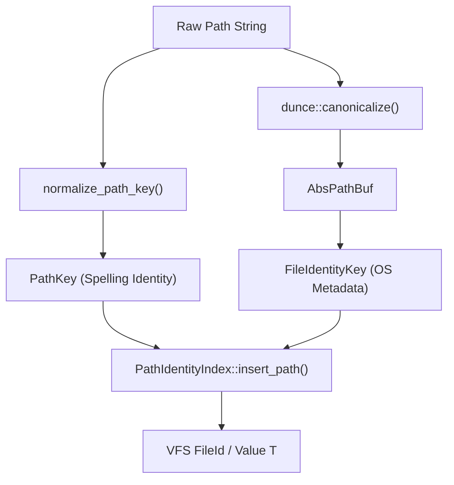
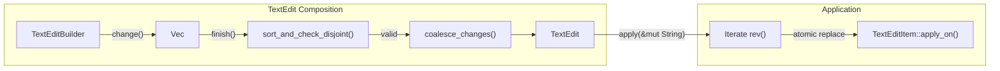

<!-- source: DeepWiki mcp.deepwiki.com · repo pascal-lab/vide · page 10.1 Path and Text Utilities · fetched 2026-10-12 -->

# Path and Text Utilities

Relevant source files

The following files were used as context for generating this wiki page:

- [crates/utils/Cargo.toml](crates/utils/Cargo.toml)
- [crates/utils/src/lib.rs](crates/utils/src/lib.rs)
- [crates/utils/src/line_index.rs](crates/utils/src/line_index.rs)
- [crates/utils/src/lines.rs](crates/utils/src/lines.rs)
- [crates/utils/src/path_identity.rs](crates/utils/src/path_identity.rs)
- [crates/utils/src/paths.rs](crates/utils/src/paths.rs)
- [crates/utils/src/test_support.rs](crates/utils/src/test_support.rs)
- [crates/utils/src/text_edit.rs](crates/utils/src/text_edit.rs)
- [crates/utils/src/thread.rs](crates/utils/src/thread.rs)

The `utils` crate provides the foundational types and logic for path manipulation, text coordinate mapping, and structured text editing. These utilities ensure consistency across the Vide workspace, particularly when handling cross-platform path differences and mapping between byte-level offsets and line/column coordinates required by the Language Server Protocol (LSP).

## Path Management

Vide utilizes thin wrappers around the `camino` crate to distinguish between absolute and relative paths at the type level. This prevents logic errors where a relative path is accidentally used in a context requiring an absolute one.

### Absolute and Relative Paths
*   **`AbsPathBuf` / `AbsPath`**: Represents an absolute, UTF-8 encoded path. Construction via `try_from` or `assert` ensures the path is absolute [crates/utils/src/paths.rs:13-118]().
*   **`RelPathBuf` / `RelPath`**: Represents a relative path. Used for sub-paths within a project or library [crates/utils/src/paths.rs:238-281]().

### Path Identity and Deduplication
Because the same file can be referred to by multiple path "spellings" (e.g., symlinks, case-insensitive filesystems, or Windows extended-length paths), Vide implements an identity system based on filesystem inodes/metadata.

*   **`PathKey`**: A normalized string representation of a path used for stable identification before I/O is performed. It replaces backslashes with forward slashes and handles Windows prefix normalization [crates/utils/src/path_identity.rs:8-24](), [crates/utils/src/path_identity.rs:198-212]().
*   **`FileIdentityKey`**: A platform-specific unique identifier. On Unix, this uses `dev` and `ino` from `std::os::unix::fs::MetadataExt` [crates/utils/src/path_identity.rs:175-181](). On Windows, it uses the volume serial number and file index via `winapi-util` [crates/utils/src/path_identity.rs:183-191]().
*   **`PathIdentityIndex<T>`**: A specialized map that associates both path aliases (spellings) and physical file identities with a value (e.g., a `FileId`). This ensures that opening a symlink or a path with different casing resolves to the same internal entity [crates/utils/src/path_identity.rs:87-141]().
*   **`PathIdentitySet`**: A set-based version of the identity index used to deduplicate paths based on both spelling and OS evidence [crates/utils/src/path_identity.rs:145-166]().

### Path Utility Flow
The following diagram illustrates how a raw path string is transformed into a stable identity.

**Path Normalization and Identity Mapping**

Sources: [crates/utils/src/path_identity.rs:8-141](), [crates/utils/src/paths.rs:13-118]()

## Text Utilities

Text in Vide is handled using `text_size` types (`TextSize`, `TextRange`) which represent 0-indexed byte offsets. Mapping these to the `(line, column)` format expected by editors is handled by the `LineIndex`.

### LineIndex and Coordinate Mapping
`LineIndex` caches the positions of newlines to allow $O(\log N)$ lookups of line numbers from byte offsets via binary search [crates/utils/src/line_index.rs:78-107]().

*   **`LineCol`**: Native UTF-8 based line and column (0-indexed) [crates/utils/src/line_index.rs:15-21]().
*   **`WideLineCol`**: Line and column calculated using UTF-16 or UTF-32 encoding, required for LSP compatibility [crates/utils/src/line_index.rs:40-46]().
*   **`WideEncoding`**: Enum specifying `Utf16` (where surrogate pairs count as 2 units) or `Utf32` (where each char is 1 unit) [crates/utils/src/line_index.rs:23-37]().

Key methods in `LineIndex`:
| Method | Description |
| :--- | :--- |
| `new(text: &str)` | Analyzes text to find newlines and non-ASCII characters [crates/utils/src/line_index.rs:90-97](). |
| `try_line_col(offset)` | Converts byte `TextSize` to `LineCol`, checking for multi-byte character boundaries [crates/utils/src/line_index.rs:103-117](). |
| `to_wide(enc, line_col)` | Adjusts a UTF-8 `LineCol` to a `WideLineCol` by subtracting byte-width differences of non-ASCII characters [crates/utils/src/line_index.rs:133-147](). |
| `to_utf8(enc, wide_line_col)` | Inverse of `to_wide`; converts LSP coordinates back to internal byte offsets [crates/utils/src/line_index.rs:151-165](). |
| `lines(range)` | Returns an iterator of `TextRange` for each line within the given range [crates/utils/src/line_index.rs:187-199](). |

### Line Endings
The `LineEnding` enum handles normalization between Unix (`\n`) and Dos (`\r\n`) formats. The `normalize` function converts text to Unix format in-place while recording the original ending style to allow round-tripping [crates/utils/src/lines.rs:12-26]().

Sources: [crates/utils/src/line_index.rs:1-165](), [crates/utils/src/lines.rs:12-32]()

## Text Editing

Atomic changes to source code are represented by `TextEdit`. This structure ensures that multiple changes can be applied safely without overlapping.

### TextEdit Structures
*   **`TextEditItem`**: A single replacement operation consisting of a `TextRange` (the area to delete) and a `String` (the text to insert). Insertions are replacements with an empty range [crates/utils/src/text_edit.rs:10-19]().
*   **`TextEdit`**: A collection of `TextEditItem`s. It maintains an invariant that all changes are disjoint and sorted by their deletion range [crates/utils/src/text_edit.rs:37-40]().
*   **`TextEditBuilder`**: A helper to accumulate changes. When `finish()` is called, it sorts and coalesces adjacent changes into a single atomic `TextEdit` [crates/utils/src/text_edit.rs:166-201]().

### SourceChange and Application
While `TextEdit` handles changes within a single buffer, higher layers (like the IDE crate) use `SourceChange` to group edits across multiple files.

**Text Edit Application Logic**

Sources: [crates/utils/src/text_edit.rs:77-107](), [crates/utils/src/text_edit.rs:166-201](), [crates/utils/src/text_edit.rs:215-228]()

## Summary of Key Entities

| Entity | File Path | Purpose |
| :--- | :--- | :--- |
| `AbsPathBuf` | [crates/utils/src/paths.rs:14]() | Type-safe absolute UTF-8 path wrapper. |
| `PathIdentityIndex` | [crates/utils/src/path_identity.rs:87]() | Maps physical file identity (inodes) to internal IDs. |
| `LineIndex` | [crates/utils/src/line_index.rs:78]() | Maps byte offsets to line/column coordinates. |
| `TextEdit` | [crates/utils/src/text_edit.rs:37]() | Represents a set of disjoint text replacements. |
| `LineEnding` | [crates/utils/src/lines.rs:12]() | Normalizes `\r\n` to `\n` and tracks original format. |
| `TestDir` | [crates/utils/src/test_support.rs:6]() | RAII-based temporary directory for unit testing. |
| `Pool` | [crates/utils/src/thread.rs:7]() | Thread pool with latency-sensitive and worker priorities. |

Sources: [crates/utils/src/lib.rs:1-17](), [crates/utils/src/paths.rs:1-281](), [crates/utils/src/line_index.rs:1-206](), [crates/utils/src/thread.rs:7-104]()

---

