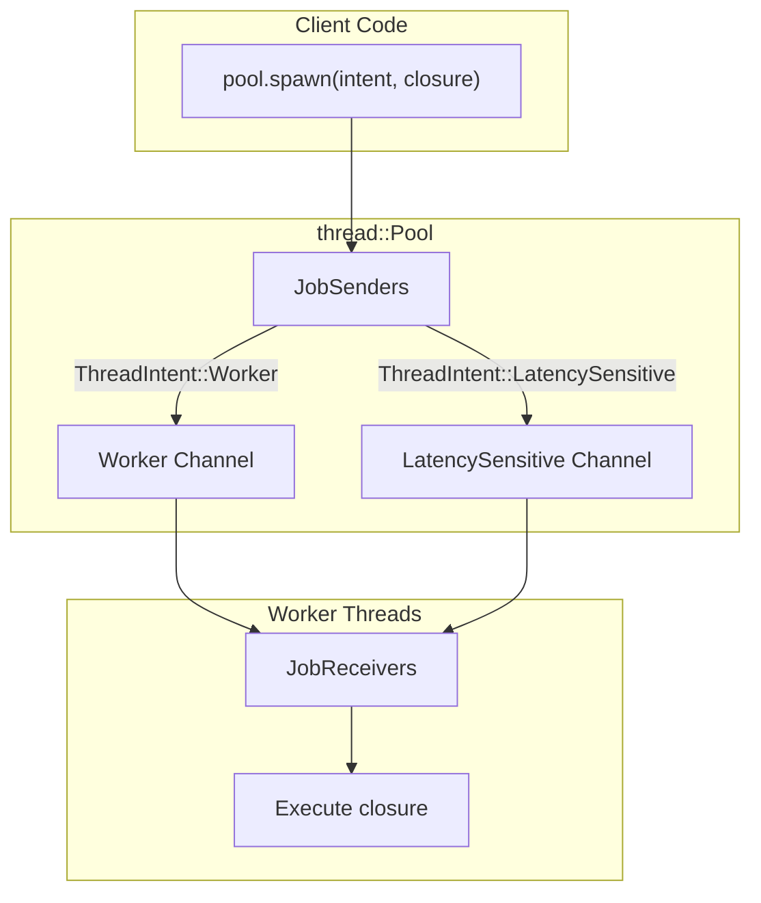
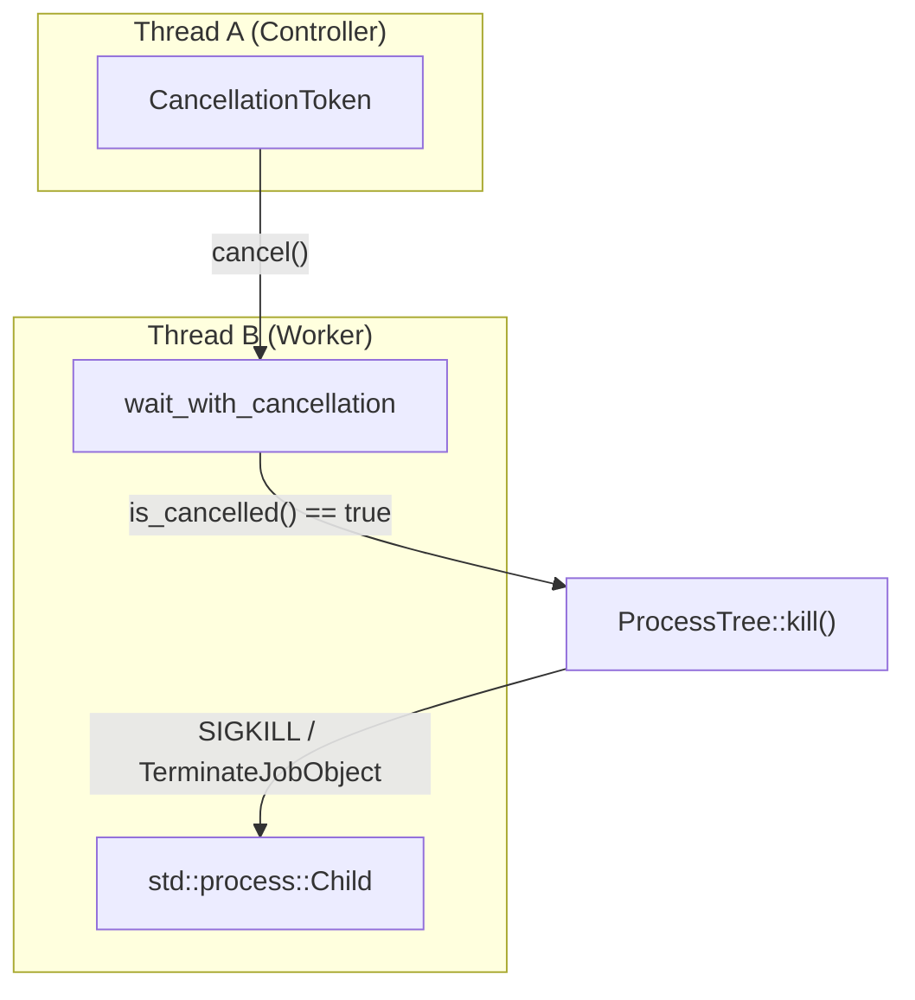
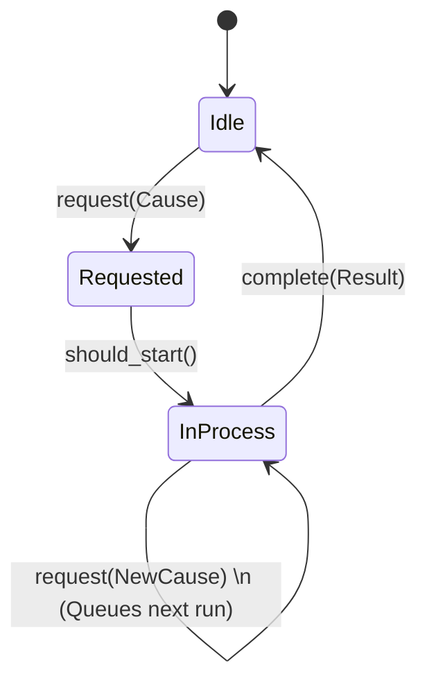
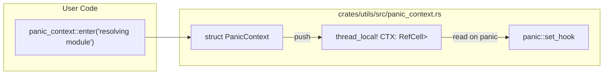

<!-- source: DeepWiki mcp.deepwiki.com · repo pascal-lab/vide · page 10.2 Concurrency and Task Utilities · fetched 2026-10-12 -->

# Concurrency and Task Utilities

Relevant source files

The following files were used as context for generating this wiki page:

- [crates/utils/Cargo.toml](crates/utils/Cargo.toml)
- [crates/utils/src/excl_task.rs](crates/utils/src/excl_task.rs)
- [crates/utils/src/lib.rs](crates/utils/src/lib.rs)
- [crates/utils/src/lines.rs](crates/utils/src/lines.rs)
- [crates/utils/src/panic_context.rs](crates/utils/src/panic_context.rs)
- [crates/utils/src/path_identity.rs](crates/utils/src/path_identity.rs)
- [crates/utils/src/paths.rs](crates/utils/src/paths.rs)
- [crates/utils/src/test_support.rs](crates/utils/src/test_support.rs)
- [crates/utils/src/text_edit.rs](crates/utils/src/text_edit.rs)
- [crates/utils/src/thread.rs](crates/utils/src/thread.rs)
- [crates/utils/src/utry.rs](crates/utils/src/utry.rs)

The Vide codebase utilizes a suite of utilities to manage asynchronous execution, thread safety, and fallible operations. These tools are primarily located in the `utils` crate and provide standardized patterns for task cancellation, exclusive execution, thread pool management, and enhanced error reporting during panics.

## Threading and Task Pools

Vide manages concurrency through a custom `thread::Pool` and specialized thread builders. These utilities ensure consistent thread naming, stack sizes, and priority handling (intents).

### Thread Intents and Naming
The `ThreadIntent` enum (defined in `thread.rs`) distinguishes between standard background tasks and latency-sensitive operations [crates/utils/src/thread.rs:108-112](). 

*   **`Pool`**: A multi-priority thread pool that manages a set of worker threads [crates/utils/src/thread.rs:7-15](). It uses `crossbeam_channel` to dispatch jobs. The pool maintains two separate channels: `worker` and `latency_sensitive` [crates/utils/src/thread.rs:18-21]().
*   **Latency Budget**: To prevent starvation of background tasks while prioritizing UI-responsive tasks, the pool implements a `latency_budget` (defaulting to 3) [crates/utils/src/thread.rs:175](). This allows a burst of latency-sensitive jobs before checking the standard worker queue [crates/utils/src/thread.rs:126-172]().
*   **`JoinHandle`**: A wrapper around `jod_thread::JoinHandle` that ensures threads are joined on drop unless `allow_leak` is set [crates/utils/src/thread.rs:225-235]().

**Task Pool Dispatch Logic**

Sources: [crates/utils/src/thread.rs:7-47](), [crates/utils/src/thread.rs:125-172](), [crates/utils/src/thread.rs:178-185]()

## Task Cancellation and Process Management

Vide implements a hierarchical cancellation system using `CancellationToken`. This allows the server to abort long-running operations (like background diagnostics or workspace loading) when a newer request arrives or the user closes a file.

### CancellationToken
The `CancellationToken` [crates/utils/src/cancellation.rs:11-13]() uses an `AtomicBool` wrapped in an `Arc` to signal cancellation across thread boundaries. It supports a parent-child relationship where cancelling a parent automatically propagates to all children [crates/utils/src/cancellation.rs:37-52]().

### Process Execution with Cancellation
The `process.rs` module provides wrappers for executing external commands (like the Verible formatter or Slang compiler) while respecting cancellation signals.

*   **`wait_with_cancellation`**: Polls a child process and kills it if the token is cancelled [crates/utils/src/process.rs:16-31]().
*   **Cross-Platform Killing**: On Windows, it uses Job Objects via `winapi` to ensure the entire process tree is terminated [crates/utils/src/process.rs:65-81](). On Unix, it uses process groups (`libc::kill`) [crates/utils/src/process.rs:149-161]().

**Process Cancellation Data Flow**

Sources: [crates/utils/src/cancellation.rs:11-86](), [crates/utils/src/process.rs:16-31](), [crates/utils/src/process.rs:59-81](), [crates/utils/src/process.rs:147-161]()

## Exclusive Task Execution (ExclTask)

The `ExclTask` utility ensures that only one instance of a specific long-running operation is active at a time. It is frequently used in the LSP server to manage workspace fetching and VFS loading.

### Implementation Details
`ExclTask` tracks whether a task is currently `in_process` and if a new execution has been `requested` [crates/utils/src/excl_task.rs:4-8]().

| Method | Description |
| :--- | :--- |
| `request(reason)` | Marks the task as needing execution with a specific cause [crates/utils/src/excl_task.rs:17-19](). |
| `should_start()` | Returns the cause if no task is running, and sets `in_process` to true [crates/utils/src/excl_task.rs:21-27](). |
| `complete(result)` | Resets `in_process` and stores the output of the operation [crates/utils/src/excl_task.rs:29-33](). |

**Exclusive Task Lifecycle**

Sources: [crates/utils/src/excl_task.rs:4-46]()

## Panic Context and Error Reporting

To improve the debuggability of crashes in a highly concurrent environment, Vide uses a `PanicContext`. This utility allows developers to attach string metadata to the current thread's stack, which is then printed if a panic occurs.

### Usage and Mechanics
The `enter(context)` function [crates/utils/src/panic_context.rs:3-9]() pushes a string onto a thread-local vector. It returns a `PanicContext` guard that pops the string when dropped [crates/utils/src/panic_context.rs:34-38]().

The utility overrides the default panic hook [crates/utils/src/panic_context.rs:18-31](). When a panic happens, it iterates through the thread-local "context stack" and prints the frames to stderr before calling the original hook [crates/utils/src/panic_context.rs:20-28]().

**Entity Mapping: Panic Context**

Sources: [crates/utils/src/panic_context.rs:3-45]()

## Fallible Operations: utry! and check_or_throw!

Vide provides macros to simplify working with `Option` and `Result` types in logic that requires early exits without excessive boilerplate.

*   **`check_or_throw!`**: Evaluates a boolean expression; if false, it immediately returns `None` from the current scope using the `?` operator on a `None` value [crates/utils/src/utry.rs:2-8]().
*   **`utry!` (Deprecated/Legacy)**: The codebase previously utilized a `utry!` macro for fallible blocks; modern implementations typically favor direct `Option` chaining or the `check_or_throw!` utility.

These utilities are essential for keeping IDE feature logic (like completion or navigation) concise when navigating complex HIR/AST structures where many properties might be optional.

Sources: [crates/utils/src/utry.rs:1-9]()

---

