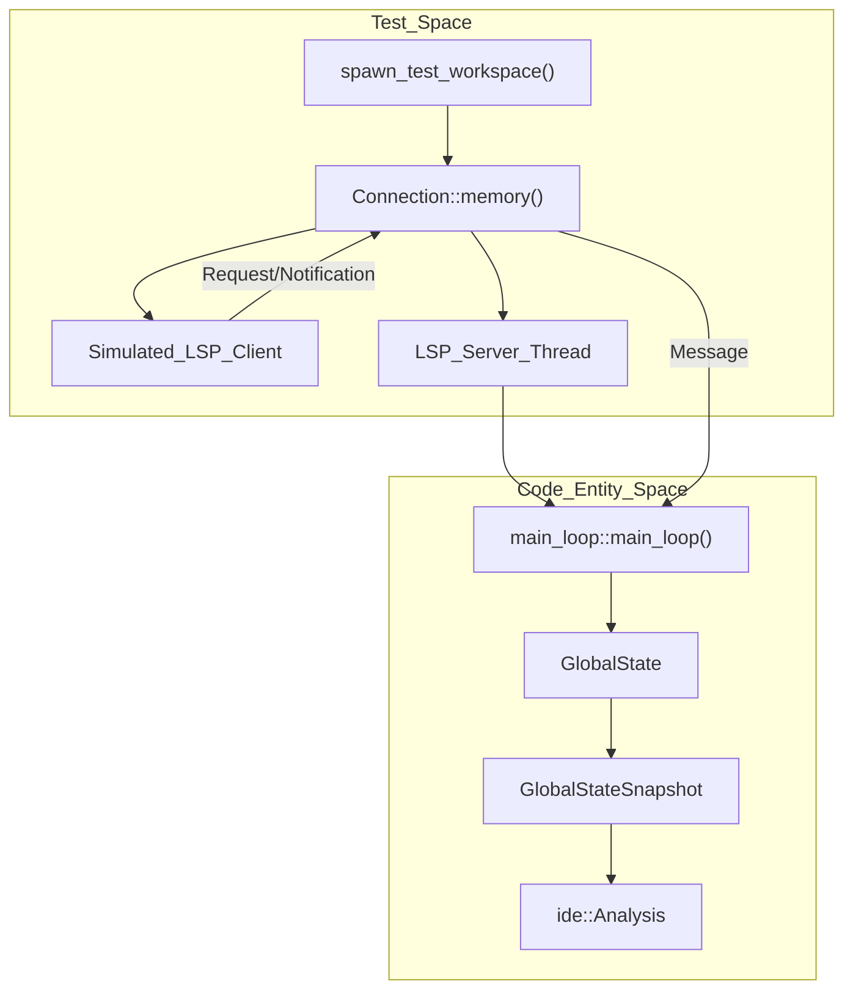
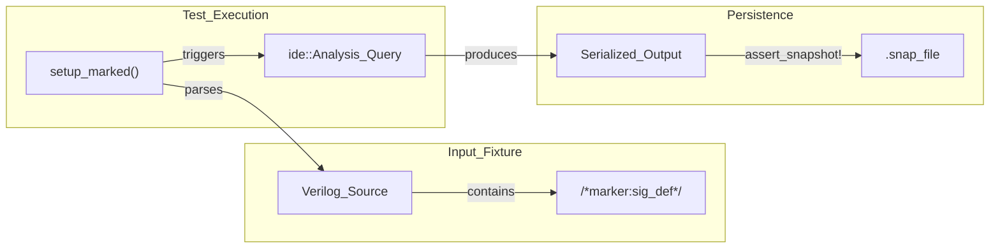

<!-- source: DeepWiki mcp.deepwiki.com · repo pascal-lab/vide · page 11 Testing Infrastructure · fetched 2026-10-12 -->

# Testing Infrastructure

Relevant source files

The following files were used as context for generating this wiki page:

- [crates/ide/src/definitions.rs](crates/ide/src/definitions.rs)
- [crates/ide/src/diagnostics.rs](crates/ide/src/diagnostics.rs)
- [crates/ide/src/document_symbols.rs](crates/ide/src/document_symbols.rs)
- [crates/ide/src/navigation_target.rs](crates/ide/src/navigation_target.rs)
- [crates/ide/src/verilog_2005.rs](crates/ide/src/verilog_2005.rs)
- [crates/project-model/src/lib.rs](crates/project-model/src/lib.rs)
- [crates/project-model/src/toml_workspace.rs](crates/project-model/src/toml_workspace.rs)
- [src/tests.rs](src/tests.rs)

The Vide testing infrastructure is designed to validate correctness across multiple layers of the system, from low-level IDE logic to high-level Language Server Protocol (LSP) interactions. The strategy relies on a combination of simulated LSP environments, snapshot-based unit testing, and specialized test utilities.

### Testing Architecture Overview

The testing stack mirrors the system architecture, providing hooks at the `ide` crate level for logic verification and at the `src` (LSP server) level for integration verification.

| Test Type | Location | Scope | Primary Tools |
| :--- | :--- | :--- | :--- |
| **Integration** | `src/tests.rs` | Full LSP lifecycle, VFS, and multi-file projects | `spawn_test_workspace`, `Connection::memory()` |
| **IDE Unit** | `crates/ide/src/` | Specific features (Completion, Goto, etc.) | Caret markers, `insta` snapshots |
| **Infrastructure** | `crates/utils/src/test_support.rs` | Filesystem mocking and temp directories | `TestDir` |

### Code Entity Mapping: Test Environment

The following diagram illustrates how the testing infrastructure simulates a real editor environment to exercise the `GlobalState` and `Analysis` engines.

**Test Simulation Flow**

Sources: [src/tests.rs:140-149](), [src/tests.rs:102-107]()

---

### LSP Integration Tests

Integration tests reside in `src/tests.rs` and verify the server's behavior as a black box. These tests use an in-memory connection to simulate a client-server handshake.

*   **Workspace Lifecycle**: Initialization, configuration changes via `DidChangeConfiguration`, and file watching using `DidChangeWatchedFiles` [src/tests.rs:23-26]().
*   **Diagnostic Pipeline**: Validating both "Push" (via `PublishDiagnostics`) and "Pull" (via `DocumentDiagnosticRequest`) diagnostic models [src/tests.rs:13-22]().
*   **Project Modeling**: Testing how the server handles "best-effort" (unconfigured) vs "configured" (with `vide.toml`) workspaces [src/tests.rs:168-190]().

For details, see [LSP Integration Tests](#11.1).

### IDE Unit Tests and Snapshot Testing

The `ide` crate uses a data-driven testing approach. Instead of writing verbose assertions, developers use **Caret Markers** and **Snapshots**.

*   **Caret Markers**: Fixtures use `/*marker:name*/` or `/*caret*/` to indicate the simulated cursor position for features like completion, rename, or document highlighting [crates/ide/src/verilog_2005.rs:43-92]().
*   **Snapshot Files (`.snap`)**: Vide uses the `insta` crate for snapshot testing. The output of IDE queries (e.g., semantic tokens or symbols) is serialized and stored in `.snap` files [crates/ide/src/verilog_2005.rs:20-20]().
*   **Functional Specification**: `verilog_2005.rs` serves as a large functional test suite, verifying navigation across modules, tasks, generate blocks, and specify blocks [crates/ide/src/verilog_2005.rs:43-92]().

**IDE Test Data Flow**

Sources: [crates/ide/src/verilog_2005.rs:166-178](), [crates/ide/src/verilog_2005.rs:134-164]()

For details, see [IDE Unit Tests and Snapshot Testing](#11.2).

### Test Support Utilities

Vide provides several utilities to manage the environment during testing:
*   **`TestDir`**: A wrapper for temporary directories that ensures cleanup and provides `AbsPathBuf` compatibility [src/tests.rs:57-57]().
*   **`setup_marked_files`**: Utility to initialize a virtual workspace with multiple files containing caret markers for cross-file navigation testing [crates/ide/src/verilog_2005.rs:182-201]().
*   **`normalize_fixture_text`**: Ensures cross-platform consistency by handling line endings and indentation in test strings [crates/ide/src/verilog_2005.rs:99-99]().

Sources: [src/tests.rs:57-57](), [crates/ide/src/verilog_2005.rs:182-201]()

---

## Child Pages
*   [LSP Integration Tests](#11.1) — Detailed guide on `src/tests.rs`, simulated clients, and workspace configuration testing.
*   [IDE Unit Tests and Snapshot Testing](#11.2) — Deep dive into caret fixtures, the snapshot workflow, and functional specifications for Verilog features.

---

