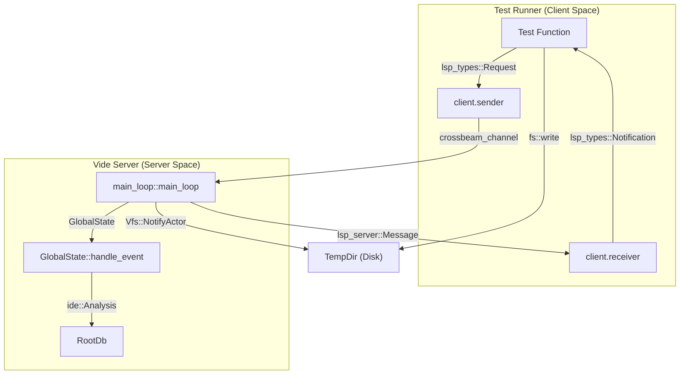
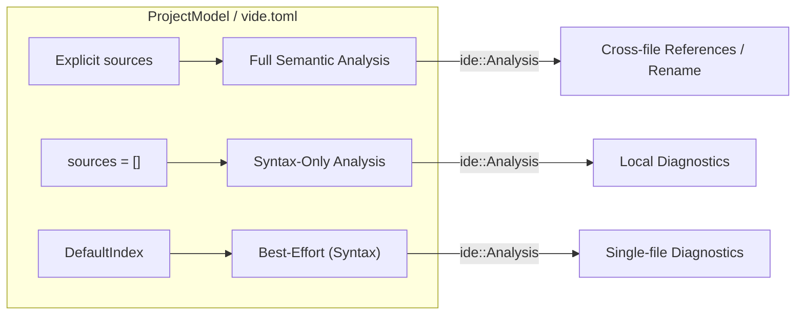

<!-- source: DeepWiki mcp.deepwiki.com · repo pascal-lab/vide · page 11.1 LSP Integration Tests · fetched 2026-10-12 -->

# LSP Integration Tests

Relevant source files

The following files were used as context for generating this wiki page:

- [crates/ide/src/diagnostics.rs](crates/ide/src/diagnostics.rs)
- [crates/project-model/src/lib.rs](crates/project-model/src/lib.rs)
- [crates/project-model/src/toml_workspace.rs](crates/project-model/src/toml_workspace.rs)
- [src/global_state/diagnostics.rs](src/global_state/diagnostics.rs)
- [src/global_state/handlers/request/code_action.rs](src/global_state/handlers/request/code_action.rs)
- [src/global_state/qihe.rs](src/global_state/qihe.rs)
- [src/global_state/semantic_compiler.rs](src/global_state/semantic_compiler.rs)
- [src/tests.rs](src/tests.rs)
- [src/tests/code_actions.rs](src/tests/code_actions.rs)
- [src/tests/diagnostics.rs](src/tests/diagnostics.rs)
- [src/tests/workspace_symbols.rs](src/tests/workspace_symbols.rs)

The LSP integration test suite, located in `src/tests.rs`, provides end-to-end validation of the Vide language server. These tests simulate an LSP client by spawning the server's main loop in a separate thread and communicating via memory-based channels. This allows for testing complex interactions like cross-file navigation, workspace configuration changes, and the diagnostic lifecycle without requiring a physical editor.

### Test Infrastructure and Lifecycle

The testing framework relies on `spawn_test_workspace` to initialize a server instance. It utilizes `lsp_server::Connection::memory()` to create a bidirectional communication pipe between the "client" (the test runner) and the server [src/tests.rs:146-149]().

#### Key Components
*   **`spawn_test_workspace`**: Sets up the `config::Config`, initializes the `main_loop`, and returns the client-side connection [src/tests.rs:140-149]().
*   **`recv_lsp_message_until`**: A helper function that polls the client receiver for a specific message within a 30-second timeout (`LSP_TEST_TIMEOUT`), ensuring tests do not hang indefinitely [src/tests.rs:68-86]().
*   **`TempDir`**: Alias for `utils::test_support::TestDir`, providing isolated file system environments for each test case [src/tests.rs:57]().
*   **`open_test_document`**: Simulates a `DidOpenTextDocument` notification, marking a file as "open" in the server's memory [src/tests.rs:151-166]().

#### Simulated Client-Server Data Flow
The following diagram illustrates how the test suite bridges the LSP protocol with the internal server state.

**LSP Test Communication Flow**

Sources: [src/tests.rs:102-107](), [src/tests.rs:140-149](), [src/tests.rs:151-166]()

---

### Diagnostic Models: Push vs. Pull

Vide supports both the traditional "Push" model (server sends `textDocument/publishDiagnostics`) and the LSP 3.17 "Pull" model (`textDocument/diagnostic` and `workspace/diagnostic`).

#### Push Diagnostics
In push mode, the server automatically broadcasts diagnostics when files change. Tests like `pull_capable_client_does_not_receive_duplicate_publish_diagnostics` verify that the server respects client capabilities; if a client supports pull diagnostics, the server should suppress unsolicited push notifications [src/tests/diagnostics.rs:71-181]().

#### Pull Diagnostics
Pull diagnostics are tested via `DocumentDiagnosticRequest` and `WorkspaceDiagnosticRequest`. The server returns a `DocumentDiagnosticReportResult`, which can be "Full" or "Unchanged" based on the `previous_result_id` [src/tests/diagnostics.rs:95-130]().

| Feature | LSP Request/Notification | Handler in Tests |
| :--- | :--- | :--- |
| **Push** | `textDocument/publishDiagnostics` | `PublishDiagnostics::METHOD` [src/tests/diagnostics.rs:133]() |
| **Pull (Doc)** | `textDocument/diagnostic` | `DocumentDiagnosticRequest` [src/tests/diagnostics.rs:98]() |
| **Pull (WS)** | `workspace/diagnostic` | `WorkspaceDiagnosticRequest` [src/tests.rs:32]() |

Sources: [src/tests/diagnostics.rs:71-181](), [crates/ide/src/diagnostics.rs:33-55](), [src/global_state/diagnostics.rs:127-131]()

---

### Workspace Configuration Modes

The test suite validates Vide's behavior across different project states, particularly how it handles `vide.toml` through the `project-model` crate.

1.  **Configured Mode**: Tests use `setup_configured_diagnostics_test`, which writes a `DEFAULT_TEST_CONFIG` (`sources = ["**"]`). This enables full semantic analysis [src/tests.rs:177-182]().
2.  **Best-Effort (Unconfigured) Mode**: When `vide.toml` is missing, Vide uses `ManifestSourcePolicy::DefaultIndex`, scanning the root for indexing but disabling heavy semantic diagnostics [crates/project-model/src/lib.rs:135-142]().
3.  **Syntax-Only Mode**: A specific configuration (`SYNTAX_ONLY_TEST_CONFIG`) sets `sources = []`, which prevents the server from scanning the workspace for semantic analysis while maintaining syntax checks [src/tests.rs:61-66]().

**Configuration Impact on Analysis**

Sources: [src/tests.rs:60-66](), [crates/project-model/src/lib.rs:135-161](), [crates/project-model/src/toml_workspace.rs:71-84]()

---

### Navigation and Refactoring Tests

Integration tests ensure that `ide` layer features work correctly when exposed through the LSP protocol.

*   **Goto Definition**: Tests verify that a `GotoDefinition` request on a module instantiation returns the correct `GotoDefinitionResponse` pointing to the module definition in another file [src/tests.rs:17-31]().
*   **Rename**: Validates the `textDocument/rename` request and custom extensions like `EXPANDED_RENAME_COMMAND`. These tests ensure that renaming a signal or module generates a `WorkspaceEdit` that correctly updates all references [src/tests.rs:48-52]().
*   **Workspace Symbols**: `workspace_symbol_finds_symbols_across_files` confirms that the server can find symbols across multiple files using fuzzy queries (e.g., searching for "top shared") [src/tests/workspace_symbols.rs:3-95]().
*   **Code Actions**: Tests in `src/tests/code_actions.rs` verify that the server provides relevant quick-fixes (like "Insert missing ';'") and refactors (like "Extract into variable") based on the `CodeActionContext` and current diagnostics [src/tests/code_actions.rs:174-209]().

Sources: [src/tests/workspace_symbols.rs:3-95](), [src/tests/code_actions.rs:4-53](), [crates/ide/src/diagnostics.rs:216-235]()

---

### File Watching and VFS Synchronization

Vide relies on `DidChangeWatchedFiles` to detect external changes (e.g., `git checkout` or external editor edits).

The test logic for watched files typically involves:
1.  Writing a file to disk using `fs::write` to simulate an external change.
2.  Sending a `DidChangeWatchedFiles` notification to the server containing `FileEvent` items with `FileChangeType::Created`, `Changed`, or `Deleted` [src/tests.rs:16-25]().
3.  Verifying that the server updates its internal `Vfs` and triggers a re-analysis, advancing the `DiagnosticCommitFreshness` [src/global_state/diagnostics.rs:10-15]().

This confirms the integration between the LSP protocol layer and the `vfs` crate's notification logic.

Sources: [src/tests.rs:24-26](), [src/global_state/diagnostics.rs:66-78](), [crates/project-model/src/lib.rs:48-51]()

---

