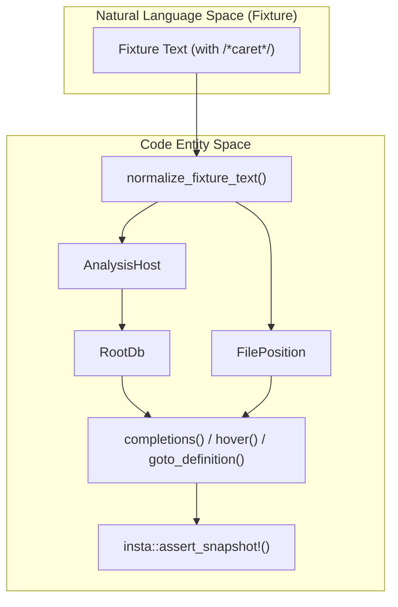
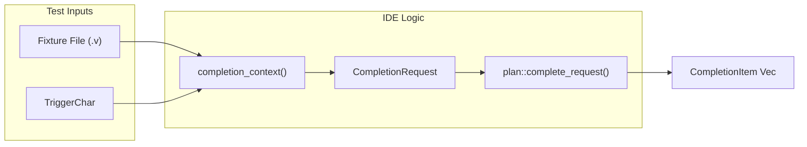

<!-- source: DeepWiki mcp.deepwiki.com · repo pascal-lab/vide · page 11.2 IDE Unit Tests and Snapshot Testing · fetched 2026-10-12 -->

# IDE Unit Tests and Snapshot Testing

Relevant source files

The following files were used as context for generating this wiki page:

- [crates/ide/src/completion.rs](crates/ide/src/completion.rs)
- [crates/ide/src/completion/context.rs](crates/ide/src/completion/context.rs)
- [crates/ide/src/completion/context/decl_name.rs](crates/ide/src/completion/context/decl_name.rs)
- [crates/ide/src/completion/context/expected.rs](crates/ide/src/completion/context/expected.rs)
- [crates/ide/src/completion/context/lex.rs](crates/ide/src/completion/context/lex.rs)
- [crates/ide/src/completion/engine.rs](crates/ide/src/completion/engine.rs)
- [crates/ide/src/completion/engine/keywords.rs](crates/ide/src/completion/engine/keywords.rs)
- [crates/ide/src/completion/engine/preproc.rs](crates/ide/src/completion/engine/preproc.rs)
- [crates/ide/src/completion/engine/sensitivity_list.rs](crates/ide/src/completion/engine/sensitivity_list.rs)
- [crates/ide/src/completion/engine/tests.rs](crates/ide/src/completion/engine/tests.rs)
- [crates/ide/src/definitions.rs](crates/ide/src/definitions.rs)
- [crates/ide/src/document_symbols.rs](crates/ide/src/document_symbols.rs)
- [crates/ide/src/navigation_target.rs](crates/ide/src/navigation_target.rs)
- [crates/ide/src/snapshots/ide__verilog_2005__verilog_2005_lsp_snapshots.snap](crates/ide/src/snapshots/ide__verilog_2005__verilog_2005_lsp_snapshots.snap)
- [crates/ide/src/verilog_2005.rs](crates/ide/src/verilog_2005.rs)
- [crates/syntax/src/has_name.rs](crates/syntax/src/has_name.rs)
- [crates/utils/src/uniq_vec.rs](crates/utils/src/uniq_vec.rs)

This page describes the infrastructure used to test IDE features within the `ide` crate. The testing strategy relies on marker-based fixtures to simulate user interaction (like cursor placement) and snapshot testing to verify complex outputs like completion lists, semantic tokens, and document symbols.

## Overview of Testing Strategy

The `ide` crate uses several mechanisms to ensure feature correctness:
1.  **Caret Markers**: Using `/*caret*/` strings in source fixtures to define `FilePosition` for requests [crates/ide/src/completion/engine/tests.rs:15-16]().
2.  **Named Markers**: Using `/*marker:name*/` to identify specific syntax nodes for navigation and reference testing [crates/ide/src/verilog_2005.rs:43-92]().
3.  **Snapshot Testing**: Utilizing the `insta` crate to compare current IDE output against stored `.snap` files [crates/ide/src/verilog_2005.rs:20-20]().
4.  **Functional Specifications**: Large-scale tests like `verilog_2005.rs` that exercise multiple IDE features (Go-to-Definition, Symbols, Semantic Tokens) on a single complex Verilog file [crates/ide/src/verilog_2005.rs:43-92]().

### Data Flow: From Fixture to Assertion

The following diagram illustrates how a test fixture is processed into a testable state and eventually verified against a snapshot.

**Figure 1: IDE Test Execution Pipeline**

Sources: [crates/ide/src/completion/engine/tests.rs:13-48](), [crates/ide/src/verilog_2005.rs:94-114]()

## Caret Markers and Fixtures

For features requiring a specific offset (like completion or hover), tests use the `/*caret*/` marker.

### Implementation in Completion Tests
The `setup_with_path` function in the completion engine tests performs the following steps:
1.  Locates the `/*caret*/` string in the input text [crates/ide/src/completion/engine/tests.rs:16-16]().
2.  Removes the marker to restore valid Verilog syntax [crates/ide/src/completion/engine/tests.rs:18-18]().
3.  Calculates the `TextSize` offset at the marker's location [crates/ide/src/completion/engine/tests.rs:33-33]().
4.  Initializes an `AnalysisHost` and applies a `Change` containing the cleaned text [crates/ide/src/completion/engine/tests.rs:27-32]().

### Marker Mapping for Navigation
For navigation tests (references, rename, definition), the `setup_marked` function extracts multiple named markers using the `strip_markers` utility [crates/ide/src/verilog_2005.rs:174-174](). These are stored in a `HashMap<String, TextSize>` for easy lookup during test assertions [crates/ide/src/verilog_2005.rs:173-177]().

Sources: [crates/ide/src/completion/engine/tests.rs:13-35](), [crates/ide/src/verilog_2005.rs:166-178]()

## Snapshot Testing (.snap)

Vide heavily uses snapshot testing for features with voluminous or structured output. Snapshots are stored in `crates/ide/src/snapshots/`.

### Verilog 2005 Functional Spec
The `verilog_2005.rs` file contains a comprehensive test suite that generates a single "report" snapshot covering:
*   **Document Symbols**: Hierarchical view of the file generated via `document_symbols` [crates/ide/src/snapshots/ide__verilog_2005__verilog_2005_lsp_snapshots.snap:5-24]().
*   **Semantic Tokens**: Token ranges and their assigned modifiers (e.g., `READ`, `WRITE`, `Clk`) [crates/ide/src/snapshots/ide__verilog_2005__verilog_2005_lsp_snapshots.snap:26-37]().
*   **Navigation Targets**: Verification that `module_ref` correctly points to a `Module` definition [crates/ide/src/snapshots/ide__verilog_2005__verilog_2005_lsp_snapshots.snap:39-50]().
*   **Rename Operations**: Snapshots of the source code after performing renames on various entities like `genvar`, `specparam`, and `task` [crates/ide/src/snapshots/ide__verilog_2005__verilog_2005_lsp_snapshots.snap:65-106]().

### Completion Engine Snapshots
Completion tests verify both the labels and the snippets generated. The `completion_fixtures` test uses `insta::glob!` to run tests against all files in the `fixtures/` directory, comparing the resulting `Vec<CompletionItem>` against stored debug snapshots [crates/ide/src/completion/engine/tests.rs:151-157]().

Sources: [crates/ide/src/verilog_2005.rs:43-92](), [crates/ide/src/snapshots/ide__verilog_2005__verilog_2005_lsp_snapshots.snap:1-114](), [crates/ide/src/completion/engine/tests.rs:151-157]()

## Feature-Specific Test Implementation

### Completion Engine Tests
Completion tests often use external fixture files. The `load_fixture` function handles reading these files and parsing special `// trigger:` headers to simulate different LSP trigger characters (e.g., `.`, `(`, `` ` ``) [crates/ide/src/completion/engine/tests.rs:54-73]().

**Figure 2: Completion Test Components**

Sources: [crates/ide/src/completion/engine/tests.rs:87-116](), [crates/ide/src/completion/engine.rs:31-50]()

### Document Symbols and Navigation Targets
The `document_symbols` function uses a `SymbolCollecter` to traverse the HIR tree and regions, building a tree of `DocumentSymbol` objects [crates/ide/src/document_symbols.rs:67-162](). Navigation targets are handled by the `ToNav` trait, which converts internal IDs like `ModuleId` or `DefId` into a `NavTarget` containing ranges and names [crates/ide/src/navigation_target.rs:52-80]().

| Feature | Primary Code Entity | Test Verification Method |
| :--- | :--- | :--- |
| **Symbols** | `SymbolCollecter` | `DocumentSymbol` hierarchy snapshot |
| **Navigation** | `DefinitionClass` | `NavTarget` focus range matching |
| **Completion** | `CompletionContext` | `CompletionItem` label/snippet snapshot |
| **Tokens** | `SemaTokenConfig` | Encoded token class snapshot |

Sources: [crates/ide/src/document_symbols.rs:198-216](), [crates/ide/src/navigation_target.rs:34-44](), [crates/ide/src/definitions.rs:27-31]()

---

