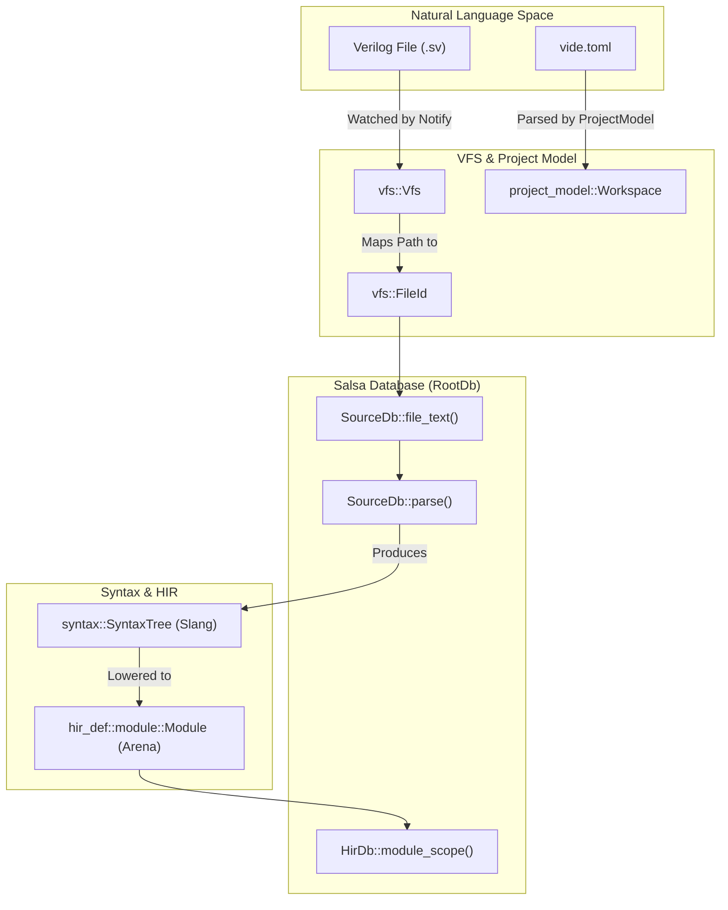
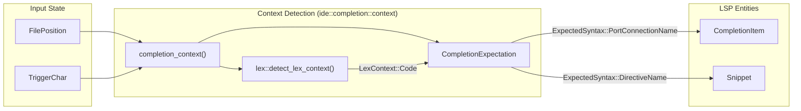

<!-- source: DeepWiki mcp.deepwiki.com · repo pascal-lab/vide · page 12 Glossary · fetched 2026-10-12 -->

# Glossary

Relevant source files

The following files were used as context for generating this wiki page:

- [Cargo.toml](Cargo.toml)
- [crates/hir/src/def_id.rs](crates/hir/src/def_id.rs)
- [crates/hir/src/hir_def.rs](crates/hir/src/hir_def.rs)
- [crates/hir/src/hir_def/block.rs](crates/hir/src/hir_def/block.rs)
- [crates/hir/src/hir_def/expr.rs](crates/hir/src/hir_def/expr.rs)
- [crates/hir/src/hir_def/file.rs](crates/hir/src/hir_def/file.rs)
- [crates/hir/src/hir_def/module.rs](crates/hir/src/hir_def/module.rs)
- [crates/hir/src/hir_def/module/port.rs](crates/hir/src/hir_def/module/port.rs)
- [crates/hir/src/hir_def/stmt.rs](crates/hir/src/hir_def/stmt.rs)
- [crates/hir/src/scope.rs](crates/hir/src/scope.rs)
- [crates/hir/src/semantics/pathres.rs](crates/hir/src/semantics/pathres.rs)
- [crates/hir/src/symbol.rs](crates/hir/src/symbol.rs)
- [crates/hir/src/type_infer.rs](crates/hir/src/type_infer.rs)
- [crates/ide/src/completion.rs](crates/ide/src/completion.rs)
- [crates/ide/src/completion/context.rs](crates/ide/src/completion/context.rs)
- [crates/ide/src/completion/context/decl_name.rs](crates/ide/src/completion/context/decl_name.rs)
- [crates/ide/src/completion/context/expected.rs](crates/ide/src/completion/context/expected.rs)
- [crates/ide/src/completion/context/lex.rs](crates/ide/src/completion/context/lex.rs)
- [crates/ide/src/completion/engine.rs](crates/ide/src/completion/engine.rs)
- [crates/ide/src/completion/engine/keywords.rs](crates/ide/src/completion/engine/keywords.rs)
- [crates/ide/src/completion/engine/preproc.rs](crates/ide/src/completion/engine/preproc.rs)
- [crates/ide/src/completion/engine/sensitivity_list.rs](crates/ide/src/completion/engine/sensitivity_list.rs)
- [crates/ide/src/completion/engine/tests.rs](crates/ide/src/completion/engine/tests.rs)
- [crates/ide/src/render.rs](crates/ide/src/render.rs)
- [crates/utils/src/uniq_vec.rs](crates/utils/src/uniq_vec.rs)
- [editors/vscode/LICENSE](editors/vscode/LICENSE)
- [editors/vscode/package-lock.json](editors/vscode/package-lock.json)
- [editors/vscode/package.json](editors/vscode/package.json)
- [src/global_state.rs](src/global_state.rs)
- [src/global_state/handlers/notification.rs](src/global_state/handlers/notification.rs)
- [src/global_state/main_loop.rs](src/global_state/main_loop.rs)
- [src/global_state/mem_docs.rs](src/global_state/mem_docs.rs)
- [src/global_state/process_changes.rs](src/global_state/process_changes.rs)
- [src/global_state/reload.rs](src/global_state/reload.rs)
- [src/global_state/snapshot.rs](src/global_state/snapshot.rs)

This page provides definitions for codebase-specific terminology, architectural patterns, and domain concepts used within Vide. It serves as a reference for engineers to understand the mapping between high-level SystemVerilog concepts and their implementation in the Rust source code.

## Core System Concepts

### Salsa / Incremental Computation
Vide uses the **Salsa** framework for incremental computation. Instead of re-parsing the entire workspace on every change, Salsa tracks dependencies between "queries" (functions). If an input (like a file's text) changes, only the affected downstream queries are re-executed.

*   **RootDb**: The central database struct that implements all Salsa query traits (e.g., `SourceDb`, `HirDb`, `IdeDb`). [src/global_state.rs:23-27]()
*   **Query Group**: A trait defining a set of related queries, such as `SourceDb` for text access and `HirDb` for semantic lowering. [crates/hir/src/db.rs:62-65]()
*   **AnalysisHost**: The main entry point for managing the database. It provides a `make_analysis` method to get a snapshot for read-only queries and an `apply_change` method for updates. [src/global_state.rs:97-101]()

### VFS (Virtual File System)
The VFS layer abstracts physical disk access. It assigns a unique, stable `FileId` to every file in the workspace.

*   **FileId**: A small integer identifier used throughout the compiler instead of paths to avoid string allocations and normalization issues. [src/global_state.rs:36-36]()
*   **Vfs**: The core structure maintaining the mapping between `FileId` and `VfsPath`. [src/global_state.rs:114-117]()
*   **Loader**: The mechanism for reading files (e.g., `NotifyHandle` for disk watching or `DummyHandle` for non-watching environments). [src/global_state.rs:124-137]()

### HIR (High-level Intermediate Representation)
HIR is Vide's semantic model. Unlike a Syntax Tree (which represents the literal structure of code), HIR represents the *meaning*—resolved names, typed expressions, and module hierarchies.

*   **Arena Allocation**: HIR nodes are stored in `la_arena::Arena<T>` structures to allow for efficient ID-based referencing (e.g., `ExprId`, `StmtId`) without using heavy pointers or Arcs everywhere. [crates/hir/src/hir_def/module.rs:82-126]()
*   **Lowering**: The process of converting a Slang Syntax Tree into HIR. This is handled by various `LowerCtx` implementations. [crates/hir/src/hir_def/module.rs:32-61]()
*   **Source Map**: A bidirectional mapping between HIR IDs and Syntax Tree pointers (`SyntaxNodePtr`), used to bridge semantic results back to the editor's text range. [crates/hir/src/hir_def/module.rs:128-171]()

---

## Domain Terms and Implementation

| Term | Definition | Code Entity |
| :--- | :--- | :--- |
| **GlobalState** | The central state machine of the LSP server, managing analysis, VFS, and task pools. | `GlobalState` [src/global_state.rs:67-77]() |
| **CaretSnapshot** | A point-in-time view of the syntax and lexer state around the user's cursor during completion. | `CaretSnapshot` [crates/ide/src/completion/context.rs:22-22]() |
| **Module** | The semantic representation of a Verilog module, containing arenas for ports, procs, and stmts. | `Module` [crates/hir/src/hir_def/module.rs:84-126]() |
| **NameScope** | A symbol table for a specific scope (file, module, block) used for name resolution. | `NameScope` [crates/hir/src/scope.rs:76-120]() |
| **PathResolution** | The result of resolving a hierarchical or scoped name, potentially pointing to multiple `DefId`s. | `PathResolution` [crates/hir/src/semantics/pathres.rs:32-43]() |
| **MemDocs** | Manages the content of files currently open in the editor (in-memory documents). | `MemDocs` [src/global_state.rs:99-99]() |
| **Qihe** | A specialized analysis sub-system for advanced linting or verification. | `Qihe` [src/global_state.rs:73-73]() |

---

## Data Flow Diagrams

### From Text to Semantic Analysis
The following diagram bridges the "Natural Language Space" (File, Text) to the "Code Entity Space" (Vfs, Salsa, HIR).

**Sources:** [src/global_state.rs:114-122](), [src/global_state/reload.rs:162-172](), [crates/hir/src/hir_def/module.rs:82-126](), [crates/hir/src/scope.rs:197-201]()

### Completion Engine Context Detection
How the engine determines what to suggest based on the cursor position.

**Sources:** [crates/ide/src/completion/context.rs:102-133](), [crates/ide/src/completion/context.rs:25-45](), [crates/ide/src/completion/context.rs:48-70]()

---

## Abbreviations

*   **AST**: Abstract Syntax Tree (specifically the Slang-provided `SyntaxTree`). [crates/hir/src/hir_def/module.rs:207-211]()
*   **FFI**: Foreign Function Interface (Vide communicates with the C++ Slang library via the `slang` crate). [Cargo.toml:63-63]()
*   **LSP**: Language Server Protocol. [Cargo.toml:35-36]()
*   **VFS**: Virtual File System. [src/global_state.rs:36-36]()
*   **HIR**: High-level Intermediate Representation. [crates/hir/src/lib.rs]()
*   **Sema**: Short for Semantics, the layer providing high-level queries over the code. [crates/hir/src/semantics/pathres.rs:31-43]()

**Sources:** [Cargo.toml:19-25](), [src/global_state.rs:67-101](), [crates/hir/src/hir_def/module.rs:82-126](), [crates/ide/src/completion/context.rs:11-32]()