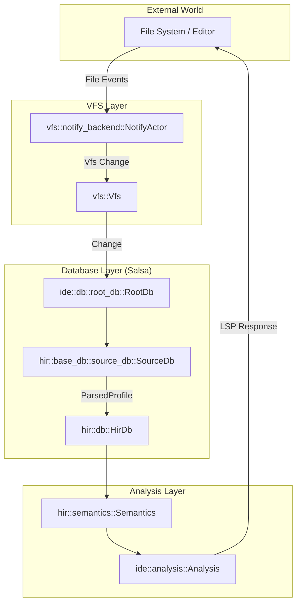

<!-- source: DeepWiki mcp.deepwiki.com · repo pascal-lab/vide · page 2 Architecture Overview · fetched 2026-10-12 -->

# Architecture Overview

<details>
<summary>Relevant source files</summary>

The following files were used as context for generating this wiki page:

- [Cargo.toml](Cargo.toml)
- [crates/hir/src/base_db/analysis_snapshot.rs](crates/hir/src/base_db/analysis_snapshot.rs)
- [crates/hir/src/base_db/source_db.rs](crates/hir/src/base_db/source_db.rs)
- [crates/hir/src/preproc.rs](crates/hir/src/preproc.rs)
- [crates/ide/Cargo.toml](crates/ide/Cargo.toml)
- [crates/ide/src/analysis_host.rs](crates/ide/src/analysis_host.rs)
- [crates/ide/src/db/root_db.rs](crates/ide/src/db/root_db.rs)
- [editors/vscode/LICENSE](editors/vscode/LICENSE)
- [editors/vscode/package-lock.json](editors/vscode/package-lock.json)
- [editors/vscode/package.json](editors/vscode/package.json)

</details>


Vide is a high-performance language server for Verilog and SystemVerilog, built using a multi-crate Rust workspace [Cargo.toml:13-14](). It leverages the **Salsa** incremental computation framework to provide low-latency IDE features by recomputing only the necessary parts of the semantic model when files change.

## High-Level System Structure

The system is organized into several distinct layers, ranging from raw file I/O to high-level IDE logic and the LSP communication protocol.

### System Data Flow
The following diagram illustrates how data flows from the physical file system through the incremental database into the IDE layer.

**Data Transformation Pipeline**

Sources: [crates/ide/src/db/root_db.rs:26-34](), [crates/ide/src/analysis_host.rs:27-30](), [Cargo.toml:19-25]()

---

## Core Subsystems

### 1. Virtual File System (VFS)
The VFS layer abstracts the physical file system, providing a consistent view of files across different environments (Native vs. WASM). It assigns a unique `FileId` [crates/hir/src/base_db/source_db.rs:8]() to every tracked file, ensuring that the rest of the system refers to files by stable identifiers rather than volatile paths.
*   **Key Entities:** `vfs::Vfs`, `vfs::FileId`, `vfs::loader::Handle`.
*   **For details, see [Virtual File System (VFS)](#2.1).**

### 2. Incremental Database (Salsa)
The `RootDb` is the heart of Vide. It is a Salsa database that composes multiple storage layers (Source, HIR, Line Index, and Symbol Index) [crates/ide/src/db/root_db.rs:26-33](). Salsa tracks dependencies between queries; for example, if a file's text changes via `set_file_text`, only the dependent ASTs and HIR structures are invalidated.
*   **Key Entities:** `ide::db::root_db::RootDb`, `hir::base_db::source_db::SourceDb`, `Durability`.
*   **For details, see [Incremental Database (Salsa / RootDb)](#2.2).**

### 3. Project Model
The project model handles workspace discovery and configuration. It parses `vide.toml` manifests to determine include paths, preprocessor defines, and the compilation profiles required for the Slang parser [crates/hir/src/base_db/source_db.rs:14-16]().
*   **Key Entities:** `project_model::ProjectManifest`, `hir::base_db::project::ProjectConfig`.
*   **For details, see [Project Model and Workspace Loading](#2.3).**

### 4. Syntax and HIR
Vide uses the **Slang** C++ library (via Rust FFI) for robust SystemVerilog parsing [Cargo.toml:63](). The resulting AST is then lowered into a **High-level Intermediate Representation (HIR)**. This layer handles preprocessor modeling [crates/hir/src/preproc.rs:1-7](), scope resolution, and name binding.
*   **Key Entities:** `syntax::SyntaxTree`, `hir::base_db::source_db::ParsedCompilationUnit`, `hir::semantics::Semantics`.

### 5. IDE and LSP Server
The `ide` crate provides the high-level API for features like "Go to Definition," "Completion," and "Hover." The `AnalysisHost` manages the `RootDb` and provides thread-safe `Analysis` snapshots [crates/ide/src/analysis_host.rs:12-25](). The LSP server (in `src/`) acts as the glue, dispatching JSON-RPC requests from the editor to the `ide` layer.

---

## Code-to-System Mapping

This diagram maps the logical subsystems to the specific Rust structs and traits that implement them.

**System Entity Map**
```mermaid
classDiagram
    class RootDb {
        +storage: salsa::Storage
        +apply_change(change: Change)
        +snapshot() salsa::Snapshot
    }
    class SourceDb {
        <<trait>>
        +file_text(file_id: FileId) Arc~str~
        +file_path(file_id: FileId) AbsPathBuf
        +project_config() Arc~ProjectConfig~
    }
    class HirDb {
        <<trait>>
        +module_data(id: ModuleId)
        +infer_query(id: ExprId)
    }
    class LineIndexDb {
        <<trait>>
        +line_index(file_id: FileId)
    }

    RootDb ..|> SourceDb
    RootDb ..|> HirDb
    RootDb ..|> LineIndexDb
    
    style RootDb stroke-width:4px
```
Sources: [crates/ide/src/db/root_db.rs:26-34](), [crates/hir/src/base_db/source_db.rs:43-62](), [crates/ide/src/analysis_host.rs:27-30]()

### Crate Dependencies

| Crate | Responsibility |
| :--- | :--- |
| `vfs` | File path and content management; file watching. |
| `syntax` | Slang FFI bindings and syntax tree utilities. |
| `hir` | Semantic model, name resolution, and preprocessor modeling. |
| `project-model` | `vide.toml` parsing and workspace layout. |
| `ide` | Concrete `RootDb` implementation and pure IDE logic. |
| `utils` | Shared utilities like paths, line indexes, and concurrency primitives. |

Sources: [Cargo.toml:53-63]()

---

