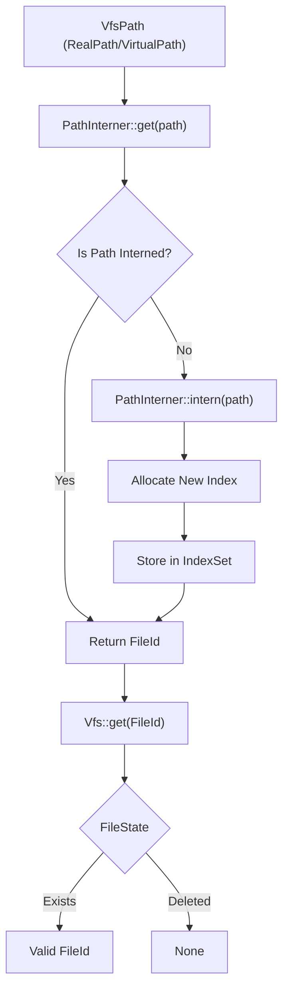
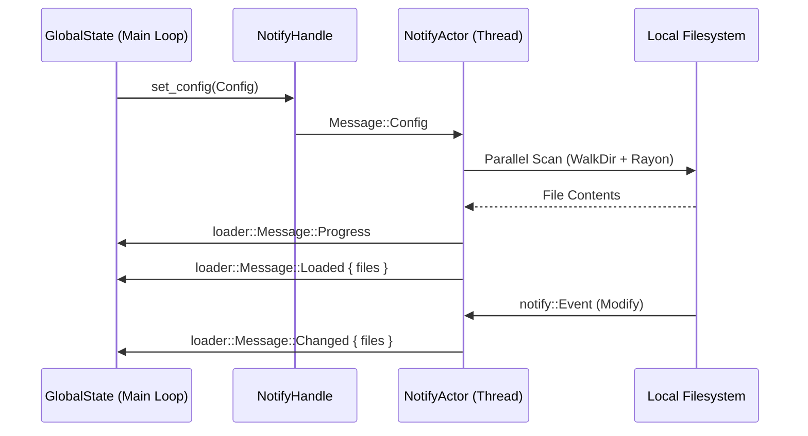

<!-- source: DeepWiki mcp.deepwiki.com · repo pascal-lab/vide · page 2.1 Virtual File System (VFS) · fetched 2026-10-12 -->

# Virtual File System (VFS)

Relevant source files

The following files were used as context for generating this wiki page:

- [crates/vfs/Cargo.toml](crates/vfs/Cargo.toml)
- [crates/vfs/src/anchored_path.rs](crates/vfs/src/anchored_path.rs)
- [crates/vfs/src/dummy.rs](crates/vfs/src/dummy.rs)
- [crates/vfs/src/file_set.rs](crates/vfs/src/file_set.rs)
- [crates/vfs/src/file_set/tests.rs](crates/vfs/src/file_set/tests.rs)
- [crates/vfs/src/lib.rs](crates/vfs/src/lib.rs)
- [crates/vfs/src/loader.rs](crates/vfs/src/loader.rs)
- [crates/vfs/src/notify.rs](crates/vfs/src/notify.rs)
- [crates/vfs/src/path_glob.rs](crates/vfs/src/path_glob.rs)
- [crates/vfs/src/path_interner.rs](crates/vfs/src/path_interner.rs)
- [crates/vfs/src/vfs_path.rs](crates/vfs/src/vfs_path.rs)
- [src/global_state/event_loop.rs](src/global_state/event_loop.rs)
- [src/global_state/workspace_state.rs](src/global_state/workspace_state.rs)

The Virtual File System (VFS) layer abstracts file access and identity within Vide. It prevents high-level crates from interacting directly with the underlying operating system, enabling consistent file handling across native and WASM environments, supporting incremental computation via `FileId` stability, and providing robust file-watching capabilities.

## File Identity and `FileId`

In Vide, files are never referred to by raw paths in semantic analysis. Instead, every file is assigned a stable `FileId` [crates/vfs/src/lib.rs:50-51](). This integer-based identity is crucial for the Salsa incremental database to track changes efficiently.

### Path Interning and Storage
The `Vfs` struct acts as the central repository for file metadata and content hashes [crates/vfs/src/lib.rs:75-79](). It uses a `PathInterner` to maintain a bidirectional mapping between `VfsPath` and `FileId` [crates/vfs/src/path_interner.rs:12-15]().

- **Stability**: Once a `FileId` is assigned to a path, it remains constant for the lifetime of the `Vfs` instance [crates/vfs/src/path_interner.rs:29-33]().
- **State Tracking**: Each file is associated with a `FileState`, which tracks whether the file `Exists` (with a content hash), is `Deleted`, or is `Excluded` [crates/vfs/src/lib.rs:82-90]().
- **Change Log**: The VFS maintains a log of `ChangedFile` entries [crates/vfs/src/lib.rs:94-99](). These changes are "taken" by the main loop to update the Salsa database [crates/vfs/src/lib.rs:260-264]().

### VFS Identity Resolution
The following diagram illustrates how a raw `VfsPath` is resolved to a canonical `FileId` via the interner.

**Path to FileId Resolution Flow**

Sources: [crates/vfs/src/lib.rs:207-215](), [crates/vfs/src/path_interner.rs:21-33](), [crates/vfs/src/lib.rs:75-79]()

## VFS Loading and Watching

The `loader::Handle` trait defines the interface for loading file contents and watching for changes [crates/vfs/src/loader.rs:82-97](). Vide provides different implementations based on the environment.

### NotifyActor (Native)
The `NotifyActor` runs in a dedicated background thread named `VfsLoader` [crates/vfs/src/notify.rs:35-37](). It utilizes the `notify` crate for OS-level events and `walkdir` for scanning.

1.  **Configuration**: The actor receives a `loader::Config` containing `Entry::Files` or `Entry::Directories` [crates/vfs/src/loader.rs:37-48]().
2.  **Parallel Scanning**: It performs an initial recursive scan of directories using `rayon` for parallelism [crates/vfs/src/notify.rs:133-162]().
3.  **Watching**: It registers `RecommendedWatcher` instances for configured roots [crates/vfs/src/notify.rs:103-112](). When a file changes, it sends a `loader::Message::Changed` back to the main loop [crates/vfs/src/notify.rs:224-230]().

### DummyHandle (WASM / Browser)
In environments like WASM where OS watching is unavailable, Vide uses the `DummyHandle` [crates/vfs/src/dummy.rs:10-12]().
- **Manual Invalidation**: The LSP server explicitly calls `invalidate` when a `didChange` or `didSave` notification arrives [crates/vfs/src/dummy.rs:39-42]().
- **Synchronous Loading**: It reads files directly via `std::fs::read` (which is often mapped to a virtual filesystem in WASM) [crates/vfs/src/dummy.rs:44-46]().

**VFS Loading Data Flow**

Sources: [crates/vfs/src/notify.rs:94-113](), [crates/vfs/src/notify.rs:133-162](), [src/global_state/event_loop.rs:178-178]()

## Source Root Partitioning

The VFS partitions the global set of files into discrete `FileSet`s [crates/vfs/src/file_set.rs:10-13](). This allows Vide to group files into logical units (e.g., a specific project or library).

### Classification Logic
- **PathMatcher**: Uses include roots and glob patterns to determine if a path belongs to a set [crates/vfs/src/file_set.rs:67-70]().
- **FileSetConfig**: Manages an ordered collection of filters. When partitioning, the first filter that matches a file "claims" it [crates/vfs/src/file_set.rs:51-56]().
- **Partitioning**: The `partition` method iterates through all files in the `Vfs` and assigns them to the appropriate `FileSet` based on the configuration [crates/vfs/src/file_set.rs:211-213]().

| Entity | Role |
| :--- | :--- |
| `FileSet` | A map between `VfsPath` and `FileId` for one source root [crates/vfs/src/file_set.rs:10-13](). |
| `FileSetConfig` | The global partitioning configuration using a finite state transducer (`fst`) for fast lookups [crates/vfs/src/file_set.rs:51-56](). |
| `FileSetFilter` | Defines the `include`, `source`, and `exclude` rules for a specific root [crates/vfs/src/file_set.rs:170-175](). |

Sources: [crates/vfs/src/file_set.rs:178-185](), [crates/vfs/src/file_set.rs:215-225]()

## Path Abstractions

Vide uses specialized path types to ensure platform independence and support virtual environments:

1.  **`VfsPath`**: An abstraction representing either a `PathBuf` (real filesystem path) or a `VirtualPath` (an arbitrary string starting with `/`) [crates/vfs/src/vfs_path.rs:12-13]().
2.  **`AbsPathBuf`**: A wrapper that guarantees the path is absolute and normalized [crates/vfs/src/lib.rs:30-30]().
3.  **`AnchoredPath`**: Represents a path relative to a specific `FileId`. This is essential for resolving SystemVerilog `` `include `` directives where the path is relative to the file containing the directive [crates/vfs/src/anchored_path.rs:43-49]().

### Normalization and Encoding
`VfsPath` provides an `encode` method used for interning paths into a `fst::Map` for fast prefix searching [crates/vfs/src/vfs_path.rs:131-180](). On Windows, it specifically handles path components and prefixes to ensure consistent identity despite OS-specific path variations [crates/vfs/src/vfs_path.rs:139-166]().

Sources: [crates/vfs/src/vfs_path.rs:36-41](), [crates/vfs/src/anchored_path.rs:32-38](), [crates/vfs/src/file_set.rs:32-37]()

---

