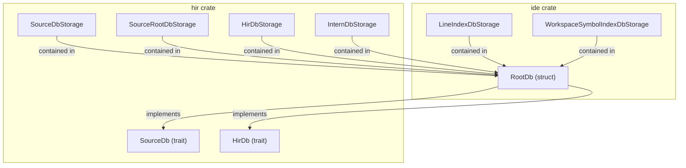
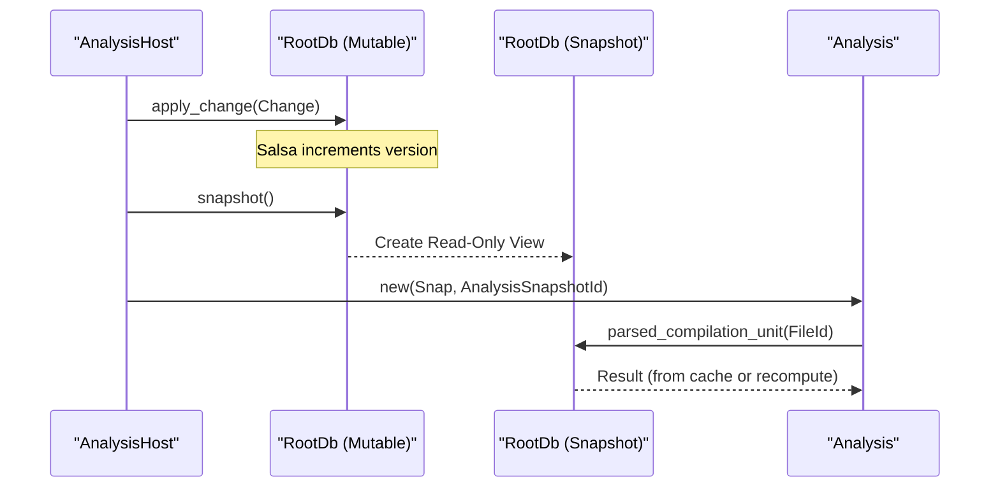

<!-- source: DeepWiki mcp.deepwiki.com · repo pascal-lab/vide · page 2.2 Incremental Database (Salsa / RootDb) · fetched 2026-10-12 -->

# Incremental Database (Salsa / RootDb)

Relevant source files

The following files were used as context for generating this wiki page:

- [crates/hir/src/base_db.rs](crates/hir/src/base_db.rs)
- [crates/hir/src/base_db/analysis_snapshot.rs](crates/hir/src/base_db/analysis_snapshot.rs)
- [crates/hir/src/base_db/change.rs](crates/hir/src/base_db/change.rs)
- [crates/hir/src/base_db/source_db.rs](crates/hir/src/base_db/source_db.rs)
- [crates/hir/src/preproc.rs](crates/hir/src/preproc.rs)
- [crates/ide/Cargo.toml](crates/ide/Cargo.toml)
- [crates/ide/src/analysis_host.rs](crates/ide/src/analysis_host.rs)
- [crates/ide/src/db/root_db.rs](crates/ide/src/db/root_db.rs)

The Vide codebase utilizes the **Salsa** query framework to provide efficient, incremental recomputation of language analysis. At the core of this system is the `RootDb`, a unified database that composes multiple functional layers (source management, parsing, HIR, and IDE features) into a single reactive entity.

### RootDb Composition

The `RootDb` is the central state holder for the Vide Language Server. It implements the `salsa::Database` trait and aggregates several storage layers via the `#[salsa::database(...)]` attribute [crates/ide/src/db/root_db.rs:26-33]().

#### Database Layers
The `RootDb` is composed of the following sub-databases:
| Storage Layer | Responsibility |
| :--- | :--- |
| `SourceDbStorage` | Basic file text, paths, and project configuration [crates/hir/src/base_db/source_db.rs:43-43](). |
| `SourceRootDbStorage` | Partitioning of files into source roots (Local vs Library) and profile mapping. |
| `HirDbStorage` | Semantic analysis and High-level Intermediate Representation [crates/hir/src/preproc.rs:24-24](). |
| `InternDbStorage` | Interning of IDs for modules, blocks, and subroutines [crates/ide/src/db/root_db.rs:30-30](). |
| `LineIndexDbStorage` | Mapping between byte offsets and line/column coordinates [crates/ide/src/db/root_db.rs:31-31](). |
| `WorkspaceSymbolIndexDbStorage` | Indexing for workspace-wide symbol searches [crates/ide/src/db/root_db.rs:32-32](). |

#### Code-to-Entity Mapping: Database Structure
The following diagram illustrates how the `RootDb` struct aggregates different query groups defined across the workspace.

**RootDb Composition Diagram**

Sources: [crates/ide/src/db/root_db.rs:26-38](), [crates/hir/src/base_db/source_db.rs:43-44](), [crates/hir/src/preproc.rs:24-24]().

---

### Change Application Lifecycle

Updates to the database are performed through the `Change` structure, which encapsulates updates to the VFS (Virtual File System) and project configuration. These changes are applied atomically to the `RootDb`.

1.  **Change Creation**: A `Change` object is populated with new source roots, updated project configurations, or specific file modifications [crates/hir/src/base_db/change.rs:12-16]().
2.  **Durability Determination**: The system assigns a `Durability` level to inputs. Library files are marked as `Durability::HIGH`, while local workspace files are `Durability::LOW` [crates/hir/src/base_db/change.rs:92-94]().
3.  **Salsa Application**: The `apply` method calls Salsa's `set_..._with_durability` methods. This invalidates only the queries that depend on the changed inputs [crates/hir/src/base_db/change.rs:35-89]().
4.  **VFS Synchronization**: Modifications, creations, and deletions from the VFS are synchronized into the Salsa input `files()` set [crates/hir/src/base_db/change.rs:57-88]().

Sources: [crates/hir/src/base_db/change.rs:11-94](), [crates/hir/src/base_db/source_db.rs:43-62]().

---

### Durability and LRU Cache Tuning

To optimize memory usage and performance, Vide utilizes Salsa's durability and LRU (Least Recently Used) caching mechanisms.

#### Durability Levels
-   **Durability::HIGH**: Used for `project_config`, `files` set, and library files [crates/hir/src/base_db/change.rs:37-53](). These rarely change, allowing Salsa to skip re-validation of dependent queries for most user edits.
-   **Durability::LOW**: Used for local source files [crates/hir/src/base_db/change.rs:93-93](). These change frequently during an editing session.

#### LRU Caching
Parsing and HIR lowering are expensive. The `RootDb` maintains an LRU cache for these queries to prevent the memory footprint from growing indefinitely while keeping recent results hot. The default capacity is **128** [crates/ide/src/db/root_db.rs:62-62]().

Queries with LRU tuning include:
-   `ParseSrcForCompilationQuery` [crates/ide/src/db/root_db.rs:79-79]()
-   `HirFileQuery` and `HirFileWithSourceMapQuery` [crates/ide/src/db/root_db.rs:81-84]()
-   `ModuleQuery` and `BlockQuery` [crates/ide/src/db/root_db.rs:85-86]()

Sources: [crates/ide/src/db/root_db.rs:62-91](), [crates/hir/src/base_db/change.rs:92-94]().

---

### Snapshot Isolation and Parallelism

Vide supports parallel request processing by leveraging Salsa's snapshot mechanism. The `RootDb` implements `salsa::ParallelDatabase`, allowing the main thread to handle writes while worker threads handle read-only queries on a consistent point-in-time snapshot. The `AnalysisHost` manages this lifecycle [crates/ide/src/analysis_host.rs:12-25]().

**Snapshot Data Flow**

Sources: [crates/ide/src/db/root_db.rs:93-97](), [crates/ide/src/analysis_host.rs:17-30](), [crates/hir/src/base_db/analysis_snapshot.rs:12-13]().

---

### Key Queries and Data Flow

The database provides high-level queries that drive the IDE features. These queries are defined in traits like `SourceDb`.

| Function | Type | Description |
| :--- | :--- | :--- |
| `file_text` | Input | Raw string content of a file [crates/hir/src/base_db/source_db.rs:46-46](). |
| `file_kind` | Input | Categorizes file as SystemVerilog, Header, or Library Map [crates/hir/src/base_db/source_db.rs:49-49](). |
| `parsed_compilation_unit` | Derived | Produces a `SyntaxTree` via Slang parser [crates/hir/src/base_db/source_db.rs:157-157](). |
| `compilation_plan_for_profile` | Derived | Determines the set of files and includes for a specific project profile [crates/hir/src/base_db/source_db.rs:160-160](). |

#### The `parsed_compilation_unit` Logic
The `parsed_compilation_unit` query is a derived query that takes a `FileId` and returns a `ParsedCompilationUnit`. It attempts to reuse authoritative parses from a `ParsedProfile` if the file is a root of a compilation plan [crates/hir/src/base_db/source_db.rs:157-179](). If not, it performs a standalone parse using `syntax_tree_options_for_file` [crates/hir/src/base_db/source_db.rs:197-205]().

Sources: [crates/hir/src/base_db/source_db.rs:43-205](), [crates/hir/src/base_db/analysis_snapshot.rs:36-43](), [crates/ide/src/db/root_db.rs:77-91]().

---

