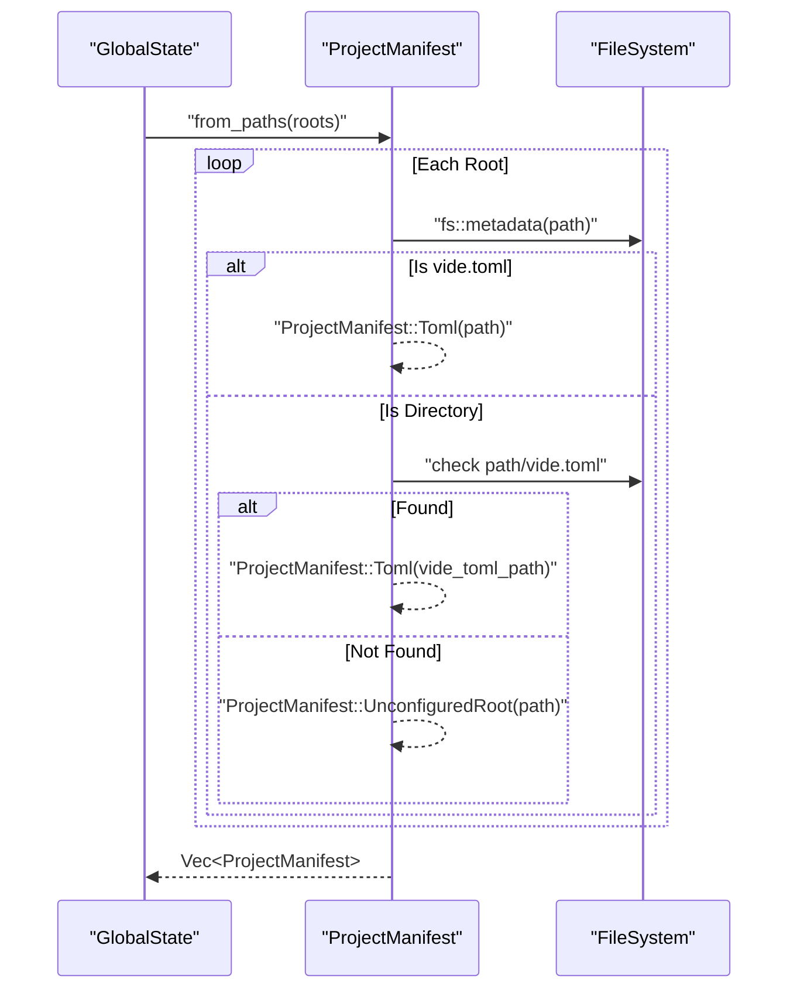
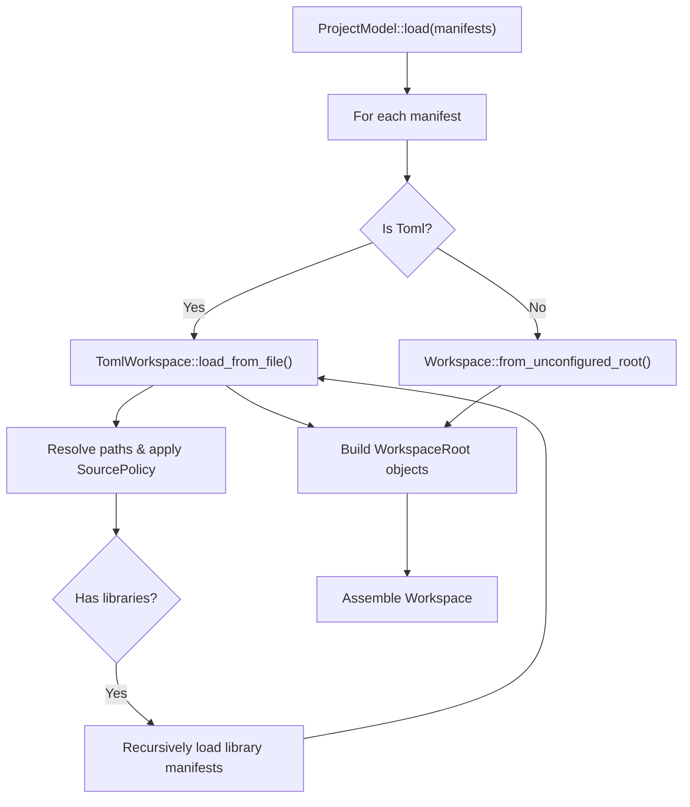

<!-- source: DeepWiki mcp.deepwiki.com · repo pascal-lab/vide · page 2.3 Project Model and Workspace Loading · fetched 2026-10-12 -->

# Project Model and Workspace Loading

<details>
<summary>Relevant source files</summary>

The following files were used as context for generating this wiki page:

- [crates/hir/Cargo.toml](crates/hir/Cargo.toml)
- [crates/hir/src/base_db/project.rs](crates/hir/src/base_db/project.rs)
- [crates/hir/src/base_db/source_root.rs](crates/hir/src/base_db/source_root.rs)
- [crates/hir/src/lib.rs](crates/hir/src/lib.rs)
- [crates/ide/src/diagnostics.rs](crates/ide/src/diagnostics.rs)
- [crates/project-model/Cargo.toml](crates/project-model/Cargo.toml)
- [crates/project-model/src/lib.rs](crates/project-model/src/lib.rs)
- [crates/project-model/src/macro_def.rs](crates/project-model/src/macro_def.rs)
- [crates/project-model/src/project_manifest.rs](crates/project-model/src/project_manifest.rs)
- [crates/project-model/src/toml_workspace.rs](crates/project-model/src/toml_workspace.rs)
- [crates/workspace-model/Cargo.toml](crates/workspace-model/Cargo.toml)
- [crates/workspace-model/src/lib.rs](crates/workspace-model/src/lib.rs)
- [crates/workspace-model/src/project.rs](crates/workspace-model/src/project.rs)
- [src/tests.rs](src/tests.rs)

</details>


This page details how Vide discovers, parses, and models SystemVerilog projects. The project model acts as the bridge between the raw file system and the semantic analysis layer, transforming file-based configurations into a structured `ProjectModel` that drives the `SourceDb` and `CompilationProfile` construction.

## Project Discovery

Project discovery is the first phase of workspace loading. Vide searches for `vide.toml` files within the provided workspace roots to identify project boundaries.

### ProjectManifest Discovery
The `ProjectManifest` enum represents a discovered project on disk [crates/project-model/src/project_manifest.rs:33-36](). Discovery logic is encapsulated in `ProjectManifest::from_path` [crates/project-model/src/project_manifest.rs:59-83]().

1.  **Direct Manifest**: If the path points directly to a `vide.toml`, it is loaded as a `ProjectManifest::Toml` [crates/project-model/src/project_manifest.rs:60-62]().
2.  **Directory Search**: If the path is a directory, Vide looks for `vide.toml` inside it using the `DISCOVERY_ORDER` [crates/project-model/src/project_manifest.rs:70-80]().
3.  **Unconfigured Root**: If no manifest is found, Vide treats the directory as a `ProjectManifest::UnconfiguredRoot` [crates/project-model/src/project_manifest.rs:82](), which enables "best-effort" indexing without explicit semantic configuration.

### Data Flow: Discovery to GlobalState
The server initialization and configuration logic maintain the list of discovered manifests, which are then used by the `GlobalState` to trigger workspace fetching and modeling.

Title: Project Discovery Sequence

Sources: [crates/project-model/src/project_manifest.rs:43-57](), [crates/project-model/src/project_manifest.rs:59-83](), [crates/project-model/src/project_manifest.rs:7-8]()

## TomlWorkspace Deserialization

When a `vide.toml` is found, it is deserialized into a `TomlWorkspace` using `serde`. The schema is defined by `TomlManifestSchema` [crates/project-model/src/toml_workspace.rs:47-126]().

### Key Manifest Fields
| Field | Type | Description |
| :--- | :--- | :--- |
| `top_modules` | `Vec<String>` | Names of the root modules for the compilation profile [crates/project-model/src/toml_workspace.rs:57](). |
| `defines` | `MacroDef` | Predefined macros parsed from strings like `SYNTHESIS` or `WIDTH=32` [crates/project-model/src/toml_workspace.rs:70](). |
| `sources` | `Option<Vec<String>>` | Glob patterns for source files. Omitted sources trigger best-effort indexing [crates/project-model/src/toml_workspace.rs:84](). |
| `include_dirs` | `Option<Vec<Utf8PathBuf>>` | Search paths for `` `include `` directives [crates/project-model/src/toml_workspace.rs:98](). |
| `libraries` | `Vec<Utf8PathBuf>` | Paths to external dependencies to be loaded as workspaces [crates/project-model/src/toml_workspace.rs:113](). |
| `exclude` | `Vec<String>` | Globs to remove files from the loaded set [crates/project-model/src/toml_workspace.rs:125](). |

### Macro Deserialization
Macros are handled by a custom deserializer `de_macros` [crates/project-model/src/toml_workspace.rs:147-172](), which uses `IDENT_RE` and `KV_RE` regexes to distinguish between simple flags and key-value pairs [crates/project-model/src/toml_workspace.rs:31-34](). These are stored as `MacroAtom` variants [crates/project-model/src/macro_def.rs:7-10]().

Sources: [crates/project-model/src/toml_workspace.rs:47-126](), [crates/project-model/src/toml_workspace.rs:147-172](), [crates/project-model/src/macro_def.rs:7-10]()

## Workspace Modeling and Source Policy

Once deserialized, the `Workspace` struct is constructed. This involves resolving relative paths and applying the `ManifestSourcePolicy`.

### ManifestSourcePolicy
The `ManifestSourcePolicy` determines how files are classified during indexing [crates/project-model/src/lib.rs:135-141]():
*   **Explicit**: If `sources` is defined in `vide.toml` (even if empty), only matching files are treated as semantic sources [crates/project-model/src/lib.rs:140]().
*   **DefaultIndex**: If `sources` is omitted, Vide defaults to `["**"]` for a "best-effort" scan [crates/project-model/src/lib.rs:30](), [crates/project-model/src/lib.rs:138]().

### WorkspaceRoot Construction
The `Workspace` is composed of `WorkspaceRoot` objects [crates/project-model/src/lib.rs:53-70](). Each root encapsulates:
*   `PathMatcher`: Compiled globs for semantic source files (`source`) and directory expansion (`source_directories`) [crates/project-model/src/lib.rs:56-58]().
*   `include_dirs`: Absolute paths for preprocessor header searching [crates/project-model/src/lib.rs:64]().
*   `exclude_prefixes` / `exclude_globs`: Logic to skip unwanted directories or files [crates/project-model/src/lib.rs:67-69]().

Title: Project Model Entity Mapping
```mermaid
classDiagram
    class TomlManifestSchema {
        +top_modules: Vec~String~
        +sources: Option~Vec~String~~
        +include_dirs: Option~Vec~Utf8PathBuf~~
        +defines: MacroDef
    }
    class Workspace {
        +workspace_root: AbsPathBuf
        +kind: WorkspaceKind
        +roots: Vec~WorkspaceRoot~
    }
    class WorkspaceRoot {
        +role: SourceRootRole
        +source: PathMatcher
        +include_dirs: Vec~AbsPathBuf~
        +source_files: Vec~AbsPathBuf~
    }
    class CompilationProfile {
        +top_modules: Vec~String~
        +preprocess: PreprocessConfig
    }

    TomlManifestSchema --> Workspace : "Workspace::from_toml()"
    Workspace *-- WorkspaceRoot : "contains"
    Workspace --> CompilationProfile : "Workspace::semantic_profile()"
```
Sources: [crates/project-model/src/lib.rs:33-70](), [crates/project-model/src/lib.rs:183-204](), [crates/project-model/src/toml_workspace.rs:47-126]()

## Workspace Loading Flow

The loading process transforms `ProjectManifest` into a `ProjectModel` containing one or more `Workspace` instances.

1.  **Helper Dispatch**: `Workspace::load` calls `load_helper` which branches based on manifest type [crates/project-model/src/lib.rs:164-181]().
2.  **TOML Loading**: `TomlWorkspace::load_from_file` reads and deserializes the manifest [crates/project-model/src/lib.rs:172]().
3.  **Path Resolution**: Relative patterns in `sources`, `include_dirs`, and `exclude` are resolved against the workspace root [crates/project-model/src/lib.rs:197-202]().
4.  **Unconfigured Loading**: If no manifest exists, `from_unconfigured_root` creates a default workspace with a `DefaultIndex` policy [crates/project-model/src/lib.rs:178]().

### Dependency Closure Calculation
If a manifest contains `libraries`, Vide recursively loads those paths. Each library is treated as a dependency workspace [crates/project-model/src/toml_workspace.rs:113](). This allows a single top-level project to aggregate multiple IP cores or library repositories, each with its own `vide.toml` or unconfigured structure.

Title: Workspace Loading Logic

Sources: [crates/project-model/src/lib.rs:164-181](), [crates/project-model/src/lib.rs:183-210](), [crates/project-model/src/toml_workspace.rs:99-113]()

## Compilation Profile Construction

The final step in modeling is translating the `Workspace` into a `CompilationProfile` used by the semantic layer (`hir` and `workspace-model`).

*   **Top Modules**: Extracted from `top_modules` in the manifest [crates/project-model/src/lib.rs:131]().
*   **Preprocess Config**: Combines `MacroDef` (converted to `Predefine` strings) and the resolved `include_dirs` [crates/project-model/src/lib.rs:132](), [crates/project-model/src/macro_def.rs:25-27]().
*   **Source Roots**: The `WorkspaceRoot` objects are used to configure `SourceRootConfig`, partitioning the VFS into logical units based on their `SourceRootRole` [crates/project-model/src/lib.rs:54]().

This profile is eventually consumed by the Salsa database (`RootDb`) to provide the necessary context for preprocessing and semantic analysis.

Sources: [crates/project-model/src/lib.rs:130-133](), [crates/project-model/src/macro_def.rs:25-49](), [crates/workspace-model/src/project.rs:1-10]() (referenced via `workspace-model`)

---

