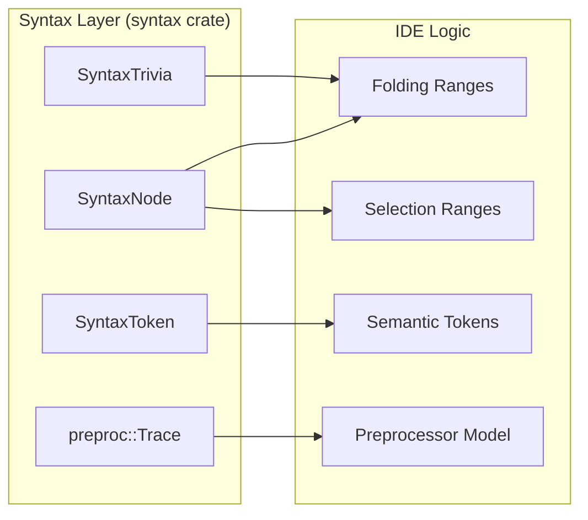

<!-- source: DeepWiki mcp.deepwiki.com · repo pascal-lab/vide · page 3 Syntax and Slang Integration · fetched 2026-10-12 -->

# Syntax and Slang Integration

<details>
<summary>Relevant source files</summary>

The following files were used as context for generating this wiki page:

- [crates/preproc/src/source/model/tests.rs](crates/preproc/src/source/model/tests.rs)
- [crates/slang/bindings/rust/ffi.rs](crates/slang/bindings/rust/ffi.rs)
- [crates/slang/bindings/rust/ffi/wrapper.cc](crates/slang/bindings/rust/ffi/wrapper.cc)
- [crates/slang/bindings/rust/ffi/wrapper.h](crates/slang/bindings/rust/ffi/wrapper.h)
- [crates/slang/bindings/rust/lib.rs](crates/slang/bindings/rust/lib.rs)
- [crates/slang/bindings/rust/syntax_tree.rs](crates/slang/bindings/rust/syntax_tree.rs)
- [crates/slang/bindings/rust/tests.rs](crates/slang/bindings/rust/tests.rs)
- [crates/slang/source/parsing/Preprocessor_macros.cpp](crates/slang/source/parsing/Preprocessor_macros.cpp)
- [crates/syntax/Cargo.toml](crates/syntax/Cargo.toml)
- [crates/syntax/src/lib.rs](crates/syntax/src/lib.rs)

</details>


This page provides a high-level overview of how Vide leverages the [Slang](https://github.com/MikePopoloski/slang) C++ library to parse SystemVerilog and how the resulting syntax trees are integrated into the Rust-based IDE infrastructure.

Vide does not implement its own SystemVerilog parser. Instead, it uses Slang via a thin Rust FFI layer to obtain a high-fidelity Concrete Syntax Tree (CST). This CST is then augmented with Rust-idiomatic extensions to support IDE features like incremental updates, navigation, and refactoring.

## Architecture Overview

The syntax layer serves as the bridge between raw file text and the High-level Intermediate Representation (HIR).

### From Text to Syntax Tree
When a file is loaded or changed, the `syntax` crate invokes Slang to produce a `SyntaxTree` [crates/slang/bindings/rust/syntax_tree.rs:35-37](). This tree contains every token, node, and piece of trivia (comments/whitespace) from the source [crates/slang/bindings/rust/tests.rs:113-162](). Because Slang is written in C++, Vide uses a custom FFI binding via `cxx` to expose these structures to Rust [crates/slang/bindings/rust/ffi.rs:13-177]().

### Syntax Entity Space
The following diagram illustrates how raw source text is transformed into the entities used by the `syntax` and `ide` crates, bridging the gap between C++ memory and Rust traits.

**Diagram: Syntax Transformation Flow**
```mermaid
graph TD
    subgraph "Natural Language Space (Source Text)"
        Text["Raw .sv File Text"]
    end

    subgraph "Code Entity Space (syntax crate)"
        ST["slang::SyntaxTree"]
        SN["slang::SyntaxNode"]
        STok["slang::SyntaxToken"]
        SExp["slang_ext::SyntaxNodeExt"]
        AstN["ast::AstNode"]
    end

    Text -->|wrapper::syntax::SourceSession| ST
    ST -->|root()| SN
    SN -->|child_node()| SN
    SN -->|child_token()| STok
    SN -.->|Trait Extension| SExp
    STok -.->|Trait Extension| SExp
    SN -->|cast()| AstN
    
    SExp -->|Provides| Range["SourceRange"]
    SExp -->|Provides| Ptr["SyntaxNodePtr"]
```
Sources: [crates/slang/bindings/rust/ffi/wrapper.h:85-98](), [crates/slang/bindings/rust/syntax_tree.rs:25-37](), [crates/syntax/src/lib.rs:6-17](), [crates/syntax/src/lib.rs:21-31]()

## Key Components

### Slang Rust Bindings
The core of the syntax layer is the `slang` crate (accessed via FFI). It provides the fundamental types:
*   `SyntaxTree`: The entry point for a parsed file, holding the `SharedPtr` to the C++ tree [crates/slang/bindings/rust/syntax_tree.rs:35-37]().
*   `SyntaxNode`: Represents structural elements (modules, blocks, expressions) [crates/slang/bindings/rust/syntax_tree.rs:25-27]().
*   `SyntaxToken`: Represents the smallest units (identifiers, keywords, operators) [crates/slang/bindings/rust/syntax_tree.rs:29-32]().
*   `SyntaxTrivia`: Represents non-semantic text like comments and whitespace [crates/slang/bindings/rust/syntax_tree.rs:70-73]().

For details on the FFI implementation and build system, see [Slang Rust Bindings](#3.1).

### Syntax Extensions (`slang_ext`)
To make Slang's C++-style API feel native to Rust and useful for an IDE, Vide implements the `slang_ext` module. This adds functionality such as:
*   **Coordinate Mapping**: Converting Slang's internal `SourceLocation` and `SourceRange` into Vide's IDE-friendly types [crates/slang/bindings/rust/ffi.rs:183-205]().
*   **Search and Traversal**: Methods to find tokens at specific offsets, which is critical for LSP features like completion and hover [crates/slang/bindings/rust/ffi/wrapper.cc:102-143]().
*   **Stable Pointers**: The `SyntaxNodePtr` allows referring to a syntax node across incremental re-parses without holding a reference to the tree [crates/syntax/src/ptr.rs:1-4]().
*   **AST Casting**: Macros like `match_ast!` allow for type-safe pattern matching on syntax nodes to treat them as specific AST types (e.g., `ModuleDeclaration`) [crates/syntax/src/lib.rs:21-40]().

For details on these utilities, see [Syntax Extensions and Utilities](#3.2).

## Integration with IDE Features

The syntax layer is the primary data source for several "low-level" IDE features that do not require full semantic analysis (HIR). It also provides the foundation for the preprocessor model.

| Feature | Implementation Logic | Source Reference |
| :--- | :--- | :--- |
| **Preprocessor Tracing** | Captures macro expansions and include file relationships during parsing. | [crates/slang/bindings/rust/ffi.rs:170-177]() |
| **Literal Analysis** | Extracts values and bases from `INTEGER_LITERAL` or `TIME_LITERAL` tokens. | [crates/slang/bindings/rust/syntax_tree.rs:169-196]() |
| **Trivia Handling** | Iterates over comments and whitespace attached to tokens for folding and formatting. | [crates/slang/bindings/rust/syntax_tree.rs:209-216]() |

**Diagram: IDE Feature Integration**

Sources: [crates/slang/bindings/rust/syntax_tree.rs:98-112](), [crates/slang/bindings/rust/syntax_tree.rs:164-168](), [crates/preproc/src/source/model/tests.rs:41-43]()

## Child Pages
*   [Slang Rust Bindings](#3.1) — Technical details of the FFI layer, `cxx` bridge, and C++ integration.
*   [Syntax Extensions and Utilities](#3.2) — Deep dive into `slang_ext`, trivia handling, `SyntaxNodePtr`, and the AST matching macros.

---

