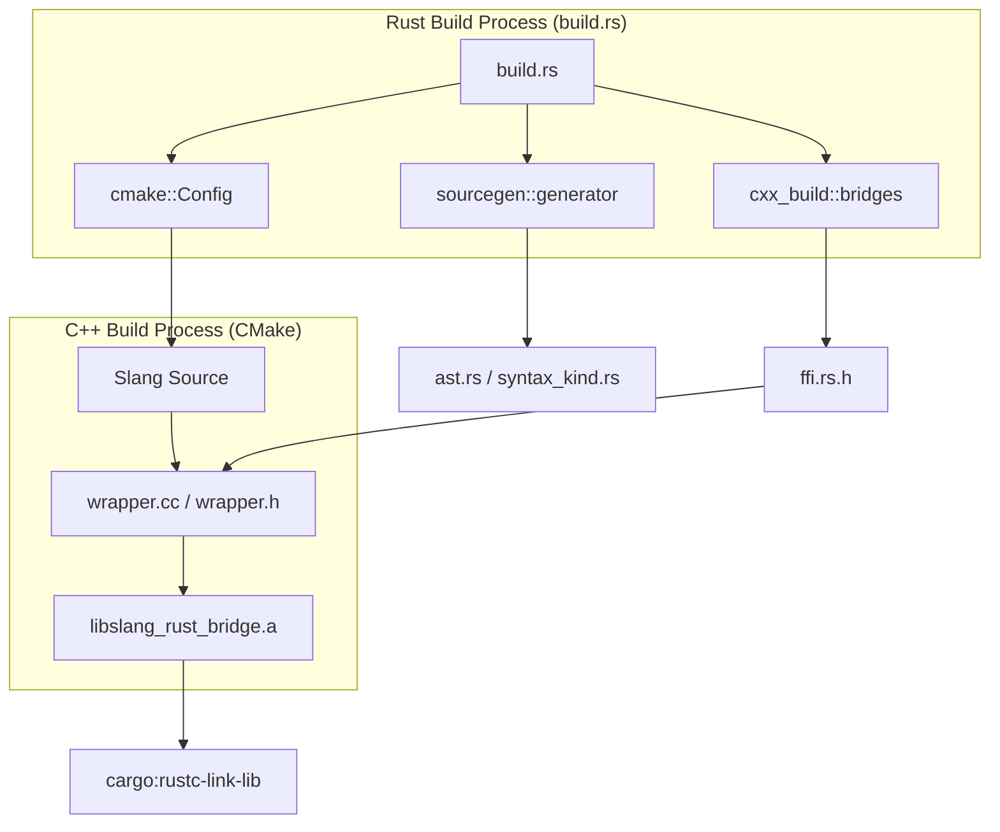
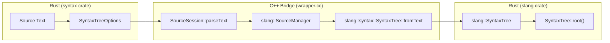

<!-- source: DeepWiki mcp.deepwiki.com · repo pascal-lab/vide · page 3.1 Slang Rust Bindings · fetched 2026-10-12 -->

# Slang Rust Bindings

Relevant source files

The following files were used as context for generating this wiki page:

- [.github/actions/setup-rust/action.yml](.github/actions/setup-rust/action.yml)
- [.github/actions/setup-sccache/action.yml](.github/actions/setup-sccache/action.yml)
- [crates/preproc/src/source/model/tests.rs](crates/preproc/src/source/model/tests.rs)
- [crates/slang/Cargo.toml](crates/slang/Cargo.toml)
- [crates/slang/bindings/rust/build.rs](crates/slang/bindings/rust/build.rs)
- [crates/slang/bindings/rust/ffi.rs](crates/slang/bindings/rust/ffi.rs)
- [crates/slang/bindings/rust/ffi/wrapper.cc](crates/slang/bindings/rust/ffi/wrapper.cc)
- [crates/slang/bindings/rust/ffi/wrapper.h](crates/slang/bindings/rust/ffi/wrapper.h)
- [crates/slang/bindings/rust/lib.rs](crates/slang/bindings/rust/lib.rs)
- [crates/slang/bindings/rust/sourcegen.rs](crates/slang/bindings/rust/sourcegen.rs)
- [crates/slang/bindings/rust/syntax_tree.rs](crates/slang/bindings/rust/syntax_tree.rs)
- [crates/slang/bindings/rust/tests.rs](crates/slang/bindings/rust/tests.rs)
- [crates/slang/include/slang/parsing/Preprocessor.h](crates/slang/include/slang/parsing/Preprocessor.h)
- [crates/slang/include/slang/parsing/PreprocessorTrace.h](crates/slang/include/slang/parsing/PreprocessorTrace.h)
- [crates/slang/include/slang/syntax/SyntaxTree.h](crates/slang/include/slang/syntax/SyntaxTree.h)
- [crates/slang/source/CMakeLists.txt](crates/slang/source/CMakeLists.txt)
- [crates/slang/source/parsing/Preprocessor.cpp](crates/slang/source/parsing/Preprocessor.cpp)
- [crates/slang/source/parsing/PreprocessorTrace.cpp](crates/slang/source/parsing/PreprocessorTrace.cpp)
- [crates/slang/source/parsing/Preprocessor_macros.cpp](crates/slang/source/parsing/Preprocessor_macros.cpp)
- [crates/slang/source/syntax/SyntaxTree.cpp](crates/slang/source/syntax/SyntaxTree.cpp)
- [rust-toolchain.toml](rust-toolchain.toml)

The Slang Rust Bindings provide a high-performance FFI (Foreign Function Interface) wrapper around the [Slang](https://github.com/MikePopoloski/slang) C++ SystemVerilog compiler. This layer is responsible for bridging the memory-managed world of Rust with the pointer-heavy C++ implementation of Slang's lexer, preprocessor, and parser. It enables Vide to leverage Slang's industry-standard SystemVerilog compliance while maintaining an idiomatic Rust interface for higher-level IDE features.

## Build System Integration

The integration between Rust and the Slang C++ library is managed via `build.rs` in the `slang` crate. This script coordinates several complex steps to ensure the native library is correctly compiled and linked.

### Compilation Pipeline
The build process uses `cmake-rs` to trigger a native build of Slang. It specifically configures Slang with `SLANG_INCLUDE_RUSTLIB=ON` and `SLANG_INCLUDE_INSTALL=ON` to prepare the bridge components [crates/slang/bindings/rust/build.rs:31-43]().

Key features of the build system include:
*   **CXX Bridge Generation**: Uses the `cxx` crate to generate C++ headers and Rust bindings from `ffi.rs` and `cxx_sv.rs` [crates/slang/bindings/rust/build.rs:17-24]().
*   **Conditional WASM Support**: If the target OS is `emscripten`, the build system switches to a static library target with specific flags (`-fwasm-exceptions`) and utilizes the Emscripten toolchain file [crates/slang/bindings/rust/build.rs:49-59]().
*   **Caching**: Integrates with `sccache` via the `VIDE_USE_SCCACHE_CMAKE` environment variable to speed up native C++ compilation in CI environments [crates/slang/bindings/rust/build.rs:61-66]().
*   **Source Generation**: Automatically generates Rust code for `SyntaxKind` and AST node structures based on Slang's metadata [crates/slang/bindings/rust/build.rs:142-150]().

### Build and Linking Flow
The following diagram illustrates how the build system bridges the two languages:

**Slang Build Artifact Flow**

Sources: [crates/slang/bindings/rust/build.rs:8-15](), [crates/slang/bindings/rust/build.rs:142-150](), [crates/slang/bindings/rust/ffi/wrapper.h:1-31]()

## FFI Architecture

The bindings utilize the `cxx` crate to provide safe transfers of opaque pointers and structured data between Rust and C++.

### Core FFI Entities
The `ffi.rs` file defines the bridge boundary. It includes raw representations of Slang's internal structures that are passed by value or reference.

| Rust Type | C++ Equivalent | Description |
| :--- | :--- | :--- |
| `RawSyntaxDiagnostic` | `slang::Diagnostic` | Flattened diagnostic data for transfer [crates/slang/bindings/rust/ffi.rs:16-33](). |
| `RawSourceBuffer` | `slang::SourceBuffer` | Represents file content and paths [crates/slang/bindings/rust/ffi.rs:36-39](). |
| `SyntaxNode` | `slang::syntax::SyntaxNode` | Opaque C++ pointer to an AST node [crates/slang/bindings/rust/syntax_tree.rs:25-27](). |
| `SyntaxToken` | `slang::parsing::Token` | Opaque C++ pointer to a lexed token [crates/slang/bindings/rust/syntax_tree.rs:29-32](). |

### Memory Management
Rust-side wrappers like `SyntaxTree` and `SyntaxNode` hold pointers to C++ memory. `SyntaxTree` uses a `SharedPtr<ffi::SyntaxTree>` to ensure the underlying Slang `SourceManager` and allocated nodes remain valid as long as the tree is alive [crates/slang/bindings/rust/syntax_tree.rs:35-37](). `SyntaxNode` and `SyntaxToken` are lightweight wrappers around pinned references (`Pin<&'a ffi::SyntaxNode>`), allowing them to be treated as copyable references with a lifetime tied to the tree [crates/slang/bindings/rust/syntax_tree.rs:25-32]().

## Syntax Tree Integration

The `SyntaxTree` is the primary entry point for parsing SystemVerilog source code. It wraps the Slang `SourceSession`, which manages the `SourceManager` and `BumpAllocator` for a specific compilation unit.

### Parsing and Buffer Management
Parsing is initiated via `SyntaxTree::from_text` or through the `Compilation` interface.
*   **Buffer IDs**: Slang identifies files using a `u32` buffer ID. The Rust bindings expose these via `RawSourceBufferId` and `RawSyntaxTreeBufferIds` to allow Vide to map Slang's internal locations back to its own `FileId` [crates/slang/bindings/rust/ffi.rs:42-54]().
*   **Options**: `SyntaxTreeOptions` allows configuring predefines, include paths, and whether to expand includes during parsing [crates/slang/bindings/rust/syntax_tree.rs:45-51]().

**Data Flow: Source to Syntax Tree**

Sources: [crates/slang/bindings/rust/syntax_tree.rs:35-37](), [crates/slang/bindings/rust/ffi/wrapper.h:89-98](), [crates/slang/bindings/rust/ffi/wrapper.cc:102-143]()

## Preprocessor and Preproc Trace

The bindings provide deep access to Slang's preprocessor, which is critical for Vide's "Preproc Index" and macro expansion visualization.

### Preprocessor Trace
The `Trace` structure (aliased from `preproc::Trace`) provides a detailed history of macro expansions and file inclusions [crates/slang/bindings/rust/syntax_tree.rs:9]().
*   **Events**: Captured via `RawPreprocessorTraceEvent`, which includes macro definitions, calls, and expansions [crates/slang/bindings/rust/ffi.rs:111-131]().
*   **Emitted Tokens**: Individual tokens resulting from preprocessing, including their origin (source, macro body, argument, etc.) [crates/slang/bindings/rust/ffi.rs:134-161]().
*   **Include Edges**: Relationships between files captured in `RawPreprocessorTraceIncludeEdge` [crates/slang/bindings/rust/ffi.rs:164-167]().

### Lexed Token at Offset
For IDE features like autocompletion, Vide uses `lex_token_at_offset` to determine the context at the cursor. This calls into the C++ `Lexer` directly to find the token kind and any active preprocessor directives at a specific byte offset [crates/slang/bindings/rust/ffi/wrapper.cc:102-143]().

## Syntax Traversal and Utilities

The `slang` crate provides higher-level Rust abstractions over the raw Slang pointers.

### Traversal Utilities
The bindings implement standard tree traversal patterns:
*   **Cursors**: `SyntaxCursor` for navigating the tree relative to positions [crates/slang/bindings/rust/lib.rs:21]().
*   **Iterators**: `SyntaxChildren`, `SyntaxAncestors`, and `SyntaxNodePreorder` for efficient tree walking [crates/slang/bindings/rust/lib.rs:22-25]().
*   **Trivia**: Tokens carry `SyntaxTrivia` (comments, whitespace), which can be accessed with their physical locations via `trivias_with_loc` [crates/slang/bindings/rust/syntax_tree.rs:214-241]().

### Numeric and Logic Types
Slang's semantic types are exposed to Rust for constant evaluation and literal rendering:
*   **SVInt**: Arbitrary-precision integers [crates/slang/bindings/rust/ffi.rs:225]().
*   **SVLogic**: Four-valued logic (0, 1, X, Z) [crates/slang/bindings/rust/ffi.rs:216]().
*   **LiteralBase**: Support for Binary, Octal, Decimal, and Hexadecimal representations [crates/slang/bindings/rust/syntax_tree.rs:7]().

## Implementation Details: `wrapper.h` and `wrapper.cc`

The C++ side of the bridge (`wrapper.h`/`wrapper.cc`) performs the translation of Slang's complex internal types into the simplified `Raw` structs defined in `ffi.rs`.

*   **SourceSession**: A wrapper around `slang::SourceManager` that maintains a cache of `assignedBuffers` to ensure consistent `BufferId` mapping across multiple parse calls [crates/slang/bindings/rust/ffi/wrapper.h:85-114]().
*   **Diagnostic Mapping**: Translates Slang's internal `Diagnostic` objects into `RawSyntaxDiagnostic`, capturing the error code, severity, message, and source ranges [crates/slang/bindings/rust/ffi/wrapper.cc:43-63]().
*   **Numeric Types**: Provides access to Slang's `SVInt` and `logic_t` types, including conversion to strings in various bases [crates/slang/bindings/rust/ffi/wrapper.h:199-209]().

Sources: [crates/slang/bindings/rust/ffi/wrapper.h:43-83](), [crates/slang/bindings/rust/ffi/wrapper.cc:17-41](), [crates/slang/bindings/rust/ffi/wrapper.cc:154-168]()

---

