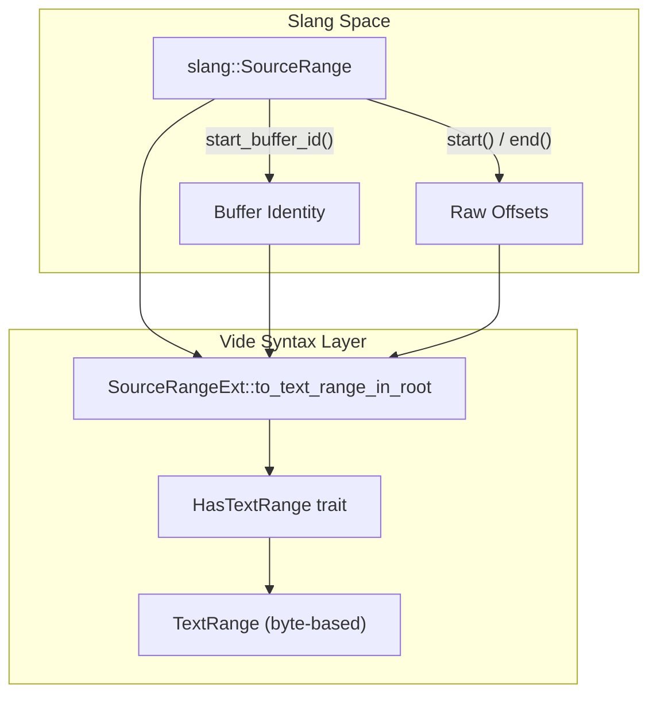
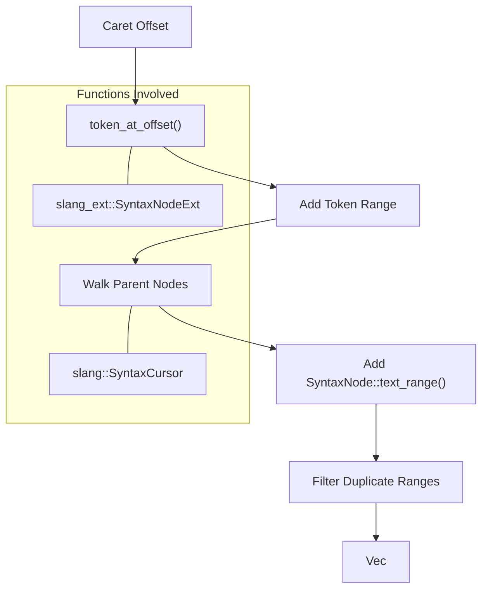

<!-- source: DeepWiki mcp.deepwiki.com · repo pascal-lab/vide · page 3.2 Syntax Extensions and Utilities · fetched 2026-10-12 -->

# Syntax Extensions and Utilities

Relevant source files

The following files were used as context for generating this wiki page:

- [crates/hir/src/region_tree.rs](crates/hir/src/region_tree.rs)
- [crates/ide/src/folding_ranges.rs](crates/ide/src/folding_ranges.rs)
- [crates/ide/src/formatting.rs](crates/ide/src/formatting.rs)
- [crates/ide/src/selection_ranges.rs](crates/ide/src/selection_ranges.rs)
- [crates/syntax/src/has_text_range.rs](crates/syntax/src/has_text_range.rs)
- [crates/syntax/src/ptr.rs](crates/syntax/src/ptr.rs)
- [crates/syntax/src/slang_ext.rs](crates/syntax/src/slang_ext.rs)
- [crates/syntax/src/slang_ext/token.rs](crates/syntax/src/slang_ext/token.rs)
- [crates/syntax/src/slang_ext/trivia.rs](crates/syntax/src/slang_ext/trivia.rs)

The `slang_ext` module provides a rich set of extensions and utility traits for the raw syntax types provided by the Slang Rust bindings. It bridges the gap between raw C++-derived syntax trees and the high-level requirements of an IDE, such as offset-based lookups, trivia (comment/whitespace) analysis, and stable node referencing via pointers.

## SyntaxNode and Token Extensions

The core of the utility layer is the `SyntaxNodeExt` trait, which extends Slang's `SyntaxNode` with methods for spatial queries. These methods are essential for features like "Go to Definition" or "Hover", where the IDE must map a cursor position (byte offset) to a specific syntax element.

### Offset-Based Lookups
- `token_at_offset`: Returns a `TokenAtOffset` enum which can represent a single token, or the two tokens on either side of an offset (e.g., when the cursor is between two words) [crates/syntax/src/slang_ext/token_at_offset.rs:11-39]().
- `covering_element`: Finds the smallest `SyntaxElement` (Node or Token) that fully contains a given `TextRange` [crates/syntax/src/slang_ext/node.rs:60-81]().
- `find_node_at_offset`: A generic helper to find the first ancestor of a token at a specific offset that matches a specific AST type `N` [crates/syntax/src/slang_ext/node.rs:25-25]().

### Token Utilities
The `TokenKindExt` and `SyntaxTokenWithParentExt` traits categorize tokens for IDE logic:
- `is_pair_token`: Identifies keywords that form blocks (e.g., `begin`/`end`, `module`/`endmodule`) [crates/syntax/src/slang_ext/token.rs:19-34]().
- `is_word_like`: Determines if a token text follows identifier rules, including system identifiers starting with `$` [crates/syntax/src/slang_ext/token.rs:64-69]().
- `pair_token`: Given a keyword like `module` or `begin`, this function finds its matching partner (e.g., `endmodule` or `end`) within the syntax tree [crates/syntax/src/slang_ext/token.rs:127-179]().

### Trivia Handling
Slang represents comments, whitespace, and directives as "trivia" attached to tokens. Vide extends this with `TriviaExt` and `TriviaKindExt` to support structured comment features:
- `is_region_begin` / `is_region_end`: Detects custom IDE regions marked with `// region` or `// endregion` [crates/syntax/src/slang_ext/trivia.rs:47-80]().
- `as_comment`: Strips comment delimiters (`//` or `/* */`) to return the raw text content [crates/syntax/src/slang_ext/trivia.rs:83-94]().

Sources: [crates/syntax/src/slang_ext/token.rs:11-53](), [crates/syntax/src/slang_ext/trivia.rs:6-34](), [crates/syntax/src/slang_ext/node.rs:1-100]().

## Syntax Pointers (`SyntaxNodePtr`)

Because `SyntaxNode` handles are tied to the lifetime of a specific `SyntaxTree`, they cannot be easily stored in long-lived caches or cross-thread data structures. `SyntaxNodePtr` provides a "stable" reference to a node by storing its `SyntaxKind` and `TextRange`.

| Type | Purpose | Implementation |
| :--- | :--- | :--- |
| `SyntaxNodePtr` | Stable reference to a node. | Stores `SyntaxKind` and `TextRange` [crates/syntax/src/ptr.rs:10-13](). |
| `SyntaxTokenPtr` | Stable reference to a token. | Stores `TokenKind` and `TextRange` [crates/syntax/src/ptr.rs:39-42](). |
| `SyntaxElementPtr` | Variant for either Node or Token. | Enum of the above two [crates/syntax/src/ptr.rs:69-72](). |

These pointers can be "resolved" back into real nodes by calling `.to_node(&tree)`, which performs an exact range lookup on the provided tree [crates/syntax/src/ptr.rs:22-25]().

Sources: [crates/syntax/src/ptr.rs:1-102]().

## Text Range Traits

The `HasTextRange` trait provides a unified way to get the `TextRange` of various syntax entities, abstracting over the underlying Slang `SourceRange` and handling buffer-to-offset conversions.

**Data Flow: From Slang SourceRange to Vide TextRange**

Title: Text Range Resolution Flow

Sources: [crates/syntax/src/has_text_range.rs:7-26](), [crates/syntax/src/has_text_range.rs:35-37]()

## IDE Feature Support

The syntax layer directly powers several IDE features through specialized collectors and traversals.

### Folding Ranges
The `folding_ranges` module uses the syntax tree and trivia to identify collapsible blocks. It categorizes folds into `FoldKind` such as `Module`, `Comment`, or `Region` [crates/ide/src/folding_ranges.rs:35-53]().

- **Comment Folding**: `collect_line_comments` groups consecutive line comments (`//`) into a single foldable block [crates/ide/src/folding_ranges.rs:164-232]().
- **Region Folding**: Uses `TriviaExt::is_region_begin` and `RegionTree` to support user-defined `#region`-style blocks [crates/ide/src/folding_ranges.rs:131-131](), [crates/hir/src/region_tree.rs:15-17]().
- **Syntax Folding**: Folds are generated for modules, generate blocks, and statement blocks by mapping HIR source ranges back to the syntax tree [crates/ide/src/folding_ranges.rs:132-141]().

### Selection Ranges
The `selection_ranges` feature allows users to expand/shrink text selection based on the syntax hierarchy.

**Process: Selection Range Expansion**

Title: Selection Range Calculation

Sources: [crates/ide/src/selection_ranges.rs:12-90](), [crates/syntax/src/slang_ext/node.rs:132-142]()

### On-Type Formatting
The formatting logic in `crates/ide/src/formatting.rs` uses `trivias_with_range` to detect if the user is typing inside a comment block to provide automatic indentation or comment leader insertion (`*` or `//`) when pressing Enter [crates/ide/src/formatting.rs:167-225](). It utilizes `SyntaxCursor` to navigate to the token after the caret offset [crates/ide/src/formatting.rs:185-187]().

Sources:
- `crates/syntax/src/slang_ext/node.rs`
- `crates/syntax/src/slang_ext/token.rs`
- `crates/syntax/src/slang_ext/trivia.rs`
- `crates/syntax/src/ptr.rs`
- `crates/syntax/src/has_text_range.rs`
- `crates/ide/src/folding_ranges.rs`
- `crates/ide/src/selection_ranges.rs`
- `crates/ide/src/formatting.rs`
- `crates/hir/src/region_tree.rs`

---

