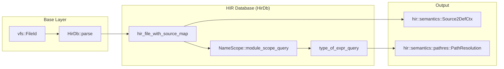

<!-- source: DeepWiki mcp.deepwiki.com · repo pascal-lab/vide · page 4 HIR (High-level Intermediate Representation) · fetched 2026-10-12 -->

# HIR (High-level Intermediate Representation)

<details>
<summary>Relevant source files</summary>

The following files were used as context for generating this wiki page:

- [crates/hir/src/container.rs](crates/hir/src/container.rs)
- [crates/hir/src/db.rs](crates/hir/src/db.rs)
- [crates/hir/src/hir_def.rs](crates/hir/src/hir_def.rs)
- [crates/hir/src/hir_def/block.rs](crates/hir/src/hir_def/block.rs)
- [crates/hir/src/hir_def/expr.rs](crates/hir/src/hir_def/expr.rs)
- [crates/hir/src/hir_def/file.rs](crates/hir/src/hir_def/file.rs)
- [crates/hir/src/hir_def/module.rs](crates/hir/src/hir_def/module.rs)
- [crates/hir/src/hir_def/module/port.rs](crates/hir/src/hir_def/module/port.rs)
- [crates/hir/src/hir_def/stmt.rs](crates/hir/src/hir_def/stmt.rs)
- [crates/hir/src/hir_def/subroutine.rs](crates/hir/src/hir_def/subroutine.rs)
- [crates/hir/src/semantics/hir_to_def.rs](crates/hir/src/semantics/hir_to_def.rs)
- [crates/hir/src/semantics/source_to_def.rs](crates/hir/src/semantics/source_to_def.rs)

</details>


The HIR (High-level Intermediate Representation) layer is the semantic heart of Vide. It transforms the concrete syntax trees (CST) produced by Slang into arena-allocated, queryable structures that represent the semantic meaning of SystemVerilog code. While the syntax layer deals with tokens and grammar, the HIR layer understands modules, ports, scopes, and types.

## Overview of the HIR Layer

The HIR layer abstracts away the complexities of the SystemVerilog grammar into a set of stable identifiers and data structures. It provides the foundation for all IDE intelligence, including name resolution, type inference, and cross-reference searching.

Key responsibilities of the HIR layer include:
- **Lowering**: Converting `Slang` syntax nodes into `HIR` structures using contexts like `LowerModuleCtx` [crates/hir/src/hir_def/module.rs:53-53]() and `LowerBlockCtx` [crates/hir/src/hir_def/block.rs:219-219]().
- **Semantic Analysis**: Building symbol tables and resolving hierarchical paths through `NameScope` queries [crates/hir/src/db.rs:117-142]().
- **Incremental Computation**: Using `Salsa` queries via `HirDb` and `InternDb` to ensure that semantic information is updated efficiently as files change [crates/hir/src/db.rs:41-79]().
- **Source Mapping**: Maintaining a bidirectional link between HIR entities and their original syntax nodes via `SourceMap<Src, Hir>` [crates/hir/src/hir_def/module.rs:67-70]().

### HIR System Architecture

The following diagram illustrates how the HIR layer bridges the gap between raw syntax and semantic queries.

**HIR Semantic Bridge**
```mermaid
graph TD
    subgraph "Natural Language Space (User Intent)"
        "ModuleDefinition"
        "VariableReference"
        "PortConnection"
    end

    subgraph "Code Entity Space (Implementation)"
        SyntaxNode["syntax::ast::ModuleDeclaration"]
        HirEntity["hir_def::module::Module"]
        SourceMap["hir::source_map::SourceMap"]
        HirDb["hir::db::HirDb (Salsa)"]
        ModuleId["hir_def::module::ModuleId"]
    end

    SyntaxNode -- "Lowering" --> HirEntity
    HirEntity -- "Interned as" --> ModuleId
    ModuleId -- "Stored in" --> HirDb
    HirEntity -- "Mapped via" --> SourceMap
    SourceMap -- "Points to" --> SyntaxNode
    
    "ModuleDefinition" -.-> HirEntity
    "VariableReference" -.-> HirEntity
```
Sources: [crates/hir/src/hir_def/module.rs:82-126](), [crates/hir/src/db.rs:78-100](), [crates/hir/src/container.rs:36-48]()

## HIR Lowering: Modules and Expressions

Lowering is the process of traversing the CST and populating HIR arenas. This is handled by specialized contexts like `LowerModuleCtx` and `LowerBlockCtx` [crates/hir/src/hir_def/block.rs:219-219](). SystemVerilog's complex port systems (both ANSI and Non-ANSI styles) are unified into a consistent `Ports` HIR representation [crates/hir/src/hir_def/module/port.rs:168-171](). Expressions are lowered into an `Expr` enum and stored in central arenas to facilitate type inference [crates/hir/src/hir_def/expr.rs:168-231]().

For details, see [HIR Lowering: Modules, Blocks, and Expressions](#4.1).

## HIR Containers

Beyond modules, SystemVerilog contains various structural units such as `Subroutine` (functions and tasks) [crates/hir/src/hir_def/subroutine.rs:44-63](), `GenerateBlock` [crates/hir/src/db.rs:109-115](), and `SpecifyBlock`. These are treated as "containers" in HIR, often identified by a `ScopeId` [crates/hir/src/container.rs:36-48](). The `HirFile` serves as the top-level container for all members found within a single source file [crates/hir/src/hir_def/file.rs:58-86]().

For details, see [HIR Containers: Files, Subroutines, and Generate Blocks](#4.2).

## Scope Resolution and Semantics

The HIR layer implements a sophisticated scope system to handle SystemVerilog's name resolution rules. This includes `ModuleScope`, `BlockScope`, and `SubroutineScope`, all computed via `Salsa` queries [crates/hir/src/db.rs:124-142](). The `Source2DefCache` helps map source-level syntax pointers back to their semantic definitions [crates/hir/src/semantics/source_to_def.rs:27-29]().

For details, see [Scope Resolution and Semantics](#4.3).

## Source Maps and Navigation

To support IDE features, every HIR entity must be traceable back to its origin in the source code. The `SourceMap` infrastructure provides a bidirectional mapping between HIR IDs (like `ExprId` or `StmtId`) and source pointers (like `ExprSrc` or `StmtSrc`) [crates/hir/src/hir_def/module.rs:128-171](). This is implemented using the `alloc_idx_and_src!` macro during the lowering phase [crates/hir/src/hir_def.rs:66-75]().

For details, see [Source Maps and Navigation Targets](#4.4).

### HIR Data Flow

This diagram shows how data flows from the base database through the HIR queries to produce semantic results.

**HIR Query Pipeline**

Sources: [crates/hir/src/db.rs:78-164](), [crates/hir/src/semantics/source_to_def.rs:31-35](), [crates/hir/src/semantics/hir_to_def.rs:16-19]()

---
**Child Pages:**
- [HIR Lowering: Modules, Blocks, and Expressions](#4.1)
- [HIR Containers: Files, Subroutines, and Generate Blocks](#4.2)
- [Scope Resolution and Semantics](#4.3)
- [Source Maps and Navigation Targets](#4.4)

---

