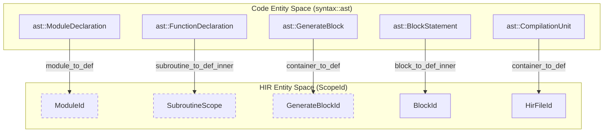
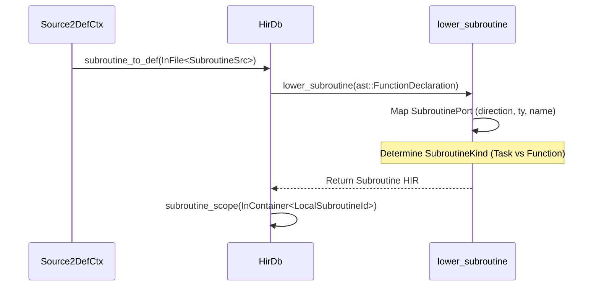

<!-- source: DeepWiki mcp.deepwiki.com · repo pascal-lab/vide · page 4.2 HIR Containers: Files, Subroutines, and Generate Blocks · fetched 2026-10-12 -->

# HIR Containers: Files, Subroutines, and Generate Blocks

Relevant source files

The following files were used as context for generating this wiki page:

- [crates/hir/src/container.rs](crates/hir/src/container.rs)
- [crates/hir/src/db.rs](crates/hir/src/db.rs)
- [crates/hir/src/hir_def/checker.rs](crates/hir/src/hir_def/checker.rs)
- [crates/hir/src/hir_def/file/config.rs](crates/hir/src/hir_def/file/config.rs)
- [crates/hir/src/hir_def/file/library.rs](crates/hir/src/hir_def/file/library.rs)
- [crates/hir/src/hir_def/file/udp.rs](crates/hir/src/hir_def/file/udp.rs)
- [crates/hir/src/hir_def/module/defparam.rs](crates/hir/src/hir_def/module/defparam.rs)
- [crates/hir/src/hir_def/module/generate.rs](crates/hir/src/hir_def/module/generate.rs)
- [crates/hir/src/hir_def/subroutine.rs](crates/hir/src/hir_def/subroutine.rs)
- [crates/hir/src/semantics/hir_to_def.rs](crates/hir/src/semantics/hir_to_def.rs)
- [crates/hir/src/semantics/source_to_def.rs](crates/hir/src/semantics/source_to_def.rs)

HIR containers represent the semantic nesting structures in SystemVerilog that hold declarations, statements, and other logic. While modules are the most common container, Vide treats top-level files, subroutines (functions/tasks), and generate blocks as first-class `ScopeId` types. These containers are interned in the `HirDb` and lowered lazily to maintain incremental performance.

## HIR Container Identity

The `ScopeId` enum is the central union for all semantic scopes that can contain HIR elements like expressions, statements, or local declarations.

| Container Type | ID Type | Description |
| :--- | :--- | :--- |
| **HirFile** | `HirFileId` | Top-level members of a source file (modules, UDPs, global subroutines). |
| **Module** | `ModuleId` | Logic contained within a `module` or `interface`. |
| **Generate Block** | `GenerateBlockId` | Scopes created by `generate`, `if`, or `for` loops. |
| **Block** | `BlockId` | Procedural blocks (e.g., `begin...end` with labels). |
| **Subroutine** | `SubroutineScope` | Logic within a `function` or `task`, tracking its parent container. |
| **Specify Block** | `SpecifyBlockId` | Logic within a `specify...endspecify` block. |

**Sources:** [crates/hir/src/container.rs:36-48](), [crates/hir/src/container.rs:126-136]()

### Container Hierarchy and Resolution
Containers often nest (e.g., a `Subroutine` inside a `Module`). The `Source2DefCtx` is responsible for traversing the syntax tree to find the correct `ScopeId` for a given `SyntaxNode`.

Title: Resolution of AST Nodes to HIR Scopes

**Sources:** [crates/hir/src/semantics/source_to_def.rs:110-148](), [crates/hir/src/semantics/source_to_def.rs:150-166]()

---

## HirFile: Top-Level Containers

A `HirFile` represents the semantic contents of a single source file. It acts as the root container for items defined outside of modules.

### Implementation
The `HirFile` struct is defined using the `define_container!` macro, which creates an arena-based storage for various SystemVerilog entities.

- **Members:** Includes `modules`, `typedefs`, `structs`, `config_decls` [crates/hir/src/hir_def/file/config.rs:10-13](), `udp_decls` [crates/hir/src/hir_def/file/udp.rs:9-12](), and global `subroutines`.
- **Lowering:** The `hir_file_with_source_map` query triggers the lowering of a file. [crates/hir/src/db.rs:86-87]()
- **Source Mapping:** `FileSourceMap` maintains a bidirectional mapping between the arena indices and `SyntaxNodePtr`. [crates/hir/src/db.rs:18-18]()

**Sources:** [crates/hir/src/db.rs:86-90](), [crates/hir/src/hir_def/file/config.rs:1-23](), [crates/hir/src/hir_def/file/udp.rs:1-24]()

---

## Subroutines (Functions and Tasks)

Subroutines are specialized containers that can appear in files, modules, or generate blocks. They are identified by `SubroutineScope` which tracks their `SubroutineParent` (File, Module, or GenerateBlock) and their `LocalSubroutineId`.

### Subroutine Structure
A `Subroutine` container holds:
- **Signature:** Name, kind (Task vs Function), and a list of `SubroutinePort`. [crates/hir/src/hir_def/subroutine.rs:47-49]()
- **Body Logic:** Arenas for `stmts`, `exprs`, `decls`, `typedefs`, and `structs`. [crates/hir/src/hir_def/subroutine.rs:51-57]()

### Subroutine Lowering Flow
Lowering is split into two phases:
1. **Header Lowering:** `lower_subroutine` parses the prototype and ports, determining directions like `Input`, `Output`, or `Ref`. [crates/hir/src/hir_def/subroutine.rs:142-181]()
2. **Body Lowering:** `lower_subroutine_body` (invoked via `LowerSubroutineBodyCtx`) lowers the procedural statements within the function/task. [crates/hir/src/hir_def/subroutine.rs:206-218]()

Title: Subroutine Lowering Sequence

**Sources:** [crates/hir/src/hir_def/subroutine.rs:142-181](), [crates/hir/src/db.rs:101-107](), [crates/hir/src/semantics/source_to_def.rs:55-62]()

---

## Generate Blocks and Regions

Generate blocks (`generate...endgenerate`, `if`, `for`) create conditional or iterative scopes. Vide distinguishes between a `GenerateRegion` (the syntactic wrapper) and a `GenerateBlock` (the actual semantic scope).

### Generate Entities
- **GenerateRegion:** A collection of `GenerateItem`s. [crates/hir/src/hir_def/module/generate.rs:59-61]()
- **GenerateBlock:** Represents the actual scope created by a loop iteration or a conditional branch. It is interned via `GenerateBlockLoc`. [crates/hir/src/db.rs:49-50]()

### Source Representation
Generate blocks use `GenerateBlockSrc` to handle three distinct syntactic origins:
1. `GenerateBlock`: A standard named or unnamed `begin...end` inside a generate region.
2. `LoopGenerate`: The block created by a `for` loop.
3. `SingleMember`: A single statement or declaration inside an `if` or `for` that isn't wrapped in `begin...end`.

**Sources:** [crates/hir/src/hir_def/module/generate.rs:146-150](), [crates/hir/src/semantics/source_to_def.rs:120-135]()

---

## Checker and Other Specialized Containers

SystemVerilog includes specialized blocks like `checker` and `defparam` which are handled as distinct HIR definitions.

- **CheckerDef:** Contains ports and local declarations (data or net). [crates/hir/src/hir_def/checker.rs:31-35]()
- **DefParam:** Contains assignments mapping a target `ExprId` to a value `ExprId`. [crates/hir/src/hir_def/module/defparam.rs:16-24]()

| Component | Role | Code Pointer |
| :--- | :--- | :--- |
| `InContainer<T>` | Wraps a value with its parent `ScopeId`. | [crates/hir/src/container.rs:202-205]() |
| `InSubroutine<T>` | Specialized wrapper for items inside a subroutine. | [crates/hir/src/container.rs:222-225]() |
| `InternDb` | Salsa query group for interning container locations. | [crates/hir/src/db.rs:41-42]() |
| `HirDb` | Salsa query group for retrieving lowered HIR structures. | [crates/hir/src/db.rs:78-79]() |

**Sources:** [crates/hir/src/container.rs:202-225](), [crates/hir/src/db.rs:41-79](), [crates/hir/src/hir_def/checker.rs:31-35]()

---

