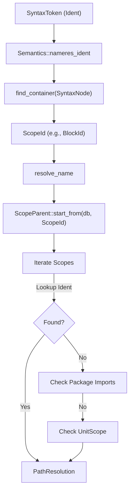
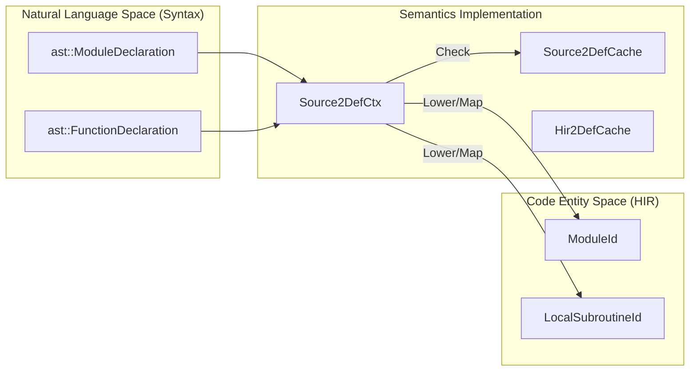

<!-- source: DeepWiki mcp.deepwiki.com · repo pascal-lab/vide · page 4.3 Scope Resolution and Semantics · fetched 2026-10-12 -->

# Scope Resolution and Semantics

Relevant source files

The following files were used as context for generating this wiki page:

- [crates/hir/src/def_id.rs](crates/hir/src/def_id.rs)
- [crates/hir/src/display.rs](crates/hir/src/display.rs)
- [crates/hir/src/hir_def/expr/data_ty.rs](crates/hir/src/hir_def/expr/data_ty.rs)
- [crates/hir/src/scope.rs](crates/hir/src/scope.rs)
- [crates/hir/src/semantics.rs](crates/hir/src/semantics.rs)
- [crates/hir/src/semantics/pathres.rs](crates/hir/src/semantics/pathres.rs)
- [crates/hir/src/symbol.rs](crates/hir/src/symbol.rs)
- [crates/hir/src/type_infer.rs](crates/hir/src/type_infer.rs)
- [crates/ide/src/code_action/handlers/extract_variable.rs](crates/ide/src/code_action/handlers/extract_variable.rs)
- [crates/ide/src/completion/engine/expr.rs](crates/ide/src/completion/engine/expr.rs)
- [crates/ide/src/completion/engine/member.rs](crates/ide/src/completion/engine/member.rs)
- [crates/ide/src/completion/engine/named.rs](crates/ide/src/completion/engine/named.rs)
- [crates/ide/src/completion/engine/typed_filter.rs](crates/ide/src/completion/engine/typed_filter.rs)
- [crates/ide/src/render.rs](crates/ide/src/render.rs)

This page details how Vide implements symbol table construction, name resolution, and semantic analysis for SystemVerilog. The system is built on a hierarchy of scopes that mirror the language's lexical structure, managed via the Salsa incremental framework to ensure efficient recomputation.

## Overview of Semantic Analysis

Semantic analysis in Vide is centered around the `Semantics` facade, which provides a high-level API for querying the properties of syntax nodes and resolving identifiers to their high-level definitions (HIR).

### Key Components

| Component | Role |
| :--- | :--- |
| `Semantics` | The primary entry point for IDE features to query semantic information [crates/hir/src/semantics.rs:33-36](). |
| `NameScope` | A container storing definitions for specific namespaces (types, values) [crates/hir/src/scope.rs:33-37](). |
| `PathResolution` | A wrapper around one or more `DefId`s representing the result of a name resolution [crates/hir/src/semantics/pathres.rs:37-43](). |
| `Source2DefCache` | A cache used by `Semantics` to map syntax pointers to HIR IDs [crates/hir/src/semantics.rs:99-102](). |

**Sources:** [crates/hir/src/semantics.rs:33-102](), [crates/hir/src/scope.rs:33-37](), [crates/hir/src/semantics/pathres.rs:37-43]()

## Scope Hierarchy and Resolution

Vide defines several scope types corresponding to SystemVerilog language constructs. These scopes are computed as Salsa queries, allowing them to be cached and incrementally updated.

### Scope Types

1.  **UnitScope**: The global/compilation unit scope. It aggregates definitions from all files in the project, providing a project-wide view of modules and packages [crates/hir/src/scope.rs:77-87]().
2.  **FileScope**: Contains items defined at the top level of a file, such as modules, interfaces, and package imports [crates/hir/src/scope.rs:122-195]().
3.  **ModuleScope**: Contains items defined within a module, including ports, parameters, nets, variables, and subroutines [crates/hir/src/scope.rs:197-210]().
4.  **SubroutineScope**: Specific to functions and tasks, including arguments and local declarations [crates/hir/src/scope.rs:240-255]().
5.  **BlockScope**: Used for procedural `begin...end` blocks, containing local variables [crates/hir/src/scope.rs:226-238]().

### Name Resolution Data Flow

Resolution starts by finding the `ScopeId` (container) of a syntax node and then walking up the lexical hierarchy via `ScopeParent`.

**Identifier Resolution Pipeline**

**Sources:** [crates/hir/src/semantics/pathres.rs:32-83](), [crates/hir/src/container.rs:1-50]()

## The Semantics Facade

The `Semantics` struct acts as a bridge between the "Natural Language Space" (Syntax Trees) and the "Code Entity Space" (HIR Definitions).

### Source to Definition Mapping

The mapping uses `Source2DefCtx` and a bidirectional `SourceMap`. It allows the IDE to ask "What HIR entity does this specific `ast::ModuleDeclaration` represent?".

**Source to Definition Resolution**

**Sources:** [crates/hir/src/semantics.rs:118-163](), [crates/hir/src/semantics/source_to_def.rs:1-100]()

## Implementation Details

### Hierarchical Path Resolution

Resolution of hierarchical names (e.g., `top.u1.sig`) is handled by `resolve_path`. It resolves the first segment and then iteratively calls `resolve_child_name`, which descends into the scope of the previous segment [crates/hir/src/semantics/pathres.rs:85-101]().

### Scope Descent

The `descend_scope` function is critical for hierarchical resolution. It maps a `DefId` (like a Module or Instance) to its internal `ScopeId` so the resolver can look inside it [crates/hir/src/semantics/pathres.rs:148-170](). For instances, it resolves the target module definition to find the correct scope [crates/hir/src/semantics/pathres.rs:172-186]().

### Namespace Handling

Vide respects SystemVerilog namespaces (types vs. values) using `NameContext`.
- **Type Context**: Used for module names, typedefs, and package names [crates/hir/src/symbol.rs:250-255]().
- **Value Context**: Used for nets, variables, parameters, and instances [crates/hir/src/symbol.rs:256-261]().

**Sources:** [crates/hir/src/semantics/pathres.rs:85-186](), [crates/hir/src/symbol.rs:250-261]()

## Type Inference Integration

Scope resolution is tightly coupled with type inference. Once a name is resolved to a `PathResolution`, the system can query its type via `db.type_of_path_resolution(res)` [crates/hir/src/type_infer.rs:110-112]().

1.  **Decl Type**: Resolves the type of a variable or net declaration [crates/hir/src/type_infer.rs:106-108]().
2.  **Typedef Resolution**: Follows typedef chains to the underlying base type, handling potential cycles [crates/hir/src/type_infer.rs:99-104]().
3.  **Expression Typing**: Infers the type of complex expressions by resolving their constituent identifiers and applying operator rules [crates/hir/src/type_infer.rs:114-116]().

**Sources:** [crates/hir/src/type_infer.rs:99-155](), [crates/ide/src/completion/engine/expr.rs:196-201]()

## Key Functions Summary

| Function | File | Description |
| :--- | :--- | :--- |
| `resolve_name` | [crates/hir/src/semantics/pathres.rs:59]() | Resolves a single `Ident` by walking up the lexical scope chain. |
| `resolve_path` | [crates/hir/src/semantics/pathres.rs:85]() | Resolves a multi-segment hierarchical name. |
| `insert_decls_and_typedefs` | [crates/hir/src/scope.rs:48]() | Common logic for populating scopes with declarations and types. |
| `type_of_def_id` | [crates/hir/src/type_infer.rs:157]() | Determines the `Ty` of a given `DefId`. |
| `container_for_node` | [crates/hir/src/semantics.rs:118]() | Finds the `ScopeId` containing a specific `SyntaxNode`. |

**Sources:**
- `crates/hir/src/semantics/pathres.rs`
- `crates/hir/src/scope.rs`
- `crates/hir/src/type_infer.rs`
- `crates/hir/src/semantics.rs`
- `crates/hir/src/symbol.rs`

---

