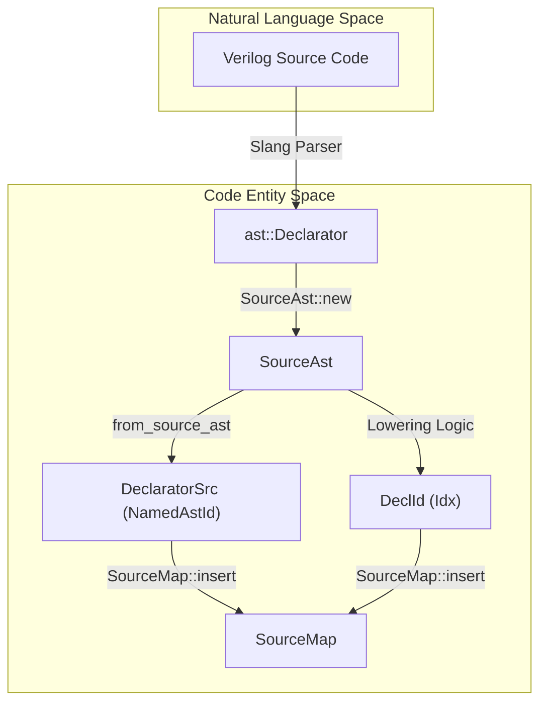
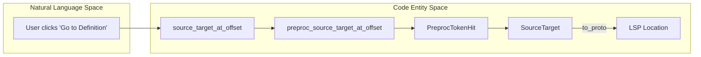

<!-- source: DeepWiki mcp.deepwiki.com · repo pascal-lab/vide · page 4.4 Source Maps and Navigation Targets · fetched 2026-10-12 -->

# Source Maps and Navigation Targets

Relevant source files

The following files were used as context for generating this wiki page:

- [crates/hir/src/has_source.rs](crates/hir/src/has_source.rs)
- [crates/hir/src/hir_def/declaration.rs](crates/hir/src/hir_def/declaration.rs)
- [crates/hir/src/hir_def/expr/declarator.rs](crates/hir/src/hir_def/expr/declarator.rs)
- [crates/hir/src/hir_def/expr/timing_control.rs](crates/hir/src/hir_def/expr/timing_control.rs)
- [crates/hir/src/hir_def/macro_file.rs](crates/hir/src/hir_def/macro_file.rs)
- [crates/hir/src/hir_def/macro_file/source_map.rs](crates/hir/src/hir_def/macro_file/source_map.rs)
- [crates/hir/src/hir_def/macro_file/tests.rs](crates/hir/src/hir_def/macro_file/tests.rs)
- [crates/hir/src/hir_def/module/continuous_assgin.rs](crates/hir/src/hir_def/module/continuous_assgin.rs)
- [crates/hir/src/hir_def/module/instantiation.rs](crates/hir/src/hir_def/module/instantiation.rs)
- [crates/hir/src/hir_def/proc.rs](crates/hir/src/hir_def/proc.rs)
- [crates/hir/src/source_map.rs](crates/hir/src/source_map.rs)
- [crates/ide/src/source_targets.rs](crates/ide/src/source_targets.rs)
- [crates/ide/src/source_targets/preproc.rs](crates/ide/src/source_targets/preproc.rs)
- [crates/ide/src/source_targets/tests.rs](crates/ide/src/source_targets/tests.rs)
- [crates/preproc/src/source/model/tests/definition_trace.rs](crates/preproc/src/source/model/tests/definition_trace.rs)
- [crates/slang/bindings/rust/preproc.rs](crates/slang/bindings/rust/preproc.rs)
- [crates/slang/bindings/rust/preproc/origin/raw.rs](crates/slang/bindings/rust/preproc/origin/raw.rs)

This page describes the infrastructure used to bridge the gap between the High-level Intermediate Representation (HIR) and the concrete syntax trees (CST) provided by Slang. This bidirectional mapping is essential for IDE features like Go-to-Definition, Hover, and Diagnostics, where the system must translate semantic entities back to their original source locations.

## Source Mapping Infrastructure

The `SourceMap<Src, Hir>` structure is a bidirectional mapping between source-map keys (typically wrapping `SyntaxNodePtr`) and HIR indices (`Idx<Hir>`). This allows the compiler to find the HIR representation of a specific syntax node and, conversely, find the source location of a semantic entity [crates/hir/src/source_map.rs:56-59]().

### Key Traits and Types

*   **`IsSrc`**: The base trait for any type that can act as a source-map key. It provides methods to retrieve the `SyntaxKind` and the full `TextRange` of the node [crates/hir/src/source_map.rs:16-38]().
*   **`IsNamedSrc`**: An extension of `IsSrc` for entities that have a specific "focus" range (usually an identifier). This is used for navigation targets and rename operations to ensure the cursor lands on the name rather than the start of the entire block [crates/hir/src/source_map.rs:40-53]().
*   **`SourceMap<Src, Hir>`**: Contains a `FxHashMap` for `Src -> Hir` lookups and an `ArenaMap` for `Hir -> Src` lookups [crates/hir/src/source_map.rs:56-59]().
*   **`SourceAst<Ast>`**: A wrapper used during lowering to ensure that only AST nodes with a valid text range in the root buffer (i.e., not inside a macro expansion or include file) are used as source-map keys [crates/hir/src/source_map.rs:122-139]().
*   **`AstId<Kind>`**: A stable identifier for an AST node within a specific file, combining a `SyntaxNodePtr` and a `HirFileId` [crates/hir/src/source_map.rs:219-221]().

### The `alloc_idx_and_src!` Macro

To maintain the source map during lowering, Vide uses the `alloc_idx_and_src!` macro. This macro handles the simultaneous allocation of a HIR entity in its arena and the insertion of the mapping into the corresponding `SourceMap` [crates/hir/src/hir_def/declaration.rs:14](), [crates/hir/src/hir_def/expr/declarator.rs:206-216]().

**Data Flow: Syntax to HIR Mapping**

The following diagram illustrates how a syntax node is lowered and tracked via the source map.

Title: Source Map Lowering Flow

Sources: [crates/hir/src/source_map.rs:56-85](), [crates/hir/src/source_map.rs:122-148](), [crates/hir/src/hir_def/expr/declarator.rs:193-217]()

## Macro Expansion and Source Targets

SystemVerilog's heavy use of macros requires sophisticated mapping to resolve navigation targets within expanded code.

### Expansion Source Maps

When a macro is expanded, Vide generates an `ExpansionSourceMap` [crates/hir/src/hir_def/macro_file/source_map.rs:29-32](). This map tracks the `Origin` of every token in the expansion:
*   **`Origin::File`**: Token came directly from a source file [crates/hir/src/hir_def/macro_file/source_map.rs:21]().
*   **`Origin::MacroBody`**: Token originated from the macro definition body [crates/hir/src/hir_def/macro_file/source_map.rs:22]().
*   **`Origin::MacroArg`**: Token was passed as an argument to the macro [crates/hir/src/hir_def/macro_file/source_map.rs:23]().

### Source Target Resolution

The `source_target_at_offset` function determines what a user is pointing at in the editor [crates/ide/src/source_targets.rs:184-196](). It first attempts to resolve the target through the preprocessor layer using `preproc_source_target_at_offset` [crates/ide/src/source_targets/preproc.rs:17-24]().

If the offset falls within a macro expansion, the system uses `ExpansionSourceMap::source_hits` to find the original tokens [crates/hir/src/hir_def/macro_file/source_map.rs:80-95](). If multiple expansions overlap the same offset, the resolution may become `SourceTargetResolution::Ambiguous` [crates/ide/src/source_targets.rs:25]().

Sources: [crates/hir/src/hir_def/macro_file/source_map.rs:19-53](), [crates/ide/src/source_targets/preproc.rs:17-58](), [crates/ide/src/source_targets.rs:22-44]()

## Navigation Targets

A `NavTarget` is the IDE-layer representation of a destination for "Go to Definition". It contains the file identity, the full range of the code block, and the specific "focus range" (the identifier) [crates/ide/src/source_targets.rs:40-44]().

### The `HasSource` Trait

The `HasSource` trait is implemented for HIR IDs to retrieve their original source location from the database [crates/hir/src/has_source.rs:14-18](). For example, `ModuleId::source` lookups the `ModuleSrc` from the file's source map [crates/hir/src/has_source.rs:20-28]().

**Bridge: Navigation Resolution**

Title: Navigation Target Construction

### Mapping Logic for Specific Declarations

Different HIR entities implement their own source mapping logic via `SourceMap` fields in their respective context structures:

| Context | Source Map Field | HIR Arena |
| :--- | :--- | :--- |
| `LowerDeclCtx` | `decl_srcs` [crates/hir/src/hir_def/expr/declarator.rs:150]() | `decls` [crates/hir/src/hir_def/expr/declarator.rs:149]() |
| `LowerInstantiationCtx` | `instantiation_srcs` [crates/hir/src/hir_def/module/instantiation.rs:177]() | `instantiations` [crates/hir/src/hir_def/module/instantiation.rs:176]() |
| `LowerProcCtx` | `proc_srcs` [crates/hir/src/hir_def/proc.rs:68]() | `procs` [crates/hir/src/hir_def/proc.rs:67]() |

Sources: [crates/hir/src/hir_def/expr/declarator.rs:146-158](), [crates/hir/src/hir_def/module/instantiation.rs:172-190](), [crates/hir/src/hir_def/proc.rs:62-81](), [crates/hir/src/has_source.rs:1-37]()

---

