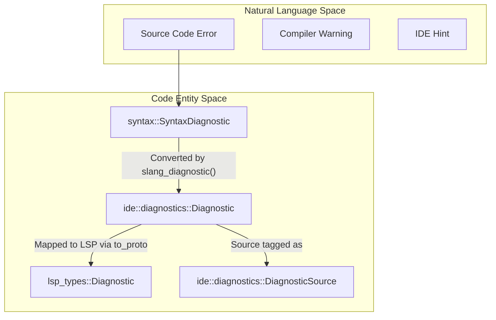
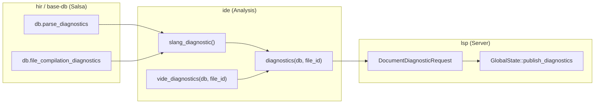

<!-- source: DeepWiki mcp.deepwiki.com · repo pascal-lab/vide · page 5.1 Diagnostics · fetched 2026-10-12 -->

# Diagnostics

Relevant source files

The following files were used as context for generating this wiki page:

- [crates/hir/src/base_db/diagnostics_config.rs](crates/hir/src/base_db/diagnostics_config.rs)
- [crates/ide/src/code_action/action.rs](crates/ide/src/code_action/action.rs)
- [crates/ide/src/code_action/context.rs](crates/ide/src/code_action/context.rs)
- [crates/ide/src/code_action/diagnostics.rs](crates/ide/src/code_action/diagnostics.rs)
- [crates/ide/src/code_action/handlers/insert_expected_token.rs](crates/ide/src/code_action/handlers/insert_expected_token.rs)
- [crates/ide/src/code_lens.rs](crates/ide/src/code_lens.rs)
- [crates/ide/src/diagnostics.rs](crates/ide/src/diagnostics.rs)
- [crates/ide/src/inlay_hint.rs](crates/ide/src/inlay_hint.rs)
- [crates/ide/src/module_resolution.rs](crates/ide/src/module_resolution.rs)
- [crates/ide/src/semantic_index.rs](crates/ide/src/semantic_index.rs)
- [crates/ide/src/semantic_tokens.rs](crates/ide/src/semantic_tokens.rs)
- [crates/project-model/src/lib.rs](crates/project-model/src/lib.rs)
- [crates/project-model/src/toml_workspace.rs](crates/project-model/src/toml_workspace.rs)
- [src/tests.rs](src/tests.rs)

The diagnostics system in Vide is responsible for collecting, filtering, and attributing errors and warnings from multiple sources—including the Slang compiler (for both parsing and semantic analysis) and Vide's own internal analysis engine. Diagnostics are managed incrementally via Salsa queries and are ultimately published to the IDE via the Language Server Protocol (LSP).

## Diagnostic Sources

Diagnostics originate from three primary subsystems, categorized by the `DiagnosticSource` enum [crates/ide/src/diagnostics.rs:33-37]():

1.  **SlangParse**: Syntax errors produced during the initial parsing of a file by the Slang library [crates/ide/src/diagnostics.rs:34-34]().
2.  **SlangSemantic**: Semantic errors (e.g., type mismatches, missing ports) produced during the compilation of a `CompilationPlan` [crates/ide/src/diagnostics.rs:35-35]().
3.  **Vide**: Custom diagnostics implemented within Vide, such as ambiguity in module resolution or identifying inactive preprocessor branches [crates/ide/src/diagnostics.rs:36-36]().

### Data Flow and Attribution

Because Slang operates on its own internal buffer system, Vide must map Slang's buffer IDs back to the VFS `FileId` to correctly attribute diagnostics in the IDE.

**Diagnostic Attribution Flow:**
1.  **Parsing/Compilation**: Slang processes text and produces `SyntaxDiagnostic` objects [crates/ide/src/diagnostics.rs:12-12]().
2.  **Mapping**: The `slang_diagnostic` function converts the raw Slang output into Vide's internal `Diagnostic` struct, translating ranges and severities [crates/ide/src/diagnostics.rs:190-214]().
3.  **Collection**: The `diagnostics` query in the `RootDb` aggregates these results for a given `FileId` [crates/ide/src/diagnostics.rs:216-230]().

**Entity Association Diagram:**

Sources: [crates/ide/src/diagnostics.rs:33-55](), [crates/ide/src/diagnostics.rs:190-214](), [src/tests.rs:18-21]()

## CompilationPlan and Scoping

Diagnostics are not always computed for a single file in isolation. The `CompilationPlan` (retrieved via `db.compilation_plan_for_profile`) defines the scope of analysis [crates/ide/src/diagnostics.rs:176-176]():

*   **File Scoped**: Diagnostics are computed for specific files using `parse_diagnostics` (syntax) and `compilation_diagnostics` (semantic) [crates/ide/src/diagnostics.rs:142-154]().
*   **Profile Scoped**: In a fully configured project (via `vide.toml`), a `CompilationProfileId` defines a set of root files. The `compilation_profile_diagnostics` function collects diagnostics for all files within that profile's plan [crates/ide/src/diagnostics.rs:156-173]().

The `SourceRootRole` determines if diagnostics should even be reported. For example, if a root's diagnostic scope is `Disabled` and the project has compilation profiles, diagnostics are suppressed [crates/ide/src/diagnostics.rs:221-226]().

Sources: [crates/ide/src/diagnostics.rs:156-182](), [crates/ide/src/diagnostics.rs:216-230](), [crates/project-model/src/lib.rs:53-70]()

## Diagnostic Filtering and Selection

Vide provides a mechanism to filter or promote diagnostics via the `DiagnosticsConfig`. Users can configure rules in their IDE settings to ignore specific warnings or turn them into errors.

### DiagnosticSelector
The `DiagnosticSelector` allows rules to target diagnostics based on several criteria:
*   **Code**: Specific subsystem and error code [crates/ide/src/code_action/diagnostics.rs:25-29]().
*   **Name**: The mnemonic name of the diagnostic (e.g., `ambiguous-module-instantiation`) [crates/ide/src/diagnostics.rs:24-25]().
*   **Source**: The entire phase (e.g., `SlangParse` vs `SlangSemantic`) [crates/ide/src/diagnostics.rs:33-37]().

Sources: [crates/ide/src/diagnostics.rs:39-55](), [crates/ide/src/code_action/diagnostics.rs:8-16]()

## IDE-Specific Diagnostics

Beyond the compiler, the `ide` crate generates "Vide" diagnostics for higher-level semantic issues [crates/ide/src/diagnostics.rs:130-130]():

| Diagnostic Name | Code | Description |
| :--- | :--- | :--- |
| `ambiguous-module-instantiation` | 1 | Triggered when a module name resolves to multiple definitions in the workspace [crates/ide/src/diagnostics.rs:24-25](). |
| `inactive-preprocessor-branch` | 2 | Marks code inside `#ifdef` branches that are not active based on current defines [crates/ide/src/diagnostics.rs:26-27](). |

### Ambiguous Module Instantiation
When the IDE encounters a module instantiation, it calls `resolve_module_name` [crates/ide/src/module_resolution.rs:72-76](). If the resolution policy (either `Strict` or `BestEffortProximity`) cannot resolve to a unique candidate, an `Ambiguous` result is returned [crates/ide/src/module_resolution.rs:33-33](). This triggers a diagnostic at the instantiation site [crates/ide/src/diagnostics.rs:24-25]().

Sources: [crates/ide/src/diagnostics.rs:24-31](), [crates/ide/src/module_resolution.rs:29-41](), [crates/ide/src/module_resolution.rs:72-80]()

## Quick Fixes and Repair Actions

Diagnostics are often associated with `CodeAction` repairs [crates/ide/src/code_action/action.rs:40-41](). The `RepairKind` enum defines which actions can satisfy a diagnostic [crates/ide/src/code_action/diagnostics.rs:31-40]():

*   **MissingConnection**: Satisfies `unconnected-port` or specific Slang semantic codes [crates/ide/src/code_action/diagnostics.rs:51-58]().
*   **MissingParameter**: Satisfies `ParamHasNoValue` [crates/ide/src/code_action/diagnostics.rs:59-62]().
*   **InsertExpectedToken**: Satisfies `SlangParse` errors where a specific token is expected [crates/ide/src/code_action/diagnostics.rs:83-86]().

**System Architecture Diagram:**

Sources: [crates/ide/src/diagnostics.rs:142-154](), [crates/ide/src/diagnostics.rs:216-230](), [src/tests.rs:27-34]()

---

