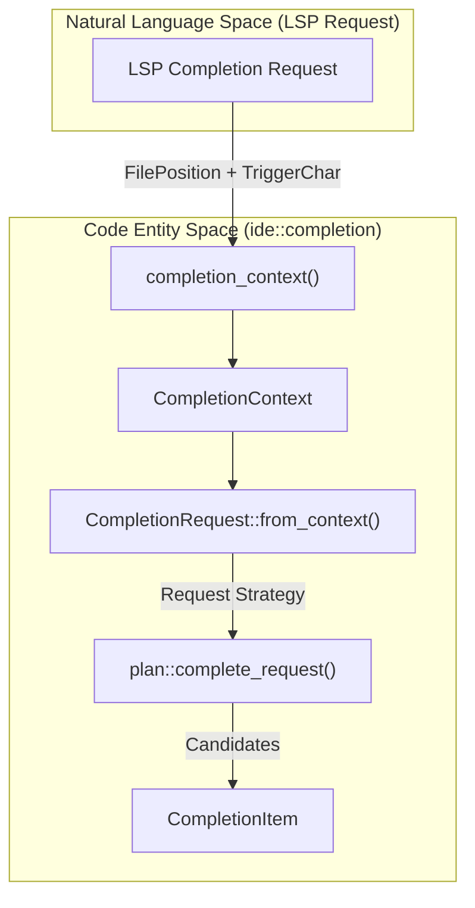
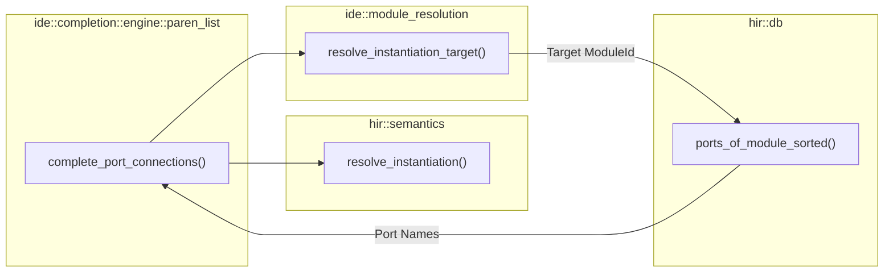

<!-- source: DeepWiki mcp.deepwiki.com · repo pascal-lab/vide · page 5.2 Completion Engine · fetched 2026-10-12 -->

# Completion Engine

<details>
<summary>Relevant source files</summary>

The following files were used as context for generating this wiki page:

- [crates/ide/src/completion.rs](crates/ide/src/completion.rs)
- [crates/ide/src/completion/context.rs](crates/ide/src/completion/context.rs)
- [crates/ide/src/completion/context/decl_name.rs](crates/ide/src/completion/context/decl_name.rs)
- [crates/ide/src/completion/context/expected.rs](crates/ide/src/completion/context/expected.rs)
- [crates/ide/src/completion/context/lex.rs](crates/ide/src/completion/context/lex.rs)
- [crates/ide/src/completion/context/resolve.rs](crates/ide/src/completion/context/resolve.rs)
- [crates/ide/src/completion/engine.rs](crates/ide/src/completion/engine.rs)
- [crates/ide/src/completion/engine/keywords.rs](crates/ide/src/completion/engine/keywords.rs)
- [crates/ide/src/completion/engine/literal.rs](crates/ide/src/completion/engine/literal.rs)
- [crates/ide/src/completion/engine/paren_list.rs](crates/ide/src/completion/engine/paren_list.rs)
- [crates/ide/src/completion/engine/plan.rs](crates/ide/src/completion/engine/plan.rs)
- [crates/ide/src/completion/engine/port_list.rs](crates/ide/src/completion/engine/port_list.rs)
- [crates/ide/src/completion/engine/preproc.rs](crates/ide/src/completion/engine/preproc.rs)
- [crates/ide/src/completion/engine/sensitivity_list.rs](crates/ide/src/completion/engine/sensitivity_list.rs)
- [crates/ide/src/completion/engine/snippets.rs](crates/ide/src/completion/engine/snippets.rs)
- [crates/ide/src/completion/engine/snippets.toml](crates/ide/src/completion/engine/snippets.toml)
- [crates/ide/src/completion/engine/tests.rs](crates/ide/src/completion/engine/tests.rs)
- [crates/ide/src/completion/request.rs](crates/ide/src/completion/request.rs)
- [crates/ide/src/completion/snapshots/ide__completion__request__tests__request_planning_matrix.snap](crates/ide/src/completion/snapshots/ide__completion__request__tests__request_planning_matrix.snap)
- [crates/ide/src/completion/syntax_keywords.rs](crates/ide/src/completion/syntax_keywords.rs)
- [crates/utils/src/uniq_vec.rs](crates/utils/src/uniq_vec.rs)

</details>


The Completion Engine in Vide is a high-performance, context-aware system designed to provide intelligent code suggestions for SystemVerilog. It employs a two-phase architecture: first, it analyzes the source code to determine the semantic and syntactic requirements at the cursor; second, it generates and filters candidates based on those requirements.

## Architecture Overview

The completion process is triggered by the `completions` function [crates/ide/src/completion/engine.rs:31-35](). It follows a linear data flow from a raw file position to a list of `CompletionItem` objects.

### Data Flow Diagram: Completion Request Lifecycle

This diagram shows how a user's request at a specific `FilePosition` is transformed into completion candidates by the internal engine components.


**Sources:** [crates/ide/src/completion/engine.rs:31-50](), [crates/ide/src/completion/context.rs:102-133]()

---

## Phase 1: Context Detection

The `CompletionContext` is the core structure representing the state of the editor at the caret [crates/ide/src/completion/context.rs:88-95](). It is built using three primary sub-components:

### 1. Lexical Context (LexContext)
The engine first determines if the caret is inside a comment, a string literal, or a preprocessor directive [crates/ide/src/completion/context/lex.rs:7-34](). This prevents the engine from suggesting code keywords inside comments or strings. Specific logic handles boundaries, such as being immediately after an apostrophe in an integer literal [crates/ide/src/completion/context/lex.rs:58-83]().

### 2. Caret Snapshot
The `CaretSnapshot` captures the `SyntaxNode` at the offset and identifies the "replacement range" (the text that will be replaced by the completion) and the "prefix" (the text already typed by the user) [crates/ide/src/completion/context.rs:173-174]().

### 3. Expected Syntax
The engine identifies what SystemVerilog construct is expected next. This is determined through:
- **Parser Expectations:** Querying the `RootDb` for what the grammar allows at this offset via `db.parser_expected_syntax` [crates/ide/src/completion/context.rs:120]().
- **Local Heuristics:** Detecting specific triggers like `.` (Member/Port), `::` (Scope Resolution), or `#` (Parameters) [crates/ide/src/completion/context/expected.rs:67-75]().

| ExpectedSyntax Variant | Trigger / Location | Implementation Detail |
| :--- | :--- | :--- |
| `PortConnectionName` | After `.` in instance | `expectation_after_dot` [crates/ide/src/completion/context/expected.rs:77-84]() |
| `MemberName` | After `.` or `::` | `expectation_after_scope_resolution` [crates/ide/src/completion/context/expected.rs:97-110]() |
| `DirectiveName` | After `` ` `` or trigger | `detect_completion_context_impl` [crates/ide/src/completion/context.rs:236-248]() |
| `EventControl` | After `@` | `expectation_after_at` [crates/ide/src/completion/context/expected.rs:158-162]() |
| `IntegerLiteralBase` | After `'` | `detect_completion_context_impl` [crates/ide/src/completion/context.rs:177-193]() |

**Sources:** [crates/ide/src/completion/context.rs:26-70](), [crates/ide/src/completion/context/lex.rs:7-34](), [crates/ide/src/completion/context/expected.rs:40-44]()

---

## Phase 2: Candidate Generation

Once the `CompletionContext` is established, it is converted into a `CompletionRequest` [crates/ide/src/completion/engine.rs:45-47](). The `plan::complete_request` function then dispatches this to specific generators.

### Keyword and Snippet Generation
Keywords are generated based on the `SyntaxKeywordContext` provided by the parser [crates/ide/src/completion/engine/keywords.rs:15-34](). 
- **Static Keywords:** Derived from `syntax_keywords` which uses Slang's keyword tables for specific language versions (e.g., "1364-2005") [crates/ide/src/completion/syntax_keywords.rs:7-32]().
- **Snippets:** Context-sensitive templates (e.g., `always_ff`, `module`) defined in `snippets.toml` and filtered by the current `KeywordSnippetScope` [crates/ide/src/completion/engine/keywords.rs:79-102]().

### Module Instantiation Snippets
If a user types a module name in a context where a module member is expected, the engine suggests instantiation templates [crates/ide/src/completion/engine/keywords.rs:36-77]():
1. **Plain:** `module_name u0();`
2. **Snippet:** `module_name ${1:u0}(${2});`
3. **Parameterized:** `module_name #(${1}) ${2:u0}(${3});`

The engine fetches all available module names from the `unit_scope` in the HIR database [crates/ide/src/completion/engine/keywords.rs:46-51]().

**Sources:** [crates/ide/src/completion/engine/keywords.rs:15-77](), [crates/ide/src/completion/syntax_keywords.rs:100-102]()

### Port and Parameter Completion
The engine performs semantic analysis to resolve hierarchical references:
- **Port Connections:** Resolves the target module of an instantiation and suggests available ports [crates/ide/src/completion/engine/paren_list.rs:112-175]().
- **Typed Filtering:** For ordered port connections, it calculates the `expected_port_ty` and filters candidates in the current module scope to match the type [crates/ide/src/completion/engine/paren_list.rs:183-193]().
- **Preprocessor Directives:** Suggests standard directives and currently visible macros using `visible_macro_names_at` [crates/ide/src/completion/engine/preproc.rs:12-43]().

---

## Implementation Detail: Port List Completion

The completion of ports involves resolving the hierarchy. The engine uses `Semantics` to find the `ModuleId` of the target being instantiated.

### Component Interaction for Port Completion



**Implementation Steps:**
1. Find the `ast::HierarchicalInstance` at the caret [crates/ide/src/completion/engine/paren_list.rs:130-134]().
2. Resolve the `target_module_id` using the `resolve_target_module_id` helper [crates/ide/src/completion/engine/paren_list.rs:144-148]().
3. Filter out ports already used in the current instance by tracking `used_named_ports` in a `FxHashSet` [crates/ide/src/completion/engine/paren_list.rs:152-161]().
4. Generate snippets for the remaining ports: `.port_name(${1:expr})` [crates/ide/src/completion/engine/paren_list.rs:163-174]().

**Sources:** [crates/ide/src/completion/engine/paren_list.rs:112-194](), [crates/ide/src/completion/engine/port_list.rs:17-29]()

---

## Testing the Engine

The completion engine is heavily tested using fixture-based tests with `/*caret*/` markers [crates/ide/src/completion/engine/tests.rs:15-18](). These tests verify that completions are offered correctly for hierarchical access, sensitive lists, and trigger characters.

**Example Test Case:**
```rust
#[test]
fn completes_hierarchical_module_root_member_access() {
    let text = r#"
module leaf;
  wire leaf_wire;
endmodule

module top;
  leaf u0();
  initial begin
    top.u0./*caret*/
  end
endmodule
"#;
    let items = completions_in_text(text, Some(TriggerChar::Dot));
    assert!(labels(&items).contains(&"leaf_wire"));
}
```
**Sources:** [crates/ide/src/completion/engine/tests.rs:129-148](), [crates/ide/src/completion/engine/tests.rs:151-157]()

---

