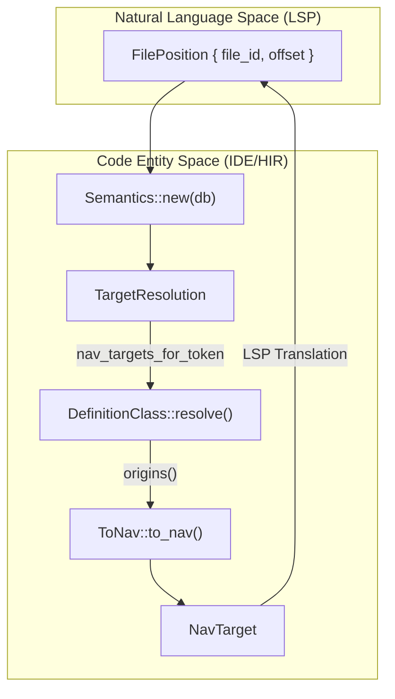
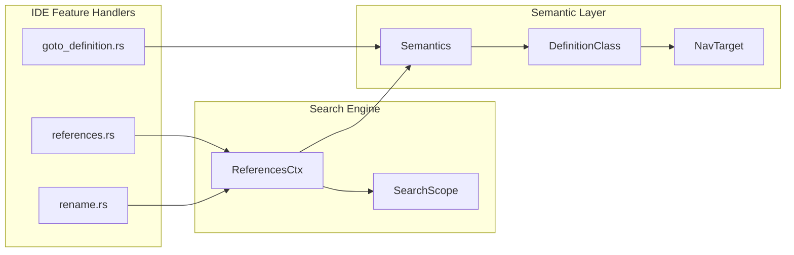

<!-- source: DeepWiki mcp.deepwiki.com · repo pascal-lab/vide · page 5.3 Navigation: Go-to-Definition, References, and Rename · fetched 2026-10-12 -->

# Navigation: Go-to-Definition, References, and Rename

Relevant source files

The following files were used as context for generating this wiki page:

- [crates/ide/src/definitions.rs](crates/ide/src/definitions.rs)
- [crates/ide/src/document_highlight.rs](crates/ide/src/document_highlight.rs)
- [crates/ide/src/document_symbols.rs](crates/ide/src/document_symbols.rs)
- [crates/ide/src/goto_declaration.rs](crates/ide/src/goto_declaration.rs)
- [crates/ide/src/goto_definition.rs](crates/ide/src/goto_definition.rs)
- [crates/ide/src/hover.rs](crates/ide/src/hover.rs)
- [crates/ide/src/navigation_target.rs](crates/ide/src/navigation_target.rs)
- [crates/ide/src/references.rs](crates/ide/src/references.rs)
- [crates/ide/src/references/search.rs](crates/ide/src/references/search.rs)
- [crates/ide/src/rename.rs](crates/ide/src/rename.rs)
- [crates/ide/src/semantic_target.rs](crates/ide/src/semantic_target.rs)
- [crates/ide/src/verilog_2005.rs](crates/ide/src/verilog_2005.rs)

This page details the implementation of symbol-based navigation features in Vide. These features rely on the interaction between the `ide` crate's high-level logic, the `hir` layer's semantic resolution, and a specialized fast-search engine for cross-file reference discovery.

## Symbol Resolution and Definition

The core of all navigation features is the `DefinitionClass`. It acts as a bridge between a raw `SyntaxToken` at a cursor position and the semantic `Definition` it represents.

### DefinitionClass Resolution
When a user triggers a navigation command, Vide first identifies the token at the offset using `token_precedence` [crates/ide/src/goto_definition.rs:199-205](). It then attempts to resolve this token into a `DefinitionClass` [crates/ide/src/definitions.rs:40-103]().

The resolution handles several cases:
1.  **Definition**: A standard semantic entity (Module, Variable, Subroutine) [crates/ide/src/definitions.rs:28]().
2.  **PortConnShorthand**: A special case for SystemVerilog `.name` connections where a single token represents both a local signal and a remote port [crates/ide/src/definitions.rs:29]().
3.  **Ambiguous**: Cases where a name might refer to multiple entities, such as overloaded identifiers [crates/ide/src/definitions.rs:30]().

The resolution logic prioritizes specific contexts like member access (`a.b`), scoped names (`pkg::item`), and declaration names [crates/ide/src/definitions.rs:49-67]().

### Definition Origins
A `DefinitionClass` can be traced back to its underlying `DefId` origins using the `origins()` method [crates/ide/src/definitions.rs:105-115](). This allows the IDE to handle multi-definition scenarios (like partial modules or ambiguous resolutions) by returning a collection of source locations.

**Sources:** [crates/ide/src/definitions.rs:26-116](), [crates/ide/src/goto_definition.rs:199-205]()

---

## Go-to-Definition and Declaration

The `goto_definition` feature maps a source position to a `NavTarget`.

### Implementation Flow
1.  **Target Resolution**: Vide uses `resolve_semantic_target` to identify the intent and the underlying syntax [crates/ide/src/goto_definition.rs:33]().
2.  **Semantic Mapping**: Calls `nav_targets_for_token` which utilizes `DefinitionClass::resolve` to get the underlying `Definition` [crates/ide/src/goto_definition.rs:86-101]().
3.  **Navigation Target Construction**: The `ToNav` trait is implemented for various HIR IDs (e.g., `ModuleId`, `DefId`, `BlockId`). It converts internal IDs into `NavTarget` structs containing `file_id`, `full_range` (the whole declaration), and `focus_range` (the identifier name) [crates/ide/src/navigation_target.rs:52-79]().

### Go-to-Declaration
`goto_declaration` specifically attempts to find the declaration site rather than the definition (if they differ). It uses `definition.declaration_origin(db)` to resolve the target [crates/ide/src/goto_declaration.rs:69-81]().

### Control Flow Pairs
Vide supports navigation for keyword pairs like `begin`/`end` or `module`/`endmodule`. The `handle_ctrl_flow_kw` function identifies these `pair_token` matches and returns the opposite keyword as a navigation target [crates/ide/src/goto_definition.rs:183-197]().

### Navigation Target Data Flow
The following diagram illustrates how a syntax token is resolved into a navigable location.

**Diagram: Token to NavTarget Resolution**

**Sources:** [crates/ide/src/goto_definition.rs:27-101](), [crates/ide/src/navigation_target.rs:33-79](), [crates/ide/src/semantic_target.rs:53-80]()

---

## Find References (ReferencesCtx)

Finding references across a project is implemented in `ReferencesCtx`. It uses a two-phase search strategy to maintain performance.

### 1. Search Scope Determination
The `SearchScope` determines which files and ranges should be searched [crates/ide/src/references/search.rs:29-30](). 
*   **Public**: Searches the whole project [crates/ide/src/references/search.rs:44]().
*   **Private**: Limits the search to the current container (e.g., a local variable inside a `Subroutine` or `Block`) [crates/ide/src/references/search.rs:45-61]().

### 2. Fast Search and Verification
Vide utilizes the `ReferencesCtx` to perform the search [crates/ide/src/references.rs:184-191]().
*   **Semantic Indexing**: The search leverages `source_root_semantic_index_for_root` to quickly find files containing potential references [crates/ide/src/references/search.rs:23]().
*   **Verification**: For each candidate found, Vide verifies the semantic resolution to ensure it matches the target definition [crates/ide/src/references/search.rs:184-195]().

**Sources:** [crates/ide/src/references.rs:88-147](), [crates/ide/src/references/search.rs:29-128]()

---

## Document Highlight

Document highlighting (highlighting all occurrences of a symbol in the *current* file) is a specialized version of the reference search.

1.  It resolves the token at the cursor to a `DefinitionClass` [crates/ide/src/document_highlight.rs:80-84]().
2.  It uses `ReferencesCtx` with a `SearchScope` restricted to `single_file(file_id)` [crates/ide/src/document_highlight.rs:105-106]().
3.  It combines the definition sites (if in the same file) with all discovered reference ranges [crates/ide/src/document_highlight.rs:95-113]().

**Sources:** [crates/ide/src/document_highlight.rs:28-47](), [crates/ide/src/document_highlight.rs:89-114]()

---

## Rename and PortConnShorthand

Renaming in SystemVerilog is complicated by **Port Connection Shorthands** (`.name`).

### Transformation Logic
When renaming a signal, Vide must handle shorthand connections. If a signal is renamed such that it no longer matches the port name, the shorthand connection must be expanded into an explicit connection (e.g., `.clk` becomes `.clk(new_clk_name)`).

This logic is encapsulated in `DefinitionClass::PortConnShorthand`, which tracks both the `port` definition and the `local` signal definition [crates/ide/src/definitions.rs:29](). During a rename, the `local` signal is updated [crates/ide/src/rename.rs:141-143]().

### Rename Workflow
1.  **Prepare**: `prepare_rename` verifies the target is renameable and returns the valid range [crates/ide/src/rename.rs:104-113]().
2.  **Conflict Check**: `rename_conflict_info` checks if the `new_name` would collide with existing symbols in the same scope [crates/ide/src/rename.rs:173-208]().
3.  **Recursive Rename**: If a symbol is part of an interface or hierarchy, `recursive_rename_targets` finds all related symbols that must be renamed together [crates/ide/src/rename.rs:133-135]().

**Sources:** [crates/ide/src/rename.rs:104-171](), [crates/ide/src/definitions.rs:78-95]()

---

## Summary of Key Components

| Component | Responsibility | Location |
| :--- | :--- | :--- |
| `DefinitionClass` | Classifies what kind of entity a syntax token refers to. | [crates/ide/src/definitions.rs:27]() |
| `ReferencesCtx` | Executes searches across files for symbol references. | [crates/ide/src/references/search.rs:175]() |
| `NavTarget` | Data structure for LSP-compatible navigation results. | [crates/ide/src/navigation_target.rs:34]() |
| `ToNav` | Trait for converting HIR IDs to `NavTarget`. | [crates/ide/src/navigation_target.rs:52]() |
| `SemanticTarget` | Identifies the type of entity (Source, Macro, Include) for IDE features. | [crates/ide/src/semantic_target.rs:219]() |

**Diagram: Navigation Subsystem Interaction**

**Sources:** [crates/ide/src/references/search.rs:175-180](), [crates/ide/src/definitions.rs:40-44](), [crates/ide/src/goto_definition.rs:27-35]()

---

