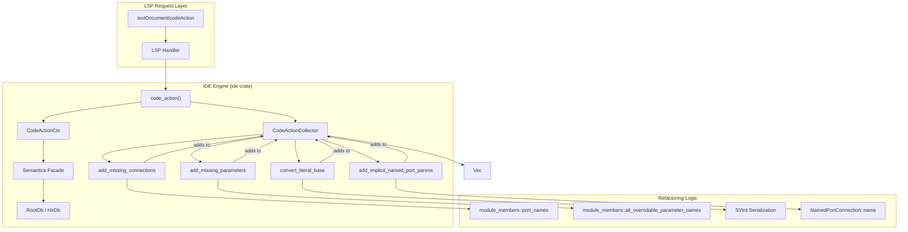
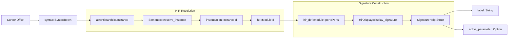

<!-- source: DeepWiki mcp.deepwiki.com · repo pascal-lab/vide · page 5.5 Code Actions and Signature Help · fetched 2026-10-12 -->

# Code Actions and Signature Help

<details>
<summary>Relevant source files</summary>

The following files were used as context for generating this wiki page:

- [crates/hir/src/semantics/resolver.rs](crates/hir/src/semantics/resolver.rs)
- [crates/ide/src/code_action.rs](crates/ide/src/code_action.rs)
- [crates/ide/src/code_action/collector.rs](crates/ide/src/code_action/collector.rs)
- [crates/ide/src/code_action/edits.rs](crates/ide/src/code_action/edits.rs)
- [crates/ide/src/code_action/handlers.rs](crates/ide/src/code_action/handlers.rs)
- [crates/ide/src/code_action/handlers/add_default_case_item.rs](crates/ide/src/code_action/handlers/add_default_case_item.rs)
- [crates/ide/src/code_action/handlers/add_implicit_named_port_parens.rs](crates/ide/src/code_action/handlers/add_implicit_named_port_parens.rs)
- [crates/ide/src/code_action/handlers/add_instance_parens.rs](crates/ide/src/code_action/handlers/add_instance_parens.rs)
- [crates/ide/src/code_action/handlers/add_missing_connections.rs](crates/ide/src/code_action/handlers/add_missing_connections.rs)
- [crates/ide/src/code_action/handlers/add_missing_parameters.rs](crates/ide/src/code_action/handlers/add_missing_parameters.rs)
- [crates/ide/src/code_action/handlers/apply_de_morgan.rs](crates/ide/src/code_action/handlers/apply_de_morgan.rs)
- [crates/ide/src/code_action/handlers/convert_literal_base.rs](crates/ide/src/code_action/handlers/convert_literal_base.rs)
- [crates/ide/src/code_action/handlers/convert_ordered_connections.rs](crates/ide/src/code_action/handlers/convert_ordered_connections.rs)
- [crates/ide/src/code_action/handlers/expand_compound_assignment.rs](crates/ide/src/code_action/handlers/expand_compound_assignment.rs)
- [crates/ide/src/code_action/handlers/expand_postfix_inc_dec.rs](crates/ide/src/code_action/handlers/expand_postfix_inc_dec.rs)
- [crates/ide/src/code_action/handlers/invert_if_else.rs](crates/ide/src/code_action/handlers/invert_if_else.rs)
- [crates/ide/src/code_action/handlers/remove_empty_port_connections.rs](crates/ide/src/code_action/handlers/remove_empty_port_connections.rs)
- [crates/ide/src/code_action/handlers/sort_named_instantiation_items.rs](crates/ide/src/code_action/handlers/sort_named_instantiation_items.rs)
- [crates/ide/src/code_action/handlers/split_declaration_declarators.rs](crates/ide/src/code_action/handlers/split_declaration_declarators.rs)
- [crates/ide/src/code_action/handlers/wrap_statement_in_begin_end.rs](crates/ide/src/code_action/handlers/wrap_statement_in_begin_end.rs)
- [crates/ide/src/code_action/tests.rs](crates/ide/src/code_action/tests.rs)
- [crates/ide/src/signature_help.rs](crates/ide/src/signature_help.rs)

</details>


This page details the implementation of IDE assistance features in Vide, specifically focusing on **Code Actions** (quick-fixes and refactorings) and **Signature Help** (parameter/port information during instantiation). These features bridge the gap between static analysis (HIR/Diagnostics) and user-driven edits.

## Code Actions

Code actions provide automated edits to resolve diagnostics or perform common refactoring tasks. They are managed by the `CodeActionCollector` which gathers potential actions based on the current cursor position and active diagnostics.

### Architecture and Data Flow

The code action system operates in two phases: collection and resolution.

1.  **Context Detection**: `CodeActionCtx` captures the current `FileId`, cursor `TextRange`, and any `CodeActionDiagnostics` reported at that location [crates/ide/src/code_action/context.rs]().
2.  **Collection**: The `code_action` engine iterates through registered handlers (e.g., `add_missing_connections`, `convert_literal_base`) [crates/ide/src/code_action/engine.rs]().
3.  **Resolution**: Depending on the `CodeActionResolveStrategy`, the system either returns just the metadata (label/ID) or computes the full `SourceChange` (text edits) [crates/ide/src/code_action/action.rs:10-15]().

### Component Interaction Diagram

The following diagram illustrates how the `CodeActionCollector` interacts with the `Semantics` layer and `RepairKind` diagnostics to generate edits.

**Code Action Generation Flow**

Sources: [crates/ide/src/code_action.rs:1-21](), [crates/ide/src/code_action/handlers.rs:30-61](), [crates/ide/src/code_action/handlers/add_missing_connections.rs:12-19](), [crates/ide/src/code_action/handlers/add_missing_parameters.rs:12-19]()

### Key Handlers

| Action ID | Purpose | Implementation File |
| :--- | :--- | :--- |
| `add_missing_connections` | Fills in unconnected ports for a module instance. | [crates/ide/src/code_action/handlers/add_missing_connections.rs:21-26]() |
| `add_missing_parameters` | Fills in missing parameter assignments in an instantiation. | [crates/ide/src/code_action/handlers/add_missing_parameters.rs:21-26]() |
| `convert_ordered_ports` | Converts `child(a, b)` to `.port_a(a), .port_b(b)`. | [crates/ide/src/code_action/handlers/convert_ordered_connections.rs:22-27]() |
| `convert_ordered_params` | Converts `child #(1, 2)` to `child #(.A(1), .B(2))`. | [crates/ide/src/code_action/handlers/convert_ordered_connections.rs:29-34]() |
| `convert_literal_base` | Cycles an integer literal between Bin, Oct, Dec, and Hex. | [crates/ide/src/code_action/handlers/convert_literal_base.rs:10-14]() |
| `add_implicit_named_port_parens` | Converts `.port` to `.port()`. | [crates/ide/src/code_action/handlers/add_implicit_named_port_parens.rs:10-15]() |
| `apply_de_morgan` | Applies or factors De Morgan's law for boolean expressions. | [crates/ide/src/code_action/handlers/apply_de_morgan.rs:12-18]() |
| `expand_postfix_inc_dec` | Expands `i++` to `i = i + 1`. | [crates/ide/src/code_action/handlers/expand_postfix_inc_dec.rs:11-16]() |

### Implementation Detail: Port and Parameter Filling
The handlers for `add_missing_connections` and `add_missing_parameters` utilize `resolve_hir_instantiation_target` to find the definition of the module being instantiated [crates/ide/src/code_action/handlers/add_missing_connections.rs:57-58](). They compare existing assignments in the HIR with the total set of ports/parameters defined in the target module to calculate the "delta" [crates/ide/src/code_action/handlers/add_missing_connections.rs:66-84](). Edits are applied using `apply_missing_list_edit` which handles comma placement and indentation [crates/ide/src/code_action/handlers/add_missing_connections.rs:90-101]().

Sources: [crates/ide/src/code_action/handlers/add_missing_connections.rs:40-105](), [crates/ide/src/code_action/handlers/add_missing_parameters.rs:40-109](), [crates/ide/src/code_action/edits.rs]()

---

## Signature Help

Signature help provides a tooltip showing the port or parameter list of a module while the user is typing inside the parentheses of an instantiation.

### Data Flow: From Offset to Signature
The feature triggers on the `textDocument/signatureHelp` request.

1.  **Node Identification**: The system finds the `ast::HierarchicalInstance` or `ast::HierarchyInstantiation` at the cursor offset [crates/ide/src/signature_help.rs:76-102]().
2.  **Target Resolution**: `resolve_instantiation_target` identifies the `ModuleId` of the module being instantiated [crates/ide/src/signature_help.rs:141-143]().
3.  **Active Parameter Calculation**: The engine determines which port/parameter the cursor is currently "in" by comparing the cursor offset against the source ranges of existing connections in the `module_src_map` [crates/ide/src/signature_help.rs:125-138]().
4.  **Label Rendering**: The `HirDisplay` trait is used to render the types and names of the target ports/parameters into a string label [crates/ide/src/signature_help.rs:195-200]().

### Signature Help Entity Mapping
This diagram maps the natural language concepts of "Signature Help" to the specific code entities in the `ide` and `hir` crates.

**Signature Help Entity Map**

Sources: [crates/ide/src/signature_help.rs:65-105](), [crates/ide/src/signature_help.rs:107-147](), [crates/ide/src/signature_help.rs:191-205](), [crates/hir/src/semantics/resolver.rs:19-35]()

### SignatureHelp Structure
The `SignatureHelp` struct contains the rendered label, documentation, and the range of each parameter within that label to allow the IDE to highlight the current parameter [crates/ide/src/signature_help.rs:41-47]().

```rust
pub struct SignatureHelp {
    pub doc: Option<Markup>,
    pub label: String,
    pub active_parameter: Option<usize>,
    pub param_ranges: Vec<TextRange>,
    config: SignatureHelpConfig,
}
```
Sources: [crates/ide/src/signature_help.rs:41-47]()

---

## Testing Infrastructure

Code actions and signature help are tested using a "caret marker" system. A string containing `/*caret*/` is passed to `db_with_file`, which strips the marker and returns the `TextSize` offset for the test [crates/ide/src/code_action/tests.rs:103-109]().

-   **`apply_action`**: Verifies that a specific `RepairKind` diagnostic triggers the expected code action and results in the correct text edit [crates/ide/src/code_action/tests.rs:125-151]().
-   **`apply_action_without_diagnostics`**: Tests refactorings (like `convert_literal_base` or `apply_de_morgan`) that do not require an active diagnostic to be available [crates/ide/src/code_action/tests.rs:153-155]().
-   **Fixture Parsing**: The `CodeActionFixture` struct parses metadata (e.g., `//- action: convert_literal_base`) to drive automated tests [crates/ide/src/code_action/tests.rs:10-64]().

Sources: [crates/ide/src/code_action/tests.rs:1-184]()

---

