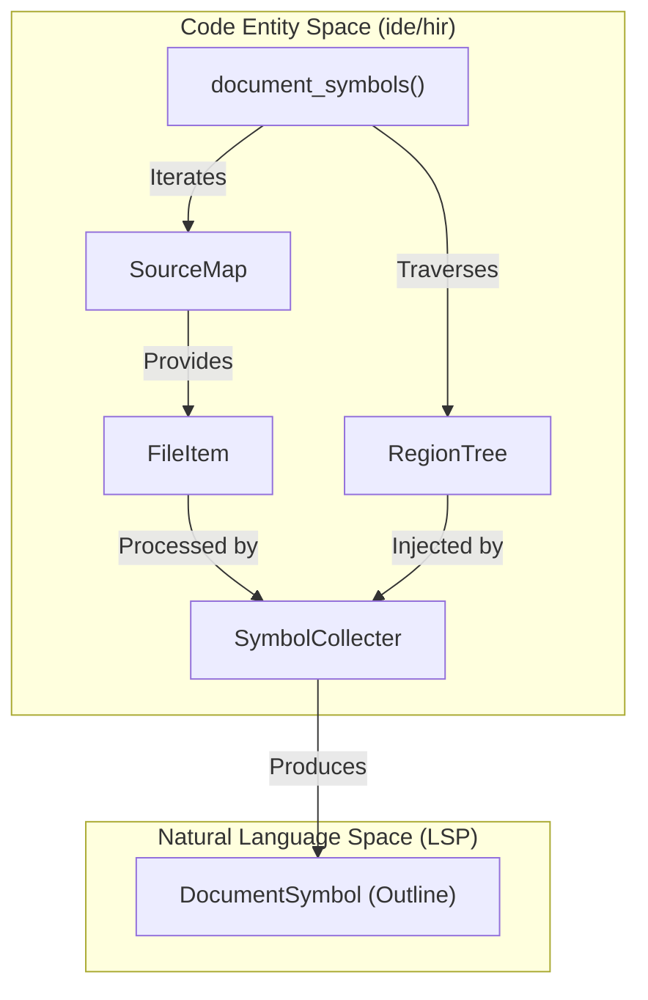
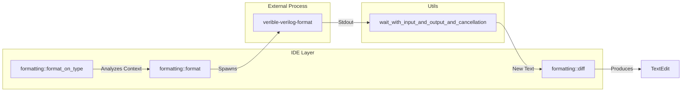

<!-- source: DeepWiki mcp.deepwiki.com · repo pascal-lab/vide · page 5.6 Document Symbols, Folding, and Formatting · fetched 2026-10-12 -->

# Document Symbols, Folding, and Formatting

Relevant source files

The following files were used as context for generating this wiki page:

- [crates/hir/src/region_tree.rs](crates/hir/src/region_tree.rs)
- [crates/ide/src/definitions.rs](crates/ide/src/definitions.rs)
- [crates/ide/src/document_symbols.rs](crates/ide/src/document_symbols.rs)
- [crates/ide/src/folding_ranges.rs](crates/ide/src/folding_ranges.rs)
- [crates/ide/src/formatting.rs](crates/ide/src/formatting.rs)
- [crates/ide/src/navigation_target.rs](crates/ide/src/navigation_target.rs)
- [crates/ide/src/selection_ranges.rs](crates/ide/src/selection_ranges.rs)
- [crates/ide/src/verilog_2005.rs](crates/ide/src/verilog_2005.rs)
- [crates/syntax/src/has_text_range.rs](crates/syntax/src/has_text_range.rs)
- [crates/syntax/src/slang_ext.rs](crates/syntax/src/slang_ext.rs)
- [crates/syntax/src/slang_ext/token.rs](crates/syntax/src/slang_ext/token.rs)

This section details how Vide provides structural navigation and code organization features. It covers the generation of document outlines (symbols), hierarchical folding of code blocks, selection range expansion, and integration with external formatters like Verible.

## Document Symbols

Vide generates a hierarchical document outline by traversing the High-level Intermediate Representation (HIR) and the `RegionTree`. This allows users to navigate complex SystemVerilog files via the editor's "Outline" view or "Go to Symbol in Editor" command.

### Symbol Collection Process

The collection is managed by the `SymbolCollecter` struct [crates/ide/src/document_symbols.rs:67-70](). It uses a stack-based approach to build a nested tree of `DocumentSymbol` objects [crates/ide/src/document_symbols.rs:56-64]().

1.  **HIR Traversal**: The function `document_symbols` queries the `RootDb` for the HIR and source map of a file [crates/ide/src/document_symbols.rs:198-201](). It iterates through `FileItem` entries, such as modules, procedures, and declarations [crates/ide/src/document_symbols.rs:208-220]().
2.  **Region Integration**: Simultaneously, it traverses the `RegionTree` (which contains `pragma protect` regions and pseudo-regions created from groups of declarations) [crates/ide/src/document_symbols.rs:202-205]().
3.  **Symbol Mapping**: For each entity, Vide determines:
    *   **Name**: Extracted via `IsNamedSrc` or `RegionNode::name` [crates/ide/src/document_symbols.rs:77-80]().
    *   **Focus Range**: The specific range of the identifier (e.g., the module name) via `name_or_full_range` [crates/ide/src/document_symbols.rs:81]().
    *   **Full Range**: The entire span of the construct via `range` [crates/ide/src/document_symbols.rs:82]().
    *   **Kind**: Mapped to LSP-compatible `SymbolKind` (e.g., Module, Function, Variable) [crates/ide/src/document_symbols.rs:83]().

### Symbol Data Flow

The following diagram illustrates how raw syntax nodes and HIR items are transformed into structured document symbols.

**Title: Document Symbol Generation Flow**

Sources: [crates/ide/src/document_symbols.rs:67-162](), [crates/ide/src/document_symbols.rs:198-212](), [crates/hir/src/region_tree.rs:20-31]()

## Folding Ranges

Folding ranges allow users to collapse sections of code. Vide identifies these ranges by combining syntactic information with HIR-based structural boundaries.

### Folding Logic
The `folding_ranges` function [crates/ide/src/folding_ranges.rs:120-145]() aggregates ranges from multiple sources:
*   **Comments**: `collect_comments` uses a `Finder` to locate `//` and `/* */` blocks [crates/ide/src/folding_ranges.rs:147-162](). Consecutive line comments are merged into a single fold [crates/ide/src/folding_ranges.rs:164-232]().
*   **HIR Structures**: Modules, blocks, and statements are folded based on their `SourceMap` ranges [crates/ide/src/folding_ranges.rs:133-142]().
*   **Regions**: Custom user regions (e.g., `// region`) stored in the `RegionTree` are collected via `collect_docs` [crates/ide/src/folding_ranges.rs:111-118]().

Vide uses `Fold::try_build` to ensure that only ranges spanning multiple lines are emitted, avoiding redundant single-line folds [crates/ide/src/folding_ranges.rs:69-75]().

Sources: [crates/ide/src/folding_ranges.rs:37-61](), [crates/ide/src/folding_ranges.rs:120-145]()

## Selection Ranges

Selection range expansion (e.g., "Expand Selection" in VS Code) allows users to incrementally select larger syntactic units. Vide implements this in `selection_ranges.rs`.

The algorithm starts at the cursor `offset` and moves upward through the syntax tree:
1.  **Trivia/Token Detection**: It first identifies if the cursor is on a comment (trivia) or a token [crates/ide/src/selection_ranges.rs:28-59]().
2.  **Parent Traversal**: It then uses `cursor.goto_parent()` to find encompassing `SyntaxNode` ranges [crates/ide/src/selection_ranges.rs:80-87]().
3.  **Precedence**: Tokens like identifiers and literals are prioritized using `token_precedence` to provide more intuitive expansion steps [crates/ide/src/selection_ranges.rs:92-98]().

Sources: [crates/ide/src/selection_ranges.rs:12-90]()

## Formatting

Vide does not implement a native formatter. Instead, it acts as a bridge to external tools, primarily the **Verible** SystemVerilog formatter.

### Verible Integration
The `format_verible` function [crates/ide/src/formatting.rs:93-126]() executes the `verible-verilog-format` binary:
*   **Input**: The current file text is passed via `stdin` [crates/ide/src/formatting.rs:114-118]().
*   **Arguments**: Includes `--indentation_spaces` derived from `FmtConfig` and `--lines` for range-based formatting [crates/ide/src/formatting.rs:107-110]().
*   **Diffing**: After receiving the formatted output, Vide uses the `dissimilar` crate to calculate a minimal `TextEdit` [crates/ide/src/formatting.rs:128-151]().

### On-Type Formatting
Vide supports `format_on_type` specifically for the `\n` character [crates/ide/src/formatting.rs:166-177]().
*   **Comment Continuation**: If the user presses Enter inside a block comment (`/* ... */`), Vide handles the insertion of leading characters via `format_in_bc` [crates/ide/src/formatting.rs:195-201]().
*   **Contextual Formatting**: It can trigger a range format for the preceding block when a new line is started if `config.on_enter` is enabled [crates/ide/src/formatting.rs:212-221]().

**Title: Formatting Implementation Architecture**

Sources: [crates/ide/src/formatting.rs:56-91](), [crates/ide/src/formatting.rs:93-126](), [crates/ide/src/formatting.rs:166-224]()

---

