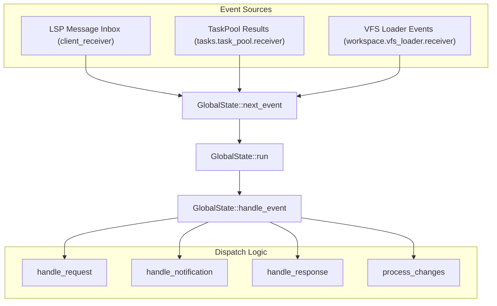
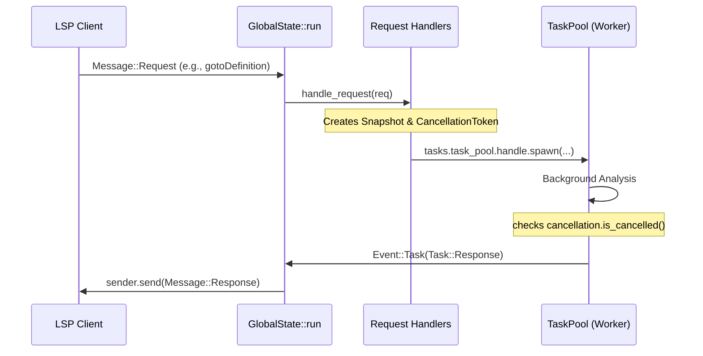

<!-- source: DeepWiki mcp.deepwiki.com · repo pascal-lab/vide · page 6.1 GlobalState and Main Loop · fetched 2026-10-12 -->

# GlobalState and Main Loop

Relevant source files

The following files were used as context for generating this wiki page:

- [crates/vfs/Cargo.toml](crates/vfs/Cargo.toml)
- [crates/vfs/src/dummy.rs](crates/vfs/src/dummy.rs)
- [crates/vfs/src/file_set.rs](crates/vfs/src/file_set.rs)
- [crates/vfs/src/lib.rs](crates/vfs/src/lib.rs)
- [crates/vfs/src/loader.rs](crates/vfs/src/loader.rs)
- [crates/vfs/src/notify.rs](crates/vfs/src/notify.rs)
- [crates/vfs/src/vfs_path.rs](crates/vfs/src/vfs_path.rs)
- [src/global_state.rs](src/global_state.rs)
- [src/global_state/event_loop.rs](src/global_state/event_loop.rs)
- [src/global_state/handlers/notification.rs](src/global_state/handlers/notification.rs)
- [src/global_state/main_loop.rs](src/global_state/main_loop.rs)
- [src/global_state/mem_docs.rs](src/global_state/mem_docs.rs)
- [src/global_state/process_changes.rs](src/global_state/process_changes.rs)
- [src/global_state/reload.rs](src/global_state/reload.rs)
- [src/global_state/snapshot.rs](src/global_state/snapshot.rs)
- [src/global_state/task.rs](src/global_state/task.rs)
- [src/global_state/workspace_state.rs](src/global_state/workspace_state.rs)

The `GlobalState` is the central coordinator of the Vide language server. It manages the server's internal state, orchestrates communication between the LSP client and background workers, and maintains the integrity of the incremental computation database (Salsa). The main loop acts as the heartbeat of the server, dispatching events from the LSP inbox, the task pool, and the virtual file system (VFS).

## GlobalState Architecture

`GlobalState` acts as a mutable container for all long-lived server components. It is designed to provide "Snapshot Isolation": while the main loop can mutate the state, background tasks work on an immutable `GlobalStateSnapshot` to ensure consistency without blocking the main thread.

### Key Components

| Component | Type | Role |
| :--- | :--- | :--- |
| `analysis_host` | `AnalysisHost` | The entry point to the Salsa database; handles `Change` applications [src/global_state.rs:98](). |
| `vfs` | `Arc<RwLock<(Vfs, ...)>` | Manages the mapping between file paths and `FileId`s [src/global_state.rs:116](). |
| `task_pool` | `TaskPool<Task>` | A thread pool for executing CPU-bound IDE requests and background IO [src/global_state.rs:87](). |
| `mem_docs` | `MemDocs` | Tracks in-memory document versions and content for unsaved changes [src/global_state.rs:99](). |
| `config` | `Arc<Config>` | Holds server settings, client capabilities, and workspace roots [src/global_state.rs:91](). |
| `vfs_loader` | `Handle` | Interface for reading and watching files on the filesystem [src/global_state.rs:115](). |

### Snapshot Isolation
To handle requests concurrently, `GlobalState` provides a `make_snapshot()` method [src/global_state.rs:160-191](). This creates a `GlobalStateSnapshot` [src/global_state/snapshot.rs:65-79]() which contains a snapshot of the `analysis_host`. This allows background threads to perform complex queries (like go-to-definition or completions) on a point-in-time view of the code while the main loop continues to process new LSP messages.

Sources: [src/global_state.rs:67-123](), [src/global_state/snapshot.rs:65-98]()

## The Main Loop

The main loop is implemented in `GlobalState::run` [src/global_state/event_loop.rs:90-113](). It uses `crossbeam_channel::select!` in `next_event` [src/global_state/event_loop.rs:135-141]() to poll for events from three primary sources:
1.  **LSP Inbox**: Requests and notifications from the editor via `client_receiver`.
2.  **Task Pool**: Results from background tasks (e.g., completed analysis or workspace fetching) [src/global_state.rs:87]().
3.  **VFS Loader**: Notifications about file system changes or file loading progress [src/global_state.rs:115]().

### Event Dispatching Pipeline

Sources: [src/global_state/event_loop.rs:100-141](), [src/global_state/event_loop.rs:168-183]()

## Process Changes Pipeline

When the VFS detects file changes or the client sends `didChange` notifications, `GlobalState::process_changes` [src/global_state/process_changes.rs:27]() is invoked. This is the critical pipeline that synchronizes the external world with the internal Salsa database.

1.  **Collect Changes**: The pipeline takes changes from the VFS [src/global_state/process_changes.rs:32]().
2.  **VFS to Salsa Mapping**: The pipeline converts `vfs::ChangedFile` events into a `hir::base_db::change::Change` object [src/global_state/process_changes.rs:82]().
3.  **Database Application**: `analysis_host.apply_change(change)` is called, which increments the Salsa database revision [src/global_state/process_changes.rs:86]().
4.  **Diagnostic Invalidation**: Based on the changes, the server determines which files need new diagnostic runs via `invalidate_diagnostics` [src/global_state/process_changes.rs:131-164]().
5.  **Workspace Reload**: If structure changes are detected, it triggers a workspace-wide invalidation [src/global_state/process_changes.rs:100]().

Sources: [src/global_state/process_changes.rs:27-125]()

## Task Management and Cancellation

Vide uses a `TaskPool` to manage background execution. 

*   **Task Types**: Tasks include `FetchWorkspace`, `SemanticCompiler`, and `QiheTask` [src/global_state/task.rs:16-25]().
*   **Execution**: Tasks are spawned using `spawn_and_send_cps` on the `TaskPool` [src/global_state/reload.rs:47]().
*   **Cancellation**: When the server shuts down or an exit notification is received, `cancel_all_tasks` is called [src/global_state/event_loop.rs:104](). The `GlobalStateSnapshot` carries a `CancellationToken` [src/global_state/snapshot.rs:73]() that handlers check to abort stale work.

### Request Dispatching Flow

Sources: [src/global_state/event_loop.rs:168-179](), [src/global_state/task.rs:45-60]()

## Workspace Reloading

Workspace loading is managed via `fetch_workspaces` [src/global_state/reload.rs:43](). When a reload is requested:
1.  The server spawns a background worker to run `ProjectModel::load` [src/global_state/reload.rs:62]().
2.  Progress is reported via `FetchWorkspaceProgress::Begin` and `End` [src/global_state/reload.rs:26-30]().
3.  Once finished, `switch_workspaces` [src/global_state/reload.rs:140]() updates `GlobalState.workspace.workspaces` [src/global_state/reload.rs:152]().
4.  The VFS is re-partitioned into new source roots [src/global_state/reload.rs:168]().
5.  A `Change` is applied to the `analysis_host` to reset the project structure in Salsa [src/global_state/reload.rs:172]().

Sources: [src/global_state/reload.rs:43-109](), [src/global_state/reload.rs:140-188]()

---

