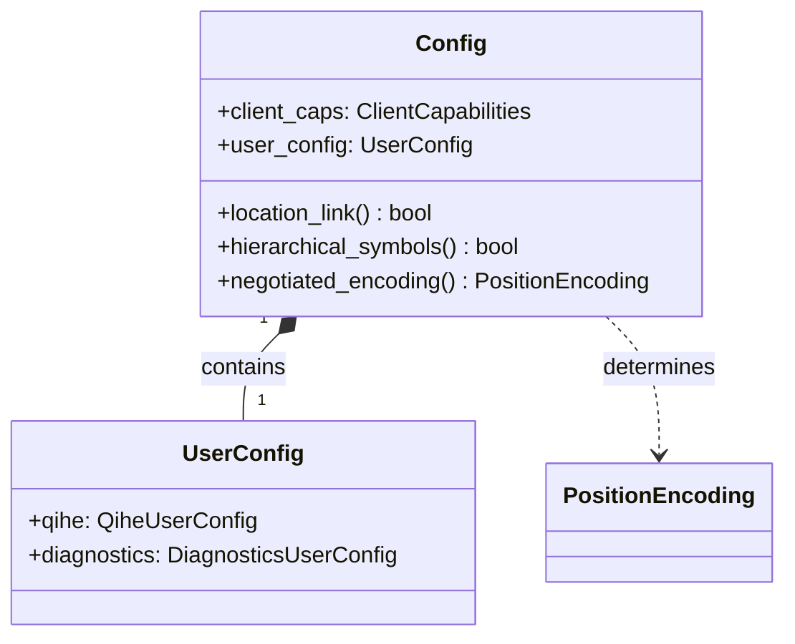

<!-- source: DeepWiki mcp.deepwiki.com · repo pascal-lab/vide · page 6.2 LSP Request and Notification Handlers · fetched 2026-10-12 -->

# LSP Request and Notification Handlers

<details>
<summary>Relevant source files</summary>

The following files were used as context for generating this wiki page:

- [crates/ide/src/analysis.rs](crates/ide/src/analysis.rs)
- [crates/ide/src/db.rs](crates/ide/src/db.rs)
- [crates/ide/src/db/workspace_symbol_index_db.rs](crates/ide/src/db/workspace_symbol_index_db.rs)
- [crates/ide/src/lib.rs](crates/ide/src/lib.rs)
- [crates/ide/src/workspace_symbols.rs](crates/ide/src/workspace_symbols.rs)
- [src/config/caps.rs](src/config/caps.rs)
- [src/config/user_config.rs](src/config/user_config.rs)
- [src/global_state/diagnostics/publisher.rs](src/global_state/diagnostics/publisher.rs)
- [src/global_state/dispatch.rs](src/global_state/dispatch.rs)
- [src/global_state/dispatch/notification.rs](src/global_state/dispatch/notification.rs)
- [src/global_state/dispatch/request.rs](src/global_state/dispatch/request.rs)
- [src/global_state/handlers/notification/lifecycle.rs](src/global_state/handlers/notification/lifecycle.rs)
- [src/global_state/handlers/notification/text_changes.rs](src/global_state/handlers/notification/text_changes.rs)
- [src/global_state/handlers/notification/text_document.rs](src/global_state/handlers/notification/text_document.rs)
- [src/global_state/handlers/notification/workspace.rs](src/global_state/handlers/notification/workspace.rs)
- [src/global_state/handlers/request.rs](src/global_state/handlers/request.rs)
- [src/global_state/handlers/request/commands.rs](src/global_state/handlers/request/commands.rs)
- [src/global_state/handlers/request/diagnostics.rs](src/global_state/handlers/request/diagnostics.rs)
- [src/global_state/handlers/request/navigation.rs](src/global_state/handlers/request/navigation.rs)
- [src/global_state/qihe/tests.rs](src/global_state/qihe/tests.rs)
- [src/lsp_ext/ext.rs](src/lsp_ext/ext.rs)
- [src/lsp_ext/to_proto.rs](src/lsp_ext/to_proto.rs)
- [src/tests/navigation.rs](src/tests/navigation.rs)

</details>


The LSP server implementation in Vide relies on a structured dispatching mechanism to handle incoming messages from the client. This process involves routing requests and notifications through specialized dispatchers that interact with the `GlobalState` and the underlying `Analysis` engine.

## Message Dispatching Architecture

Incoming LSP messages are received by the main loop and categorized as either `Request` or `Notification`. Vide uses two primary dispatcher classes to route these messages to their respective handlers: `ReqDispatcher` and `NotifDispatcher`.

### Dispatcher Flow
The `ReqDispatcher` handles synchronous requests that require a response. It checks if the request method matches a registered handler and, if so, executes it against a `GlobalStateSnapshot`. This ensures that request handling is thread-safe and isolated from concurrent state changes. Requests are dispatched using several modes:
*   `on_sync_mut`: Executed immediately on the main thread (requires mutable access to `GlobalState`).
*   `on_no_retry`: Executed in the `TaskPool`; if the request is cancelled, it is not retried.
*   `on_latency_sensitive`: Prioritized tasks like semantic tokens.
*   `on_fmt_thread`: Specialized thread for formatting tasks to avoid blocking analysis.

The `NotifDispatcher` handles asynchronous notifications that typically update the server's internal state (e.g., file changes, configuration updates).

**LSP Message Routing Logic**
```mermaid
graph TD
    subgraph "GlobalState Dispatch [src/global_state/dispatch/request.rs]"
        [handle_request] --> [ReqDispatcher]
        [handle_notification] --> [NotifDispatcher]
    end

    subgraph "ReqDispatcher Routing [src/global_state/dispatch/request.rs]"
        [ReqDispatcher] --> |"textDocument/completion"| [handle_completion]
        [ReqDispatcher] --> |"textDocument/definition"| [handle_goto_definition]
        [ReqDispatcher] --> |"textDocument/diagnostic"| [handle_document_diagnostic]
        [ReqDispatcher] --> |"workspace/executeCommand"| [handle_execute_command]
    end

    subgraph "Execution Layer [crates/ide/src/analysis.rs]"
        [handle_goto_definition] --> |"AnalysisSnapshot::goto_definition"| [Analysis]
        [handle_completion] --> |"AnalysisSnapshot::completion"| [Analysis]
    end

    subgraph "Code Entity Space"
        [Analysis] --> [RootDb]
        [ReqDispatcher] --> [GlobalState]
    end
```
Sources: [src/global_state/dispatch/request.rs:14-105](), [src/global_state/dispatch/notification.rs:1-20](), [crates/ide/src/analysis.rs:59-70]()

## Request Handlers

Request handlers are located primarily in `src/global_state/handlers/request/`. They translate LSP types into internal Vide types using `from_proto`, invoke queries on the `ide` layer via `snap.analysis`, and convert the results back using `to_proto`.

### Key Request Handlers

| Handler | LSP Method | Description |
| :--- | :--- | :--- |
| `handle_goto_definition` | `textDocument/definition` | Resolves the symbol at the caret and returns its definition location. [src/global_state/handlers/request/navigation.rs:12-24]() |
| `handle_completion` | `textDocument/completion` | Provides context-aware code completion candidates, including snippets and keywords. [src/global_state/handlers/request/completion.rs:1-10]() |
| `handle_document_diagnostic` | `textDocument/diagnostic` | Implements the LSP pull diagnostics model for a specific file. [src/global_state/handlers/request/diagnostics.rs:8-16]() |
| `handle_code_action` | `textDocument/codeAction` | Returns available quick-fixes and refactorings for a range. [src/global_state/handlers/request/code_action.rs:1-12]() |
| `handle_execute_command` | `workspace/executeCommand` | Executes server-side commands like `vide.server.runQiheAnalysis`. [src/global_state/handlers/request/commands.rs:1-13]() |
| `handle_semantic_tokens_full` | `textDocument/semanticTokens/full` | Computes semantic highlighting for the entire file. [src/global_state/handlers/request/semantic_tokens.rs:1-10]() |

### Navigation and Definition Logic
The `handle_goto_definition` function uses `from_proto::file_position` to convert LSP coordinates into a `FilePosition` [src/global_state/handlers/request/navigation.rs:16](). It then queries `snap.analysis.goto_definition(position)` [src/global_state/handlers/request/navigation.rs:17](). The resulting `NavTarget` is converted to an LSP `GotoDefinitionResponse` using `to_proto::goto_definition_response`, which handles `LocationLink` support if the client supports it [src/lsp_ext/to_proto.rs:48-72]().

Sources: [src/global_state/handlers/request/navigation.rs:12-24](), [src/lsp_ext/to_proto.rs:48-72]()

## Notification Handlers

Notification handlers update the `GlobalState` and are defined in `src/global_state/handlers/notification/`. These handlers are the primary entry point for mutations to the Virtual File System (VFS) and the `MemDocs`.

### Document Lifecycle Handlers

1.  **`handle_did_open_text_document`**: Triggered when a file is opened. It adds the document to `MemDocs` and triggers a VFS update. [src/global_state/handlers/notification/text_document.rs:1-20]()
2.  **`handle_did_change_text_document`**: Handles incremental or full text updates by applying `TextDocumentContentChangeEvent` to the in-memory buffer. [src/global_state/handlers/notification/text_changes.rs:1-20]()
3.  **`handle_did_close_text_document`**: Removes the file from `MemDocs` and cleans up associated state. [src/global_state/handlers/notification/text_document.rs:21-35]()

### Workspace and File Watching
*   **`handle_did_change_watched_files`**: Processes file system events (Created, Changed, Deleted). If a `vide.toml` is changed, it triggers a workspace reload. [src/global_state/handlers/notification/workspace.rs:1-20]()
*   **`handle_did_change_configuration`**: Updates the server's `Config` based on client settings. [src/global_state/handlers/notification/lifecycle.rs:1-15]()

Sources: [src/global_state/handlers/notification/text_document.rs:1-35](), [src/global_state/handlers/notification/workspace.rs:1-20]()

## Capability Negotiation

Vide negotiates capabilities during initialization. The `Config` struct determines which LSP features to enable based on the intersection of client support and server implementation.

**Capability and Config Relationship**

Sources: [src/config/caps.rs:30-221](), [src/config/user_config.rs:121-135]()

### Key Capabilities
*   **Position Encoding**: Negotiated in `negotiated_encoding`. Vide prefers `UTF-8` or `UTF-32` if the client lists them in `general.position_encodings`, otherwise defaulting to the LSP standard. [src/config/caps.rs:221-235]()
*   **Pull vs Push Diagnostics**: If `cli_pull_diagnostics_support` returns true, the server skips the proactive `publishDiagnostics` notifications and waits for the client to request them via `handle_document_diagnostic`. [src/config/caps.rs:167-176](), [src/global_state/diagnostics/publisher.rs:136-139]()
*   **Hierarchical Symbols**: Enabled if the client supports `hierarchical_document_symbol_support`. [src/config/caps.rs:76-85]()

## Diagnostic Handling

Diagnostics can be "pushed" (via `DiagnosticsPublisher`) or "pulled" (via `handle_document_diagnostic`). 
*   **Pull Model**: The client calls `textDocument/diagnostic`. Vide uses `snap.lsp_diagnostics(file_id)` to fetch results from the Salsa database. [src/global_state/handlers/request/diagnostics.rs:8-16]()
*   **Push Model**: The server calculates diagnostics in the background and uses `DiagnosticsPublisher::publish` to send `PublishDiagnosticsParams` to the client. It tracks `published_diagnostics` to avoid sending redundant data. [src/global_state/diagnostics/publisher.rs:111-150]()

Sources: [src/global_state/handlers/request/diagnostics.rs:8-16](), [src/global_state/diagnostics/publisher.rs:111-200]()

---

