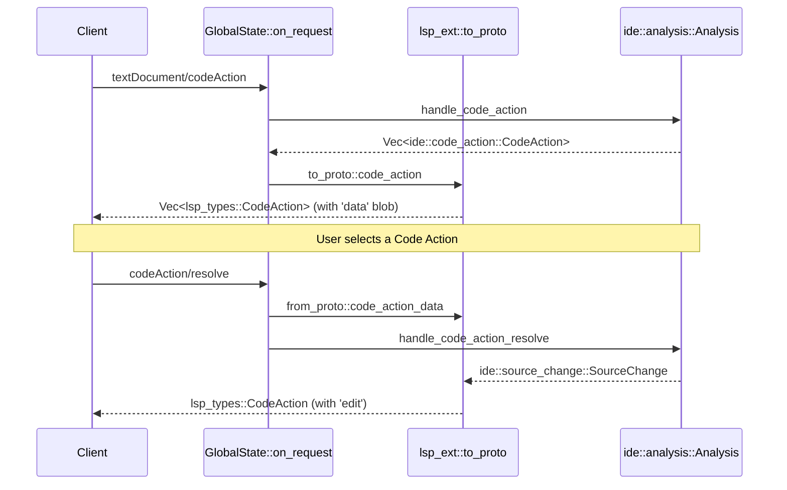

<!-- source: DeepWiki mcp.deepwiki.com · repo pascal-lab/vide · page 6.3 Protocol Translation (to_proto / from_proto) · fetched 2026-10-12 -->

# Protocol Translation (to_proto / from_proto)

<details>
<summary>Relevant source files</summary>

The following files were used as context for generating this wiki page:

- [crates/ide/src/analysis.rs](crates/ide/src/analysis.rs)
- [crates/ide/src/lib.rs](crates/ide/src/lib.rs)
- [src/config/caps.rs](src/config/caps.rs)
- [src/config/user_config.rs](src/config/user_config.rs)
- [src/global_state/handlers/request.rs](src/global_state/handlers/request.rs)
- [src/lsp_ext.rs](src/lsp_ext.rs)
- [src/lsp_ext/ext.rs](src/lsp_ext/ext.rs)
- [src/lsp_ext/from_proto.rs](src/lsp_ext/from_proto.rs)
- [src/lsp_ext/to_proto.rs](src/lsp_ext/to_proto.rs)

</details>


Protocol translation is the boundary layer between Vide's internal semantic representations and the Language Server Protocol (LSP) wire format. This logic is primarily housed in the `src/lsp_ext` module [src/lsp_ext.rs:1-5](), split between `to_proto.rs` (internal to LSP) [src/lsp_ext/to_proto.rs:1-47]() and `from_proto.rs` (LSP to internal) [src/lsp_ext/from_proto.rs:1-11]().

## Overview of Data Flow

The translation layer acts as a pure transformation stage that consumes a `GlobalStateSnapshot` to resolve file identifiers and line information. It ensures that internal types like `NavTarget`, `SemaToken`, and `SourceChange` are correctly serialized into `lsp_types` while respecting client-specific configurations like UTF-16 vs UTF-8 position encoding [src/lsp_ext/to_proto.rs:48-72]().

### Position and Range Encoding
Vide internally uses byte-based offsets (`TextSize`). The LSP requires line/column positions, often encoded in UTF-16 for compatibility with editors like VS Code.

*   **From Proto:** `from_proto::offset` converts an `lsp_types::Position` into a `TextSize` by checking the `PositionEncoding` (UTF-8 or Wide UTF-16/UTF-32) and utilizing the `LineIndex` [src/lsp_ext/from_proto.rs:26-41]().
*   **To Proto:** `to_proto::range` maps an internal `TextRange` to an `lsp_types::Range` using `LineInfo` to calculate the correct line and column for the target editor [src/lsp_ext/to_proto.rs:328-331]().

**Sources:** [src/lsp_ext/from_proto.rs:26-55](), [src/lsp_ext/to_proto.rs:328-341]()

## Navigation and Symbols

Converting internal navigation targets to LSP responses involves mapping `NavTarget` structures to `Location` or `LocationLink` objects.

### Go-to-Definition
The `goto_definition_response` function handles the conversion. If the client supports `LocationLink` (determined via `snap.config.location_link()`), it provides a richer response including the `origin_selection_range` (the source token) and the `target_range` (the definition's full span) vs the `target_selection_range` (the specific identifier) [src/lsp_ext/to_proto.rs:48-72]().

### Document Symbols
Internal `DocumentSymbol` trees are recursively transformed into `lsp_types::DocumentSymbol` [src/lsp_ext/to_proto.rs:75-92](). The `SymbolKind` from the IDE layer is mapped to LSP-standard kinds via `symbol_kind()` [src/lsp_ext/to_proto.rs:272-300]().

| Internal `ide::SymbolKind` | LSP `SymbolKind` | Code Reference |
| :--- | :--- | :--- |
| `Module` | `Class` | [src/lsp_ext/to_proto.rs:274]() |
| `Fn` | `Function` | [src/lsp_ext/to_proto.rs:289]() |
| `ParamDecl` | `Constant` | [src/lsp_ext/to_proto.rs:279]() |
| `Instance` | `Object` | [src/lsp_ext/to_proto.rs:286]() |
| `Typedef` | `TypeParameter` | [src/lsp_ext/to_proto.rs:284]() |

**Sources:** [src/lsp_ext/to_proto.rs:48-114](), [crates/ide/src/lib.rs:50-74](), [src/config/caps.rs:87-95]()

## Semantic Tokens

Vide provides high-fidelity syntax highlighting via semantic tokens. The internal `SemaToken` contains a `TextRange`, a `type_id`, and a `modifier_set`.

1.  **Relative Encoding:** The `to_proto::semantic_tokens` function takes a list of `SemaToken` and converts absolute ranges into the delta-encoded integer array required by the LSP `SemanticTokens` response [src/lsp_ext/to_proto.rs:228-246]().
2.  **Mapping:** Custom types like `SemaTokenPort` (e.g., `CLK_PORT`, `RST_PORT`) are mapped to custom strings in the legend defined in `SEMA_TOKENS_TYPES` [src/lsp_ext/ext.rs:50-82]().

### Semantic Token Encoding Flow
Title: Semantic Token Encoding Flow
```mermaid
graph TD
    "ide::semantic_tokens::SemaToken"["ide::semantic_tokens::SemaToken"] --> "to_proto::semantic_tokens"["to_proto::semantic_tokens"]
    "to_proto::semantic_tokens" --> "DeltaEncoding"["Delta Encoding (Line/Char Diff)"]
    "DeltaEncoding" --> "lsp_types::SemanticTokens"["lsp_types::SemanticTokens"]
    
    subgraph "Mapping Table"
        "SemaTokenPort::Clk"["SemaTokenPort::Clk"] --> "sema_token_types::CLK_PORT"["sema_token_types::CLK_PORT ('port_clock')"]
        "SemaTokenModifier::Readonly"["SemaTokenModifier::Readonly"] --> "sema_token_modifiers::READONLY"["sema_token_modifiers::READONLY"]
    end
```
**Sources:** [src/lsp_ext/to_proto.rs:228-270](), [src/lsp_ext/ext.rs:50-112]()

## Diagnostics and Selector Hints

Diagnostics in Vide are enriched with "Selector Hints" to allow fine-grained suppression.

*   **Conversion:** `to_proto::diagnostic` converts an `ide::diagnostics::Diagnostic` into `lsp_types::Diagnostic` [src/lsp_ext/to_proto.rs:148-174]().
*   **Selector Hints:** The `diagnostic_selector_hints` function generates strings like `code:subsystem:id`, `name:diagnostic_name`, and `option:option_name` [src/lsp_ext/to_proto.rs:202-214](). These are embedded in the `data` field of the LSP diagnostic [src/lsp_ext/to_proto.rs:185-200]().

**Sources:** [src/lsp_ext/to_proto.rs:148-214](), [crates/ide/src/diagnostics.rs:1-10]()

## Workspace Edits and Code Actions

The translation of code modifications follows a multi-step process:

1.  **SourceChange to WorkspaceEdit:** An internal `SourceChange` (containing multiple `FileId` edits) is converted to an `lsp_types::WorkspaceEdit`. This requires looking up the `Url` for every `FileId` via the `GlobalStateSnapshot` [src/lsp_ext/to_proto.rs:388-410]().
2.  **Deferred Resolution:** For complex code actions, Vide uses the `data` field in `lsp_types::CodeAction` to store a `CodeActionData` blob [src/lsp_ext/to_proto.rs:444-455](). This allows the server to defer the expensive calculation of the `WorkspaceEdit` until the user actually selects the action in the UI.

### Code Action Data Flow
Title: Code Action Request and Resolution

**Sources:** [src/lsp_ext/to_proto.rs:412-460](), [src/lsp_ext/from_proto.rs:98-101](), [src/global_state/handlers/request.rs:12-12]()

## Formatting

The formatting translation bridges Vide's internal `TextEdit` and the LSP `TextEdit` format. The `to_proto::text_edit` function maps internal offsets to line/column positions using the file's `LineInfo` [src/lsp_ext/to_proto.rs:364-375](). This supports `handle_formatting`, `handle_on_type_formatting`, and `handle_range_formatting` [src/global_state/handlers/request.rs:16-18]().

**Sources:** [src/lsp_ext/to_proto.rs:364-386](), [src/global_state/handlers/request.rs:16-18]()

---

