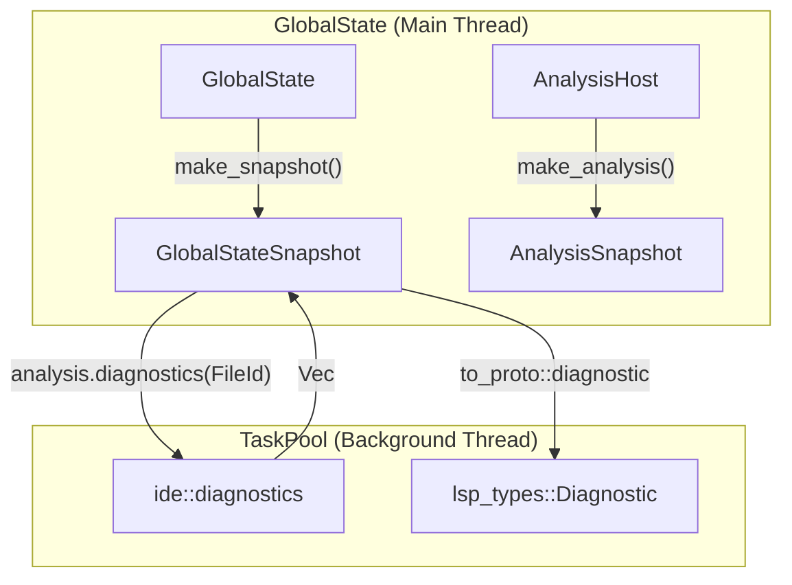
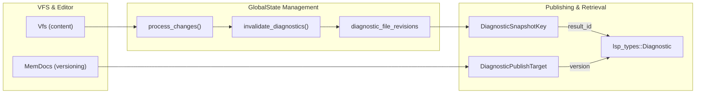

<!-- source: DeepWiki mcp.deepwiki.com · repo pascal-lab/vide · page 6.4 Diagnostic Publishing and Snapshot · fetched 2026-10-12 -->

# Diagnostic Publishing and Snapshot

Relevant source files

The following files were used as context for generating this wiki page:

- [src/global_state.rs](src/global_state.rs)
- [src/global_state/diagnostics.rs](src/global_state/diagnostics.rs)
- [src/global_state/dispatcher.rs](src/global_state/dispatcher.rs)
- [src/global_state/handlers/notification.rs](src/global_state/handlers/notification.rs)
- [src/global_state/handlers/request/code_action.rs](src/global_state/handlers/request/code_action.rs)
- [src/global_state/main_loop.rs](src/global_state/main_loop.rs)
- [src/global_state/mem_docs.rs](src/global_state/mem_docs.rs)
- [src/global_state/process_changes.rs](src/global_state/process_changes.rs)
- [src/global_state/qihe.rs](src/global_state/qihe.rs)
- [src/global_state/reload.rs](src/global_state/reload.rs)
- [src/global_state/respond.rs](src/global_state/respond.rs)
- [src/global_state/semantic_compiler.rs](src/global_state/semantic_compiler.rs)
- [src/global_state/snapshot.rs](src/global_state/snapshot.rs)
- [src/global_state/trace.rs](src/global_state/trace.rs)
- [src/tests/code_actions.rs](src/tests/code_actions.rs)
- [src/tests/diagnostics.rs](src/tests/diagnostics.rs)
- [src/tests/workspace_symbols.rs](src/tests/workspace_symbols.rs)

The diagnostic system in Vide manages the computation and reporting of SystemVerilog errors and warnings. It supports both the "Push" model (server sends notifications) and the "Pull" model (client requests diagnostics), utilizing a snapshot and caching mechanism to ensure consistency across incremental changes.

## GlobalStateSnapshot API

The `GlobalStateSnapshot` represents an immutable, point-in-time view of the server state. It is used by background tasks to perform analysis without blocking the main event loop, ensuring that diagnostic computation happens on a consistent version of the source code.

### Key Responsibilities
*   **Isolation**: Provides a consistent view of the `AnalysisSnapshot`, `Vfs`, and `MemDocs` [src/global_state/snapshot.rs:65-79]().
*   **LSP Translation**: Converts internal IDE diagnostics into LSP-compliant types using `LineInfo` for coordinate mapping [src/global_state/snapshot.rs:167-188]().
*   **External Source Integration**: Merges diagnostics from internal analysis with those from `external_sources` like Qihe [src/global_state/snapshot.rs:190-200]().
*   **Cancellability**: Holds a `CancellationToken` to abort diagnostic computation if a newer change arrives [src/global_state/snapshot.rs:73-73]().

### Data Flow: Snapshot Creation

Sources: [src/global_state.rs:160-191](), [src/global_state/snapshot.rs:145-165](), [src/global_state/snapshot.rs:167-188]().

## Diagnostic Ownership and Caching

Vide uses a structured ownership model to track which component produced a diagnostic and whether it is still valid after a code change.

### DiagnosticOwner
Diagnostics are categorized by their `DiagnosticOwner`, which determines their lifecycle and how they are identified in pull requests:
*   **File(FileId)**: Diagnostics tied to a specific file [src/global_state/diagnostics.rs:104-104]().
*   **SourceRoot(SourceRootId)**: Diagnostics scoped to a group of files [src/global_state/diagnostics.rs:105-105]().
*   **CompilationProfile(CompilationProfileId)**: Diagnostics originating from the project model or `vide.toml` [src/global_state/diagnostics.rs:106-106]().
*   **External**: Diagnostics produced by external tools (e.g., `source: "qihe"`) [src/global_state/diagnostics.rs:107-107]().

### Result ID Caching
To support LSP 3.17+ diagnostic pull requests, `GlobalStateSnapshot` generates a `result_id` via `DiagnosticSnapshotKey`. This key ensures that the client only downloads new data when the underlying state changes. It incorporates:
1.  The `AnalysisSnapshotId` [src/global_state/diagnostics.rs:184-184]().
2.  `readiness_revision`: Tracks if the workspace is fully loaded [src/global_state/diagnostics.rs:186-186]().
3.  `dependency_revisions`: A list of `DiagnosticFileRevision` for all files that could affect the target [src/global_state/diagnostics.rs:189-189]().
4.  `external_revisions`: Versions of external diagnostic sets [src/global_state/diagnostics.rs:190-190]().

Sources: [src/global_state/diagnostics.rs:103-125](), [src/global_state/diagnostics.rs:183-216](), [src/global_state/diagnostics.rs:218-235]().

## Push vs. Pull Diagnostic Models

Vide dynamically selects the diagnostic delivery method based on client capabilities and user configuration.

| Feature | Push Model | Pull Model |
| :--- | :--- | :--- |
| **Trigger** | Server-side `process_changes` [src/global_state/process_changes.rs:27-27]() | Client sends `DocumentDiagnosticRequest` [src/tests/diagnostics.rs:98-98]() |
| **LSP Method** | `textDocument/publishDiagnostics` [src/global_state/main_loop.rs:133-133]() | `textDocument/diagnostic` |
| **Efficiency** | Sends updates for all open files | Only computes for requested/visible files |
| **Invalidation** | Server clears via empty list [src/global_state/process_changes.rs:98-98]() | Server sends `workspace/diagnostic/refresh` [src/global_state/process_changes.rs:151-151]() |

### Implementation in `process_changes`
When changes are applied in `GlobalState::process_changes`:
1.  **Pull Model**: If the client supports it, Vide calls `WorkspaceDiagnosticRefresh` to notify the client that existing pulled diagnostics may be stale [src/global_state/process_changes.rs:144-153]().
2.  **Push Model**: Vide identifies affected `FileId`s and calls `request_diagnostics`, which eventually triggers the `DiagnosticsPublisher` to send notifications [src/global_state/process_changes.rs:155-164]().

Sources: [src/global_state/process_changes.rs:131-164](), [src/global_state/main_loop.rs:128-135](), [src/tests/diagnostics.rs:71-160]().

## Version Tracking with MemDocs

The server reconciles file versions between the disk (VFS) and the editor's memory.

*   **`MemDocs`**: Tracks the `version` and content of files currently open in the editor [src/global_state/mem_docs.rs:11-14]().
*   **`DiagnosticPublishTarget`**: Pairs a `FileId` with its current LSP `Url` and `version` [src/global_state/snapshot.rs:33-44](). This ensures that diagnostics published to the client are attributed to the correct document version, preventing "flicker" during typing.
*   **`DiagnosticFileRevision`**: A monotonic counter per file, incremented in `process_changes` whenever a file's content is modified [src/global_state/process_changes.rs:88-91]().

### System Entity Map: Diagnostic Lifecycle

Sources: [src/global_state/snapshot.rs:33-62](), [src/global_state/process_changes.rs:87-91](), [src/global_state/diagnostics.rs:183-191]().

## Diagnostic Invalidation Logic

The `invalidate_diagnostics` function coordinates re-analysis based on the `DiagnosticInvalidation` type:
*   **FileChanges(FxHashSet<FileId>)**: Triggered by edits. If `DiagnosticsUpdateUserConfig` is `OnType`, it invalidates diagnostics for the changed files and their dependents [src/global_state/process_changes.rs:103-107]().
*   **WorkspaceChanged**: Triggered by structural changes (e.g., `vide.toml` edits). This invalidates all diagnostics across the workspace [src/global_state/process_changes.rs:99-100]().
*   **Semantic Compiler Integration**: Invalidation also schedules the `SemanticCompiler` to run full-project analysis for affected `CompilationProfileId`s [src/global_state/process_changes.rs:141-142]().

Sources: [src/global_state/process_changes.rs:20-23](), [src/global_state/process_changes.rs:131-164](), [src/global_state/semantic_compiler.rs:74-90]().

---

